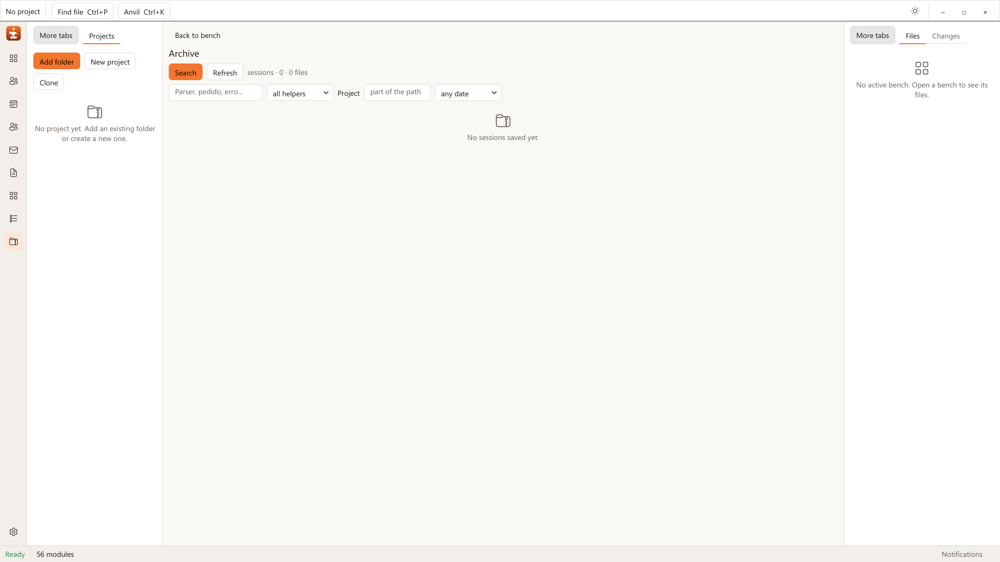

state: en.light.rail.archive.tab
capture_sha: (ver captures/en.light.rail.archive.tab.png)
model: opencode/glm-5.3-flash-free
---

# Archive (rail tab)

Tela do módulo Archive, que lista e filtra sessões anteriores dos ajudantes, com estados vazios quando não há projeto ou bancada ativa. É a variante em inglês com tema claro da página de referência `pt-BR.dark.rail.archive.tab`.

## Como chegar
No rail à esquerda, clique no botão "Archive" (o último dos ícones do grupo principal, destacado em laranja quando ativo). Equivalente por comando de captura: `forja-app --locale en --theme light --rail archive.tab`.

## Regiões
- **Barra superior** (0,0)–(1920,40): indicador de projeto ("No project"), botões de comando "Find file  Ctrl+P" e "Anvil  Ctrl+K", alternador de tema (ícone, sem nome acessível) e os botões de janela "–", "□" e "×".
- **Trilho à esquerda** (0,40)–(50,1048): logo do app (imagem em (12,50)–(40,78)) e a coluna de botões-ícone de navegação ("Board", "Helpers", "Routines", "Muster", "Requests", "Skills", "Usage", "Extensions", "Archive"), com "Settings" fixado na base.
- **Painel lateral esquerdo** (50,40)–(304,1048): abas "Projects" (ativa) e "More tabs"; ações "Add folder", "New project" e "Clone"; ícone e mensagem de estado vazio "No project yet. Add an existing folder or create a new one."; no topo, o rótulo "No project" pertence à barra superior e fica sobreposto a esta região.
- **Divisor vertical** (304,42)–(320,1048): separador fino entre o painel esquerdo e a área central.
- **Área central** (320,42)–(1612,1048): no topo, o botão "Back to bench"; título "Archive", botões "Search" e "Refresh", contador "sessions · 0 · 0 files", campo de filtro (sugestão "Parser, pedido, erro…"), seletor "all helpers", rótulo "Project" com campo (sugestão "part of the path"), seletor de período "any date" e o estado vazio "No sessions saved yet." com ícone de pasta acima.
- **Divisor vertical** (1612,42)–(1628,1048): separador entre a área central e o painel direito.
- **Painel direito** (1628,42)–(1920,1048): abas "More tabs", "Files" (ativa) e "Changes"; ícone (sem nome acessível) em (1756,117)–(1784,145) e a mensagem "No active bench. Open a bench to see its files.".
- **Barra de status** (0,1048)–(1920,1080): rótulos "Ready" (em verde) à esquerda, "56 modules" ao lado e "Notifications" à direita.

## Elementos
| Elemento | Tipo | Posição (px) | Estado | O que faz |
|---|---|---|---|---|
| "Find file  Ctrl+P" | Button | (99,5)–(218,37) | — | Abre a busca rápida de arquivos (atalho Ctrl+P). |
| "Anvil  Ctrl+K" | Button | (226,5)–(327,37) | — | Abre a paleta de comandos (atalho Ctrl+K). |
| (sem nome acessível) | Unknown | (1741,5)–(1773,37) | — | Alternador de tema (ícone de sol). |
| "–" | Button | (1795,5)–(1827,37) | — | Minimiza a janela. |
| "□" | Button | (1835,5)–(1867,37) | — | Maximiza/restaura a janela. |
| "×" | Button | (1875,5)–(1909,37) | — | Fecha a janela. |
| "No project" | Label | (11,12)–(77,31) | — | Mostra que não há projeto selecionado na sessão atual. |
| (sem nome acessível) | Unknown | (304,42)–(320,1048) | — | Divisor vertical entre painel esquerdo e área central. |
| (sem nome acessível) | Unknown | (1612,42)–(1628,1048) | — | Divisor vertical entre área central e painel direito. |
| (sem nome acessível) | Image | (12,50)–(40,78) | clicável | Logo do app no topo do trilho. |
| "More tabs" | Button | (64,50)–(151,85) | — | Abre a lista das demais abas do painel esquerdo. |
| "Back to bench" | Button | (324,50)–(435,82) | — | Botão no topo da área central que volta para a visão de bancada; aparenta ser resquício da tela anterior. |
| "More tabs" | Button | (1632,50)–(1719,85) | — | Abre a lista das demais abas do painel direito. |
| "Projects" | Button | (159,52)–(231,84) | marcado=True | Aba ativa do painel esquerdo; lista os projetos. |
| "Files" | Button | (1727,52)–(1778,84) | marcado=True | Aba ativa do painel direito; mostraria os arquivos acessíveis à bancada. |
| "Changes" | Button | (1778,52)–(1855,84) | marcado=False | Aba de alterações pendentes da bancada. |
| "Archive" | Label | (324,90)–(382,114) | clicável | Título da área central. |
| "Board" | Button | (8,94)–(44,130) | marcado=False | Botão-ícone do trilho que abre a visão de quadro. |
| "Add folder" | Button | (64,101)–(154,133) | — | Adiciona uma pasta existente como projeto (botão em destaque laranja). |
| "New project" | Button | (162,101)–(261,133) | — | Cria um projeto novo. |
| (ícone) | Label | (1756,117)–(1784,145) | clicável | Ícone do estado vazio do painel direito. |
| "Search" | Button | (324,122)–(389,154) | — | Aplica os filtros de busca do acervo (botão em destaque laranja). |
| "Refresh" | Button | (397,122)–(467,154) | — | Recarrega a lista de sessões do acervo. |
| "sessions · 0 · 0 files" | Label | (475,129)–(590,148) | — | Contador do resultado atual (0 sessões, 0 arquivos). |
| "Helpers" | Button | (8,138)–(44,174) | marcado=False | Botão-ícone do trilho que abre os ajudantes. |
| "Clone" | Button | (64,141)–(123,173) | — | Clona um repositório como novo projeto. |
| "No active bench. Open a bench to see its files." | Label | (1644,153)–(1896,191) | — | Estado vazio do painel direito. |
| (sem nome acessível) | TextInput | (324,162)–(504,194) | — | Campo de filtro textual (sugestão exibida: "Parser, pedido, erro…"). |
| "all helpers" | ComboBox | (512,162)–(640,194) | — | Seletor de ajudante com o valor "all helpers". |
| "Project" | Label | (648,162)–(691,194) | — | Rótulo do filtro por projeto ao lado. |
| (sem nome acessível) | TextInput | (699,162)–(827,194) | — | Campo do filtro por projeto (sugestão: "part of the path"). |
| "any date" | ComboBox | (835,162)–(963,194) | — | Seletor de período com o valor "any date". |
| "Routines" | Button | (8,182)–(44,218) | marcado=False | Botão-ícone do trilho que abre as rotinas. |
| (ícone) | Label | (168,201)–(196,229) | clicável | Ícone de pasta do estado vazio do painel esquerdo. |
| (ícone) | Label | (952,218)–(980,246) | clicável | Ícone de pasta do estado vazio da área central. |
| "Muster" | Button | (8,226)–(44,262) | marcado=False | Botão-ícone do trilho que abre o mutirão. |
| "No project yet. Add an existing folder or create a new one." | Label | (67,237)–(297,275) | — | Estado vazio do painel esquerdo. |
| "No sessions saved yet." | Label | (897,254)–(1035,273) | — | Estado vazio da busca do acervo. |
| "Requests" | Button | (8,270)–(44,306) | marcado=False | Botão-ícone do trilho que abre os pedidos. |
| "Skills" | Button | (8,314)–(44,350) | marcado=False | Botão-ícone do trilho que abre as skills. |
| "Usage" | Button | (8,358)–(44,394) | marcado=False | Botão-ícone do trilho que abre o uso. |
| "Extensions" | Button | (8,402)–(44,438) | marcado=False | Botão-ícone do trilho que abre as extensões. |
| "Archive" | Button | (8,446)–(44,482) | marcado=True | Botão-ícone do trilho da tela atual, em destaque laranja. |
| "Settings" | Button | (8,1004)–(44,1040) | marcado=False | Botão-ícone do trilho que abre os ajustes. |
| "Ready" | Label | (10,1055)–(48,1074) | — | Status geral do app. |
| "56 modules" | Label | (70,1055)–(142,1074) | — | Quantidade de módulos carregados. |
| "Notifications" | Label | (1808,1055)–(1886,1074) | — | Acesso às notificações na barra de status. |

## Aparência
Diferenças em relação à referência (pt-BR, tema escuro): todos os textos aparecem em inglês ("Archive", "Search", "Refresh", "all helpers", "any date", "No sessions saved yet." etc.). Tema claro: fundo geral bege/creme claro, painéis quase brancos e trilho levemente mais escuro que o painel lateral; o destaque continua em laranja ("Brasa") nos elementos ativos: aba "Projects" (sublinhado), botões "Add folder" e "Search" preenchidos com laranja e texto branco, e botão-ícone "Archive" do trilho com fundo laranja-claro. Tipografia sans-serif escura; títulos ("Archive") maiores e rótulos de estado vazio em cinza médio centralizados. Espaçamentos iguais aos da referência: botões do trilho com 44 px de lado e passo de 44 px, barra de status de 32 px de altura com "Ready" em verde e demais textos em cinza escuro.

## Problemas encontrados
- O botão "Back to bench" (324,50)–(435,82) aparece no topo da área central da tela Archive, sobrepondo-se à linha de abas; parece um resquício de navegação da tela de bancada.
- A sugestão do campo de filtro exibida na imagem ("Parser, pedido, erro…") está em português, sem tradução para o idioma en desta variante.
- Vários elementos sem nome acessível: os dois divisores verticais, o logo (Image), o alternador de tema da barra superior, os dois campos de filtro (TextInput) e os três ícones de estado vazio, o que dificulta a navegação por leitor de telas.
- Os botões de janela usam apenas os símbolos "–", "□" e "×" como nome acessível, sem rótulo descritivo.
- A linha de abas do painel esquerdo não exibe as demais abas diretamente (só "More tabs"), exigindo interação extra para alcançá-las.
