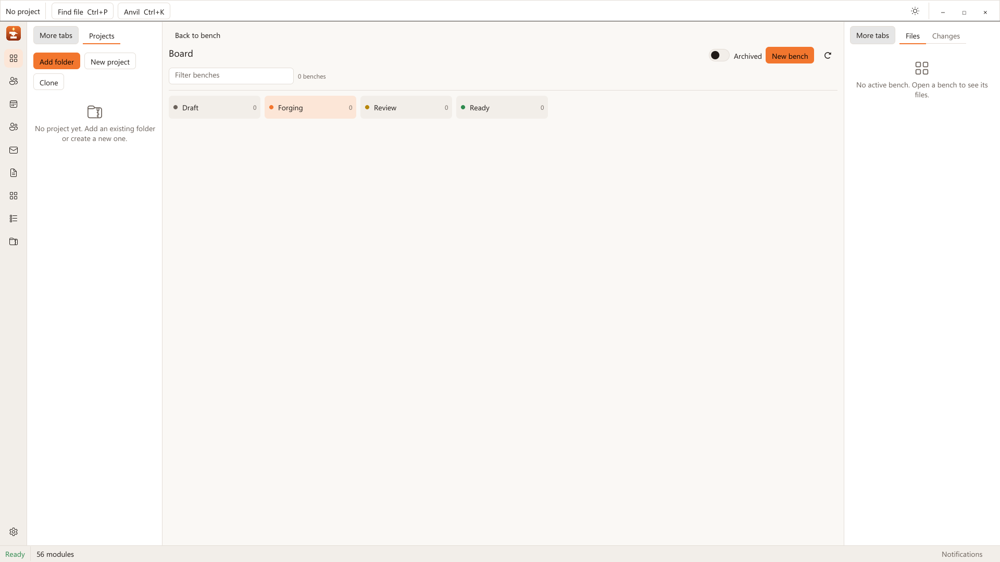

state: en.light.rail.board.page
capture_sha: —
model: opencode/glm-5.3-flash-free
---

# Board (página do painel Projetos) — variante en / tema light

Variante em inglês com tema claro da página de referência (pt-BR.dark.rail.board.page): mesma estrutura de tela — quadro Kanban de bancadas com colunas de fluxo (Draft, Forging, Review, Ready), painel de projetos à esquerda e painel de arquivos à direita, ambos vazios porque não há projeto aberto. Mudam os textos (inglês), as cores (tema claro) e a resolução da captura (1920×1080 em vez de 1280×800); além disso, as abas extras dos painéis laterais aparecem recolhidas em botões "More tabs" e há um botão "Back to bench" sobre a área central.

## Como chegar
Na janela principal, clique no primeiro ícone do trilho à esquerda, o botão "Board" (retângulo (8,94)–(44,130)), abaixo da logomarca da Forja; a aba "Projects" do painel esquerdo fica marcada. A captura foi gerada com o comando `forja-app --locale en --theme light --rail board.page`.

## Regiões
- **Barra superior** — (0,0)–(1920,42): rótulo "No project" à esquerda, botões "Find file  Ctrl+P" e "Anvil  Ctrl+K"; à direita, ícone de tema (sol, sem nome acessível) e os botões de janela "–", "□" e "×".
- **Trilho à esquerda** — (0,42)–(56,1048): logomarca (imagem sem nome acessível em (12,50)–(40,78)) e coluna de ícones: "Board", "Helpers", "Routines", "Muster", "Requests", "Skills", "Usage", "Extensions", "Archive", com "Settings" fixado no rodapé.
- **Painel esquerdo (Projects)** — (56,42)–(304,1048): botão "More tabs", aba marcada "Projects", botões "Add folder", "New project" e "Clone"; mensagem de vazio "No project yet. Add an existing folder or create a new one." com ícone de pasta.
- **Área central (Board)** — (320,42)–(1612,1048): botão "Back to bench", título "Board", interruptor "Archived", botão "New bench" (laranja) e botão "⟳"; campo de filtro sem nome acessível com marca d'água "Filter benches", contador "0 benches" e as quatro colunas de fluxo com cabeçalhos e contadores "0".
- **Painel direito (Files)** — (1628,42)–(1920,1048): botão "More tabs", abas marcadas "Files" e "Changes"; ícone de grade e mensagem "No active bench. Open a bench to see its files."
- **Barra de status** — (0,1048)–(1920,1080): "Ready" (em verde) e "56 modules" à esquerda, "Notifications" à direita.

## Elementos
| Elemento | Tipo | Posição (px) | Estado | O que faz |
|---|---|---|---|---|
| "Find file  Ctrl+P" | Button | (99,5)–(218,37) | normal | Abre a busca/arquivos rápidos pelo atalho Ctrl+P. |
| "Anvil  Ctrl+K" | Button | (226,5)–(327,37) | normal | Abre o lançador de ajudantes/agentes pelo atalho Ctrl+K. |
| (sem nome acessível) | Unknown | (1741,5)–(1773,37) | normal | Ícone de sol; alterna o tema da interface. |
| "–" | Button | (1795,5)–(1827,37) | normal | Minimiza a janela. |
| "□" | Button | (1835,5)–(1867,37) | normal | Maximiza/restaura a janela. |
| "×" | Button | (1875,5)–(1909,37) | normal | Fecha a janela. |
| "No project" | Label | (11,12)–(77,31) | normal | Mostra que não há projeto aberto. |
| (sem nome acessível) | Unknown | (304,42)–(320,1048) | normal | Divisor vertical entre o painel esquerdo e a área central. |
| (sem nome acessível) | Unknown | (1612,42)–(1628,1048) | normal | Divisor vertical entre a área central e o painel direito. |
| (sem nome acessível) | Image | (12,50)–(40,78) | normal | Logomarca da Forja no topo do trilho. |
| "More tabs" | Button | (64,50)–(151,85) | normal | Recolhe/mostra as abas adicionais do painel esquerdo (não há outras abas visíveis nesta variante). |
| "Back to bench" | Button | (324,50)–(435,82) | normal | Volta da visão de quadro para a bancada anterior. Não existe na página de referência. |
| "More tabs" | Button | (1632,50)–(1719,85) | normal | Recolhe/mostra as abas adicionais do painel direito. |
| "Projects" | Button | (159,52)–(231,84) | marcado=True | Aba ativa do painel esquerdo, com sublinhado laranja. |
| "Files" | Button | (1727,52)–(1778,84) | marcado=True | Aba ativa do painel direito, com sublinhado laranja. |
| "Changes" | Button | (1778,52)–(1855,84) | normal | Aba que mostraria as mudanças (controle de versão). |
| "Board" | Label | (324,90)–(371,114) | normal | Título da página central. |
| "New bench" | Button | (1470,90)–(1563,122) | normal | Botão em destaque laranja para criar uma bancada. |
| "⟳" | Button | (1571,90)–(1608,122) | normal | Recarrega/atualiza o quadro. |
| "Board" | Button | (8,94)–(44,130) | marcado=True | Ícone do trilho que abre esta página do quadro. |
| "Archived" | CheckBox | (1361,94)–(1462,118) | marcado=False | Interruptor para exibir somente bancadas guardadas. |
| "Add folder" | Button | (64,101)–(154,133) | normal | Botão em destaque laranja para importar uma pasta como projeto. |
| "New project" | Button | (162,101)–(261,133) | normal | Cria um projeto novo. |
| (ícone) | Label | (1756,117)–(1784,145) | normal | Ícone de grade do estado vazio do painel direito. |
| (sem nome acessível) | TextInput | (324,130)–(564,162) | normal | Campo de filtro com a marca d'água "Filter benches". |
| "Helpers" | Button | (8,138)–(44,174) | normal | Ícone do trilho para a área de ajudantes (agentes de IA). |
| "0 benches" | Label | (572,138)–(625,154) | normal | Contador de bancadas visíveis no quadro. |
| "Clone" | Button | (64,141)–(123,173) | normal | Clona um projeto existente. |
| "No active bench. Open a bench to see its files." | Label | (1644,153)–(1896,191) | normal | Mensagem de vazio do painel direito. |
| "Routines" | Button | (8,182)–(44,218) | normal | Ícone do trilho para a área de rotinas. |
| "Draft" | Label | (350,197)–(381,216) | normal | Cabeçalho da primeira coluna do fluxo, com ponto cinza. |
| "Forging" | Label | (534,197)–(581,216) | normal | Cabeçalho da segunda coluna, com ponto laranja e fundo laranja claro (coluna destacada). |
| "Review" | Label | (718,197)–(761,216) | normal | Cabeçalho da terceira coluna, com ponto ambarino/oliva. |
| "Ready" | Label | (902,197)–(940,216) | normal | Cabeçalho da quarta coluna, com ponto verde. |
| "0" | Label | (486,198)–(492,214) | normal | Contador de cartões na coluna Draft. |
| "0" | Label | (670,198)–(676,214) | normal | Contador de cartões na coluna Forging. |
| "0" | Label | (854,198)–(860,214) | normal | Contador de cartões na coluna Review. |
| "0" | Label | (1038,198)–(1044,214) | normal | Contador de cartões na coluna Ready. |
| (ícone) | Label | (168,201)–(196,229) | normal | Ícone de pasta ilustrando o estado vazio do painel esquerdo. |
| "Muster" | Button | (8,226)–(44,262) | normal | Ícone do trilho para a área de mutirão. |
| "No project yet. Add an existing folder or create a new one." | Label | (67,237)–(297,275) | normal | Mensagem de vazio do painel de projetos. |
| "Requests" | Button | (8,270)–(44,306) | normal | Ícone do trilho para a área de pedidos. |
| "Skills" | Button | (8,314)–(44,350) | normal | Ícone do trilho para a área de skills. |
| "Usage" | Button | (8,358)–(44,394) | normal | Ícone do trilho para a área de uso. |
| "Extensions" | Button | (8,402)–(44,438) | normal | Ícone do trilho para a área de extensões. |
| "Archive" | Button | (8,446)–(44,482) | normal | Ícone do trilho para a área de acervo. |
| "Settings" | Button | (8,1004)–(44,1040) | normal | Ícone do trilho para os ajustes, fixado no rodapé do trilho. |
| "Ready" | Label | (10,1055)–(48,1074) | normal | Estado geral do app na barra de status, em verde. |
| "56 modules" | Label | (70,1055)–(142,1074) | normal | Quantidade de módulos carregados. |
| "Notifications" | Label | (1808,1055)–(1886,1074) | normal | Indicador de notificações, clicável, no canto direito. |
| (ícone) | Label | (952,1072)–(980,1100) | normal | Ícone de estado vazio do quadro; fica quase todo abaixo da barra de status, fora da área visível. |
| "No bench in this board yet. Create one to start." | Label | (822,1108)–(1111,1127) | normal | Mensagem de vazio do quadro; inteiramente abaixo da altura da janela, invisível na captura. |

## Aparência
Tema claro com fundo creme/off-white (tons próximos de #f5f1ea), painéis laterais e área central em creme levemente mais escuro que a barra superior. O acento laranja ("Brasa") aparece nos botões "New bench" e "Add folder" (fundo laranja com texto branco), no sublinhado das abas ativas "Projects" e "Files", no ponto laranja e no fundo laranja claro da coluna destacada "Forging"; as demais colunas usam pontos cinza (Draft), ambarino (Review) e verde (Ready). O texto é cinza escuro sobre claro, com "Ready" na barra de status em verde. Tipografia sem serifa de um único tamanho; botões do trilho de 36 px alinhados a um trilho de 56 px; abas e botões do cabeçalho em faixas de ~32 px de altura com cantos arredondados pequenos. Comparado à referência escura, o contraste é invertido (texto escuro sobre fundo claro) e os mesmos papéis de cor se mantêm.

## Problemas encontrados
- O Label "(ícone)" do estado vazio do quadro, em (952,1072)–(980,1100), invade a barra de status e ultrapassa a altura da janela (1080 px).
- A mensagem "No bench in this board yet. Create one to start." ((822,1108)–(1111,1127)) está inteiramente abaixo da área visível e não aparece na tela.
- O campo de filtro de bancadas (TextInput em (324,130)–(564,162)) não tem nome acessível; o rótulo visível é só a marca d'água "Filter benches".
- Há dois botões "More tabs" com o mesmo nome ("More tabs" em (64,50)–(151,85) e (1632,50)–(1719,85)), o que dificulta a distinção por leitor de tela.
- O texto "Archived" do CheckBox tem retângulo (1361,94)–(1462,118) com altura de 24 px, menor que os botões vizinhos de 32 px, ficando desalinhado verticalmente em relação a "New bench".
- Elementos sem nome acessível além do esperado: divisores verticais, ícone de tema da barra superior, logomarca e campo de filtro.
