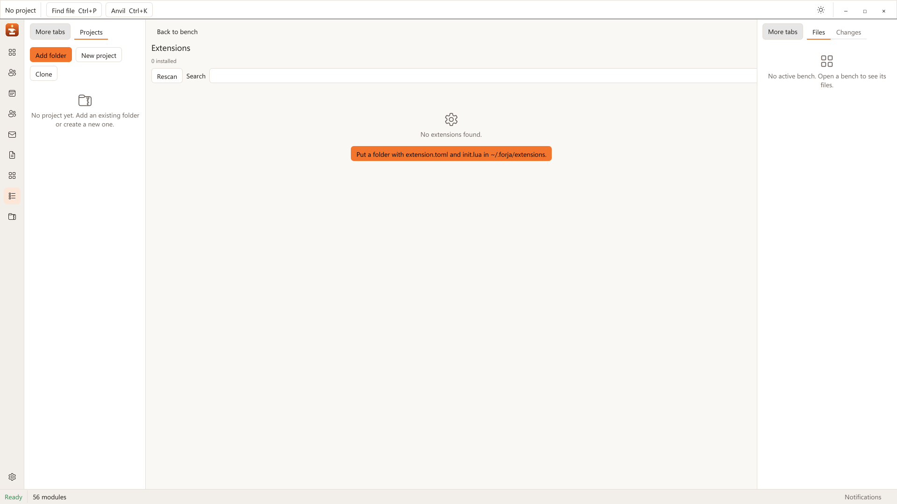

# Painel de extensões (Extensions)

Tela do painel central de extensões, onde se vê a lista de extensões instaladas do projeto (vazia nesta captura) e a instrução para instalá-las manualmente em `~/.forja/extensions`. Variante em inglês e tema claro da página de referência (pt-BR, tema escuro); a estrutura é a mesma, mudando os textos, as cores e a janela (1920×1080 em vez de 1280×800).

## Como chegar
Abrir a Forja e, no trilho vertical à esquerda, clicar no botão "Extensions" (item do trilho destacado com fundo laranja claro). Equivale a abrir o app com o trilho apontando para o painel de extensões. Comando de captura: `forja-app --locale en --theme light --rail extension.page`.

## Regiões
- **Barra superior** (0,0)–(1920,40): rótulo do projeto atual "No project", botões de comando "Find file  Ctrl+P" e "Anvil  Ctrl+K" com atalhos, botão sem nome acessível para alternar tema (ícone de sol em ~1757,20) e os botões de janela "–", "□" e "×" no canto direito.
- **Trilho à esquerda** (0,42)–(48,1048): logotipo do app (imagem em 12,50) e uma coluna de ícones de navegação: "Board", "Helpers", "Routines", "Muster", "Requests", "Skills", "Usage", "Extensions" (ativo) e "Archive", com "Settings" isolado na base (8,1004).
- **Painel lateral esquerdo (Projects)** (48,42)–(304,1048): botão "More tabs" (abas ocultas) e a aba ativa "Projects"; botões "Add folder" (destacado em laranja), "New project" e "Clone"; estado vazio com ícone de pasta e o texto "No project yet. Add an existing folder or create a new one.".
- **Área central (painel de extensões)** (320,42)–(1612,1048): botão "Back to bench" no topo, título "Extensions" com contador "0 installed", botão "Rescan", rótulo "Search" e campo de texto de busca em largura quase total (324,186)–(1608,218); estado vazio com ícone de engrenagem, o texto "No extensions found." e um botão-aviso laranja com o caminho de instalação.
- **Painel direito (Files)** (1628,42)–(1920,1048): botão "More tabs" (abas ocultas), abas "Files" (ativa) e "Changes"; estado vazio com ícone de grade e o texto "No active bench. Open a bench to see its files.".
- **Barra de status** (0,1048)–(1920,1080): status "Ready" em verde à esquerda, contador "56 modules" ao lado e "Notifications" à direita.

## Elementos
| Elemento | Tipo | Posição (px) | Estado | O que faz |
|---|---|---|---|---|
| "No project" | Rótulo | (11,12)–(77,31) | clicável, focável | Mostra que nenhum projeto está aberto. |
| "Find file  Ctrl+P" | Botão | (99,5)–(218,37) | clicável, focável | Abre a busca rápida de arquivos (Ctrl+P). |
| "Anvil  Ctrl+K" | Botão | (226,5)–(327,37) | clicável, focável | Abre a paleta de comandos (Ctrl+K). |
| (sem nome acessível) | Desconhecido | (1741,5)–(1773,37) | clicável, focável | Ícone de sol na barra superior: alterna tema claro/escuro. |
| "–" | Botão | (1795,5)–(1827,37) | clicável, focável | Minimiza a janela. |
| "□" | Botão | (1835,5)–(1867,37) | clicável, focável | Maximiza/restaura a janela. |
| "×" | Botão | (1875,5)–(1909,37) | clicável, focável | Fecha a janela. |
| (sem nome acessível) | Desconhecido | (304,42)–(320,1048) | focável | Divisor arrastável entre o painel de projetos e a área central. |
| (sem nome acessível) | Desconhecido | (1612,42)–(1628,1048) | focável | Divisor arrastável entre a área central e o painel de arquivos. |
| (sem nome acessível) | Imagem | (12,50)–(40,78) | clicável, focável | Logotipo do app no topo do trilho. |
| "More tabs" | Botão | (64,50)–(151,85) | clicável, focável | Menu com as abas ocultas do painel lateral esquerdo. |
| "Back to bench" | Botão | (324,50)–(435,82) | clicável, focável | Volta ao painel da bancada ativa. |
| "More tabs" | Botão | (1632,50)–(1719,85) | clicável, focável | Menu com as abas ocultas do painel direito. |
| "Projects" | Botão (aba) | (159,52)–(231,84) | marcado=True | Aba ativa do painel lateral: lista de projetos, com sublinhado laranja. |
| "Files" | Botão (aba) | (1727,52)–(1778,84) | marcado=True | Aba ativa do painel direito: navegador de arquivos da bancada, com sublinhado laranja. |
| "Changes" | Botão (aba) | (1778,52)–(1855,84) | clicável, focável, marcado=False | Mostra as mudanças (diff) da bancada. |
| "Extensions" | Rótulo | (324,90)–(407,114) | clicável | Título do painel central. |
| "Board" | Botão (ícone) | (8,94)–(44,130) | clicável, focável, marcado=False | Vai à tela de quadro do trilho. |
| "Add folder" | Botão | (64,101)–(154,133) | clicável, focável | Abre o seletor para adicionar uma pasta de projeto; botão primário em laranja. |
| "New project" | Botão | (162,101)–(261,133) | clicável, focável | Cria um novo projeto. |
| (ícone) | Rótulo | (1756,117)–(1784,145) | clicável | Ícone de grade do estado vazio do painel de arquivos. |
| "0 installed" | Rótulo | (324,122)–(377,138) | clicável | Contador de extensões instaladas (vazio). |
| "Helpers" | Botão (ícone) | (8,138)–(44,174) | clicável, focável, marcado=False | Vai à tela de ajudantes (agentes de IA). |
| "Clone" | Botão | (64,141)–(123,173) | clicável, focável | Clona um repositório como novo projeto. |
| "Rescan" | Botão | (324,146)–(391,178) | clicável, focável | Reescaneia as pastas de extensões e atualiza a lista. |
| "Search" | Rótulo | (399,146)–(440,178) | clicável | Rótulo do campo de busca de extensões. |
| "No active bench. Open a bench to see its files." | Rótulo | (1644,153)–(1896,191) | clicável | Estado vazio do painel de arquivos, quebrado em duas linhas. |
| "Routines" | Botão (ícone) | (8,182)–(44,218) | clicável, focável, marcado=False | Vai à tela de rotinas. |
| (sem nome acessível) | Campo de texto | (324,186)–(1608,218) | clicável, focável | Campo de busca por nome de extensão. |
| (ícone) | Rótulo | (168,201)–(196,229) | clicável | Ícone de pasta do estado vazio do painel de projetos. |
| "Muster" | Botão (ícone) | (8,226)–(44,262) | clicável, focável, marcado=False | Vai à tela de mutirão. |
| "No project yet. Add an existing folder or create a new one." | Rótulo | (67,237)–(297,275) | clicável | Estado vazio do painel de projetos. |
| (ícone) | Rótulo | (952,242)–(980,270) | clicável | Ícone de engrenagem do estado vazio do painel de extensões. |
| "Requests" | Botão (ícone) | (8,270)–(44,306) | clicável, focável, marcado=False | Vai à tela de pedidos. |
| "No extensions found." | Rótulo | (901,278)–(1032,297) | clicável | Mensagem de lista vazia de extensões. |
| "Put a folder with extension.toml and init.lua in ~/.forja/extensions." | Botão | (751,313)–(1181,345) | clicável, focável | Instrução de instalação manual de extensões, exposta como botão clicável com fundo laranja. |
| "Skills" | Botão (ícone) | (8,314)–(44,350) | clicável, focável, marcado=False | Vai à tela de skills. |
| "Usage" | Botão (ícone) | (8,358)–(44,394) | clicável, focável, marcado=False | Vai à tela de uso. |
| "Extensions" | Botão (ícone) | (8,402)–(44,438) | clicável, focável, marcado=True | Item ativo do trilho: mostra o painel de extensões (esta tela), com fundo laranja claro. |
| "Archive" | Botão (ícone) | (8,446)–(44,482) | clicável, focável, marcado=False | Vai à tela de acervo. |
| "Settings" | Botão (ícone) | (8,1004)–(44,1040) | clicável, focável, marcado=False | Vai à tela de ajustes, fixado na base do trilho. |
| "Ready" | Rótulo | (10,1055)–(48,1074) | clicável | Status geral do app na barra inferior. |
| "56 modules" | Rótulo | (70,1055)–(142,1074) | clicável | Contador de módulos carregados. |
| "Notifications" | Rótulo | (1808,1055)–(1886,1074) | clicável, focável | Abre a área de notificações, no canto direito da barra de status. |

## Aparência
Tema claro: fundos em tons creme/off-white, com a barra superior e a barra de status em bege levemente mais escuro que os painéis; a área central é um creme um tom diferente do painel esquerdo, e os três painéis são separados por divisores verticais de 1 px. A cor de destaque segue sendo o laranja ("Brasa"): preenchimento do botão "Add folder" e do botão-aviso de instalação (ambos com texto escuro no tema claro), fundo laranja claro do item ativo "Extensions" no trilho e sublinhado das abas ativas "Projects" e "Files"; o status "Ready" aparece em verde na barra de status. Texto principal em cinza-escuro/marrom sobre fundo claro (bom contraste) e textos secundários/estados vazios em cinza médio. Tipografia sem serifa, em torno de 13–14 px, com atalhos ("Ctrl+P", "Ctrl+K") na mesma linha do comando. Em relação à referência (pt-BR, escuro), mudam os textos (inglês), os fundos (claro em vez de quase preto) e a janela (1920×1080): por haver mais largura, os painéis laterais mostram menos abas de uma vez e recorrem a botões "More tabs" de estouro, e o painel central ganha o botão "Back to bench" acima do título.

## Problemas encontrados
- O botão de alternar tema na barra superior (1741,5)–(1773,37) não tem nome acessível; só se identifica pela imagem do sol.
- O campo de busca de extensões (324,186)–(1608,218) é um TextInput sem nome acessível; o rótulo "Search" fica fora do campo, sem associação.
- O logotipo do app (imagem em 12,50) e os três ícones de estado vazio (168,201), (952,242) e (1756,117) estão sem nome acessível.
- A instrução "Put a folder with extension.toml and init.lua in ~/.forja/extensions." é exposta com papel de Botão; semanticamente é um texto de ajuda, o que pode confundir leitores de tela.
- Nomes acessíveis duplicados: dois botões "More tabs" (64,50) e (1632,50) e dois "Extensions" (título do painel central e item do trilho), o que ambigua comandos de voz e leitores de tela.
- Nenhum elemento com retângulo além da largura/altura da janela (1920×1080) nesta captura.
