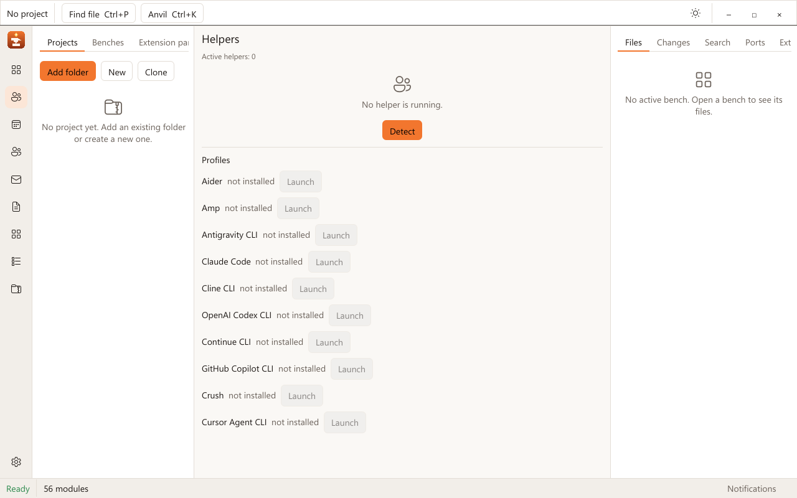

state: en.light.rail.helper.tab
capture_sha: pendente
model: opencode/glm-5.3-flash-free
---

# Helpers (trilho, aba helper.tab) — variante en / tema claro

Tela do painel central "Helpers", que lista os perfis de ajudantes de código (agentes de IA) e permite detectar e iniciar cada um, com o trilho esquerdo na aba Helpers e o painel direito em Files.

## Como chegar
Na janela principal, clique no segundo ícone do trilho à esquerda (ícone de pessoas, botão "Helpers", (8,138)–(44,174), marcado como ativo). Comando de captura/abertura: `forja-app --locale en --theme light --rail helper.tab` (arquivo `captures/en.light.rail.helper.tab.png`, 1920×1080 px).

## O que muda em relação à referência (pt-BR.dark.rail.helper.tab)
- **Idioma**: todos os textos em inglês ("Find file", "Anvil", "No project", "Helpers", "Active helpers: 0", "Profiles", "Installed (0)", "Ready", "56 modules", "Notifications", etc.).
- **Tema**: claro em vez de escuro (fundos creme/off-white, texto escuro).
- **Resolução**: captura em 1920×1080 (referência em 1280×800); nesta variante a lista de perfis não aparece cortada.
- **Estado do app diferente**: a detecção de ajudantes está em andamento — há o rótulo "Detecting…" no canto superior direito da área central (em vez do botão "Detectar"), a lista de perfis está recolhida atrás do botão "Show not installed (16)" e a seção "Installed (0)" está vazia; na referência a lista de perfis estava expandida com os 16 ajudantes.
- **Elementos presentes aqui que não estavam na referência**: botão "Back to bench" no topo da área central e campo de filtro (`TextInput` com placeholder "Filter helpers...") ao lado de "Profiles".
- **Abas**: os painéis lateral e direito mostram botão "More tabs" (menu de abas ocultas) em vez de listar todas as abas diretamente; no painel direito só "Files" (ativa) e "Changes" estão visíveis.

## Regiões
- **Barra de título** — (0,0)–(1920,42): rótulo do projeto ("No project"), ações rápidas "Find file  Ctrl+P" e "Anvil  Ctrl+K", botão de tema (ícone de sol, sem nome acessível) e botões de janela "–", "□", "×".
- **Trilho esquerdo (rail)** — (0,42)–(48,1048): logotipo da Forja (imagem sem nome acessível) e ícones de navegação: "Board", "Helpers" (ativo), "Routines", "Muster", "Requests", "Skills", "Usage", "Extensions", "Archive" e "Settings".
- **Painel lateral esquerdo** — (48,42)–(304,1048): botão "More tabs", aba "Projects" (ativa), botões "Add folder", "New project" e "Clone", e estado vazio com ícone de pasta (rótulo "(ícone)" em (168,201)–(196,229)) e a mensagem "No project yet. Add an existing folder or create a new one.".
- **Divisor 1** — (304,42)–(320,1048): divisor arrastável entre o painel esquerdo e a área central.
- **Área central** — (320,42)–(1612,1048): botão "Back to bench", cabeçalho "Helpers" e contador "Active helpers: 0"; estado vazio com ícone (rótulo "(ícone)" em (952,162)–(980,190)) e o texto "No helper is running."; seção "Profiles" com campo de filtro, seção "Installed (0)" com a mensagem "No installed helpers found on PATH." e o botão "Show not installed (16)"; no canto superior direito, o rótulo "Detecting…" indica detecção em andamento.
- **Divisor 2** — (1612,42)–(1628,1048): divisor arrastável entre a área central e o painel direito.
- **Painel direito** — (1628,42)–(1920,1048): botão "More tabs", abas "Files" (ativa) e "Changes"; estado vazio com ícone de grade (rótulo "(ícone)" em (1756,117)–(1784,145)) e a mensagem "No active bench. Open a bench to see its files.".
- **Barra de status** — (0,1048)–(1920,1080): "Ready", "56 modules" e "Notifications" à direita.

## Elementos
| Elemento | Tipo | Posição (px) | Estado | O que faz |
|---|---|---|---|---|
| "Find file  Ctrl+P" | Button | (99,5)–(218,37) | — | Abre a busca rápida de arquivos (atalho Ctrl+P). |
| "Anvil  Ctrl+K" | Button | (226,5)–(327,37) | — | Abre a paleta de comandos (atalho Ctrl+K). |
| (sem nome acessível) | Unknown | (1741,5)–(1773,37) | — | Ícone de sol: alterna tema claro/escuro. |
| "–" | Button | (1795,5)–(1827,37) | — | Minimiza a janela. |
| "□" | Button | (1835,5)–(1867,37) | — | Maximiza/restaura a janela. |
| "×" | Button | (1875,5)–(1909,37) | — | Fecha a janela. |
| "No project" | Label | (11,12)–(77,31) | — | Mostra que nenhum projeto está aberto. |
| (sem nome acessível) | Unknown | (304,42)–(320,1048) | foco | Divisor arrastável entre painel esquerdo e área central. |
| (sem nome acessível) | Unknown | (1612,42)–(1628,1048) | foco | Divisor arrastável entre área central e painel direito. |
| (sem nome acessível) | Image | (12,50)–(40,78) | — | Logotipo da Forja no trilho (ícone de bigorna laranja). |
| "More tabs" | Button | (64,50)–(151,85) | — | Menu com as abas ocultas do painel esquerdo. |
| "Back to bench" | Button | (324,50)–(435,82) | — | Volta da visão de ajudantes para a bancada. |
| "More tabs" | Button | (1632,50)–(1719,85) | — | Menu com as abas ocultas do painel direito. |
| "Projects" | Button | (159,52)–(231,84) | marcado=True | Aba ativa do painel esquerdo (sublinhado laranja). |
| "Files" | Button | (1727,52)–(1778,84) | marcado=True | Aba ativa do painel direito (sublinhado laranja). |
| "Changes" | Button | (1778,52)–(1855,84) | marcado=False | Aba de mudanças (diffs) da bancada. |
| "Helpers" | Label | (324,90)–(384,114) | — | Título do painel central. |
| "Board" | Button | (8,94)–(44,130) | marcado=False | Ícone do trilho: abre o quadro. |
| "Add folder" | Button | (64,101)–(154,133) | — | Adiciona uma pasta de projeto existente (botão primário laranja). |
| "New project" | Button | (162,101)–(261,133) | — | Cria um projeto novo. |
| "Detecting…" | Label | (1538,105)–(1608,124) | — | Indica que a detecção de ajudantes instalados está em andamento. |
| (ícone) | Label | (1756,117)–(1784,145) | — | Ícone de grade do estado vazio do painel direito. |
| "Active helpers: 0" | Label | (324,122)–(410,138) | — | Contador de ajudantes em execução. |
| "Helpers" | Button | (8,138)–(44,174) | marcado=True | Ícone do trilho: abre esta tela de Helpers (ativa). |
| "Clone" | Button | (64,141)–(123,173) | — | Clona um repositório como projeto. |
| "No active bench. Open a bench to see its files." | Label | (1644,153)–(1896,191) | — | Estado vazio do painel de arquivos. |
| (ícone) | Label | (952,162)–(980,190) | — | Ícone de pessoas do estado vazio da área central. |
| "Routines" | Button | (8,182)–(44,218) | marcado=False | Ícone do trilho: abre rotinas. |
| "No helper is running." | Label | (902,198)–(1031,217) | — | Estado vazio da lista de ajudantes em execução. |
| (ícone) | Label | (168,201)–(196,229) | — | Ícone de pasta do estado vazio do painel esquerdo. |
| "Muster" | Button | (8,226)–(44,262) | marcado=False | Ícone do trilho: abre o mutirão. |
| "No project yet. Add an existing folder or create a new one." | Label | (67,237)–(297,275) | — | Estado vazio da lista de projetos. |
| (sem nome acessível) | TextInput | (377,244)–(605,267) | — | Campo de filtro da lista de perfis (placeholder "Filter helpers..."). |
| "Profiles" | Label | (324,246)–(369,265) | — | Título da seção que lista os perfis de ajudantes. |
| "Requests" | Button | (8,270)–(44,306) | marcado=False | Ícone do trilho: abre pedidos. |
| "Installed (0)" | Label | (324,279)–(395,298) | — | Contador de ajudantes instalados encontrados. |
| "No installed helpers found on PATH." | Label | (324,306)–(548,325) | — | Estado vazio da lista de instalados. |
| "Skills" | Button | (8,314)–(44,350) | marcado=False | Ícone do trilho: abre skills. |
| "Show not installed (16)" | Button | (324,341)–(486,373) | — | Expande a lista dos 16 perfis de ajudantes não instalados. |
| "Usage" | Button | (8,358)–(44,394) | marcado=False | Ícone do trilho: abre uso/consumo. |
| "Extensions" | Button | (8,402)–(44,438) | marcado=False | Ícone do trilho: abre extensões. |
| "Archive" | Button | (8,446)–(44,482) | marcado=False | Ícone do trilho: abre o acervo. |
| "Settings" | Button | (8,1004)–(44,1040) | marcado=False | Ícone do trilho: abre os ajustes. |
| "Ready" | Label | (10,1055)–(48,1074) | — | Status geral do app na barra de status (texto em verde). |
| "56 modules" | Label | (70,1055)–(142,1074) | — | Quantidade de módulos carregados. |
| "Notifications" | Label | (1808,1055)–(1886,1074) | — | Atalho/área de notificações na barra de status. |

## Aparência
Tema claro: fundo creme/off-white (~#faf6f0) em toda a janela, com separações por linhas finas cinza-claro entre as regiões. Cor de destaque laranja (accent "Brasa") no logotipo, no sublinhado da aba ativa "Projects", no botão primário "Add folder" (fundo laranja, texto branco) e no texto "Ready" em verde. Texto em cinza-escuro; mensagens de estado vazio em cinza médio. Tipografia sem serifa de tamanho único, com hierarquia por peso (título "Helpers" maior). A aba ativa do trilho ("Helpers") recebe fundo destacado arredondado. Espaçamento regular: ícones do trilho com passo vertical de 44 px, alinhamento à esquerda consistente em x=324 na área central e x=64 no painel lateral.

## Problemas encontrados
- Dois botões com o mesmo nome acessível "More tabs" na mesma tela (painel esquerdo e painel direito), o que dificulta a identificação por leitor de tela.
- Campo de filtro (`TextInput` em (377,244)–(605,267)) sem nome acessível; só é identificável pelo placeholder "Filter helpers..." visível na imagem.
- Botões de janela com nomes acessíveis simbólicos "–", "□" e "×" em vez de rótulos descritivos (Minimize/Maximize/Close).
- Vários elementos sem nome acessível: dois divisores, o botão de tema, o logotipo do trilho e os ícones de estado vazio (registrados como "(sem nome acessível)" ou "(ícone)").
- Rótulo "Detecting…" usa reticências tipográficas ("…"); conferir consistência com o restante dos textos.
- Nenhum elemento com retângulo além dos limites da janela (1920×1080) nesta captura.
