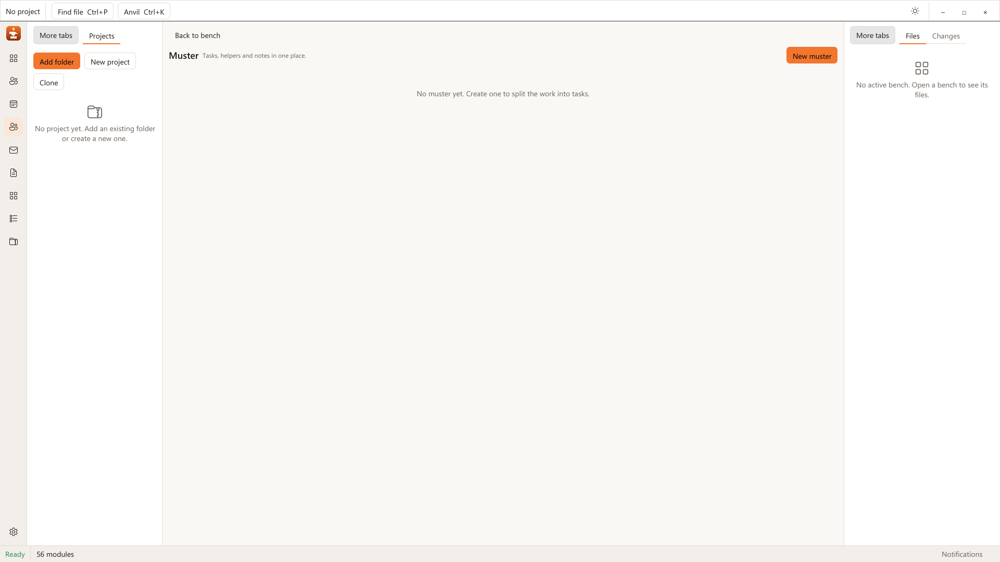

state: en.light.rail.muster.page
capture_sha: (pendente)
model: opencode/glm-5.3-flash-free
---

# Muster (muster.page)

Tela inicial do trilho "Muster", que reúne tarefas, ajudantes e anotações do projeto; sem projeto aberto, mostra estados vazios nas três colunas.

## Como chegar
Inicie o app com o trilho Muster ativo: `forja-app --locale en --theme light --rail muster.page`. Na interface, clique no quinto ícone do trilho à esquerda (o de pessoas, "Muster"), que é a entrada marcada.

Variante de referência: pt-BR.dark.rail.muster.page. Mudanças nesta variante: textos em inglês e tema claro (fundo creme, texto escuro); as tiras de abas dos painéis laterais mostram menos abas e um botão "More tabs" para as que não couberam; aparece o botão "Back to bench" no topo da área central, ausente na referência; a janela capturada é maior (1920×1080 px), então o trilho "Settings" fica no rodapé em y≈1004 e a barra de status em y≈1055.

## Regiões
- **Barra superior** (0,0)–(1920,42): à esquerda o chip "No project" e os botões "Find file  Ctrl+P" e "Anvil  Ctrl+K"; à direita o botão de tema (ícone de sol, sem nome) e os botões de janela "–", "□" e "×".
- **Trilho à esquerda** (0,42)–(56,1048): a marca do app no topo e uma coluna de ícones ("Board", "Helpers", "Routines", "Muster", "Requests", "Skills", "Usage", "Extensions", "Archive") e, no rodapé, "Settings".
- **Painel esquerdo** (56,42)–(304,1048): botão "More tabs" e a aba "Projects" (marcada), os botões "Add folder", "New project" e "Clone" e a mensagem de estado vazio "No project yet. Add an existing folder or create a new one." sobre um ícone de pasta.
- **Área central** (320,42)–(1612,1048): topo com o botão "Back to bench"; abaixo, o título "Muster" com o subtítulo "Tasks, helpers and notes in one place.", o botão laranja "New muster" à direita e o estado vazio "No muster yet. Create one to split the work into tasks." centralizado na coluna.
- **Painel direito** (1628,42)–(1920,1048): botão "More tabs", abas "Files" (marcada) e "Changes", com ícone de grade e a mensagem "No active bench. Open a bench to see its files.".
- **Barra de status** (0,1048)–(1920,1080): "Ready" em verde à esquerda, "56 modules" ao lado e "Notifications" à direita.

## Elementos
| Elemento | Tipo | Posição (px) | Estado | O que faz |
|---|---|---|---|---|
| "Find file  Ctrl+P" | Button | (99,5)–(218,37) | clicável, focável | Abre o localizador de arquivos do projeto; atalho Ctrl+P indicado no rótulo. |
| "Anvil  Ctrl+K" | Button | (226,5)–(327,37) | clicável, focável | Abre a paleta de comandos ("Anvil"); atalho Ctrl+K indicado no rótulo. |
| (sem nome acessível) | Unknown | (1741,5)–(1773,37) | clicável, focável | Botão de alternância de tema, desenhado como ícone de sol na extremidade direita da barra de título. |
| "–" | Button | (1795,5)–(1827,37) | clicável, focável | Minimiza a janela. |
| "□" | Button | (1835,5)–(1867,37) | clicável, focável | Maximiza/restaura a janela. |
| "×" | Button | (1875,5)–(1909,37) | clicável, focável | Fecha a janela. |
| "No project" | Label | (11,12)–(77,31) | clicável, focável | Indicador do projeto atual na barra de título; sem projeto, exibe este texto. |
| (sem nome acessível) | Unknown | (304,42)–(320,1048) | focável | Divisor vertical entre o painel esquerdo e a área central (arrastável/redimensionável). |
| (sem nome acessível) | Unknown | (1612,42)–(1628,1048) | focável | Divisor vertical entre a área central e o painel direito. |
| (sem nome acessível) | Image | (12,50)–(40,78) | clicável, focável | Marca/logo do app no topo do trilho (ícone laranja). |
| "More tabs" | Button | (64,50)–(151,85) | clicável, focável |Lista as abas restantes do painel esquerdo que não couberam na tira (na referência: "Benches" e "Extension panels"). |
| "Back to bench" | Button | (324,50)–(435,82) | clicável, focável | Volta da área central do Muster para a visão da bancada; aparece no topo da área central. |
| "More tabs" | Button | (1632,50)–(1719,85) | clicável, focável | Lista as abas restantes do painel direito que não couberam na tira (na referência: "Search", "Ports" e "Extension panels"). |
| "Projects" | Button | (159,52)–(231,84) | marcado=True | Aba do painel esquerdo que lista os projetos; é a aba ativa, com sublinhado. |
| "Files" | Button | (1727,52)–(1778,84) | marcado=True | Aba do painel direito com o navegador de arquivos; é a aba ativa, com sublinhado. |
| "Changes" | Button | (1778,52)–(1855,84) | marcado=False | Aba de mudanças (arquivos alterados) do painel direito. |
| "New muster" | Button | (1510,90)–(1608,122) | clicável, focável | Botão primário laranja que cria um muster na área central. |
| "Board" | Button | (8,94)–(44,130) | marcado=False | Entrada do trilho para o quadro; ícone de grade. |
| "Muster" | Label | (324,94)–(381,118) | clicável | Título da tela na área central. |
| "Tasks, helpers and notes in one place." | Label | (389,98)–(587,114) | clicável | Subtítulo descritivo ao lado do título. |
| "Add folder" | Button | (64,101)–(154,133) | clicável, focável | Botão destacado do painel Projects para adicionar uma pasta de projeto. |
| "New project" | Button | (162,101)–(261,133) | clicável, focável | Cria um projeto novo no painel Projects. |
| (ícone) | Label | (1756,117)–(1784,145) | clicável | Ícone decorativo (grade de quadradinhos) do estado vazio do painel Files. |
| "Helpers" | Button | (8,138)–(44,174) | marcado=False | Entrada do trilho para ajudantes de código. |
| "Clone" | Button | (64,141)–(123,173) | clicável, focável | Ação do painel Projects para clonar um repositório/pasta. |
| "No active bench. Open a bench to see its files." | Label | (1644,153)–(1896,191) | clicável | Estado vazio do painel Files; orienta abrir uma bancada. |
| "No muster yet. Create one to split the work into tasks." | Label | (800,170)–(1132,189) | clicável | Estado vazio da área central; orienta criar um muster. |
| "Routines" | Button | (8,182)–(44,218) | marcado=False | Entrada do trilho para rotinas. |
| (ícone) | Label | (168,201)–(196,229) | clicável | Ícone decorativo (pasta aberta) do estado vazio do painel Projects. |
| "Muster" | Button | (8,226)–(44,262) | marcado=True | Entrada do trilho da tela atual; é a entrada marcada, com fundo laranja claro. |
| "No project yet. Add an existing folder or create a new one." | Label | (67,237)–(297,275) | clicável | Estado vazio do painel Projects; orienta adicionar pasta ou criar projeto. |
| "Requests" | Button | (8,270)–(44,306) | marcado=False | Entrada do trilho para pedidos. |
| "Skills" | Button | (8,314)–(44,350) | marcado=False | Entrada do trilho para skills. |
| "Usage" | Button | (8,358)–(44,394) | marcado=False | Entrada do trilho para uso. |
| "Extensions" | Button | (8,402)–(44,438) | marcado=False | Entrada do trilho para extensões. |
| "Archive" | Button | (8,446)–(44,482) | marcado=False | Entrada do trilho para o acervo. |
| "Settings" | Button | (8,1004)–(44,1040) | marcado=False | Entrada do trilho para ajustes, fixada no rodapé do trilho. |
| "Ready" | Label | (10,1055)–(48,1074) | clicável | Status geral na barra inferior, em verde. |
| "56 modules" | Label | (70,1055)–(142,1074) | clicável | Contagem de módulos carregados. |
| "Notifications" | Label | (1808,1055)–(1886,1074) | clicável, focável | Área de notificações no canto direito da barra de status. |

## Aparência
Tema claro: fundo creme/off-white (tons de bege muito claro) no trilho e nos painéis, com a área central em branco levemente distinto e divisórias verticais discretas. O laranja é a cor de destaque: marca do app no trilho, abas ativas "Projects" e "Files" sublinhadas em laranja, entrada do trilho "Muster" com fundo laranja claro, botão primário "New muster" e botão "Add folder" em laranja sólido com texto branco. Tipografia sem serifa em dois tamanhos: título "Muster" maior em negrito, o resto em corpo pequeno; subtítulo e estados vazios em cinza médio (contraste mais baixo que o texto principal). A aba ativa de cada tira é marcada por sublinhado laranja. Espaçamento uniforme: ícones do trilho com 32 px de lado e passo vertical de 44 px; botões de janela de ~32 px alinhados no topo.

## Problemas encontrados
- Dois botões com o mesmo nome acessível "More tabs" (painel esquerdo em (64,50) e painel direito em (1632,50)), o que dificulta a identificação por leitores de tela.
- O botão "Back to bench" aparece no topo da área central embora o painel direito informe "No active bench. Open a bench to see its files."; a ação de voltar a uma bancada é oferecida sem bancada ativa.
- Botão de alternância de tema e as duas divisórias verticais estão sem nome acessível.
- Textos de estado vazio e subtítulo em cinza sobre fundo claro têm contraste reduzido (por exemplo, "Tasks, helpers and notes in one place.").
- As tiras de abas escondem as demais abas atrás de "More tabs" sem indicação visual de quantas existem.
