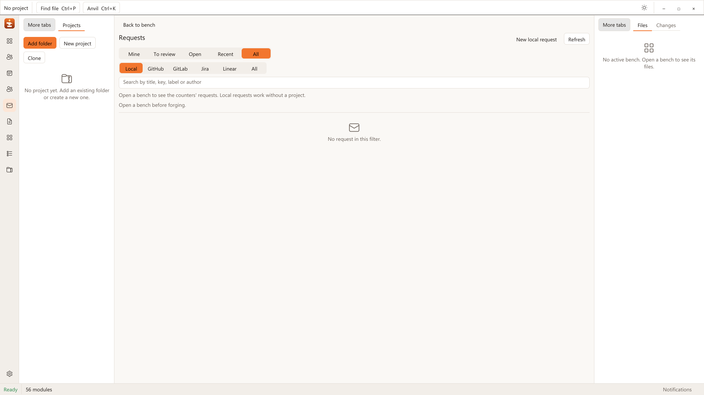

state: en.light.rail.request.page
capture_sha: (não informado)
model: opencode/glm-5.3-flash-free

# Requests (página request.page no trilho)

Tela de listagem e filtro de pedidos (tarefas/demandas) dos balcões, com painel de projetos à esquerda e painel de arquivos da bancada à direita; funciona sem projeto aberto para pedidos locais. Variante em inglês e tema claro da página de referência (pt-BR.dark.rail.request.page); captura em 1920×1080 px (a referência usa 1280×800, por isso as coordenadas diferem).

## Como chegar
Na janela principal, clicar no ícone de envelope "Requests" no trilho à esquerda ((8,270)–(44,306), 5º botão-ícone do trilho, após o logotipo). Via comando de captura: `forja-app --locale en --theme light --rail request.page`.

## Regiões
- **Barra superior** (0,0)–(1920,42): seletor de projeto "No project", atalhos "Find file  Ctrl+P" e "Anvil  Ctrl+K", botão de alternância de tema (ícone de sol, sem nome acessível) e botões de janela –, □, ×.
- **Trilho à esquerda** (0,42)–(52,1048): logotipo da Forja no topo (12,50)–(40,78) e botões-ícone de 36×36 px: Board, Helpers, Routines, Muster, Requests (ativo, marcado=True), Skills, Usage, Extensions, Archive; "Settings" fixado no rodapé (8,1004).
- **Painel lateral esquerdo** (52,42)–(304,1048): faixa de abas com "More tabs" e a aba ativa "Projects"; ações "Add folder", "New project" e "Clone"; estado vazio com ícone de pasta (168,201)–(196,229) e o texto "No project yet. Add an existing folder or create a new one.".
- **Área central** (320,42)–(1612,1048): botão "Back to bench" acima do cabeçalho; título "Requests" com "New local request" e "Refresh"; filtros de lista (Mine, To review, Open, Recent, All — "All" ativo); filtros de origem (Local — ativo, GitHub, GitLab, Jira, Linear, All); campo de busca com o texto-guia "Search by title, key, label or author" (324,210)–(1608,242); dois avisos ("Open a bench to see the counters' requests. Local requests work without a project." e "Open a bench before forging."); estado vazio com ícone de envelope (952,334)–(980,362) e "No request in this filter.".
- **Painel direito** (1628,42)–(1920,1048): faixa de abas com "More tabs", "Files" (ativa) e "Changes"; estado vazio com ícone de grade (1756,117)–(1784,145) e o texto "No active bench. Open a bench to see its files.".
- **Barra de status** (0,1048)–(1920,1080): "Ready" em verde, "56 modules" e "Notifications" à direita.

Separadores verticais finos de 16 px dividem os painéis em x=304–320 e x=1612–1628.

Diferenças em relação à referência: além do idioma, as faixas de abas dos painéis lateral e direito mostram um botão "More tabs" em vez da lista completa de abas ("Bancadas"/"Benchmarks" e "Painéis de extensões"/"Extension panels" ficam recolhidas; no painel direito só "Files" e "Changes" ficam visíveis) e há um botão "Back to bench" acima do título da área central, ausente na lista da referência.

## Elementos
| Elemento | Tipo | Posição (px) | Estado | O que faz |
|---|---|---|---|---|
| "No project" | Label | (11,12)–(77,31) | — | Indica o projeto atual (nenhum selecionado); abre a lista de projetos. |
| "Find file  Ctrl+P" | Button | (99,5)–(218,37) | — | Abre a busca rápida de arquivos (atalho Ctrl+P). |
| "Anvil  Ctrl+K" | Button | (226,5)–(327,37) | — | Abre a paleta de comandos (atalho Ctrl+K). |
| (sem nome acessível) | Unknown | (1741,5)–(1773,37) | — | Botão-ícone de sol: alterna tema claro/escuro. |
| "–" | Button | (1795,5)–(1827,37) | — | Minimiza a janela. |
| "□" | Button | (1835,5)–(1867,37) | — | Maximiza/restaura a janela. |
| "×" | Button | (1875,5)–(1909,37) | — | Fecha a janela. |
| (sem nome acessível) | Unknown | (304,42)–(320,1048) | foco | Separador vertical entre painel esquerdo e área central. |
| (sem nome acessível) | Unknown | (1612,42)–(1628,1048) | foco | Separador vertical entre área central e painel direito. |
| (sem nome acessível) | Image | (12,50)–(40,78) | — | Logotipo da Forja no topo do trilho. |
| "More tabs" | Button | (64,50)–(151,85) | — | Revela as abas restantes do painel esquerdo (ex.: lista de bancadas e painéis de extensões). |
| "Back to bench" | Button | (324,50)–(435,82) | — | Volta da página de pedidos para a bancada ativa. |
| "More tabs" | Button | (1632,50)–(1719,85) | — | Revela as abas restantes do painel direito. |
| "Projects" | Button | (159,52)–(231,84) | marcado=True | Aba ativa do painel esquerdo; mostra a lista de projetos. |
| "Files" | Button | (1727,52)–(1778,84) | marcado=True | Aba ativa do painel direito; lista os arquivos da bancada. |
| "Changes" | Button | (1778,52)–(1855,84) | marcado=False | Mostra as mudanças (diff) da bancada. |
| "Requests" | Label | (324,90)–(396,114) | — | Título da área central. |
| "New local request" | Button | (1396,90)–(1530,122) | — | Cria um pedido local (funciona sem projeto). |
| "Refresh" | Button | (1538,90)–(1608,122) | — | Recarrega a lista de pedidos. |
| "Board" | Button | (8,94)–(44,130) | marcado=False | Botão-ícone do trilho: abre o quadro de pedidos. |
| "Add folder" | Button | (64,101)–(154,133) | — | Adiciona uma pasta existente como projeto (destacado em laranja). |
| "New project" | Button | (162,101)–(261,133) | — | Cria um projeto novo. |
| (ícone) | Label | (1756,117)–(1784,145) | — | Ícone de grade do estado vazio do painel direito. |
| "Mine" | Button | (324,130)–(407,162) | marcado=False | Filtro de pedidos atribuídos a mim. |
| "To review" | Button | (407,130)–(490,162) | marcado=False | Filtro de pedidos aguardando revisão. |
| "Open" | Button | (490,130)–(573,162) | marcado=False | Filtro de pedidos em aberto. |
| "Recent" | Button | (573,130)–(657,162) | marcado=False | Filtro de pedidos acessados recentemente. |
| "All" | Button | (657,130)–(740,162) | marcado=True | Filtro ativo: mostra todos os pedidos. |
| "Helpers" | Button | (8,138)–(44,174) | marcado=False | Botão-ícone do trilho: abre os ajudantes de código. |
| "Clone" | Button | (64,141)–(123,173) | — | Clona um repositório para criar um projeto. |
| "No active bench. Open a bench to see its files." | Label | (1644,153)–(1896,191) | — | Estado vazio do painel direito. |
| "Local" | Button | (324,170)–(391,202) | marcado=True | Filtro de origem ativo: pedidos locais. |
| "GitHub" | Button | (391,170)–(458,202) | marcado=False | Filtro de origem: pedidos do GitHub. |
| "GitLab" | Button | (458,170)–(526,202) | marcado=False | Filtro de origem: pedidos do GitLab. |
| "Jira" | Button | (526,170)–(593,202) | marcado=False | Filtro de origem: pedidos do Jira. |
| "Linear" | Button | (593,170)–(660,202) | marcado=False | Filtro de origem: pedidos do Linear. |
| "All" | Button | (660,170)–(727,202) | marcado=False | Filtro de origem: todas as origens. |
| "Routines" | Button | (8,182)–(44,218) | marcado=False | Botão-ícone do trilho: abre as rotinas. |
| (ícone) | Label | (168,201)–(196,229) | — | Ícone de pasta do estado vazio do painel esquerdo. |
| (sem nome acessível) | TextInput | (324,210)–(1608,242) | — | Campo de busca com o texto-guia "Search by title, key, label or author". |
| "Muster" | Button | (8,226)–(44,262) | marcado=False | Botão-ícone do trilho: abre o mutirão. |
| "No project yet. Add an existing folder or create a new one." | Label | (67,237)–(297,275) | — | Estado vazio do painel esquerdo. |
| "Open a bench to see the counters' requests. Local requests work without a project." | Label | (324,250)–(833,269) | — | Aviso sobre o escopo dos pedidos. |
| "Requests" | Button | (8,270)–(44,306) | marcado=True | Botão-ícone do trilho da tela atual (envelope, realce laranja). |
| "Open a bench before forging." | Label | (324,277)–(507,296) | — | Aviso: a ação de forjar exige bancada ativa. |
| "Skills" | Button | (8,314)–(44,350) | marcado=False | Botão-ícone do trilho: abre as skills. |
| (ícone) | Label | (952,334)–(980,362) | — | Ícone de envelope do estado vazio da área central. |
| "Usage" | Button | (8,358)–(44,394) | marcado=False | Botão-ícone do trilho: abre o uso de recursos. |
| "No request in this filter." | Label | (894,370)–(1038,389) | — | Estado vazio da lista de pedidos. |
| "Extensions" | Button | (8,402)–(44,438) | marcado=False | Botão-ícone do trilho: abre as extensões. |
| "Archive" | Button | (8,446)–(44,482) | marcado=False | Botão-ícone do trilho: abre o acervo. |
| "Settings" | Button | (8,1004)–(44,1040) | marcado=False | Botão-ícone do trilho (rodapé): abre os ajustes. |
| "Ready" | Label | (10,1055)–(48,1074) | — | Status geral na cor verde. |
| "56 modules" | Label | (70,1055)–(142,1074) | — | Quantidade de módulos carregados. |
| "Notifications" | Label | (1808,1055)–(1886,1074) | — | Atalho/indicador de notificações na barra de status. |

## Aparência
Tema claro de fundo creme/off-white (janela ~#faf7f2, painéis em tom levemente distinto). A cor de destaque é o laranja, aplicado ao botão primário "Add folder", aos filtros ativos "All" (lista) e "Local" (origem) — texto branco sobre laranja — e à borda esquerda do botão ativo "Requests" do trilho. Texto em cinza-escuro; rótulos inativos e avisos em cinza médio com contraste menor. Tipografia sem serifa de um único tamanho nas abas e botões, com tamanhos menores nos avisos e na barra de status. Botões e abas com cantos arredondados e bordas sutis; espaçamento consistente de ~8 px entre filtros e ~16 px entre seções. Na barra de status, "Ready" aparece em verde sobre fundo claro. Em relação à referência escura, a paleta é invertida (fundo claro/texto escuro em vez de fundo escuro/texto claro) e o laranja de destaque mantém o mesmo papel.

## Problemas encontrados
- O botão de alternância de tema no topo direito (1741,5)–(1773,37) não tem nome acessível; é identificável apenas pelo ícone de sol.
- O campo de busca (TextInput) não tem nome acessível, apenas o texto-guia visível.
- Os três ícones de estado vazio (pasta, envelope, grade) são Labels "(ícone)" sem descrição acessível.
- O nome "All" se repete em dois grupos de filtro (lista e origem) com retângulos distintos, o que pode gerar ambiguidade para leitores de tela.
- O nome "More tabs" se repete em dois painéis (esquerdo (64,50)–(151,85) e direito (1632,50)–(1719,85)) sem indicação de contexto, o que pode gerar ambiguidade para leitores de tela.
