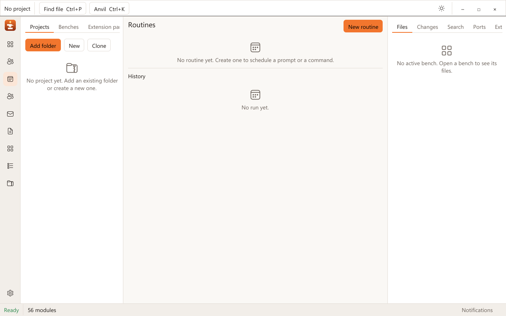

# Rotinas (página do trilho, com painéis vazios — variante en/light)

Tela inicial da área de rotinas do app em inglês com tema claro, mostrada com os painéis de projetos (à esquerda), rotinas (centro) e arquivos de bancada (à direita) ainda sem conteúdo.

## Como chegar
Abrir o Forja em inglês com tema light, com o trilho esquerdo posicionado em "Routines" (o botão "Routines" do trilho aparece marcado). Comando de captura: `forja-app --locale en --theme light --rail routine.page`.

## Regiões
Em relação à página de referência (pt-BR/dark), esta captura foi feita em janela maior (1920×1080 px), com tema claro e textos em inglês; as coordenadas abaixo já são desta captura.

- **Barra superior (0,0)–(1920,42):** rótulo do projeto ("No project") à esquerda; botões "Find file Ctrl+P" e "Anvil Ctrl+K"; ícone de tema (sol, sem nome acessível) à direita; e os botões de janela (minimizar "–", maximizar "□", fechar "×") no canto superior direito.
- **Trilho à esquerda (0,42)–(56,1048):** coluna vertical de ícones de navegação; a logomarca (12,50)–(40,78) no topo e, abaixo, os botões-ícone "Board", "Helpers", "Routines" (marcado, com fundo laranja), "Muster", "Requests", "Skills", "Usage", "Extensions", "Archive" e, na base, "Settings" (8,1004)–(44,1040).
- **Painel lateral esquerdo (56,42)–(304,1048):** botão "More tabs" e a aba "Projects" (marcada, com sublinhado laranja); botões "Add folder" (destaque laranja), "New project" e "Clone"; estado vazio com ícone (168,201)–(196,229) e a mensagem "No project yet. Add an existing folder or create a new one.".
- **Área central (320,42)–(1612,1048):** botão "Back to bench" no topo (presente nesta variante, ausente na referência); título "Routines" com o botão de destaque "New routine"; estado vazio com ícone (952,146)–(980,174) e a mensagem "No routine yet. Create one to schedule a prompt or a command."; abaixo, a seção "History" com ícone (952,266)–(980,294) e a mensagem "No run yet.".
- **Painel direito (1628,42)–(1920,1048):** botão "More tabs" e as abas "Files" (marcada) e "Changes"; estado vazio com ícone (1756,117)–(1784,145) e a mensagem "No active bench. Open a bench to see its files.". Nesta variante as abas extras da referência ("Busca", "Portas", "Painéis de extensões") ficam recolhidas sob "More tabs".
- **Barra de status (0,1048)–(1920,1080):** "Ready" em verde à esquerda, "56 modules" ao lado; "Notifications" à direita.

## Elementos
| Elemento | Tipo | Posição (px) | Estado | O que faz |
|---|---|---|---|---|
| "Find file Ctrl+P" | Button | (99,5)–(218,37) | — | Atalho global de busca de arquivos (Ctrl+P). |
| "Anvil Ctrl+K" | Button | (226,5)–(327,37) | — | Atalho global de comandos (Ctrl+K). |
| (sem nome acessível) | Unknown | (1741,5)–(1773,37) | — | Ícone de tema (sol) na barra superior; alterna o tema. |
| "–" | Button | (1795,5)–(1827,37) | — | Minimizar a janela. |
| "□" | Button | (1835,5)–(1867,37) | — | Maximizar/restaurar a janela. |
| "×" | Button | (1875,5)–(1909,37) | — | Fechar a janela. |
| "No project" | Label | (11,12)–(77,31) | clicável | Indica que nenhum projeto está aberto; abre a seletora de projetos. |
| (sem nome acessível) | Unknown | (304,42)–(320,1048) | — | Divisor/calha entre o painel esquerdo e a área central (arrastável). |
| (sem nome acessível) | Unknown | (1612,42)–(1628,1048) | — | Divisor/calha entre a área central e o painel direito (arrastável). |
| (sem nome acessível) | Image | (12,50)–(40,78) | clicável | Logomarca do Forja no topo do trilho. |
| "More tabs" | Button | (64,50)–(151,85) | — | Revela as abas restantes do painel esquerdo (não visíveis nesta variante). |
| "Back to bench" | Button | (324,50)–(435,82) | — | Volta da página de rotinas para a tela da bancada (exclusivo desta variante). |
| "More tabs" | Button | (1632,50)–(1719,85) | — | Revela as abas restantes do painel direito ("Busca", "Portas" e "Painéis de extensões" na referência). |
| "Projects" | Button | (159,52)–(231,84) | marcado=True | Aba do painel esquerdo que exibe a lista de projetos (ativa). |
| "Files" | Button | (1727,52)–(1778,84) | marcado=True | Aba do painel direito que mostra os arquivos da bancada (ativa). |
| "Changes" | Button | (1778,52)–(1855,84) | marcado=False | Aba do painel direito que mostra as mudanças da bancada. |
| "Routines" | Label | (324,90)–(393,114) | clicável | Título da página central. |
| "New routine" | Button | (1509,90)–(1608,122) | — | Cria uma nova rotina (ação principal da página, em destaque laranja). |
| "Board" | Button | (8,94)–(44,130) | marcado=False | Botão-ícone do trilho para a tela do quadro. |
| "Add folder" | Button | (64,101)–(154,133) | — | Adiciona uma pasta de projeto existente (botão em destaque laranja). |
| "New project" | Button | (162,101)–(261,133) | — | Cria um projeto novo. |
| (ícone) | Label | (1756,117)–(1784,145) | clicável | Ícone ilustrativo do estado vazio do painel de arquivos (centralizado). |
| "Helpers" | Button | (8,138)–(44,174) | marcado=False | Botão-ícone do trilho para a tela de ajudantes. |
| "Clone" | Button | (64,141)–(123,173) | — | Clona um projeto (repositório) existente. |
| (ícone) | Label | (952,146)–(980,174) | clicável | Ícone ilustrativo do estado vazio das rotinas (centralizado). |
| "No active bench. Open a bench to see its files." | Label | (1644,153)–(1896,191) | clicável | Mensagem de estado vazio do painel de arquivos, em duas linhas. |
| "Routines" | Button | (8,182)–(44,218) | marcado=True | Botão-ícone do trilho da página atual, destacado com fundo laranja. |
| "No routine yet. Create one to schedule a prompt or a command." | Label | (768,182)–(1164,201) | clicável | Mensagem de estado vazio das rotinas. |
| (ícone) | Label | (168,201)–(196,229) | clicável | Ícone ilustrativo do estado vazio dos projetos (centralizado no painel esquerdo). |
| "History" | Label | (324,223)–(368,242) | clicável | Título da seção de histórico de execuções abaixo das rotinas. |
| "Muster" | Button | (8,226)–(44,262) | marcado=False | Botão-ícone do trilho para a tela de mutirão. |
| "No project yet. Add an existing folder or create a new one." | Label | (67,237)–(297,275) | clicável | Mensagem de estado vazio do painel de projetos, em duas linhas. |
| (ícone) | Label | (952,266)–(980,294) | clicável | Ícone ilustrativo do estado vazio do histórico (centralizado). |
| "Requests" | Button | (8,270)–(44,306) | marcado=False | Botão-ícone do trilho para a tela de pedidos. |
| "No run yet." | Label | (932,302)–(1001,321) | clicável | Mensagem de estado vazio do histórico de execuções. |
| "Skills" | Button | (8,314)–(44,350) | marcado=False | Botão-ícone do trilho para a tela de skills. |
| "Usage" | Button | (8,358)–(44,394) | marcado=False | Botão-ícone do trilho para a tela de uso. |
| "Extensions" | Button | (8,402)–(44,438) | marcado=False | Botão-ícone do trilho para a tela de extensões. |
| "Archive" | Button | (8,446)–(44,482) | marcado=False | Botão-ícone do trilho para a tela de acervo. |
| "Settings" | Button | (8,1004)–(44,1040) | marcado=False | Botão-ícone do trilho (engrenagem), fixado na base, para os ajustes. |
| "Ready" | Label | (10,1055)–(48,1074) | clicável | Indicador de estado na barra de status, em verde. |
| "56 modules" | Label | (70,1055)–(142,1074) | clicável | Contagem de módulos carregados, na barra de status. |
| "Notifications" | Label | (1808,1055)–(1886,1074) | clicável | Abre as notificações, à direita da barra de status. |

## Aparência
Tema claro: fundo geral em off-white/creme (aprox. #faf6f0 na área de conteúdo, com painéis em tom levemente mais claro e barra superior/barra de status em branco). Cor de destaque laranja, usada no botão "Add folder", no botão "New routine", no botão-ícone "Routines" do trilho (fundo laranja com ícone escuro) e no sublinhado das abas ativas ("Projects" e "Files"). O indicador "Ready" na barra de status usa verde. Textos em marrom-escuro/quase preto com bom contraste; mensagens de estado vazio em cinza médio, centralizadas horizontalmente em suas regiões, acompanhadas de um ícone acima do texto. Em relação à variante dark, a hierarquia e o layout são idênticos, mudando apenas a inversão de cores (fundo claro/texto escuro em vez de fundo escuro/texto claro). Tipografia sem serifa em tamanho pequeno (títulos "Routines" e "History" levemente maiores), com espaçamento uniforme: trilho com ícones de 36 px e passos regulares de 44 px, divisores verticais de 16 px (304–320 e 1612–1628) separando os três painéis, e barra de status de 32 px com "Ready"/"56 modules" alinhados à esquerda e "Notifications" à direita.

## Problemas encontrados
- O ícone de tema na barra superior (1741,5)–(1773,37) é exposto como "(sem nome acessível)", sem rótulo para leitores de tela; os demais ícones da barra (logomarca, divisores) também não têm nome acessível.
- Os botões-ícone do trilho ("Board", "Helpers", "Muster", "Requests", "Skills", "Usage", "Extensions", "Archive", "Settings") dependem exclusivamente de ícone na interface; o nome acessível existe na árvore, mas não há rótulo visível nem dica na tela.
- Os três ícones ilustrativos dos estados vazios são expostos como "(sem nome acessível)"/"(ícone)", sem descrição para leitores de tela.
- Nenhum texto cortado, sobreposto ou fora da janela nesta captura: todos os retângulos cabem em 1920×1080, diferentemente da referência pt-BR, em que a aba "Painéis de extensões" do painel direito ultrapassava a largura.
