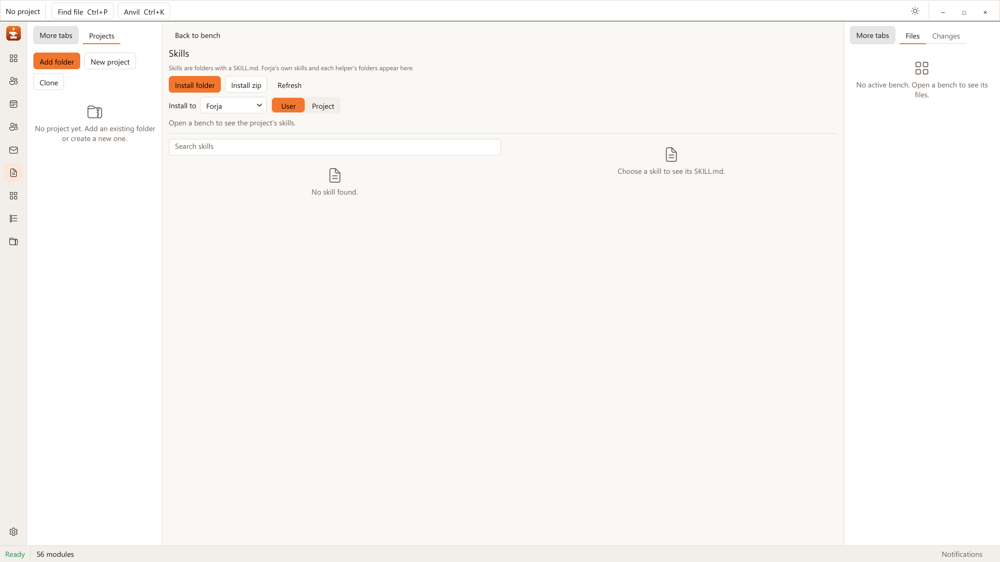

# Skills (página central) — variante inglês/tema claro

Tela de gerenciamento de skills (pastas com `SKILL.md`): permite instalar, criar e buscar skills da Forja e dos ajudantes, enquanto o restante da janela mostra projetos e arquivos. Variante de referência: `pt-BR.dark.rail.skill.page`; aqui os textos estão em inglês, o tema é claro e a janela tem 1920×1080 px.

## Como chegar
Na barra vertical à esquerda, clique no ícone "Skills" (o nono botão do trilho, marcado em laranja). Equivalente a abrir o app com `forja-app --locale en --theme light --rail skill.page`.

## Regiões
- **Barra superior** (0,0)–(1920,42): rótulo do projeto atual ("No project"), botões "Find file  Ctrl+P" e "Anvil  Ctrl+K", ícone de tema e botões de janela (minimizar, maximizar, fechar).
- **Trilho à esquerda** (0,42)–(52,1048): logotipo da Forja no topo e botões-ícone de navegação ("Board", "Helpers", "Routines", "Muster", "Requests", "Skills", "Usage", "Extensions", "Archive"), com "Settings" fixado no rodapé do trilho.
- **Painel lateral esquerdo** (52,42)–(304,1048): abas "More tabs" e "Projects" (ativa); ações "Add folder" (destacada em laranja), "New project" e "Clone"; estado vazio com ícone de pasta e o texto "No project yet. Add an existing folder or create a new one.".
- **Área central** (320,42)–(1612,1048): botão "Back to bench" no topo, título "Skills" com descrição, ações de instalação, seletor de destino ("Install to") com escopos "User"/"Project", aviso "Open a bench to see the project's skills.", campo de busca e duas mensagens de estado vazio ("No skill found." e "Choose a skill to see its SKILL.md.").
- **Painel lateral direito** (1628,42)–(1920,1048): abas "More tabs", "Files" (ativa) e "Changes"; ícone de grade e texto "No active bench. Open a bench to see its files.".
- **Barra de status** (0,1048)–(1920,1080): status "Ready", contagem "56 modules" e "Notifications" à direita.

Diferenças em relação à página de referência (pt-BR, tema escuro): todos os rótulos em inglês; o trilho expõe nomes acessíveis nos botões ("Board", "Helpers", "Routines", "Muster", "Requests", "Skills", "Usage", "Extensions", "Archive", "Settings"); há um botão "Back to bench" no topo da área central; o painel direito mostra apenas "Files" e "Changes" além de "More tabs"; a janela é maior (1920×1080) e "Settings" fica em (8,1004)–(44,1040).

## Elementos
| Elemento | Tipo | Posição (px) | Estado | O que faz |
|---|---|---|---|---|
| "Find file  Ctrl+P" | Botão | (99,5)–(218,37) | — | Abre a busca rápida de arquivos (atalho Ctrl+P) |
| "Anvil  Ctrl+K" | Botão | (226,5)–(327,37) | — | Abre a paleta de comandos (atalho Ctrl+K) |
| (sem nome acessível) | Ícone | (1741,5)–(1773,37) | — | Ícone de sol na barra superior; alterna o tema |
| "–" | Botão | (1795,5)–(1827,37) | — | Minimiza a janela |
| "□" | Botão | (1835,5)–(1867,37) | — | Maximiza/restaura a janela |
| "×" | Botão | (1875,5)–(1909,37) | — | Fecha a janela |
| "No project" | Rótulo | (11,12)–(77,31) | — | Mostra o projeto ativo na barra superior |
| (sem nome acessível) | Divisor | (304,42)–(320,1048) | — | Separador vertical entre o painel esquerdo e a área central |
| (sem nome acessível) | Divisor | (1612,42)–(1628,1048) | — | Separador vertical entre a área central e o painel direito |
| (sem nome acessível) | Imagem | (12,50)–(40,78) | — | Logotipo da Forja no topo do trilho |
| "More tabs" | Botão | (64,50)–(151,85) | — | Lista as demais abas do painel esquerdo |
| "Back to bench" | Botão | (324,50)–(435,82) | — | Volta da página de skills para a bancada |
| "More tabs" | Botão | (1632,50)–(1719,85) | — | Lista as demais abas do painel direito |
| "Projects" | Botão | (159,52)–(231,84) | marcado=True | Aba ativa do painel esquerdo; mostra a lista de projetos |
| "Files" | Botão | (1727,52)–(1778,84) | marcado=True | Aba ativa do painel direito; lista de arquivos |
| "Changes" | Botão | (1778,52)–(1855,84) | marcado=False | Aba de mudanças (versionamento) |
| "Skills" | Rótulo | (324,90)–(363,114) | — | Título da página central |
| "Board" | Botão | (8,94)–(44,130) | marcado=False | Ícone do trilho para o quadro |
| "Add folder" | Botão | (64,101)–(154,133) | — | Adiciona uma pasta de projeto existente (destacado em laranja) |
| "New project" | Botão | (162,101)–(261,133) | — | Cria um projeto novo |
| (ícone) | Rótulo | (1756,117)–(1784,145) | — | Ícone de grade do estado vazio do painel de arquivos |
| "Skills are folders with a SKILL.md. Forja's own skills and each helper's folders appear here." | Rótulo | (324,122)–(794,138) | — | Descrição da página |
| "Helpers" | Botão | (8,138)–(44,174) | marcado=False | Ícone do trilho para ajudantes |
| "Clone" | Botão | (64,141)–(123,173) | — | Clona um projeto |
| "Install folder" | Botão | (324,146)–(424,178) | — | Instala uma skill a partir de uma pasta (botão destacado em laranja) |
| "Install zip" | Botão | (432,146)–(513,178) | — | Instala uma skill a partir de um arquivo zip |
| "Refresh" | Botão | (521,146)–(591,178) | — | Atualiza a lista de skills |
| "No active bench. Open a bench to see its files." | Rótulo | (1644,153)–(1896,191) | — | Estado vazio do painel de arquivos |
| "Routines" | Botão | (8,182)–(44,218) | marcado=False | Ícone do trilho para rotinas |
| "Install to" | Rótulo | (324,186)–(376,218) | — | Rótulo do seletor de destino da instalação |
| "Forja" | Caixa de seleção | (384,186)–(512,218) | — | Combobox que escolhe o escopo de instalação; mostra "Forja" |
| "User" | Botão | (520,186)–(587,218) | marcado=True | Escopo de instalação no usuário (selecionado, laranja) |
| "Project" | Botão | (587,186)–(654,218) | marcado=False | Escopo de instalação no projeto |
| (ícone) | Rótulo | (168,201)–(196,229) | — | Ícone de pasta do estado vazio do painel de projetos |
| "Muster" | Botão | (8,226)–(44,262) | marcado=False | Ícone do trilho para o mutirão |
| "Open a bench to see the project's skills." | Rótulo | (324,226)–(567,245) | — | Aviso de que as skills de projeto dependem de uma bancada |
| "No project yet. Add an existing folder or create a new one." | Rótulo | (67,237)–(297,275) | — | Estado vazio da lista de projetos |
| (sem nome acessível) | Campo de texto | (324,267)–(962,299) | — | Campo de busca com o texto de sugestão "Search skills" |
| "Requests" | Botão | (8,270)–(44,306) | marcado=False | Ícone do trilho para pedidos |
| (ícone) | Rótulo | (1275,283)–(1303,311) | — | Ícone de documento do estado vazio direito da área central |
| "Skills" | Botão | (8,314)–(44,350) | marcado=True | Ícone do trilho da página atual (destacado em laranja) |
| "Choose a skill to see its SKILL.md." | Rótulo | (1187,319)–(1392,338) | — | Estado vazio do painel de detalhe da skill |
| (ícone) | Rótulo | (629,323)–(657,351) | — | Ícone de documento do estado vazio esquerdo da área central |
| "Usage" | Botão | (8,358)–(44,394) | marcado=False | Ícone do trilho para uso |
| "No skill found." | Rótulo | (599,359)–(688,378) | — | Estado vazio da lista de skills |
| "Extensions" | Botão | (8,402)–(44,438) | marcado=False | Ícone do trilho para extensões |
| "Archive" | Botão | (8,446)–(44,482) | marcado=False | Ícone do trilho para o acervo |
| "Settings" | Botão | (8,1004)–(44,1040) | marcado=False | Ícone do trilho para ajustes, fixado no rodapé |
| "Ready" | Rótulo | (10,1055)–(48,1074) | — | Status atual na barra inferior |
| "56 modules" | Rótulo | (70,1055)–(142,1074) | — | Contagem de módulos carregados |
| "Notifications" | Rótulo | (1808,1055)–(1886,1074) | — | Abre as notificações na barra de status |

## Aparência
Tema claro: fundo bege/creme com leve tom quente nas três colunas, separadas por divisores verticais finos e discretos. A cor de destaque é o laranja, usado nos botões "Add folder" e "Install folder", no botão de escopo "User" e no botão ativo "Skills" do trilho; as abas ativas ("Projects", "Files") recebem sublinhado escuro. Comparado à variante de referência (tema escuro), inverte-se o contraste: texto cinza-escuro/carvão sobre fundo claro, mantendo o mesmo laranja de destaque e a mesma disposição. Tipografia sans-serif de corpo pequeno (rótulos em torno de 13–16 px), com o título "Skills" em tamanho maior. Os ícones de estado vazio são contornos cinza centralizados com a mensagem abaixo. Botões secundários têm borda fina arredondada e fundo levemente mais escuro que o painel; o espaçamento entre ações é uniforme (cerca de 8–16 px).

## Problemas encontrados
- O campo de busca "Search skills" é um TextInput sem nome acessível; o texto de sugestão só aparece visualmente.
- O ícone de alternância de tema na barra superior (1741,5)–(1773,37) é um elemento clicável sem nome acessível; a função só é identificável pela imagem.
- Os divisores verticais entre as colunas são elementos sem nome acessível.
- Os três ícones de estado vazio aparecem como rótulos "(ícone)" sem descrição de texto alternativa.
- O botão de aba "Changes" do painel direito fica colado à borda do painel (retângulo até x=1855, com o painel terminando em x=1920), sem margem direita visível.
