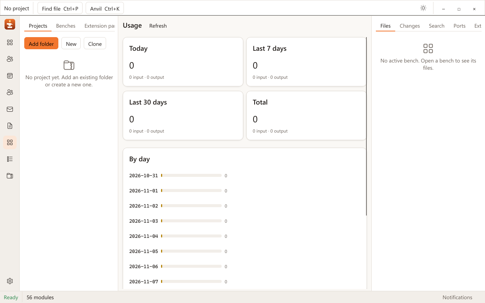

state: en.light.rail.usage.page
capture_sha: —
model: opencode/glm-5.3-flash-free
---

# Usage (página central, com trilho e painéis laterais)

Tela de estatísticas de uso de tokens dos ajudantes, exibida na área central enquanto o trilho lateral e os painéis de projetos e arquivos continuam visíveis. Variante em inglês com tema claro da página de referência (pt-BR.dark.rail.usage.page); além do idioma e das cores, esta captura mostra a mensagem "No usage recorded yet" no lugar da série "Por dia" e botões "More tabs" no lugar da lista completa de abas dos painéis.

## Como chegar
Na barra superior ou no trilho à esquerda, clique no botão "Usage" (o sétimo ícone do trilho, marcado como ativo). Equivalente a abrir o app com `forja-app --locale en --theme light --rail usage.page`. Captura: `captures/en.light.rail.usage.page.png` (1920×1080 px, escala 1.0).

## Regiões
- **Barra superior** (0,0)–(1920,42): botão de projeto "No project", "Find file  Ctrl+P", "Anvil  Ctrl+K", botão de alternância de tema (ícone de sol, sem nome acessível) e os botões de janela "–", "□", "×".
- **Trilho de ícones à esquerda** (0,42)–(48,1048): logotipo do app (imagem) em cima, seguido dos botões "Board", "Helpers", "Routines", "Muster", "Requests", "Skills", "Usage" (ativo), "Extensions" e "Archive"; "Settings" fixado embaixo.
- **Painel de projetos (esquerda)** (48,42)–(304,1048): botão de abas ocultas "More tabs", aba "Projetos" ("Projects", ativa), botões "Add folder", "New project" e "Clone", e o estado vazio com ícone de pasta e a mensagem "No project yet. Add an existing folder or create a new one.".
- **Área central** (320,42)–(1612,1048): botão "Back to bench" no topo; cabeçalho "Usage" com botão "Refresh"; seletor "Period" com "Today", "Last 7 days" (ativo), "Last 30 days" e "Total"; cartão explicativo "No usage recorded yet" com o texto sobre as transcrições locais e o botão "Scan again"; quatro cartões de valores ("Today", "Last 7 days", "Last 30 days", "Total") com "US$ 0.00", "0 tokens", "0 input · 0 output" e "0 cache read · 0 cache write".
- **Painel direito** (1628,42)–(1920,1048): botão de abas ocultas "More tabs", abas "Files" (ativa) e "Changes", e o estado vazio com ícone de grade e a mensagem "No active bench. Open a bench to see its files.".
- **Barra de status** (0,1048)–(1920,1080): "Ready" em verde, "56 modules" e, à direita, "Notifications".

## Elementos
| Elemento | Tipo | Posição (px) | Estado | O que faz |
|---|---|---|---|---|
| "Find file  Ctrl+P" | Button | (99,5)–(218,37) | — | Abre a busca de arquivos (atalho Ctrl+P) |
| "Anvil  Ctrl+K" | Button | (226,5)–(327,37) | — | Abre a paleta de comandos (atalho Ctrl+K) |
| (sem nome acessível) | Unknown | (1741,5)–(1773,37) | — | Ícone de sol: alterna tema claro/escuro |
| "–" | Button | (1795,5)–(1827,37) | — | Minimiza a janela |
| "□" | Button | (1835,5)–(1867,37) | — | Maximiza/restaura a janela |
| "×" | Button | (1875,5)–(1909,37) | — | Fecha a janela |
| "No project" | Label | (11,12)–(77,31) | — | Mostra que não há projeto aberto; clique abre o seletor de projeto |
| (sem nome acessível) | Unknown | (304,42)–(320,1048) | — | Divisor redimensionável entre painel esquerdo e área central |
| (sem nome acessível) | Unknown | (1612,42)–(1628,1048) | — | Divisor redimensionável entre área central e painel direito |
| (sem nome acessível) | Image | (12,50)–(40,78) | — | Logotipo da Forja no topo do trilho |
| "More tabs" | Button | (64,50)–(151,85) | — | Abre as abas restantes do painel esquerdo (bancadas, painéis de extensões) |
| "Back to bench" | Button | (324,50)–(435,82) | — | Volta da página para a visão da bancada |
| "More tabs" | Button | (1632,50)–(1719,85) | — | Abre as abas restantes do painel direito (busca, portas, painéis de extensões) |
| "Projects" | Button | (159,52)–(231,84) | marcado=True | Aba ativa do painel esquerdo; mostra a lista de projetos |
| "Files" | Button | (1727,52)–(1778,84) | marcado=True | Aba ativa do painel direito; lista de arquivos da bancada |
| "Changes" | Button | (1778,52)–(1855,84) | marcado=False | Aba de mudanças (diffs) da bancada |
| "Usage" | Label | (324,90)–(374,122) | — | Título da página central |
| "Refresh" | Button | (382,90)–(452,122) | — | Recarrega os dados de uso |
| "Board" | Button | (8,94)–(44,130) | marcado=False | Ícone do trilho: abre o quadro de projetos |
| "Add folder" | Button | (64,101)–(154,133) | — | Destaque laranja: adiciona uma pasta de projeto |
| "New project" | Button | (162,101)–(261,133) | — | Cria um projeto novo |
| (ícone) | Label | (1756,117)–(1784,145) | — | Ícone de grade do estado vazio do painel direito |
| "Today" | Button | (366,130)–(465,162) | marcado=False | Filtro do período: uso de hoje |
| "Last 7 days" | Button | (465,130)–(564,162) | marcado=True | Filtro ativo: últimos 7 dias |
| "Last 30 days" | Button | (564,130)–(663,162) | marcado=False | Filtro do período: últimos 30 dias |
| "Total" | Button | (663,130)–(762,162) | marcado=False | Filtro do período: total acumulado |
| "Helpers" | Button | (8,138)–(44,174) | marcado=False | Ícone do trilho: lista os ajudantes |
| "Period" | Label | (324,138)–(358,154) | — | Rótulo do seletor de período |
| "Clone" | Button | (64,141)–(123,173) | — | Clona um repositório para usar como projeto |
| "No active bench. Open a bench to see its files." | Label | (1644,153)–(1896,191) | — | Estado vazio do painel direito |
| "Routines" | Button | (8,182)–(44,218) | marcado=False | Ícone do trilho: abre as rotinas |
| "No usage recorded yet" | Label | (341,195)–(527,219) | — | Título do cartão explicativo do estado sem dados |
| (ícone) | Label | (168,201)–(196,229) | — | Ícone de pasta do estado vazio do painel esquerdo |
| "Muster" | Button | (8,226)–(44,262) | marcado=False | Ícone do trilho: abre o mutirão |
| "The numbers come from the local transcripts of the installed helpers: Claude Code reads ~/.claude/projects, Codex reads ~/.codex/sessions and OpenCode reads its storage folder. Nothing leaves this machine. Run a helper session in a bench and click Refresh; if everything stays at zero, check that the helper CLI is installed and has already run at least once." | Label | (341,235)–(1571,273) | — | Explica a origem dos números (transcrições locais dos ajudantes), garante que nada sai da máquina e orienta o que verificar se tudo ficar em zero |
| "No project yet. Add an existing folder or create a new one." | Label | (67,237)–(297,275) | — | Estado vazio da lista de projetos |
| "Requests" | Button | (8,270)–(44,306) | marcado=False | Ícone do trilho: abre os pedidos |
| "Scan again" | Button | (341,287)–(431,319) | — | Reexecuta a leitura das transcrições locais |
| "Skills" | Button | (8,314)–(44,350) | marcado=False | Ícone do trilho: abre as skills |
| "Usage" | Button | (8,358)–(44,394) | marcado=True | Ícone do trilho ativo: mostra esta página de uso |
| "Today" | Label | (341,365)–(945,389) | — | Título do cartão de uso de hoje |
| "Last 7 days" | Label | (987,365)–(1591,389) | — | Título do cartão dos últimos 7 dias |
| "Extensions" | Button | (8,402)–(44,438) | marcado=False | Ícone do trilho: abre as extensões |
| "US$ 0.00" | Label | (341,405)–(945,437) | — | Custo do cartão "Today" |
| "US$ 0.00" | Label | (987,405)–(1591,437) | — | Custo do cartão "Last 7 days" |
| "0 tokens" | Label | (341,445)–(945,464) | — | Total de tokens do cartão "Today" |
| "0 tokens" | Label | (987,445)–(1591,464) | — | Total de tokens do cartão "Last 7 days" |
| "Archive" | Button | (8,446)–(44,482) | marcado=False | Ícone do trilho: abre o acervo |
| "0 input · 0 output" | Label | (341,472)–(945,488) | — | Detalhe de tokens do cartão "Today" |
| "0 input · 0 output" | Label | (987,472)–(1591,488) | — | Detalhe de tokens do cartão "Last 7 days" |
| "0 cache read · 0 cache write" | Label | (341,496)–(945,512) | — | Detalhe de cache do cartão "Today" |
| "0 cache read · 0 cache write" | Label | (987,496)–(1591,512) | — | Detalhe de cache do cartão "Last 7 days" |
| "Last 30 days" | Label | (341,558)–(945,582) | — | Título do cartão dos últimos 30 dias |
| "Total" | Label | (987,558)–(1591,582) | — | Título do cartão de total acumulado |
| "US$ 0.00" | Label | (341,598)–(945,630) | — | Custo do cartão "Last 30 days" |
| "US$ 0.00" | Label | (987,598)–(1591,630) | — | Custo do cartão "Total" |
| "0 tokens" | Label | (341,638)–(945,657) | — | Total de tokens do cartão "Last 30 days" |
| "0 tokens" | Label | (987,638)–(1591,657) | — | Total de tokens do cartão "Total" |
| "0 input · 0 output" | Label | (341,665)–(945,681) | — | Detalhe de tokens do cartão "Last 30 days" |
| "0 input · 0 output" | Label | (987,665)–(1591,681) | — | Detalhe de tokens do cartão "Total" |
| "0 cache read · 0 cache write" | Label | (341,689)–(945,705) | — | Detalhe de cache do cartão "Last 30 days" |
| "0 cache read · 0 cache write" | Label | (987,689)–(1591,705) | — | Detalhe de cache do cartão "Total" |
| "Settings" | Button | (8,1004)–(44,1040) | marcado=False | Ícone do trilho: abre os ajustes |
| "Ready" | Label | (10,1055)–(48,1074) | — | Status do app, em verde |
| "56 modules" | Label | (70,1055)–(142,1074) | — | Quantidade de módulos carregados |
| "Notifications" | Label | (1808,1055)–(1886,1074) | — | Abre as notificações, na barra de status |

## Aparência
Tema claro: fundo creme/off-white na barra superior e na barra de status, painéis em bege claro e cartões brancos com bordas arredondadas finas. O acento laranja (Brasa) aparece no botão primário "Add folder", no botão de período ativo "Last 7 days" (fundo laranja, texto branco) e no retângulo do item ativo "Usage" do trilho; as abas ativas "Projects" e "Files" levam sublinhado escuro. Texto principal em quase preto, textos secundários e estados vazios em cinza médio; "Ready" na barra de status em verde. Tipografia sans-serif em peso regular, com os totais "US$ 0.00" em corpo maior e "0 tokens" em monoespaçada. Cartões dispostos em grade de duas colunas (colunas 341–945 e 987–1591) com alinhamento consistente; ícones do trilho centralizados em coluna única de 36 px.

## Problemas encontrados
- Os botões de janela usam os símbolos "–", "□" e "×" como nome acessível, em vez de rótulos descritivos ("Minimize", "Maximize", "Close").
- O botão de alternância de tema na barra superior (1741,5)–(1773,37) não tem nome acessível (apenas ícone de sol).
- O logotipo do app (12,50)–(40,78) é uma imagem sem nome acessível.
- Os dois botões de abas ocultas têm o mesmo nome acessível "More tabs", o que os torna ambíguos para leitores de tela; não há como distinguir o do painel esquerdo do do painel direito.
- O botão "Back to bench" aparece no topo da área central mesmo sem bancada ativa (o painel direito informa "No active bench"), um estado inconsistente.
