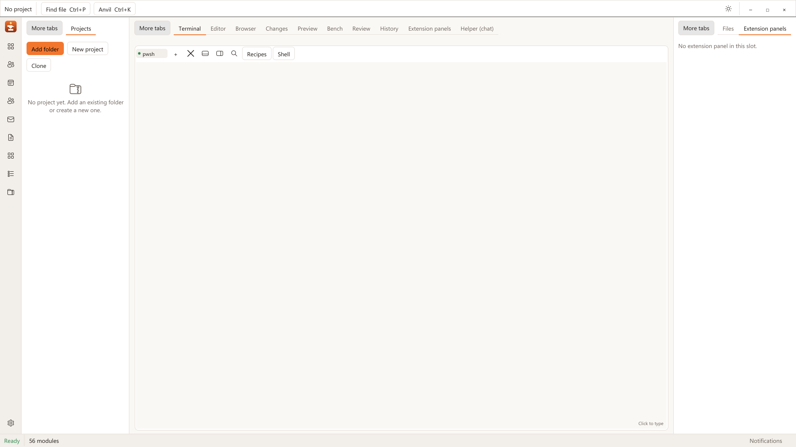

state: en.light.right-tab.extension.panels.right
capture_sha: (ver manifesto da captura)
model: opencode/glm-5.3-flash-free
---

# Painel de extensões (slot direito) — variante en / tema light

Tela principal da Forja no estado inicial (nenhum projeto aberto), com o painel direito exibindo o slot "Extension panels", vazio. Variante em inglês e tema claro da página de referência (pt-BR.dark): a estrutura é a mesma; mudam os textos (tradução para inglês), as cores (tema claro) e o layout desta captura é 1920×1080, o que faz todas as abas caberem nas faixas — inclusive a aba ativa "Extension panels" do painel direito, visível nesta variante.

## Como chegar
Abrir o app com o painel direito apontado para o slot de painéis de extensão: `forja-app --locale en --theme light --right-tab extension.panels.right`. Na interface, clicando na aba "Extension panels" da faixa de abas do painel direito, à direita da aba "Files".

## Regiões
- **Barra superior** (0,0)–(1920,42): rótulo "No project" à esquerda; botões "Find file  Ctrl+P" e "Anvil  Ctrl+K"; ícone de tema (sol) e botões de janela (–, □, ×) à direita.
- **Trilho de ícones à esquerda** (0,42)–(48,1048): logotipo da Forja (bigorna laranja) e, de cima para baixo, os botões "Board", "Helpers", "Routines", "Muster", "Requests", "Skills", "Usage", "Extensions", "Archive" e, no rodapé do trilho, "Settings".
- **Painel esquerdo** (48,42)–(304,1048): faixa de abas com "More tabs" e "Projects" (ativa, sublinhada); botões "Add folder" (destaque laranja), "New project" e "Clone"; estado vazio com ícone de pasta e o texto "No project yet. Add an existing folder or create a new one.".
- **Divisor vertical 1** (304,42)–(320,1048): separador redimensionável entre o painel esquerdo e a área central.
- **Área central** (320,42)–(1616,1048): faixa de abas ("More tabs", "Terminal" ativa, "Editor", "Browser", "Changes", "Preview", "Bench", "Review", "History", "Extension panels" e "Helper (chat)"); barra de ferramentas do terminal com a aba "pwsh · Running" (bolinha verde), "+", ícones de fechar/dividir/maximizar/busca e os botões "Recipes" e "Shell"; área do terminal vazia com a dica "Click to type" no canto inferior direito.
- **Divisor vertical 2** (1616,42)–(1632,1048): separador entre a área central e o painel direito.
- **Painel direito** (1632,42)–(1920,1048): faixa de abas com "More tabs", "Files" e "Extension panels" (ativa, sublinhada); mensagem "No extension panel in this slot." indicando o slot vazio.
- **Barra de status** (0,1048)–(1920,1080): "Ready" em verde à esquerda, "56 modules" em seguida e "Notifications" à direita.

## Elementos
| Elemento | Tipo | Posição (px) | Estado | O que faz |
|---|---|---|---|---|
| "Find file  Ctrl+P" | Button | (99,5)–(218,37) | — | Abre a busca rápida de arquivos (atalho Ctrl+P) |
| "Anvil  Ctrl+K" | Button | (226,5)–(327,37) | — | Abre a paleta de comandos (atalho Ctrl+K) |
| (sem nome acessível) | Unknown | (1741,5)–(1773,37) | — | Ícone de sol na barra superior: alterna tema claro/escuro |
| "–" | Button | (1795,5)–(1827,37) | — | Minimiza a janela |
| "□" | Button | (1835,5)–(1867,37) | — | Maximiza/restaura a janela |
| "×" | Button | (1875,5)–(1909,37) | — | Fecha a janela |
| "No project" | Label | (11,12)–(77,31) | — | Indica que nenhum projeto está aberto |
| (sem nome acessível) | Unknown | (304,42)–(320,1048) | — | Divisor vertical entre painel esquerdo e área central (arrastar redimensiona) |
| (sem nome acessível) | Unknown | (1616,42)–(1632,1048) | — | Divisor vertical entre área central e painel direito |
| (sem nome acessível) | Image | (12,50)–(40,78) | — | Logotipo da Forja (bigorna laranja) no topo do trilho |
| "More tabs" | Button | (64,50)–(151,85) | — | Lista as abas ocultas da faixa do painel esquerdo (as demais abas do painel não cabem visíveis) |
| "More tabs" | Button | (324,50)–(411,85) | — | Primeiro item da faixa de abas da área central; lista abas adicionais |
| "More tabs" | Button | (1636,50)–(1723,85) | — | Primeiro item da faixa de abas do painel direito; lista abas adicionais |
| "Projects" | Button | (159,52)–(231,84) | marcado=True | Aba ativa do painel esquerdo; mostra a lista de projetos |
| "Terminal" | Button | (419,52)–(496,84) | marcado=True | Aba ativa da área central; mostra o terminal |
| "Editor" | Button | (496,52)–(556,84) | marcado=False | Aba da área central; mostra o editor |
| "Browser" | Button | (556,52)–(629,84) | marcado=False | Aba da área central; mostra o navegador |
| "Changes" | Button | (629,52)–(706,84) | marcado=False | Aba da área central; mostra diff de arquivos |
| "Preview" | Button | (706,52)–(777,84) | marcado=False | Aba da área central; visualiza arquivos |
| "Bench" | Button | (777,52)–(838,84) | marcado=False | Aba da área central; mostra a visão da bancada |
| "Review" | Button | (838,52)–(905,84) | marcado=False | Aba da área central; revisão de mudanças |
| "History" | Button | (905,52)–(973,84) | marcado=False | Aba da área central; histórico da bancada |
| "Extension panels" | Button | (973,52)–(1099,84) | marcado=False | Aba da área central; painéis de extensão na área central |
| "Helper (chat)" | Button | (1099,52)–(1202,84) | marcado=False | Aba da área central; chat com o ajudante |
| "Files" | Button | (1731,52)–(1782,84) | marcado=False | Aba do painel direito; lista de arquivos |
| "Extension panels" | Button | (1782,52)–(1908,84) | marcado=True | Aba ativa do slot direito; mostra os painéis de extensão — visível e dentro da janela nesta variante |
| "Board" | Button | (8,94)–(44,130) | marcado=False | Item do trilho: quadro geral do app |
| "Add folder" | Button | (64,101)–(154,133) | — | Botão em destaque laranja: adiciona uma pasta de projeto |
| "New project" | Button | (162,101)–(261,133) | — | Cria um projeto novo |
| "No extension panel in this slot." | Label | (1636,101)–(1825,120) | — | Mensagem de estado vazio do slot direito |
| "+" | Button | (407,113)–(441,145) | — | Abre um novo terminal |
| (sem nome acessível) | Unknown | (444,113)–(476,145) | — | Ícone X: fecha o terminal atual |
| (sem nome acessível) | Unknown | (479,113)–(511,145) | — | Ícone de dividir terminal |
| (sem nome acessível) | Unknown | (514,113)–(546,145) | — | Ícone de maximizar o painel do terminal |
| (sem nome acessível) | Unknown | (549,113)–(581,145) | — | Ícone de lupa: busca no terminal |
| "Recipes" | Button | (584,113)–(655,145) | — | Lista de receitas do terminal |
| "Shell" | Button | (658,113)–(711,145) | — | Seletor de shell/perfil do terminal |
| "pwsh · Running" | Button | (328,118)–(404,140) | — | Aba do terminal "pwsh" com indicador de execução |
| "Close pwsh" | Button | (385,121)–(401,137) | — | Controle de fechar (X) dentro da aba "pwsh · Running" |
| "Helpers" | Button | (8,138)–(44,174) | marcado=False | Item do trilho: lista de ajudantes (agentes de IA) |
| "Clone" | Button | (64,141)–(123,173) | — | Clona um repositório para começar um projeto |
| (sem nome acessível) | Unknown | (328,150)–(1608,1036) | — | Área de conteúdo do terminal, vazia; exibe a dica "Click to type" no canto inferior direito |
| "Routines" | Button | (8,182)–(44,218) | marcado=False | Item do trilho: rotinas/tarefas |
| (ícone) | Label | (168,201)–(196,229) | — | Ícone de pasta do estado vazio do painel esquerdo |
| "Muster" | Button | (8,226)–(44,262) | marcado=False | Item do trilho: mutirão de ajudantes |
| "No project yet. Add an existing folder or create a new one." | Label | (67,237)–(297,275) | — | Mensagem de estado vazio do painel esquerdo |
| "Requests" | Button | (8,270)–(44,306) | marcado=False | Item do trilho: pedidos |
| "Skills" | Button | (8,314)–(44,350) | marcado=False | Item do trilho: skills dos ajudantes |
| "Usage" | Button | (8,358)–(44,394) | marcado=False | Item do trilho: uso de recursos |
| "Extensions" | Button | (8,402)–(44,438) | marcado=False | Item do trilho: extensões instaladas |
| "Archive" | Button | (8,446)–(44,482) | marcado=False | Item do trilho: acervo de conteúdo |
| "Settings" | Button | (8,1004)–(44,1040) | marcado=False | Item do trilho: abre os ajustes |
| "Ready" | Label | (10,1055)–(48,1074) | — | Status geral na barra de status, em verde |
| "56 modules" | Label | (70,1055)–(142,1074) | — | Quantidade de módulos carregados |
| "Notifications" | Label | (1808,1055)–(1886,1074) | — | Atalho/indicador de notificações na barra de status |

## Aparência
Tema claro: fundo geral creme/off-white, painéis levemente destacados por bordas finas cinza-claras; texto em cinza-escuro com bom contraste. Cor de destaque laranja (identidade "Brasa") no logotipo, no botão "Add folder" (fundo laranja sólido) e no sublinhado das abas ativas ("Projects", "Terminal", "Extension panels"). Bolinha verde indica o terminal "pwsh · Running" e "Ready" aparece em verde na barra de status. Tipografia sans-serif de tamanho uniforme; botões "New project", "Clone", "Recipes", "Shell" e as abas usam contornos arredondados discretos. Diferenças em relação à referência (pt-BR, dark): fundo e textos invertidos (superfícies claras em vez de marrom-escuro), textos em inglês e, por a janela ter 1920 px de largura, as faixas de abas não se sobrepõem nem cortam texto — a aba do painel esquerdo oculta entra no menu "More tabs" em vez de transbordar.

## Problemas encontrados
- Três botões com o mesmo nome acessível "More tabs" (64,50), (324,50) e (1636,50), em painéis diferentes; para leitores de tela não fica claro a qual faixa de abas cada um pertence.
- Botão de tema na barra superior (1741,5)–(1773,37) sem nome acessível; mesmo problema nos ícones de fechar/dividir/maximizar/busca do terminal (444–581,113) e nos divisores de painéis.
- Nome acessível "(ícone)" no rótulo do ícone de pasta (168,201)–(196,229) não descreve o elemento.
- Botões de janela nomeados apenas com os símbolos "–", "□" e "×", sem rótulos descritivos.
- "Close pwsh" (385,121)–(401,137) é um alvo de clique de apenas 16×16 px sobreposto à aba "pwsh · Running" (328,118)–(404,140); alvo pequeno para ponteiro e toque.
- O painel esquerdo exibe apenas a aba "Projects", com as demais abas do painel recolhidas no "More tabs"; quem procura a aba de bancadas/painéis de extensão à esquerda não a encontra visível.
