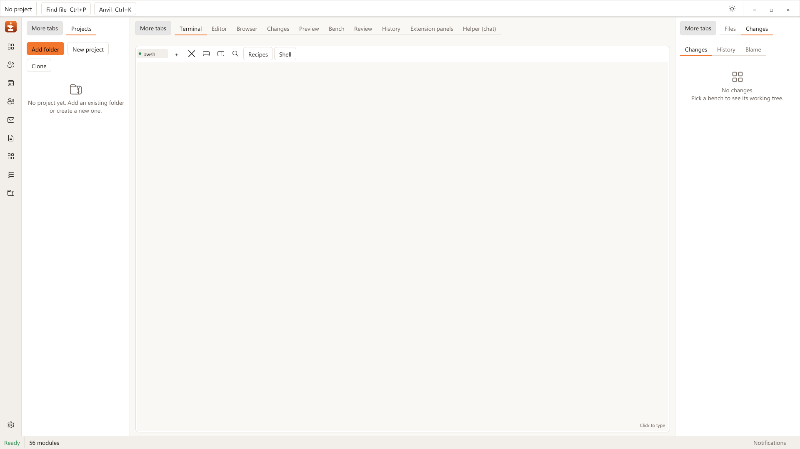

# Tela principal — painel direito "Changes" (git.changes)

Tela principal do app com o painel direito aberto na aba "Changes" (git), mostrando estado vazio porque nenhuma bancada está selecionada. Variante en, tema light, layout "right-tab" com alvo "git.changes" — a estrutura é a mesma da página de referência (pt-BR, dark); mudam o idioma dos textos, as cores do tema, o tamanho da janela (1920×1080 em vez de 1280×800) e detalhes da árvore apontados abaixo (aqui as abas do painel esquerdo aparecem recolhidas no botão "More tabs" e o chip do terminal tem nomes acessíveis próprios).

## Como chegar
Na janela principal, clique em "Changes" na faixa de abas do topo do painel direito (à direita de "Files"). A subaba "Changes" já vem selecionada. Comando de captura: `forja-app --locale en --theme light --right-tab git.changes` (imagem: `captures/en.light.right-tab.git.changes.png`, 1920×1080 px, escala 1.0).

## Regiões
- **Barra superior** (0,0)–(1920,42): seletor de projeto "No project", botões "Find file  Ctrl+P" e "Anvil  Ctrl+K", e à direita o alternador de tema (ícone de sol) e os botões de janela "–", "□", "×".
- **Trilho à esquerda** (0,42)–(52,1048): coluna de ícones de navegação — "Board", "Helpers", "Routines", "Muster", "Requests", "Skills", "Usage", "Extensions", "Archive" e, no rodapé, "Settings"; o logotipo da Forja (bigorna laranja) no topo.
- **Painel esquerdo** (52,42)–(304,1048): botão "More tabs" e a aba "Projects" (ativa, com sublinhado laranja); ao contrário da referência, as demais abas do painel estão recolhidas em "More tabs"; ações "Add folder" (destaque laranja), "New project" e "Clone"; estado vazio com ícone de pasta e o texto "No project yet. Add an existing folder or create a new one.".
- **Divisor** (304,42)–(320,1048): separador vertical arrastável entre o painel esquerdo e a área central.
- **Área central** (320,42)–(1612,1048): faixa com "More tabs" e as abas "Terminal" (ativa), "Editor", "Browser", "Changes", "Preview", "Bench", "Review", "History", "Extension panels" e "Helper (chat)"; barra do terminal com o chip "pwsh · Running" (ponto verde, com "Close pwsh" dentro), botão "+", quatro botões de ícone sem nome e os chips "Recipes" e "Shell"; abaixo, o terminal vazio com a dica "Click to type" no canto inferior direito.
- **Divisor** (1612,42)–(1628,1048): separador vertical entre a área central e o painel direito.
- **Painel direito** (1628,42)–(1920,1048): botão "More tabs" e abas "Files" e "Changes" (ativa); subabas "Changes" (ativa), "History" e "Blame"; estado vazio com ícone de grade e o texto "No changes. Pick a bench to see its working tree.".
- **Barra de status** (0,1048)–(1920,1080): "Ready" em verde à esquerda, "56 modules" ao lado e "Notifications" à direita.

## Elementos
| Elemento | Tipo | Posição (px) | Estado | O que faz |
|---|---|---|---|---|
| "Find file  Ctrl+P" | Button | (99,5)–(218,37) | — | Abre a busca rápida de arquivos (atalho Ctrl+P). |
| "Anvil  Ctrl+K" | Button | (226,5)–(327,37) | — | Abre a paleta de comandos "Anvil" (atalho Ctrl+K). |
| (sem nome acessível) | Unknown | (1741,5)–(1773,37) | — | Ícone de sol: alterna tema claro/escuro. |
| "–" | Button | (1795,5)–(1827,37) | — | Minimiza a janela. |
| "□" | Button | (1835,5)–(1867,37) | — | Maximiza/restaura a janela. |
| "×" | Button | (1875,5)–(1909,37) | — | Fecha a janela. |
| "No project" | Label | (11,12)–(77,31) | — | Indicador do projeto ativo na barra superior (chip clicável). |
| (sem nome acessível) | Unknown | (304,42)–(320,1048) | — | Divisor vertical entre painel esquerdo e área central. |
| (sem nome acessível) | Unknown | (1612,42)–(1628,1048) | — | Divisor vertical entre área central e painel direito. |
| (sem nome acessível) | Image | (12,50)–(40,78) | — | Logotipo da Forja (bigorna laranja) no topo do trilho. |
| "More tabs" | Button | (64,50)–(151,85) | — | Botão da faixa de abas do painel esquerdo: revela as abas restantes. |
| "More tabs" | Button | (324,50)–(411,85) | — | Botão da faixa de abas da área central: revela as abas restantes. |
| "More tabs" | Button | (1632,50)–(1719,85) | — | Botão da faixa de abas do painel direito: revela as abas restantes. |
| "Projects" | Button | (159,52)–(231,84) | marcado=True | Aba ativa do painel esquerdo; mostra a lista de projetos. |
| "Terminal" | Button | (419,52)–(496,84) | marcado=True | Aba ativa da área central; mostra o terminal integrado. |
| "Editor" | Button | (496,52)–(556,84) | marcado=False | Aba do editor de arquivos. |
| "Browser" | Button | (556,52)–(629,84) | marcado=False | Aba do navegador. |
| "Changes" | Button | (629,52)–(706,84) | marcado=False | Aba da área central para visualização de difusões. |
| "Preview" | Button | (706,52)–(777,84) | marcado=False | Aba do visualizador/pré-visualização. |
| "Bench" | Button | (777,52)–(838,84) | marcado=False | Aba da bancada. |
| "Review" | Button | (838,52)–(905,84) | marcado=False | Aba de revisão. |
| "History" | Button | (905,52)–(973,84) | marcado=False | Aba de histórico da faixa central. |
| "Extension panels" | Button | (973,52)–(1099,84) | marcado=False | Aba dos painéis de extensão da faixa central. |
| "Helper (chat)" | Button | (1099,52)–(1202,84) | marcado=False | Aba do chat do ajudante. |
| "Files" | Button | (1727,52)–(1778,84) | marcado=False | Aba do painel de arquivos. |
| "Changes" | Button | (1778,52)–(1855,84) | marcado=True | Aba ativa do painel direito; mostra as mudanças (git) da bancada. |
| "Board" | Button | (8,94)–(44,130) | marcado=False | Ícone do trilho: abre o quadro. |
| "Add folder" | Button | (64,101)–(154,133) | — | Ação destacada em laranja: adiciona uma pasta de projeto. |
| "New project" | Button | (162,101)–(261,133) | — | Cria um novo projeto. |
| "Changes" | Button | (1632,101)–(1709,133) | marcado=True | Subaba ativa do painel de git: lista de mudanças. |
| "History" | Button | (1709,101)–(1777,133) | marcado=False | Subaba de histórico de commits. |
| "Blame" | Button | (1777,101)–(1838,133) | marcado=False | Subaba de blame. |
| "+" | Button | (407,113)–(441,145) | — | Nova instância/aba de terminal. |
| (sem nome acessível) | Unknown | (444,113)–(476,145) | — | Ícone "X": fecha o terminal/painel atual. |
| (sem nome acessível) | Unknown | (479,113)–(511,145) | — | Ícone de retângulo cheio: alterna modo de preenchimento/divisão do painel. |
| (sem nome acessível) | Unknown | (514,113)–(546,145) | — | Ícone de retângulo dividido: divide o terminal. |
| (sem nome acessível) | Unknown | (549,113)–(581,145) | — | Ícone de lupa: busca no terminal. |
| "Recipes" | Button | (584,113)–(655,145) | — | Chip que abre a lista de receitas do terminal. |
| "Shell" | Button | (658,113)–(711,145) | — | Chip para escolher/trocar o shell. |
| "pwsh · Running" | Button | (328,118)–(404,140) | — | Chip da sessão "pwsh" com ponto verde (sessão em execução). |
| "Close pwsh" | Button | (385,121)–(401,137) | — | Botão dentro do chip: fecha a sessão "pwsh". |
| "Helpers" | Button | (8,138)–(44,174) | marcado=False | Ícone do trilho: abre a lista de ajudantes. |
| (sem nome acessível) | Unknown | (328,150)–(1604,1036) | — | Área do terminal, vazia; dica "Click to type" no canto inferior direito. |
| (ícone) | Label | (1756,171)–(1784,199) | — | Ícone de grade (quatro quadrados) do estado vazio do painel direito. |
| "Routines" | Button | (8,182)–(44,218) | marcado=False | Ícone do trilho: abre rotinas. |
| (ícone) | Label | (168,201)–(196,229) | — | Ícone de pasta do estado vazio do painel esquerdo. |
| "No changes. Pick a bench to see its working tree." | Label | (1660,207)–(1881,245) | — | Mensagem de estado vazio das mudanças (git). |
| "Muster" | Button | (8,226)–(44,262) | marcado=False | Ícone do trilho: abre o mutirão. |
| "No project yet. Add an existing folder or create a new one." | Label | (67,237)–(297,275) | — | Mensagem de estado vazio da lista de projetos. |
| "Requests" | Button | (8,270)–(44,306) | marcado=False | Ícone do trilho: abre pedidos. |
| "Skills" | Button | (8,314)–(44,350) | marcado=False | Ícone do trilho: abre skills. |
| "Usage" | Button | (8,358)–(44,394) | marcado=False | Ícone do trilho: abre uso. |
| "Extensions" | Button | (8,402)–(44,438) | marcado=False | Ícone do trilho: abre extensões. |
| "Archive" | Button | (8,446)–(44,482) | marcado=False | Ícone do trilho: abre o acervo. |
| "Settings" | Button | (8,1004)–(44,1040) | marcado=False | Ícone do trilho (rodapé): abre os ajustes. |
| "Ready" | Label | (10,1055)–(48,1074) | — | Status geral na barra de status, em verde. |
| "56 modules" | Label | (70,1055)–(142,1074) | — | Contador de módulos carregados. |
| "Notifications" | Label | (1808,1055)–(1886,1074) | — | Abre notificações, à direita da barra de status. |

## Aparência
Tema claro de fundo creme/off-white em toda a janela, com texto escuro; a área do terminal é um retângulo com tom levemente mais claro e borda sutil. A cor de destaque é o laranja (Brasa), usada no logotipo, no botão "Add folder", nos sublinhados das abas ativas ("Projects", "Terminal", "Changes" do painel direito e a subaba "Changes"); o ponto verde do chip "pwsh · Running" indica sessão ativa e "Ready" aparece em verde na barra de status. Tipografia sem serifa de ~13–14 px em rótulos de abas, botões e status; as mensagens de estado vazio têm ~14 px em cinza médio, centralizadas, com ícone acima (~28 px). Abas inativas ficam em cinza médio sem sublinhado; chips ("pwsh · Running", "Recipes", "Shell") são pequenos retângulos arredondados com borda sutil; ícones do trilho são alvos quadrados de 36 px alinhados em x 8–44, como na referência. O painel central é dominado pela área vazia do terminal (região 328–1604 × 150–1036).

## Problemas encontrados
- Botões de janela rotulados apenas com os caracteres "–", "□" e "×" como nome acessível.
- Alternador de tema (1741,5)–(1773,37) sem nome acessível e com papel "Unknown".
- Os três botões "More tabs" ((64,50)–(151,85), (324,50)–(411,85) e (1632,50)–(1719,85)) compartilham o mesmo nome acessível em regiões diferentes; o mesmo vale para "Changes" (três ocorrências) e "History" (duas), o que é ambíguo para leitores de tela.
- "Close pwsh" (385,121)–(401,137) fica dentro do botão "pwsh · Running" (328,118)–(404,140) (botões aninhados/sobrepostos) e tem alvo pequeno (16×16 px).
- Os quatro botões de ícone da barra do terminal ((444,113)–(476,145), (479,113)–(511,145), (514,113)–(546,145) e (549,113)–(581,145)) não têm nome acessível.
- Divisores verticais ((304,42)–(320,1048) e (1612,42)–(1628,1048)), a área do terminal (328,150)–(1604,1036) e o logotipo (12,50)–(40,78) sem nome acessível.
- A dica "Click to type" (≈1536,1016–1601,1030), visível na imagem dentro do terminal, não tem entrada na árvore de acessibilidade.
- Abas inativas e textos de estado vazio em cinza médio sobre fundo creme (por exemplo "Editor", "Browser", "Preview") têm contraste moderado/baixo.
