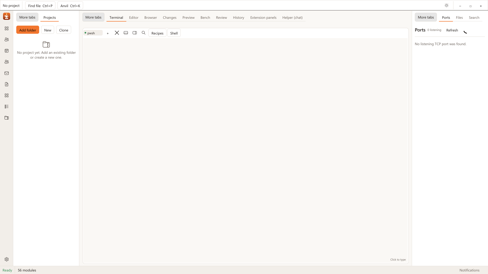

state: en.light.right-tab.ports.panel
capture_sha: en.light.right-tab.ports.panel
model: opencode/glm-5.3-flash-free
---

# Painel Portas (aba lateral direita)

Tela do painel "Ports", que lista as portas TCP em escuta detectadas no ambiente de trabalho; nesta captura nenhuma porta foi encontrada. Variante em inglês com tema claro da página de referência (pt-BR, tema escuro); a estrutura é a mesma e mudam os textos (em inglês) e as cores.

## Como chegar
Na janela principal do Forja, clique na aba **"Ports"** na linha de abas do painel lateral direito (à direita de **"Search"**). A captura foi gerada com o comando `forja-app --locale en --theme light --right-tab ports.panel`.

## Regiões
- **Barra superior (barra de título)** — (0,0)–(1920,42): rótulo do projeto atual ("No project"), botões "Find file  Ctrl+P" e "Anvil  Ctrl+K", botão-ícone de tema (sol) e os controles de janela "–", "□", "×".
- **Trilho à esquerda** — (0,42)–(52,1048): logotipo da Forja no topo e botões-ícone verticais "Board", "Helpers", "Routines", "Muster", "Requests", "Skills", "Usage", "Extensions", "Archive" e, na base, "Settings".
- **Painel lateral esquerdo (Projects)** — (52,42)–(304,1048): aba "Projects" ativa (as demais abas ficam recolhidas em "More tabs"); botões "Add folder", "New project" e "Clone"; estado vazio com ícone de pasta e o texto "No project yet. Add an existing folder or create a new one.".
- **Área central (Terminal)** — (320,42)–(1612,1048): linha de abas ("Terminal", "Editor", "Browser", "Changes", "Preview", "Bench", "Review", "History", "Extension panels", "Helper (chat)"); barra do terminal com o chip "pwsh · Running", "+", ícones de fechar/dividir/sessão/busca e botões "Recipes" e "Shell"; superfície do terminal vazia com o aviso "Click to type" no canto inferior direito.
- **Painel lateral direito (Ports)** — (1628,42)–(1920,1048): abas "Files", "Search" e "Ports" (ativa), com as demais recolhidas em "More tabs"; cabeçalho "Ports" com o contador "0 listening", o botão "Refresh" e um indicador de giro ao lado; campo de filtro "Filter port, process, or bench…", opção "Show all system ports" e a mensagem "No listening TCP port was found.".
- **Barra de status** — (0,1048)–(1920,1080): "Ready" (em tom verde de destaque), "56 modules" à esquerda e "Notifications" à direita.

## Elementos
| Elemento | Tipo | Posição (px) | Estado | O que faz |
|---|---|---|---|---|
| "Find file  Ctrl+P" | Button | (99,5)–(218,37) | click,focus | Abre a busca rápida de arquivos (atalho Ctrl+P). |
| "Anvil  Ctrl+K" | Button | (226,5)–(327,37) | click,focus | Abre a paleta de comandos "Anvil" (atalho Ctrl+K). |
| (sem nome acessível) | Unknown | (1741,5)–(1773,37) | click,focus | Botão-ícone de alternância de tema (sol), à esquerda dos controles de janela. |
| "–" | Button | (1795,5)–(1827,37) | click,focus | Minimiza a janela. |
| "□" | Button | (1835,5)–(1867,37) | click,focus | Restaura/maximiza a janela. |
| "×" | Button | (1875,5)–(1909,37) | click,focus | Fecha a janela. |
| "No project" | Label | (11,12)–(77,31) | click,focus | Indica o projeto atual na barra de título; sem projeto aberto. |
| (sem nome acessível) | Unknown | (304,42)–(320,1048) | focus | Divisor vertical arrastável entre o painel esquerdo e a área central. |
| (sem nome acessível) | Unknown | (1612,42)–(1628,1048) | focus | Divisor vertical arrastável entre a área central e o painel direito. |
| (sem nome acessível) | Image | (12,50)–(40,78) | click,focus | Logotipo da Forja (bigorna sobre quadrado laranja) no topo do trilho. |
| "More tabs" | Button | (64,50)–(151,85) | click,focus | Recolhe as abas restantes do painel esquerdo em um menu. |
| "More tabs" | Button | (324,50)–(411,85) | click,focus | Recolhe as abas restantes da área central em um menu. |
| "More tabs" | Button | (1632,50)–(1719,85) | click,focus | Recolhe as abas restantes do painel direito em um menu. |
| "Projects" | Button | (159,52)–(231,84) | click,focus, marcado=True | Aba ativa do painel esquerdo; mostra a lista de projetos. |
| "Terminal" | Button | (419,52)–(496,84) | click,focus, marcado=True | Aba ativa da área central; mostra o terminal. |
| "Editor" | Button | (496,52)–(556,84) | click,focus, marcado=False | Aba que troca a área central para o editor. |
| "Browser" | Button | (556,52)–(629,84) | click,focus, marcado=False | Aba que troca a área central para o navegador de arquivos. |
| "Changes" | Button | (629,52)–(706,84) | click,focus, marcado=False | Aba que troca a área central para a visualização de diferenças. |
| "Preview" | Button | (706,52)–(777,84) | click,focus, marcado=False | Aba que troca a área central para o visualizador. |
| "Bench" | Button | (777,52)–(838,84) | click,focus, marcado=False | Aba que troca a área central para a bancada. |
| "Review" | Button | (838,52)–(905,84) | click,focus, marcado=False | Aba que troca a área central para a revisão. |
| "History" | Button | (905,52)–(973,84) | click,focus, marcado=False | Aba que troca a área central para o histórico. |
| "Extension panels" | Button | (973,52)–(1099,84) | click,focus, marcado=False | Aba extra da área central para painéis de extensões. |
| "Helper (chat)" | Button | (1099,52)–(1202,84) | click,focus, marcado=False | Aba da área central que abre o chat do ajudante. |
| "Files" | Button | (1727,52)–(1778,84) | click,focus, marcado=False | Aba do painel direito que mostra arquivos. |
| "Search" | Button | (1778,52)–(1843,84) | click,focus, marcado=False | Aba do painel direito que abre a busca. |
| "Ports" | Button | (1843,52)–(1898,84) | click,focus, marcado=True | Aba ativa do painel direito; mostra esta tela de portas em escuta. |
| "Board" | Button | (8,94)–(44,130) | click,focus, marcado=False | Botão-ícone do trilho que abre o quadro. |
| "Add folder" | Button | (64,101)–(154,133) | click,focus | Botão primário laranja; abre o seletor para adicionar uma pasta de projeto. |
| "New project" | Button | (162,101)–(261,133) | click,focus | Cria um novo projeto. |
| "Ports" | Label | (1632,101)–(1674,133) | click | Título do painel atual. |
| "0 listening" | Label | (1681,101)–(1736,133) | click | Contador de portas TCP detectadas; zero nesta captura. |
| "Refresh" | Button | (1744,101)–(1814,133) | click,focus | Repete a detecção de portas em escuta; a cada clique aparece um pequeno indicador de giro ao lado. |
| "+" | Button | (407,113)–(441,145) | click,focus | Abre uma nova sessão/aba de terminal. |
| (sem nome acessível) | Unknown | (444,113)–(476,145) | click,focus | Botão-ícone fechar (X) da sessão atual. |
| (sem nome acessível) | Unknown | (479,113)–(511,145) | click,focus | Botão-ícone de dividir o terminal. |
| (sem nome acessível) | Unknown | (514,113)–(546,145) | click,focus | Botão-ícone de sessão/aba (retângulo). |
| (sem nome acessível) | Unknown | (549,113)–(581,145) | click,focus | Botão-ícone de busca no terminal (lupa). |
| "Recipes" | Button | (584,113)–(655,145) | click,focus | Lista de receitas de comandos para o terminal. |
| "Shell" | Button | (658,113)–(711,145) | click,focus | Seletor do shell da sessão. |
| "pwsh · Running" | Button | (328,118)–(404,140) | click,focus | Chip da sessão ativa "pwsh", com ponto verde de status. |
| "Close pwsh" | Button | (385,121)–(401,137) | click,focus | Fecha a sessão pwsh; fica dentro do chip da sessão. |
| "Helpers" | Button | (8,138)–(44,174) | click,focus, marcado=False | Botão-ícone do trilho que abre a lista de ajudantes. |
| "Clone" | Button | (64,141)–(123,173) | click,focus | Abre o fluxo de clonagem de repositório. |
| (sem nome acessível) | TextInput | (1632,145)–(1908,177) | click,focus | Campo de filtro da lista de portas, com o placeholder "Filter port, process, or bench…". |
| (sem nome acessível) | Unknown | (328,150)–(1604,1036) | click,focus | Superfície do terminal, vazia; clique concentra o cursor ("Click to type"). |
| "Routines" | Button | (8,182)–(44,218) | click,focus, marcado=False | Botão-ícone do trilho que abre rotinas. |
| "Show all system ports" | CheckBox | (1632,189)–(1814,213) | click,focus, marcado=False | Alterna a exibição de portas de sistema na lista. |
| (ícone) | Label | (168,201)–(196,229) | click | Ícone de pasta do estado vazio da lista de projetos. |
| "Muster" | Button | (8,226)–(44,262) | click,focus, marcado=False | Botão-ícone do trilho que abre o mutirão. |
| "No project yet. Add an existing folder or create a new one." | Label | (67,237)–(297,275) | click | Mensagem de estado vazio da lista de projetos. |
| "No listening TCP port was found." | Label | (1632,243)–(1834,262) | click | Mensagem de estado vazio do painel de portas. |
| "Requests" | Button | (8,270)–(44,306) | click,focus, marcado=False | Botão-ícone do trilho que abre pedidos. |
| "Skills" | Button | (8,314)–(44,350) | click,focus, marcado=False | Botão-ícone do trilho que abre skills. |
| "Usage" | Button | (8,358)–(44,394) | click,focus, marcado=False | Botão-ícone do trilho que abre o uso de recursos. |
| "Extensions" | Button | (8,402)–(44,438) | click,focus, marcado=False | Botão-ícone do trilho que abre extensões. |
| "Archive" | Button | (8,446)–(44,482) | click,focus, marcado=False | Botão-ícone do trilho que abre o acervo. |
| "Settings" | Button | (8,1004)–(44,1040) | click,focus, marcado=False | Botão-ícone do trilho que abre os ajustes, fixado na base. |
| "Ready" | Label | (10,1055)–(48,1074) | click | Estado geral do app na barra de status. |
| "56 modules" | Label | (70,1055)–(142,1074) | click | Quantidade de módulos carregados. |
| "Notifications" | Label | (1808,1055)–(1886,1074) | click,focus | Área de notificações na barra de status. |

## Aparência
Tema claro quente: fundo creme/off-white nas barras, no trilho e nos painéis, com a área central do terminal em um tom levemente mais escuro que o restante. Acento laranja ("Brasa") no botão primário "Add folder", no logotipo e no sublinhado das abas ativas "Projects", "Terminal" e "Ports"; os botões secundários têm contorno fino cinza e fundo branco. Texto em cinza-escuro com contraste bom nos rótulos principais; "Ready" na barra de status aparece em tom verde de destaque (na referência escura era alaranjado). Ponto verde indica a sessão "pwsh · Running" ativa. Tipografia sem serifa de tamanho médio (~19 px nesta escala) nos botões e rótulos, com atalhos ("Ctrl+P", "Ctrl+K") em tom mais apagado; cantos arredondados moderados em botões e chips; o trilho de ícones tem 36 px de largura útil, alinhado ao centro, e a barra de status é uma faixa fina e contínua na base.

## Problemas encontrados
- Botões sem nome acessível: alternância de tema (1741,5)–(1773,37) e os quatro ícones da barra do terminal (fechar, dividir, sessão, busca).
- O campo de filtro do painel de portas (1632,145)–(1908,177) é um TextInput sem nome acessível; só o placeholder o identifica.
- A superfície do terminal (328,150)–(1604,1036) e o logotipo (12,50)–(40,78) não têm nome acessível.
- O rótulo "(ícone)" do estado vazio (168,201)–(196,229) não tem nome acessível significativo.
- O botão "Close pwsh" (385,121)–(401,137) fica dentro do chip "pwsh · Running" (328,118)–(404,140): um botão aninhado dentro de outro, com alvos de clique sobrepostos.
- "No project" (11,12)–(77,31) e "Notifications" (1808,1055)–(1886,1074) são Labels, mas expõem ações de clique e foco, papel incoerente com o tipo.
- Três abas aparecem simultaneamente com marcado=True ("Projects", "Terminal" e "Ports"), o que torna ambíguo qual painel está de fato selecionado.
