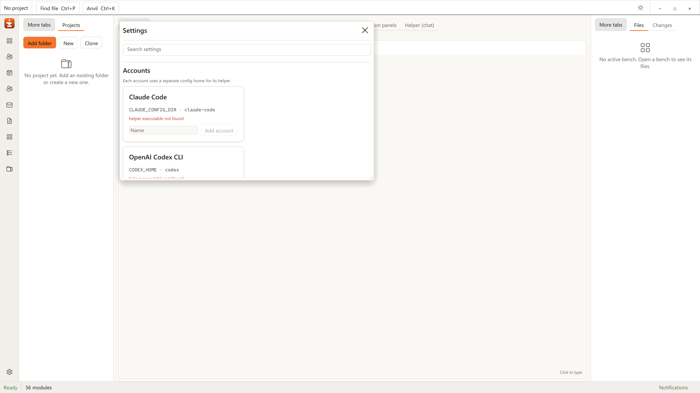

# Settings — Accounts

Janela modal de configurações aberta na seção "Accounts", onde se registram os ajudantes de código (agentes de IA) usados nos projetos.

## Como chegar
No app: clicar no botão "Settings" (ícone de engrenagem no rodapé do trilho à esquerda) e abrir a seção "Accounts". Comando de captura: `forja-app --locale en --theme light --settings accounts`.

Diferente da referência pt-BR/dark, o painel esquerdo mostra só a aba "Projects", com as demais recolhidas no botão "More tabs"; o mesmo vale para a área central e o painel direito. A janela modal é mais baixa ((328,58)–(1026,496) contra (328,58)–(1026,571) na referência) e corta o final do segundo cartão de conta. Também aparece aqui a aba de terminal "pwsh · Running" (com "Close pwsh"), escondida atrás do modal.

## Regiões
- **Barra superior (0,0)–(1920,42):** rótulo "No project", botões "Find file  Ctrl+P" e "Anvil  Ctrl+K", alternador de tema (ícone de sol, sem nome acessível) e os botões de janela "–", "□", "×".
- **Trilho à esquerda (0,42)–(48,1048):** logo do app (12,50)–(40,78) e uma coluna de ícones: "Board", "Helpers", "Routines", "Muster", "Requests", "Skills", "Usage", "Extensions", "Archive" e, no rodapé, "Settings".
- **Painel esquerdo (48,42)–(304,1048):** botão "More tabs", aba "Projects" (ativa), botões "Add folder" (destacado em laranja), "New project" e "Clone"; estado vazio com ícone de pasta e o texto "No project yet. Add an existing folder or create a new one.".
- **Área central (304,42)–(1612,1048):** botão "More tabs" e abas "Terminal" (ativa), "Editor", "Browser", "Changes", "Preview", "Bench", "Review", "History", "Extension panels" e "Helper (chat)"; barra de ferramentas ("+", "Recipes", "Shell") e aba "pwsh · Running" ficam cobertos pelo modal "Settings" (328,58)–(1026,496); abaixo do modal há uma área de texto com a dica "Click to type" no canto inferior direito.
- **Separadores verticais:** faixas estreitas em (304,42)–(320,1048) e (1612,42)–(1628,1048) dividem painel esquerdo, área central e painel direito.
- **Painel direito (1628,42)–(1920,1048):** botão "More tabs", abas "Files" (ativa) e "Changes"; estado vazio com ícone de grade ((ícone), (1756,117)–(1784,145)) e o texto "No active bench. Open a bench to see its files.".
- **Barra de status (0,1048)–(1920,1080):** "Ready" e "56 modules" à esquerda, "Notifications" à direita.

## Elementos
| Elemento | Tipo | Posição (px) | Estado | O que faz |
|---|---|---|---|---|
| "Find file  Ctrl+P" | Button | (99,5)–(218,37) | normal | Abre a busca de arquivos do projeto (atalho Ctrl+P). |
| "Anvil  Ctrl+K" | Button | (226,5)–(327,37) | normal | Abre a paleta de comandos (atalho Ctrl+K). |
| Ícone de sol, sem nome acessível | Desconhecido | (1741,5)–(1773,37) | normal | Alterna o tema (claro/escuro). |
| "–" | Button | (1795,5)–(1827,37) | normal | Minimiza a janela. |
| "□" | Button | (1835,5)–(1867,37) | normal | Maximiza/restaura a janela. |
| "×" | Button | (1875,5)–(1909,37) | normal | Fecha a janela. |
| "No project" | Label | (11,12)–(77,31) | normal | Mostra o projeto atualmente aberto (nenhum). |
| Sem nome acessível | Desconhecido | (304,42)–(320,1048) | focável | Separador arrastável entre painel esquerdo e área central. |
| Sem nome acessível | Desconhecido | (1612,42)–(1628,1048) | focável | Separador arrastável entre área central e painel direito. |
| Sem nome acessível | Desconhecido | (319,49)–(339,69) | focável | Alça de redimensionamento (canto superior esquerdo do modal). |
| Sem nome acessível | Desconhecido | (1016,49)–(1036,69) | focável | Alça de redimensionamento (canto superior direito do modal). |
| Logo do app, sem nome acessível | Image | (12,50)–(40,78) | clicável, focável | Marca visual da Forja (bigorna) no topo do trilho. |
| "More tabs" | Button | (64,50)–(151,85) | normal | Recolhe/expande as abas extras do painel esquerdo ("Bench", "Extension panels"). |
| "More tabs" | Button | (324,50)–(411,85) | normal | Recolhe/expande as abas extras da área central; coberto pelo modal. |
| "More tabs" | Button | (1632,50)–(1719,85) | normal | Recolhe/expandia as abas extras do painel direito. |
| Sem nome acessível | Desconhecido | (339,51)–(1016,67) | focável | Faixa de arraste do título do modal. |
| "Projects" | Button | (159,52)–(231,84) | marcado=True | Aba ativa do painel esquerdo; mostra a lista de projetos. |
| "Terminal" | Button | (419,52)–(496,84) | marcado=True | Aba ativa da área central; coberta pelo modal. |
| "Editor" | Button | (496,52)–(556,84) | marcado=False | Aba do editor; coberta pelo modal. |
| "Browser" | Button | (556,52)–(629,84) | marcado=False | Aba do navegador; coberta pelo modal. |
| "Changes" | Button | (629,52)–(706,84) | marcado=False | Aba de mudanças (git); coberta pelo modal. |
| "Preview" | Button | (706,52)–(777,84) | marcado=False | Aba de visualização; coberta pelo modal. |
| "Bench" | Button | (777,52)–(838,84) | marcado=False | Aba da bancada; coberta pelo modal. |
| "Review" | Button | (838,52)–(905,84) | marcado=False | Aba de revisão; coberta pelo modal. |
| "History" | Button | (905,52)–(973,84) | marcado=False | Aba de histórico; coberta pelo modal. |
| "Extension panels" | Button | (973,52)–(1099,84) | marcado=False | Aba de painéis de extensões da área central; início coberto pelo modal ("ion panels" visível). |
| "Helper (chat)" | Button | (1099,52)–(1202,84) | marcado=False | Aba do chat do ajudante; visível à direita do modal. |
| "Files" | Button | (1727,52)–(1778,84) | marcado=True | Aba ativa do painel direito; lista de arquivos da bancada. |
| "Changes" | Button | (1778,52)–(1855,84) | marcado=False | Aba de mudanças da bancada. |
| "Settings" | Window | (328,58)–(1026,496) | focada | Janela modal de configurações sobreposta à área de trabalho. |
| "Close window" | Button | (985,67)–(1017,99) | normal | Ícone "×" que fecha o modal. |
| Sem nome acessível | Desconhecido | (321,69)–(337,486) | focável | Borda esquerda redimensionável do modal. |
| Sem nome acessível | Desconhecido | (1018,69)–(1034,486) | focável | Borda direita redimensionável do modal. |
| "Settings" | Label | (337,71)–(403,95) | clicável | Título do modal. |
| "Board" | Button | (8,94)–(44,130) | marcado=False | Ícone do quadro (visão geral). |
| "Add folder" | Button | (64,101)–(154,133) | normal | Botão destacado em laranja para adicionar uma pasta de projeto. |
| "New project" | Button | (162,101)–(261,133) | normal | Cria um novo projeto. |
| "+" | Button | (407,113)–(441,145) | normal | Botão "+" da barra de ferramentas central; coberto pelo modal. |
| Sem nome acessível | Desconhecido | (444,113)–(476,145) | clicável, focável | Ícone de ferramenta da barra central; coberto pelo modal. |
| Sem nome acessível | Desconhecido | (479,113)–(511,145) | clicável, focável | Ícone de ferramenta da barra central; coberto pelo modal. |
| Sem nome acessível | Desconhecido | (514,113)–(546,145) | clicável, focável | Ícone de ferramenta da barra central; coberto pelo modal. |
| Sem nome acessível | Desconhecido | (549,113)–(581,145) | clicável, focável | Ícone de ferramenta da barra central; coberto pelo modal. |
| "Recipes" | Button | (584,113)–(655,145) | normal | Abre receitas; coberto pelo modal. |
| "Shell" | Button | (658,113)–(711,145) | normal | Abre o shell; coberto pelo modal. |
| (ícone) | Label | (1756,117)–(1784,145) | clicável | Ilustração do estado vazio do painel direito (ícone de grade). |
| "pwsh · Running" | Button | (328,118)–(404,140) | clicável, focável | Aba do terminal pwsh em execução; fica escondida atrás do modal/campo de busca. |
| Sem nome acessível | TextInput | (337,121)–(1017,153) | clicável, focável | Campo de busca de ajustes (placeholder "Search settings"). |
| "Close pwsh" | Button | (385,121)–(401,137) | clicável, focável | Fecha a sessão pwsh; coberto pelo campo de busca/modal. |
| "Helpers" | Button | (8,138)–(44,174) | marcado=False | Ícone da seção de ajudantes no trilho. |
| "Clone" | Button | (64,141)–(123,173) | normal | Clona um projeto existente. |
| Sem nome acessível | Desconhecido | (328,150)–(1604,1036) | clicável, focável | Área de texto central atrás/abaixo do modal, com a dica "Click to type" no canto inferior direito. |
| "No active bench. Open a bench to see its files." | Label | (1644,153)–(1896,191) | clicável | Mensagem de estado vazio do painel de arquivos. |
| Sem nome acessível | Desconhecido | (337,167)–(1017,487) | focável | Corpo rolável do modal (lista de seções/cartões). |
| Sem nome acessível | Desconhecido | (1015,167)–(1017,487) | clicável, focável | Barra de rolagem estreita do corpo do modal. |
| "Accounts" | Label | (337,181)–(412,205) | clicável | Título da seção de contas exibida no modal. |
| "Routines" | Button | (8,182)–(44,218) | marcado=False | Ícone da seção de rotinas no trilho. |
| "Each account uses a separate config home for its helper." | Label | (337,213)–(634,229) | clicável | Explicação da seção: cada conta tem sua própria pasta de configuração. |
| "Muster" | Button | (8,226)–(44,262) | marcado=False | Ícone da seção "Muster" no trilho. |
| "No project yet. Add an existing folder or create a new one." | Label | (67,237)–(297,275) | clicável | Mensagem de estado vazio do painel de projetos. |
| "Claude Code" | Label | (354,254)–(458,278) | clicável | Nome do primeiro cartão de conta (ajudante Claude Code). |
| "Requests" | Button | (8,270)–(44,306) | marcado=False | Ícone da seção de pedidos no trilho. |
| "CLAUDE_CONFIG_DIR · claude-code" | Label | (354,294)–(590,309) | clicável | Variável de configuração e identificador da conta Claude Code, em fonte mono. |
| "helper executable not found" | Label | (354,317)–(503,333) | clicável | Aviso em vermelho: o executável do Claude Code não foi localizado. |
| "Skills" | Button | (8,314)–(44,350) | marcado=False | Ícone da seção de skills no trilho. |
| "Add account" | Button | (550,341)–(652,373) | desativado | Adicionaria uma conta Claude Code; desativado até preencher o nome. |
| Sem nome acessível | TextInput | (354,346)–(542,369) | clicável, focável | Campo "Name" da conta Claude Code. |
| "Usage" | Button | (8,358)–(44,394) | marcado=False | Ícone da seção de uso no trilho. |
| "Extensions" | Button | (8,402)–(44,438) | marcado=False | Ícone da seção de extensões no trilho. |
| "OpenAI Codex CLI" | Label | (354,419)–(502,443) | clicável | Nome do segundo cartão de conta (ajudante OpenAI Codex CLI). |
| "Archive" | Button | (8,446)–(44,482) | marcado=False | Ícone da seção de acervo no trilho. |
| "CODEX_HOME · codex" | Label | (354,459)–(491,474) | clicável | Variável de configuração e identificador da conta Codex, em fonte mono. |
| "helper executable not found" | Label | (354,482)–(503,498) | clicável | Aviso em vermelho: o executável do Codex não foi localizado; cortado pela borda inferior do modal. |
| Sem nome acessível | Desconhecido | (319,486)–(339,506) | focável | Alça de redimensionamento (canto inferior esquerdo do modal). |
| Sem nome acessível | Desconhecido | (1016,486)–(1036,506) | focável | Alça de redimensionamento (canto inferior direito do modal). |
| Sem nome acessível | Desconhecido | (339,488)–(1016,504) | focável | Borda inferior redimensionável do modal. |
| "Add account" | Button | (550,506)–(652,538) | desativado | Adicionaria uma conta OpenAI Codex CLI; fica abaixo da borda inferior do modal (496), invisível. |
| Sem nome acessível | TextInput | (354,511)–(542,534) | clicável, focável | Campo "Name" da conta OpenAI Codex CLI; abaixo da borda inferior do modal, invisível. |
| "Settings" | Button | (8,1004)–(44,1040) | marcado=False | Ícone de engrenagem que abre esta tela de ajustes. |
| "Ready" | Label | (10,1055)–(48,1074) | clicável | Status geral do app, em verde. |
| "56 modules" | Label | (70,1055)–(142,1074) | clicável | Quantidade de módulos carregados. |
| "Notifications" | Label | (1808,1055)–(1886,1074) | clicável, focável | Abre o painel de notificações. |

## Aparência
Tema claro: fundo geral off-white/creme, modal branco com sombra suave e cantos arredondados, textos em cinza-escuro sobre fundo claro (bom contraste nos títulos "Settings", "Accounts", "Claude Code", "OpenAI Codex CLI"). A cor de destaque é o laranja/âmbar: o logo (bigorna) e o botão "Add folder" são laranja (com texto claro), e a aba ativa "Projects" tem sublinhado laranja; as abas ativas "Terminal" e "Files" também aparecem marcadas. Mensagens de erro ("helper executable not found") em vermelho; "Ready" na barra de status em verde. Identificadores como "CLAUDE_CONFIG_DIR · claude-code" e "CODEX_HOME · codex" usam fonte monoespaçada. Cartões das contas em caixas com borda fina e cantos arredondados, separadas por bom espaçamento vertical; campos de texto claros com borda cinza e placeholders apagados ("Search settings", "Name"); botões desativados ("Add account") esmaecidos. Comparado à referência escura, inverte-se o esquema (texto escuro sobre fundo claro); o destaque laranja e a semântica de cores (vermelho/verde) se mantêm.

## Problemas encontrados
- O conteúdo do segundo cartão não cabe no modal: a segunda ocorrência de "helper executable not found" (354,482)–(503,498) é cortada pela borda inferior da janela "Settings" (termina em y=496), e o TextInput (354,511)–(542,534) e o botão "Add account" (550,506)–(652,538) ficam inteiramente abaixo dela, invisíveis — o corpo do modal tem rolagem (barra em (1015,167)–(1017,487)), mas os campos ficam fora da área visível.
- O modal "Settings" (328,58)–(1026,496) se sobrepõe à barra de abas central (y 50–84) e à barra de ferramentas, escondendo "More tabs" central, as abas "Terminal" a "Extension panels" (só o fragmento "ion panels" aparece), os botões "+", "Recipes", "Shell" e quatro ícones sem nome.
- A aba "pwsh · Running" (328,118)–(404,140) e seu botão "Close pwsh" (385,121)–(401,137) ficam sob o modal e sob o campo de busca TextInput (337,121)–(1017,153), que se sobrepõe a ambos.
- A área central sem nome (328,150)–(1604,1036) se sobrepõe ao retângulo do modal "Settings".
- A janela modal é mais baixa que na referência pt-BR/dark (496 contra 571 de altura), o que agrava o corte do segundo cartão de conta.
- O campo de busca de ajustes e os dois campos "Name" são TextInput sem nome acessível; o rótulo visível é apenas o placeholder.
- O alternador de tema na barra superior e os quatro ícones da barra de ferramentas central não têm nome acessível, o que prejudica leitores de tela.
- O logo do app (Image) e o ícone de estado vazio do painel direito também não têm nome acessível (este último aparece como o rótulo genérico "(ícone)").
- "Find file  Ctrl+P" e "Anvil  Ctrl+K" têm dois espaços entre o rótulo e o atalho.
