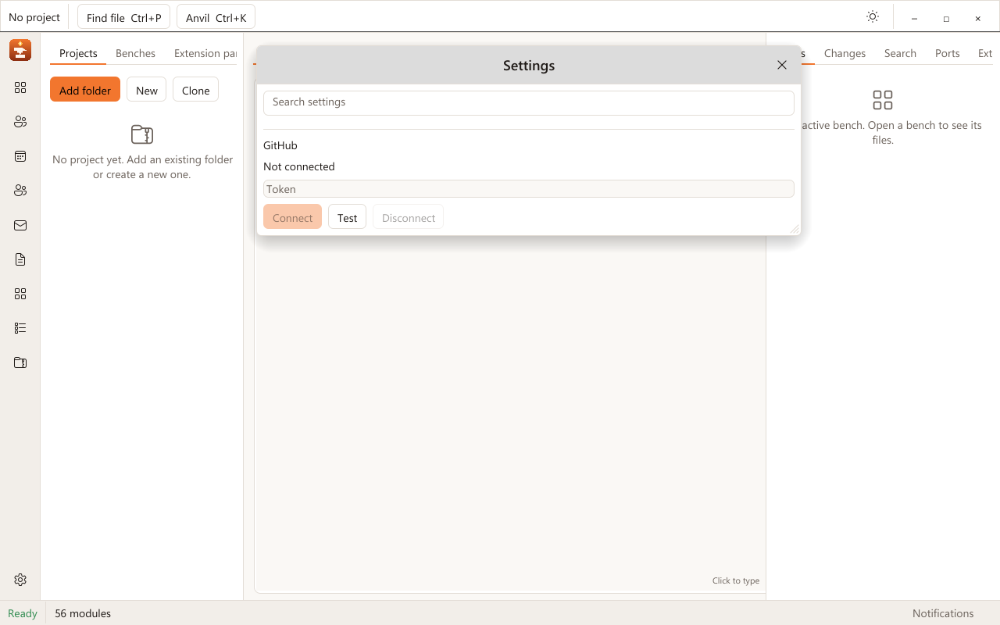

state: en.light.settings.counter_github
capture_sha: (pendente)
---

# Settings — GitHub (connection token)

Settings screen shown as a modal window "Settings" over the desktop, opened on the GitHub section, where a token is informed to connect the account (target `counter_github`), with state "Not connected". Variant in English ("en") and light theme of the reference page (pt-BR/dark).

## How to get there
In the main window, click the "Settings" button on the icon rail on the left (bottom) and select the GitHub section; or open the app directly in the section with the capture command `forja-app --locale en --theme light --settings counter_github`.

## Regions
- **Top bar** (0,0)–(1920,42): label "No project" on the left, buttons "Find file  Ctrl+P" and "Anvil  Ctrl+K", theme toggle icon (sun) and window buttons "–", "□", "×" on the right.
- **Left rail** (0,42)–(56,1048): icon column with buttons "Board", "Helpers", "Routines", "Muster", "Requests", "Skills", "Usage", "Extensions", "Archive" and, at the bottom, "Settings".
- **Left side panel** (56,42)–(304,1048): logo (orange anvil), "More tabs" button, "Projects" tab (active), buttons "Add folder" (orange), "New project" and "Clone"; empty state "No project yet. Add an existing folder or create a new one." with folder icon.
- **Central area** (320,42)–(1612,1048): tab strip (Terminal, Editor, Browser, Changes, Preview, Bench, Review, History, Extension panels, Helper (chat)) and toolbar ("+" icons, "Recipes", "Shell"), almost entirely covered by the modal window; the "pwsh · Running" terminal strip and the empty editor area with the hint "Click to type" (bottom right corner) are behind the modal.
- **Right panel** (1628,42)–(1920,1048): "More tabs" button, tabs "Files" (active) and "Changes"; grid icon and message "No active bench. Open a bench to see its files."
- **Status bar** (0,1048)–(1920,1080): "Ready" and "56 modules" on the left, "Notifications" on the right.
- **Modal window "Settings"** (328,58)–(1026,307): settings search field, "GitHub" section with status "Not connected", token field and buttons "Connect" (disabled), "Test" and "Disconnect" (disabled).

## Elements
| Element | Type | Position (px) | State | What it does |
|---|---|---|---|---|
| "No project" | Label | (11,12)–(77,31) | — | Indicates that no project is open. |
| "Find file  Ctrl+P" | Button | (99,5)–(218,37) | — | Quick file search (Ctrl+P shortcut). |
| "Anvil  Ctrl+K" | Button | (226,5)–(327,37) | — | Command palette (Ctrl+K shortcut). |
| (unnamed accessible) | Unknown | (1741,5)–(1773,37) | — | Sun icon: light/dark theme toggle. |
| "–" | Button | (1795,5)–(1827,37) | — | Minimize window. |
| "□" | Button | (1835,5)–(1867,37) | — | Maximize/restore window. |
| "×" | Button | (1875,5)–(1909,37) | — | Close window. |
| (unnamed accessible) | Image | (12,50)–(40,78) | — | Forja logo (orange anvil). |
| "More tabs" | Button | (64,50)–(151,85) | — | Menu with the remaining tabs of the left panel (in this variant, only "Projects" is shown directly). |
| "Projects" | Button | (159,52)–(231,84) | checked=True | Active tab of the left panel. |
| "Add folder" | Button | (64,101)–(154,133) | — | Opens a selector to add an existing project (orange highlight). |
| "New project" | Button | (162,101)–(261,133) | — | Creates a new project. |
| "Clone" | Button | (64,141)–(123,173) | — | Clones a repository. |
| (icon) | Label | (168,201)–(196,229) | — | Folder icon of the left panel's empty state. |
| "No project yet. Add an existing folder or create a new one." | Label | (67,237)–(297,275) | — | Empty state message of the projects panel. |
| "Board" | Button | (8,94)–(44,130) | checked=False | Board icon button on the left rail. |
| "Helpers" | Button | (8,138)–(44,174) | checked=False | Helpers icon button. |
| "Routines" | Button | (8,182)–(44,218) | checked=False | Routines icon button. |
| "Muster" | Button | (8,226)–(44,262) | checked=False | Muster icon button. |
| "Requests" | Button | (8,270)–(44,306) | checked=False | Requests icon button. |
| "Skills" | Button | (8,314)–(44,350) | checked=False | Skills icon button. |
| "Usage" | Button | (8,358)–(44,394) | checked=False | Usage icon button. |
| "Extensions" | Button | (8,402)–(44,438) | checked=False | Extensions icon button. |
| "Archive" | Button | (8,446)–(44,482) | checked=False | Archive icon button. |
| "Settings" | Button | (8,1004)–(44,1040) | checked=False | Icon button that opens this settings screen. |
| "More tabs" | Button | (324,50)–(411,85) | — | Menu with the remaining tabs of the central area, in front of the modal. |
| "Terminal" | Button | (419,52)–(496,84) | checked=True | Central area terminal tab, covered by the modal. |
| "Editor" | Button | (496,52)–(556,84) | checked=False | Text editor tab. |
| "Browser" | Button | (556,52)–(629,84) | checked=False | Project browser tab. |
| "Changes" | Button | (629,52)–(706,84) | checked=False | Diffs tab. |
| "Preview" | Button | (706,52)–(777,84) | checked=False | File preview tab. |
| "Bench" | Button | (777,52)–(838,84) | checked=False | Active bench tab. |
| "Review" | Button | (838,52)–(905,84) | checked=False | Review tab. |
| "History" | Button | (905,52)–(973,84) | checked=False | History tab. |
| "Extension panels" | Button | (973,52)–(1099,84) | checked=False | Extension panels tab of the central area; only the end of the text ("ion panels") is visible next to the edge of the modal. |
| "Helper (chat)" | Button | (1099,52)–(1202,84) | checked=False | Tab for chatting with helpers. |
| "+" | Button | (407,113)–(441,145) | — | Add button of the editor toolbar (behind the modal). |
| (unnamed accessible) | Unknown | (444,113)–(476,145) | — | Editor toolbar tool icon. |
| (unnamed accessible) | Unknown | (479,113)–(511,145) | — | Editor toolbar tool icon. |
| (unnamed accessible) | Unknown | (514,113)–(546,145) | — | Editor toolbar tool icon. |
| (unnamed accessible) | Unknown | (549,113)–(581,145) | — | Editor toolbar tool icon. |
| "Recipes" | Button | (584,113)–(655,145) | — | Recipes tab/panel of the central area. |
| "Shell" | Button | (658,113)–(711,145) | — | Shell tab/panel of the central area. |
| "pwsh · Running" | Button | (328,118)–(404,140) | — | Terminal session tab (pwsh in execution), behind the modal. |
| "Close pwsh" | Button | (385,121)–(401,137) | — | Closes the pwsh session, behind the modal. |
| (unnamed accessible) | TextInput | (337,121)–(1017,153) | — | "Search settings" field (visible placeholder) to filter sections. |
| (unnamed accessible) | Unknown | (328,150)–(1604,1036) | — | Empty central editor area; shows the hint "Click to type" in the bottom right corner. |
| "GitHub" | Label | (337,181)–(380,200) | — | Title of the GitHub connection section. |
| "Not connected" | Label | (337,208)–(428,227) | — | Current state of the integration. |
| (unnamed accessible) | PasswordInput | (337,235)–(1017,258) | — | Token field, with placeholder "Token", hidden text. |
| "Connect" | Button | (337,266)–(412,298) | disabled | Would save and validate the token; inactive while the field is empty. |
| "Test" | Button | (420,266)–(469,298) | — | Tests the provided token. |
| "Disconnect" | Button | (477,266)–(568,298) | disabled | Would remove the connection; inactive because there is no connection. |
| "More tabs" | Button | (1632,50)–(1719,85) | — | Menu with the remaining tabs of the right panel (in this variant, only "Files" and "Changes" are shown). |
| "Files" | Button | (1727,52)–(1778,84) | checked=True | Active tab of the right panel (bench files). |
| "Changes" | Button | (1778,52)–(1855,84) | checked=False | Tab of pending changes. |
| (icon) | Label | (1756,117)–(1784,145) | — | Grid icon at the top of the right panel. |
| "No active bench. Open a bench to see its files." | Label | (1644,153)–(1896,191) | — | Empty state message of the files panel. |
| "Settings" | Window | (328,58)–(1026,307) | focus | Settings modal window. |
| "Settings" | Label | (337,71)–(403,95) | — | Modal window title. |
| "Close window" | Button | (985,67)–(1017,99) | — | Modal × button to close the settings window. |
| "Ready" | Label | (10,1055)–(48,1074) | — | General status in the bottom bar. |
| "56 modules" | Label | (70,1055)–(142,1074) | — | Number of loaded modules. |
| "Notifications" | Label | (1808,1055)–(1886,1074) | — | Access to notifications. |

Unnamed elements of the tree, by rectangle: vertical dividers between panels at (304,42)–(320,1048) and (1612,42)–(1628,1048); modal resize handles at (319,49)–(339,69), (1016,49)–(1036,69), (321,69)–(337,297), (1018,69)–(1034,297) and in the bottom corners (319,297)–(339,317) and (1016,297)–(1036,317); central tab strip behind the modal at (339,51)–(1016,67) and bottom strip of the modal at (339,299)–(1016,315).

## Appearance
Light theme with off-white/cream background (window and panels in very close tones); the "Settings" modal uses white background with projected shadow and stand-out title. Orange accent color: anvil logo, primary button "Add folder" and disabled button "Connect" (faded orange). Secondary buttons have a subtle gray outline. Active tabs ("Projects", "Files") have an orange underline. Sans-serif typography in two sizes: interface texts and section labels ("GitHub", "Not connected", "Token") larger; tab labels and window buttons smaller. Search and token fields occupy almost the entire width of the modal, left-aligned at x=337; the three action buttons form a row under the field. Empty states of the panels use centered gray text with an icon above. Left rail icons in dark gray, uniform and centered in 36 px columns.

## Differences from the reference (pt-BR/dark)
Texts in English ("Settings", "Search settings", "Token", "Not connected", "Connect", "Test", "Disconnect" etc.). Light theme: cream background, white modal and dark text, as opposed to charcoal brown and gray modal of the dark theme. In the left panel, the tabs "Bancadas" and "Painéis de extensões" give way to a "More tabs" button; in the right panel, the group "Ajudante (chat)", "Busca", "Portas" and the second "Painéis de extensões" are also replaced by "More tabs" — in this variant no tab has a rectangle beyond the image width. The status bar is at y≈1055 (image of 1920×1080) instead of y≈775 (1280×800). The "Close window" button, which was an inconsistency in pt-BR, here matches the interface language.

## Issues found
- The search field and the token field have no accessible name (they rely only on the "Search settings"/"Token" placeholders).
- The four icon buttons of the editor toolbar (444–581 px) and the theme icon of the top bar are without an accessible name.
- The modal overlaps the central tabs (from "Terminal" to "Helper (chat)"), the editor toolbar and the "pwsh · Running" and "Close pwsh" controls, which are completely covered.
- The "Extension panels" tab has the text truncated in the image by the edge of the modal (only "ion panels" appears), although the rectangle continues beyond it.
- The text "Click to type", visible in the central area ((~1565,1015)–(~1600,1032)), has no corresponding element in the accessibility tree.
- Support texts in medium gray over a light background (placeholders "Search settings" and "Token", "Not connected" and empty state messages) have low contrast.
- The modal resize handles, including the corners in (319,297) and (1016,297), are clickable regions without an accessible name.
