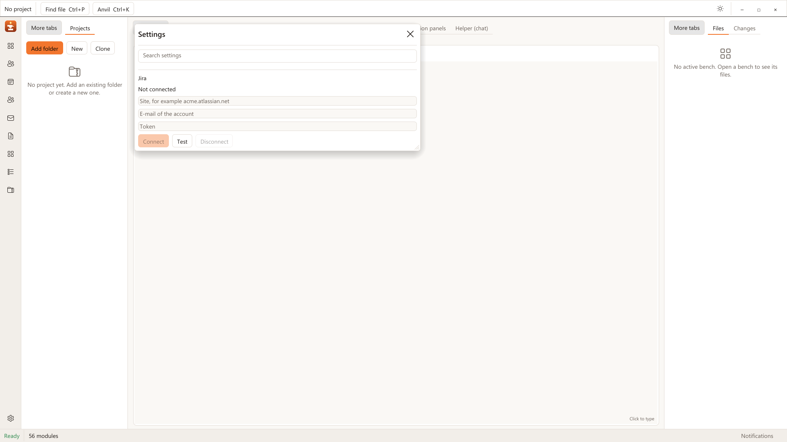

# Settings — Jira counter

Janela modal de ajustes da Forja aberta na seção "Jira", para configurar a conexão do contador com um site Jira (site, e-mail da conta e token).

## Como chegar
Na janela principal, clique no ícone de engrenagem "Settings" no rodapé do trilho à esquerda (retângulo (8,1004)–(44,1040)); na janela "Settings", localize a seção "Jira" rolando a lista ou digitando "Jira" no campo de busca de ajustes. Captura direta desta seção: `forja-app --locale en --theme light --settings counter_jira`.

## Regiões
- **Barra superior** (0,0)–(1920,42): rótulo "No project", botões "Find file  Ctrl+P" e "Anvil  Ctrl+K", ícone de tema (sol, sem nome acessível) e botões de janela "–", "□" e "×".
- **Trilho à esquerda** (0,42)–(52,1048): logotipo (imagem sem nome em (12,50)–(40,78)) e coluna de ícones quadrados correspondentes aos botões "Board", "Helpers", "Routines", "Muster", "Requests", "Skills", "Usage", "Extensions", "Archive" e, no rodapé, "Settings".
- **Painel esquerdo** (52,42)–(304,1048): botão "More tabs" e aba "Projects" (marcada); botões "Add folder" (destaque laranja), "New project" e "Clone"; estado vazio com ícone de pasta (rótulo "(ícone)" em (168,201)–(196,229)) e o texto "No project yet. Add an existing folder or create a new one.".
- **Área central** (320,42)–(1612,1048): botão "More tabs" e fileira de abas "Terminal" (marcada), "Editor", "Browser", "Changes", "Preview", "Bench", "Review", "History", "Extension panels" e "Helper (chat)"; painel de terminal com a aba "pwsh · Running" e a dica "Click to type" no canto inferior direito. Sobre essa área está aberta a janela modal "Settings" (328,58)–(1026,369), que contém o campo de busca, a seção "Jira", os campos de conexão e os botões "Connect", "Test" e "Disconnect".
- **Painel direito** (1628,42)–(1920,1048): botão "More tabs", aba "Files" (marcada) e aba "Changes"; ícone de grade (rótulo "(ícone)" em (1756,117)–(1784,145)) e o aviso "No active bench. Open a bench to see its files.".
- **Barra de status** (0,1048)–(1920,1080): "Ready" e "56 modules" à esquerda; "Notifications" à direita.

## Elementos
| Elemento | Tipo | Posição (px) | Estado | O que faz |
|---|---|---|---|---|
| "No project" | Label | (11,12)–(77,31) | — | Mostra que não há projeto ativo; clicável |
| "Find file  Ctrl+P" | Button | (99,5)–(218,37) | — | Abre a busca de arquivos (atalho Ctrl+P) |
| "Anvil  Ctrl+K" | Button | (226,5)–(327,37) | — | Abre a paleta de comandos (atalho Ctrl+K) |
| (sem nome acessível) | Unknown | (1741,5)–(1773,37) | — | Ícone de sol no canto superior direito; alterna tema |
| "–" | Button | (1795,5)–(1827,37) | — | Minimiza a janela |
| "□" | Button | (1835,5)–(1867,37) | — | Maximiza/restaura a janela |
| "×" | Button | (1875,5)–(1909,37) | — | Fecha a janela |
| (sem nome acessível) | Unknown | (304,42)–(320,1048) | — | Divisória vertical entre painel esquerdo e área central |
| (sem nome acessível) | Unknown | (1612,42)–(1628,1048) | — | Divisória vertical entre área central e painel direito |
| (sem nome acessível) | Unknown | (319,49)–(339,69) | — | Controle pequeno no topo da divisória esquerda (recolher painel) |
| (sem nome acessível) | Unknown | (1016,49)–(1036,69) | — | Controle pequeno no topo da divisória direita (recolher painel) |
| (sem nome acessível) | Image | (12,50)–(40,78) | — | Logotipo da Forja no topo do trilho |
| "More tabs" | Button | (64,50)–(151,85) | — | Abre o menu com as demais abas do painel esquerdo |
| "More tabs" | Button | (324,50)–(411,85) | — | Abre o menu com as demais abas da área central |
| "More tabs" | Button | (1632,50)–(1719,85) | — | Abre o menu com as demais abas do painel direito |
| (sem nome acessível) | Unknown | (339,51)–(1016,67) | — | Sublinhado da aba "Terminal" |
| "Projects" | Button | (159,52)–(231,84) | marcado=True | Aba ativa do painel esquerdo |
| "Terminal" | Button | (419,52)–(496,84) | marcado=True | Aba ativa da área central |
| "Editor" | Button | (496,52)–(556,84) | — | Aba do editor |
| "Browser" | Button | (556,52)–(629,84) | — | Aba do navegador |
| "Changes" | Button | (629,52)–(706,84) | — | Aba de mudanças da área central |
| "Preview" | Button | (706,52)–(777,84) | — | Aba de pré-visualização |
| "Bench" | Button | (777,52)–(838,84) | — | Aba da bancada |
| "Review" | Button | (838,52)–(905,84) | — | Aba de revisão |
| "History" | Button | (905,52)–(973,84) | — | Aba de histórico |
| "Extension panels" | Button | (973,52)–(1099,84) | — | Aba de painéis de extensões da área central; parcialmente coberta pela modal ("ion panels" visível) |
| "Helper (chat)" | Button | (1099,52)–(1202,84) | — | Aba do chat do ajudante |
| "Files" | Button | (1727,52)–(1778,84) | marcado=True | Aba ativa do painel direito |
| "Changes" | Button | (1778,52)–(1855,84) | — | Aba de mudanças do painel direito |
| "Settings" | Window | (328,58)–(1026,369) | foco | Janela modal de ajustes em primeiro plano |
| "Close window" | Button | (985,67)–(1017,99) | — | Fecha a janela "Settings" (ícone "×") |
| (sem nome acessível) | Unknown | (321,69)–(337,359) | — | Alça de redimensionamento à esquerda da modal |
| (sem nome acessível) | Unknown | (1018,69)–(1034,359) | — | Alça de redimensionamento à direita da modal |
| "Settings" | Label | (337,71)–(403,95) | — | Título da modal, alinhado à esquerda; clicável |
| "Board" | Button | (8,94)–(44,130) | — | Ícone do quadro no trilho esquerdo |
| "Add folder" | Button | (64,101)–(154,133) | — | Adiciona uma pasta de projeto (botão laranja) |
| "New project" | Button | (162,101)–(261,133) | — | Cria um novo projeto |
| "+" | Button | (407,113)–(441,145) | — | Botão com "+"; oculto sob a modal |
| (sem nome acessível) | Unknown | (444,113)–(476,145) | — | Botão de ícone; oculto sob a modal |
| (sem nome acessível) | Unknown | (479,113)–(511,145) | — | Botão de ícone; oculto sob a modal |
| (sem nome acessível) | Unknown | (514,113)–(546,145) | — | Botão de ícone; oculto sob a modal |
| (sem nome acessível) | Unknown | (549,113)–(581,145) | — | Botão de ícone; oculto sob a modal |
| "Recipes" | Button | (584,113)–(655,145) | — | Abre receitas; oculto sob a modal |
| "Shell" | Button | (658,113)–(711,145) | — | Abre o shell; oculto sob a modal |
| (ícone) | Label | (1756,117)–(1784,145) | — | Ícone de grade no painel direito (estado vazio) |
| "pwsh · Running" | Button | (328,118)–(404,140) | — | Aba do terminal pwsh em execução; oculta sob a modal |
| (sem nome acessível) | TextInput | (337,121)–(1017,153) | — | Campo "Search settings" (texto de apoio visível) |
| "Close pwsh" | Button | (385,121)–(401,137) | — | Fecha a aba do terminal pwsh; oculto sob a modal |
| "Helpers" | Button | (8,138)–(44,174) | — | Ícone de ajudantes no trilho esquerdo |
| "Clone" | Button | (64,141)–(123,173) | — | Clona um projeto |
| (sem nome acessível) | Unknown | (328,150)–(1604,1036) | — | Painel de terminal vazio atrás da modal; mostra a dica "Click to type" no canto inferior |
| "No active bench. Open a bench to see its files." | Label | (1644,153)–(1896,191) | — | Aviso do painel direito em duas linhas |
| "Jira" | Label | (337,181)–(357,200) | — | Título da seção de ajustes do contador Jira |
| "Routines" | Button | (8,182)–(44,218) | — | Ícone de rotinas no trilho esquerdo |
| (ícone) | Label | (168,201)–(196,229) | — | Ícone de pasta do estado vazio do painel esquerdo |
| "Not connected" | Label | (337,208)–(428,227) | — | Estado atual da conexão com o Jira |
| "Muster" | Button | (8,226)–(44,262) | — | Ícone do mutirão no trilho esquerdo |
| (sem nome acessível) | TextInput | (337,235)–(1017,258) | — | Campo do site Jira (texto de apoio "Site, for example acme.atlassian.net") |
| "No project yet. Add an existing folder or create a new one." | Label | (67,237)–(297,275) | — | Estado vazio do painel esquerdo |
| (sem nome acessível) | TextInput | (337,266)–(1017,289) | — | Campo "E-mail of the account" |
| "Requests" | Button | (8,270)–(44,306) | — | Ícone de pedidos no trilho esquerdo |
| (sem nome acessível) | PasswordInput | (337,297)–(1017,320) | — | Campo "Token" (entrada mascarada) |
| "Skills" | Button | (8,314)–(44,350) | — | Ícone de skills no trilho esquerdo |
| "Connect" | Button | (337,328)–(412,360) | desativado | Conecta ao Jira; indisponível enquanto os campos não estão preenchidos |
| "Test" | Button | (420,328)–(469,360) | — | Testa a configuração informada |
| "Disconnect" | Button | (477,328)–(568,360) | desativado | Encerra a conexão; indisponível porque não há conexão |
| (sem nome acessível) | Unknown | (319,359)–(339,379) | — | Alça de canto (inferior esquerdo) da modal |
| (sem nome acessível) | Unknown | (1016,359)–(1036,379) | — | Alça de canto (inferior direito) da modal |
| (sem nome acessível) | Unknown | (339,361)–(1016,377) | — | Alça de redimensionamento inferior da modal |
| "Usage" | Button | (8,358)–(44,394) | — | Ícone de uso no trilho esquerdo |
| "Extensions" | Button | (8,402)–(44,438) | — | Ícone de extensões no trilho esquerdo |
| "Archive" | Button | (8,446)–(44,482) | — | Ícone do acervo no trilho esquerdo |
| "Settings" | Button | (8,1004)–(44,1040) | — | Engrenagem no rodapé do trilho; abre a janela "Settings" |
| "Ready" | Label | (10,1055)–(48,1074) | — | Status atual na barra inferior |
| "56 modules" | Label | (70,1055)–(142,1074) | — | Quantidade de módulos carregados |
| "Notifications" | Label | (1808,1055)–(1886,1074) | — | Área de notificações à direita da barra de status |

## Aparência
Tema claro: fundo off-white com leve tom creme, texto em cinza-escuro e ícones em cinza médio. A cor de destaque é o laranja, usado no logotipo, no botão "Add folder" (fundo laranja com texto claro), no sublinhado das abas marcadas ("Projects", "Terminal", "Files") e no botão desativado "Connect" (fundo laranja pálido com texto esbranquiçado, em contraste baixo). A modal "Settings" usa fundo branco, cantos arredondados e sombra, com o título "Settings" em negrito no canto superior esquerdo e o botão de fechar ("×") no canto superior direito. Os campos de texto são retangulares claros com contorno sutil, alinhados da esquerda (x337) até x1017, com espaçamento vertical uniforme de cerca de 31 px entre campos; os botões "Connect", "Test" e "Disconnect" ficam em linha abaixo do campo "Token". O campo de busca ocupa a largura toda no topo da modal. Espaçamentos gerais consistentes (8–16 px); a tipografia é uma sans-serif de tamanho único.

## Diferenças para a referência (pt-BR.dark)
- Textos todos em inglês: "Settings" (Ajustes), "Jira", "Not connected" (Não conectado), "Connect"/"Test"/"Disconnect" (Conectar/Testar/Desconectar), "No project" (Nenhum projeto), "Find file"/"Anvil" (Achar arquivo/Bigorna), abas "Projects", "Terminal", "Editor", "Browser", "Changes", "Preview", "Bench", "Review", "History", "Extension panels", "Helper (chat)", "Files", botões "Add folder", "New project", "Clone", "Board", "Helpers", "Routines", "Muster", "Requests", "Skills", "Usage", "Extensions", "Archive", "Settings", "More tabs", rótulos "Ready", "56 modules", "Notifications" e avisos "No active bench. Open a bench to see its files." e "No project yet. Add an existing folder or create a new one.".
- Tema claro em vez de escuro: fundo creme/branco com texto escuro, invertendo o esquema da referência; o laranja de destaque e sua aplicação (logotipo, "Add folder", sublinhados de abas) permanecem.
- Janela mais larga e mais alta (1920×1080 contra 1280×800 na referência): as regiões se estendem proporcionalmente (trilho até y1048, painel direito a partir de x1628, engrenagem "Settings" em (8,1004)).
- Na fileira de abas da área central há um botão "More tabs" à esquerda de "Terminal" e uma aba extra "Helper (chat)" à direita de "Extension panels"; no painel esquerdo a aba "Bancadas" da referência não aparece como botão — há um botão "More tabs" antes de "Projects"; no painel direito só aparecem "Files" e "Changes", com "More tabs" concentrando as demais abas ("Ajudante (chat)", "Busca", "Portas", "Painéis de extensões" da referência não estão na árvore desta captura).
- Na modal, o botão de fechar tem nome acessível "Close window" em inglês (coerente com o locale) e o título "Settings" aparece alinhado à esquerda (na referência estava centralizado); a árvore desta captura não expõe a barra de título arrastável nem as linhas divisórias sob as abas que constavam na referência.

## Problemas encontrados
- Três botões com o mesmo nome acessível "More tabs" em posições distintas ((64,50), (324,50) e (1632,50)); nomes duplicados dificultam navegação e automação por acessibilidade.
- Dois botões com o mesmo nome acessível "Changes" ((629,52) e (1778,52)), um em cada painel.
- Aba "Extension panels" em (973,52)–(1099,84) é parcialmente encoberta pela modal (só "ion panels" fica visível); sobreposição esperada de uma modal, mas reduz a legibilidade do rótulo.
- Botões "+", "Recipes" e "Shell" (faixa y113–145) e a aba "pwsh · Running" com o botão "Close pwsh" ficam totalmente sob a modal e invisíveis nesta captura.
- Ícone clicável de tema (sol) em (1741,5)–(1773,37) sem nome acessível.
- Vários elementos interativos sem nome acessível: campos de texto e o campo de senha (só identificáveis pelos textos de apoio visíveis "Search settings", "Site, for example acme.atlassian.net", "E-mail of the account" e "Token"), botões de ícone em (444,113)–(581,145), alças de redimensionamento, divisórias da janela e o sublinhado da aba "Terminal".
- Botão desativado "Connect" apresenta texto claro sobre fundo laranja pálido, com contraste baixo.
- Texto "Click to type" solto no canto inferior direito da área central (parte do painel de terminal vazio atrás da modal), sem elemento correspondente nomeado na árvore.
