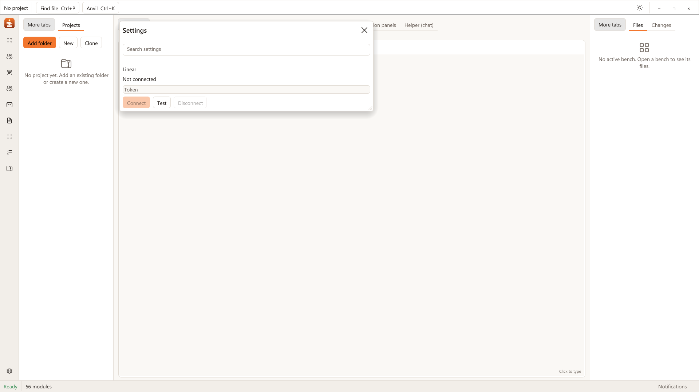

# Settings — counter_linear (Linear)

Modal settings window for the "Linear" connection (target `counter_linear`), opened over the Forja main screen, with a token field and connection actions. Variante em inglês e tema claro da página de referência (pt-BR.dark); a estrutura é a mesma e as diferenças de textos, cores e resolução são indicadas ao longo da página.

## Como chegar
No app: clique no botão "Settings" no fim do trilho de módulos à esquerda (retângulo (8,1004)–(44,1040)) e abra os ajustes da integração Linear (alvo `counter_linear`). Comando de captura: `forja-app --locale en --theme light --settings counter_linear`.

## Regiões
Nesta variante a janela foi capturada em 1920×1080 px (a referência pt-BR.dark usa 1280×800); as coordenadas abaixo seguem esta captura.
- **Barra de título superior** (0,0)–(1920,37): rótulo "No project", botões "Find file  Ctrl+P" e "Anvil  Ctrl+K" à esquerda; à direita, botão de tema (ícone de sol, sem nome acessível, em (1741,5)–(1773,37)) e os botões de janela "–" (minimizar), "□" (maximizar) e "×" (fechar).
- **Trilho de módulos à esquerda** (0,37)–(52,1048): ícone do módulo ativo no topo (imagem sem nome em (12,50)–(40,78)) e coluna de botões-ícone: "Board", "Helpers", "Routines", "Muster", "Requests", "Skills", "Usage", "Extensions", "Archive" e, no fim, "Settings".
- **Painel lateral esquerdo (Projects)** (52,37)–(304,1048): botão "More tabs" e a aba "Projects" (ativa, sublinhada em laranja); botões "Add folder", "New project" e "Clone"; ícone de pasta (rótulo "(ícone)" em (168,201)–(196,229)) e a mensagem "No project yet. Add an existing folder or create a new one.". Diferente da referência, as abas restantes do painel ficam recolhidas atrás de "More tabs".
- **Área central** (304,37)–(1612,1048): faixa de abas ("Terminal" marcada, além de "Editor", "Browser", "Changes", "Preview", "Bench", "Review", "History", "Extension panels" e "Helper (chat)") encoberta pela janela modal "Settings" (328,58)–(1026,307); barra da área central com "+", quatro botões-ícone sem nome, "Recipes" e "Shell" (também atrás do modal); aba de terminal "pwsh · Running"; e uma grande área de texto vazia com a legenda "Click to type" no canto inferior direito (~1600,996).
- **Janela modal "Settings"** (328,58)–(1026,307): título "Settings" à esquerda com botão de fechar ("Close window") à direita; campo de busca "Search settings"; seção "Linear" com estado "Not connected", campo de senha "Token" e os botões "Connect" (desativado), "Test" e "Disconnect" (desativado).
- **Painel direito** (1612,37)–(1920,1048): botão "More tabs" e abas "Files" (ativa) e "Changes"; ícone de grade (rótulo "(ícone)" em (1756,117)–(1784,145)) e a mensagem "No active bench. Open a bench to see its files.".
- **Barra de status** (0,1048)–(1920,1080): "Ready" à esquerda (em verde), "56 modules" em seguida e "Notifications" à direita.

## Elementos
| Elemento | Tipo | Posição (px) | Estado | O que faz |
|---|---|---|---|---|
| "No project" | Label | (11,12)–(77,31) | — | Indica o projeto atual na barra de título. |
| "Find file  Ctrl+P" | Button | (99,5)–(218,37) | — | Abre a busca de arquivos (atalho Ctrl+P). |
| "Anvil  Ctrl+K" | Button | (226,5)–(327,37) | — | Abre a paleta de comandos (atalho Ctrl+K). |
| (sem nome acessível) | Unknown | (1741,5)–(1773,37) | — | Ícone de sol; alterna tema claro/escuro. |
| "–" | Button | (1795,5)–(1827,37) | — | Minimiza a janela. |
| "□" | Button | (1835,5)–(1867,37) | — | Maximiza/restaura a janela. |
| "×" | Button | (1875,5)–(1909,37) | — | Fecha a janela. |
| (sem nome acessível) | Unknown | (304,42)–(320,1048) | — | Divisor vertical entre o painel esquerdo e a área central. |
| (sem nome acessível) | Unknown | (1612,42)–(1628,1048) | — | Divisor vertical entre a área central e o painel direito. |
| (sem nome acessível) | Unknown | (319,49)–(339,69) | — | Elemento de borda à esquerda da faixa de abas central. |
| (sem nome acessível) | Image | (12,50)–(40,78) | — | Ícone do módulo ativo no topo do trilho. |
| "More tabs" | Button | (64,50)–(151,85) | — | Lista as abas restantes do painel esquerdo (só "Projects" fica visível). |
| "Projects" | Button | (159,52)–(231,84) | marcado=True | Aba ativa do painel lateral; mostra a lista de projetos. |
| "More tabs" | Button | (324,50)–(411,85) | — | Lista as abas ocultas do início da faixa central; encoberto pelo modal. |
| "Terminal" | Button | (419,52)–(496,84) | marcado=True | Aba ativa da área central; encoberta pelo modal. |
| "Editor" | Button | (496,52)–(556,84) | marcado=False | Aba da área central; encoberta pelo modal. |
| "Browser" | Button | (556,52)–(629,84) | marcado=False | Aba da área central; encoberta pelo modal. |
| "Changes" | Button | (629,52)–(706,84) | marcado=False | Aba da área central; encoberta pelo modal. |
| "Preview" | Button | (706,52)–(777,84) | marcado=False | Aba da área central; encoberta pelo modal. |
| "Bench" | Button | (777,52)–(838,84) | marcado=False | Aba da área central; encoberta pelo modal. |
| "Review" | Button | (838,52)–(905,84) | marcado=False | Aba da área central; encoberta pelo modal. |
| "History" | Button | (905,52)–(973,84) | marcado=False | Aba da área central; encoberta pelo modal. |
| "Extension panels" | Button | (973,52)–(1099,84) | marcado=False | Aba da área central; o início fica encoberto pelo modal (na imagem aparece "…ion panels"). |
| (sem nome acessível) | Unknown | (1016,49)–(1036,69) | — | Elemento de borda à direita da faixa de abas central. |
| "Helper (chat)" | Button | (1099,52)–(1202,84) | marcado=False | Aba da área central; visível à direita do modal. |
| (sem nome acessível) | Unknown | (339,51)–(1016,67) | — | Faixa de fundo das abas centrais. |
| "More tabs" | Button | (1632,50)–(1719,85) | — | Lista as abas ocultas do painel direito. |
| "Files" | Button | (1727,52)–(1778,84) | marcado=True | Aba ativa do painel direito; lista de arquivos (vazia). |
| "Changes" | Button | (1778,52)–(1855,84) | marcado=False | Aba do painel direito. |
| "Settings" | Window | (328,58)–(1026,307) | foco | Janela modal de ajustes do alvo `counter_linear`. |
| "Close window" | Button | (985,67)–(1017,99) | — | Fecha a janela modal; ícone "×". |
| (sem nome acessível) | Unknown | (321,69)–(337,297) | — | Borda esquerda do modal (redimensionamento). |
| (sem nome acessível) | Unknown | (1018,69)–(1034,297) | — | Borda direita do modal (redimensionamento). |
| "Settings" | Label | (337,71)–(403,95) | — | Título do modal, alinhado à esquerda (na referência pt-BR é "Ajustes", centralizado). |
| "Board" | Button | (8,94)–(44,130) | marcado=False | Botão-ícone do trilho esquerdo. |
| "Add folder" | Button | (64,101)–(154,133) | — | Abre o seletor para adicionar uma pasta de projeto; botão destacado em laranja. |
| "New project" | Button | (162,101)–(261,133) | — | Cria um projeto novo. |
| "+" | Button | (407,113)–(441,145) | — | Botão de adicionar da barra da área central; encoberto pelo modal. |
| (sem nome acessível) | Unknown | (444,113)–(476,145) | — | Botão-ícone da barra central, sem nome; encoberto pelo modal. |
| (sem nome acessível) | Unknown | (479,113)–(511,145) | — | Botão-ícone da barra central, sem nome; encoberto pelo modal. |
| (sem nome acessível) | Unknown | (514,113)–(546,145) | — | Botão-ícone da barra central, sem nome; encoberto pelo modal. |
| (sem nome acessível) | Unknown | (549,113)–(581,145) | — | Botão-ícone da barra central, sem nome; encoberto pelo modal. |
| "Recipes" | Button | (584,113)–(655,145) | — | Abre receitas; encoberto pelo modal. |
| "Shell" | Button | (658,113)–(711,145) | — | Abre o shell; encoberto pelo modal. |
| (ícone) | Label | (1756,117)–(1784,145) | — | Ícone de grade do painel direito (estado vazio). |
| "pwsh · Running" | Button | (328,118)–(404,140) | — | Aba da sessão de terminal pwsh em execução; encoberta pelo modal. |
| "Search settings" (TextInput sem nome acessível) | TextInput | (337,121)–(1017,153) | — | Campo de busca de ajustes; texto de sugestão "Search settings". |
| "Close pwsh" | Button | (385,121)–(401,137) | — | Fecha a aba de terminal pwsh; encoberto pelo modal. |
| "Helpers" | Button | (8,138)–(44,174) | marcado=False | Botão-ícone do trilho esquerdo. |
| "Clone" | Button | (64,141)–(123,173) | — | Clona um projeto (sem efeito prática, pois não há projetos). |
| (sem nome acessível) | Unknown | (328,150)–(1604,1036) | — | Área de texto central vazia; exibe "Click to type" no canto inferior direito. |
| "No active bench. Open a bench to see its files." | Label | (1644,153)–(1896,191) | — | Mensagem de estado vazio do painel de arquivos. |
| "Linear" | Label | (337,181)–(374,200) | — | Título da seção de ajustes da conexão Linear. |
| "Routines" | Button | (8,182)–(44,218) | marcado=False | Botão-ícone do trilho esquerdo. |
| (ícone) | Label | (168,201)–(196,229) | — | Ícone de pasta do estado vazio do painel de projetos. |
| "Not connected" | Label | (337,208)–(428,227) | — | Estado atual da conexão Linear. |
| "Muster" | Button | (8,226)–(44,262) | marcado=False | Botão-ícone do trilho esquerdo. |
| "Token" (PasswordInput sem nome acessível) | PasswordInput | (337,235)–(1017,258) | — | Campo de senha para o token da conexão Linear. |
| "No project yet. Add an existing folder or create a new one." | Label | (67,237)–(297,275) | — | Mensagem de estado vazio do painel de projetos. |
| "Connect" | Button | (337,266)–(412,298) | desativado | Conecta à Linear; inativo até haver token. |
| "Test" | Button | (420,266)–(469,298) | — | Testa as credenciais informadas. |
| "Disconnect" | Button | (477,266)–(568,298) | desativado | Encerra a conexão; inativo por não haver conexão. |
| "Requests" | Button | (8,270)–(44,306) | marcado=False | Botão-ícone do trilho esquerdo. |
| (sem nome acessível) | Unknown | (319,297)–(339,317) | — | Alça inferior esquerda do modal. |
| (sem nome acessível) | Unknown | (1016,297)–(1036,317) | — | Alça inferior direita do modal. |
| (sem nome acessível) | Unknown | (339,299)–(1016,315) | — | Borda inferior do modal. |
| "Skills" | Button | (8,314)–(44,350) | marcado=False | Botão-ícone do trilho esquerdo. |
| "Usage" | Button | (8,358)–(44,394) | marcado=False | Botão-ícone do trilho esquerdo. |
| "Extensions" | Button | (8,402)–(44,438) | marcado=False | Botão-ícone do trilho esquerdo. |
| "Archive" | Button | (8,446)–(44,482) | marcado=False | Botão-ícone do trilho esquerdo. |
| "Settings" | Button | (8,1004)–(44,1040) | marcado=False | Botão-ícone do trilho esquerdo; abre a tela de ajustes. |
| "Ready" | Label | (10,1055)–(48,1074) | — | Status geral na barra de status, exibido em verde. |
| "56 modules" | Label | (70,1055)–(142,1074) | — | Contagem de módulos carregados. |
| "Notifications" | Label | (1808,1055)–(1886,1074) | — | Área de notificações na barra de status. |

## Aparência
Tema claro: fundo geral off-white (~#faf9f7), painéis e barras em branco/cinza muito claro com bordas discretas, e a janela modal "Settings" em branco com sombra e borda arredondada. A cor de destaque é o laranja: fundo do botão "Add folder", sublinhado e texto das abas ativas "Projects", "Terminal" e "Files", e o botão desativado "Connect" (fundo salgado claro com texto laranja). Tipografia sans-serif de ~13–14 px; o título "Settings" do modal é maior (~18 px) e negrito. Botões com cantos levemente arredondados e espaçamento uniforme (~8 px). Campos de entrada ocupam toda a largura do modal (337–1017 px), empilhados com espaçamento regular e borda cinza fina. Estados vazios usam ícone centralizado em cinza e texto cinza ("No project yet…", "No active bench…"). A barra de status é uma faixa contínua na base, com "Notifications" alinhado à direita. Comparada à referência pt-BR.dark, invertem-se fundo e texto (fundo claro, texto cinza-escuro) e o contraste do destaque laranja sobre fundo claro é menor que sobre fundo escuro.

## Problemas encontrados
- Três abas aparecem marcadas simultaneamente ("Projects" no painel esquerdo, "Terminal" na área central e "Files" no painel direito), o que dificulta identificar o painel realmente ativo.
- O TextInput de busca ("Search settings") e o PasswordInput de token ("Token") não têm nome acessível; dependem apenas do texto de sugestão.
- Vários botões-ícone da barra da área central ("+" e quatro elementos entre 444–581 px) estão sem nome acessível.
- Sobreposição: o modal "Settings" (328,58)–(1026,307) encobre por completo as abas "Editor", "Browser", "Changes", "Preview", "Bench", "Review" e "History", os botões "+", "Recipes", "Shell", a aba "pwsh · Running" e o botão "Close pwsh", que existem na árvore mas não são visíveis.
- A aba "Extension panels" (973,52)–(1099,84) é parcialmente encoberta pelo modal; na imagem só aparece o fragmento "…ion panels".
- O texto "Click to type" (~1600,996) é exibido em cinza claro sobre fundo claro, com contraste baixo.
- Os elementos de borda e alça do modal (321,69)–(337,297), (1018,69)–(1034,297), (319,297)–(339,317), (1016,297)–(1036,317) e (339,299)–(1016,315) estão sem nome acessível.
