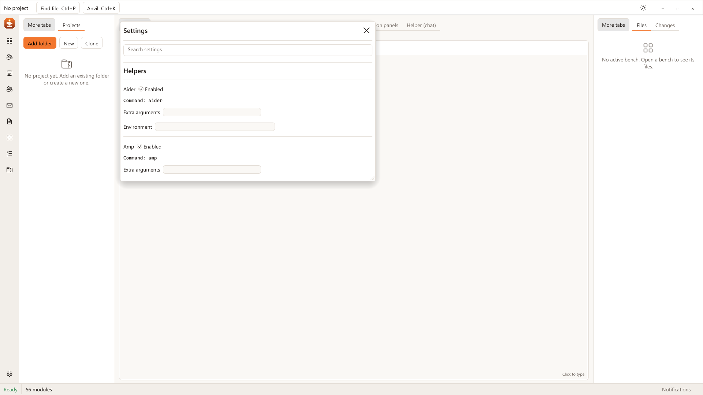

# Settings — Helpers

Tela de configuração dos ajudantes de código (agentes de IA): permite habilitar cada ajudante, definir comando, argumentos extras, ambiente e gerenciar hooks, em uma janela modal sobre a área de trabalho do app.

## Como chegar
Na janela principal, acionar o botão de engrenagem "Settings" no fim do trilho esquerdo (ou o comando de ajustes) e escolher a seção "Helpers"; a captura corresponde ao comando `forja-app --locale en --theme light --settings helper`.

## Regiões
- **Janela-mãe (fundo)**: (0,0)–(1920,1080). Barra superior (0,0)–(1920,42) com "No project", "Find file  Ctrl+P", "Anvil  Ctrl+K", ícone de tema (sol) e controles "–", "□", "×"; trilho esquerdo de ícones (0,42)–(52,1050) com o logotipo e os botões "Board", "Helpers", "Routines", "Muster", "Requests", "Skills", "Usage", "Extensions", "Archive", "Settings"; faixa de abas do app (304,42)–(1612,90) com "Terminal", "Editor", "Browser", "Changes", "Preview", "Bench", "Review", "History", "Extension panels" e "Helper (chat)"; painel de projetos (52,42)–(304,1050) com "Projects", "Add folder", "New project", "Clone" e estado vazio "No project yet. Add an existing folder or create a new one."; área central (320,42)–(1612,1050) com o painel de terminal ("pwsh · Running", campo com "Click to type" visível em ~(1507,1015), texto sem elemento correspondente na árvore); painel direito (1628,42)–(1920,1050) com "Files", "Changes" e o aviso "No active bench. Open a bench to see its files."; barra de status (0,1050)–(1920,1080) com "Ready", "56 modules" e "Notifications".
- **Modal "Settings"**: (328,58)–(1026,496) (698×438 px), janela flutuante redimensionável com grip diagonal no canto inferior direito. Barra de título com "Settings" e o botão "Close window"; campo de busca "Search settings" (337,121)–(1017,153); área de conteúdo (337,167)–(1017,487) com o título "Helpers" e os cartões Aider e Amp visíveis na dobra. Na árvore, os cartões continuam até y=3624, muito além dos limites declarados da janela.
- **Cartão de ajudante (padrão repetido)**: nome + caixa "Enabled"; linha "Command: <cmd>"; campos "Extra arguments" e "Environment"; quando aplicável, linha "Configuration file to change:" com o caminho; seção "Hooks" com estado ("unsupported", "not installed" ou "Loading…"), caixa "Allow writing hooks" e botões "Install"/"Remover" ("Install"/"Remove").

## Elementos
| Elemento | Tipo | Posição (px) | Estado | O que faz |
|---|---|---|---|---|
| "Find file  Ctrl+P" | Button | (99,5)–(218,37) | — | Abre a busca de arquivos (atalho Ctrl+P) |
| "Anvil  Ctrl+K" | Button | (226,5)–(327,37) | — | Abre a paleta de comandos (atalho Ctrl+K) |
| Ícone de tema/sol (sem nome acessível) | Unknown | (1741,5)–(1773,37) | clique | Alterna o tema |
| "–" | Button | (1795,5)–(1827,37) | — | Minimiza a janela |
| "□" | Button | (1835,5)–(1867,37) | — | Maximiza/restaura a janela |
| "×" | Button | (1875,5)–(1909,37) | — | Fecha a janela-mãe |
| "No project" | Label | (11,12)–(77,31) | clique | Indica que não há projeto aberto |
| Separador vertical esquerdo (sem nome) | Unknown | (304,42)–(320,1048) | — | Divide painel de projetos do restante |
| Separador vertical direito (sem nome) | Unknown | (1612,42)–(1628,1048) | — | Divide painel direito |
| Canto superior esquerdo do modal (sem nome) | Unknown | (319,49)–(339,69) | — | Alça de redimensionamento do modal |
| Canto superior direito do modal (sem nome) | Unknown | (1016,49)–(1036,69) | — | Alça de redimensionamento do modal |
| Logotipo da Forja (sem nome acessível) | Image | (12,50)–(40,78) | clique | Identidade do app no trilho |
| "More tabs" (painel esquerdo) | Button | (64,50)–(151,85) | — | Lista abas adicionais do painel de projetos |
| "More tabs" (faixa central) | Button | (324,50)–(411,85) | — | Lista abas adicionais da faixa central |
| "More tabs" (painel direito) | Button | (1632,50)–(1719,85) | — | Lista abas adicionais do painel direito |
| Faixa de destaque sob o modal (sem nome) | Unknown | (339,51)–(1016,67) | — | Fundo da faixa de abas central (oculto pelo modal) |
| "Projects" | Button | (159,52)–(231,84) | marcado=True | Aba ativa do painel esquerdo |
| "Terminal" | Button | (419,52)–(496,84) | marcado=True | Aba ativa da faixa central (oculta pelo modal) |
| "Editor" | Button | (496,52)–(556,84) | marcado=False | Aba do editor (oculta pelo modal) |
| "Browser" | Button | (556,52)–(629,84) | marcado=False | Aba do navegador (oculta pelo modal) |
| "Changes" (central) | Button | (629,52)–(706,84) | marcado=False | Aba de diffs (oculta pelo modal) |
| "Preview" | Button | (706,52)–(777,84) | marcado=False | Aba do visualizador (oculta pelo modal) |
| "Bench" | Button | (777,52)–(838,84) | marcado=False | Aba da bancada (oculta pelo modal) |
| "Review" | Button | (838,52)–(905,84) | marcado=False | Aba de revisão (oculta pelo modal) |
| "History" | Button | (905,52)–(973,84) | marcado=False | Aba de histórico (oculta pelo modal) |
| "Extension panels" | Button | (973,52)–(1099,84) | marcado=False | Aba de painéis de extensões (parcialmente coberta pelo modal; na imagem vê-se "ion panels") |
| "Helper (chat)" | Button | (1099,52)–(1202,84) | marcado=False | Aba do chat do ajudante |
| "Files" | Button | (1727,52)–(1778,84) | marcado=True | Aba ativa do painel direito |
| "Changes" (direita) | Button | (1778,52)–(1855,84) | marcado=False | Aba de mudanças do painel direito |
| "Settings" | Window | (328,58)–(1026,496) | foco | Janela modal de ajustes |
| "Close window" | Button | (985,67)–(1017,99) | — | Fecha o modal (ícone ×) |
| Borda esquerda do modal (sem nome) | Unknown | (321,69)–(337,486) | — | Contorno lateral de redimensionamento |
| Borda direita do modal (sem nome) | Unknown | (1018,69)–(1034,486) | — | Contorno lateral de redimensionamento |
| "Settings" | Label | (337,71)–(403,95) | clique | Título do modal |
| "Board" | Button | (8,94)–(44,130) | marcado=False | Vai ao quadro (trilho esquerdo) |
| "Add folder" | Button | (64,101)–(154,133) | — | Adiciona uma pasta de projeto (destacado em laranja) |
| "New project" | Button | (162,101)–(261,133) | — | Cria um projeto novo |
| "+" | Button | (407,113)–(441,145) | — | Adiciona item (sob o modal) |
| Controle sem nome 1 | Unknown | (444,113)–(476,145) | clique | Controle da barra sob o modal |
| Controle sem nome 2 | Unknown | (479,113)–(511,145) | clique | Controle da barra sob o modal |
| Controle sem nome 3 | Unknown | (514,113)–(546,145) | clique | Controle da barra sob o modal |
| Controle sem nome 4 | Unknown | (549,113)–(581,145) | clique | Controle da barra sob o modal |
| "Recipes" | Button | (584,113)–(655,145) | — | Aba/ação de receitas (sob o modal) |
| "Shell" | Button | (658,113)–(711,145) | — | Aba/ação de shell (sob o modal) |
| "(ícone)" | Label | (1756,117)–(1784,145) | clique | Ícone do painel direito (grade), sem rótulo |
| "pwsh · Running" | Button | (328,118)–(404,140) | — | Aba do terminal pwsh em execução (oculta pelo modal) |
| Campo "Search settings" (sem nome acessível) | TextInput | (337,121)–(1017,153) | clique | Filtra as seções de ajustes |
| "Close pwsh" | Button | (385,121)–(401,137) | — | Fecha a aba do terminal (oculto pelo modal) |
| "Helpers" | Button | (8,138)–(44,174) | marcado=False | Atalho do trilho para esta seção |
| "Clone" | Button | (64,141)–(123,173) | — | Clona um projeto |
| Área central do app (sem nome) | Unknown | (328,150)–(1604,1036) | clique | Superfície do painel de terminal (em grande parte sob o modal) |
| "No active bench. Open a bench to see its files." | Label | (1644,153)–(1896,191) | clique | Estado vazio do painel direito |
| Área de conteúdo do modal (sem nome) | Unknown | (337,167)–(1017,487) | — | Superfície com o título e os cartões |
| Barra de rolagem do modal (sem nome) | Unknown | (1015,167)–(1017,487) | clique | Faixa de 2 px na borda direita do conteúdo |
| "Helpers" | Label | (337,181)–(399,205) | clique | Título da seção |
| "Routines" | Button | (8,182)–(44,218) | marcado=False | Seção de rotinas (trilho) |
| "(ícone)" | Label | (168,201)–(196,229) | clique | Ícone de pasta do estado vazio de projetos |
| "Muster" | Button | (8,226)–(44,262) | marcado=False | Seção mutirão (trilho) |
| "Enabled" (Aider) | CheckBox | (378,227)–(445,259) | marcado=True | Liga/desliga o ajudante Aider |
| "Aider" | Label | (337,234)–(370,253) | clique | Nome do cartão |
| "No project yet. Add an existing folder or create a new one." | Label | (67,237)–(297,275) | clique | Estado vazio do painel de projetos |
| "Command: aider" | Label | (337,267)–(444,282) | clique | Mostra o comando `aider` (monoespaçado) |
| "Requests" | Button | (8,270)–(44,306) | marcado=False | Seção pedidos (trilho) |
| Campo "Extra arguments" do Aider (sem nome) | TextInput | (445,295)–(713,318) | clique | Argumentos adicionais do comando |
| "Extra arguments" (Aider) | Label | (337,297)–(437,316) | clique | Rótulo do campo |
| "Skills" | Button | (8,314)–(44,350) | marcado=False | Seção skills (trilho) |
| Campo "Environment" do Aider (sem nome) | TextInput | (423,335)–(751,358) | clique | Variáveis de ambiente |
| "Environment" (Aider) | Label | (337,337)–(415,356) | clique | Rótulo do campo |
| "Usage" | Button | (8,358)–(44,394) | marcado=False | Seção uso (trilho) |
| "Enabled" (Amp) | CheckBox | (374,384)–(441,416) | marcado=True | Liga/desliga o ajudante Amp |
| "Amp" | Label | (337,391)–(366,410) | clique | Nome do cartão |
| "Extensions" | Button | (8,402)–(44,438) | marcado=False | Seção extensões (trilho) |
| "Command: amp" | Label | (337,424)–(428,439) | clique | Mostra o comando `amp` |
| "Archive" | Button | (8,446)–(44,482) | marcado=False | Seção acervo (trilho) |
| Campo "Extra arguments" do Amp (sem nome) | TextInput | (445,452)–(713,475) | clique | Argumentos adicionais |
| "Extra arguments" (Amp) | Label | (337,454)–(437,473) | clique | Rótulo do campo |
| Canto inferior esquerdo do modal (sem nome) | Unknown | (319,486)–(339,506) | — | Alça de redimensionamento |
| Canto inferior direito do modal (sem nome) | Unknown | (1016,486)–(1036,506) | — | Grip de redimensionamento (visível na captura) |
| Borda inferior do modal (sem nome) | Unknown | (339,488)–(1016,504) | — | Contorno inferior de redimensionamento |
| Campo "Environment" do Amp (sem nome) | TextInput | (423,492)–(751,515) | clique | Variáveis de ambiente (cortado pelo limite do modal) |
| "Environment" (Amp) | Label | (337,494)–(415,513) | clique | Rótulo do campo |
| "Allow writing hooks" (Amp) | CheckBox | (471,527)–(610,559) | desativado, marcado=False | Autorizaria a escrita de hooks (indisponível) |
| "Install" (Amp) | Button | (618,527)–(678,562) | desativado | Instalaria hooks (indisponível) |
| "Remove" (Amp) | Button | (686,527)–(759,562) | desativado | Removeria hooks (indisponível) |
| "Hooks" (Amp) | Label | (337,534)–(376,553) | clique | Rótulo da seção de hooks |
| "unsupported" (Amp) | Label | (384,534)–(463,553) | clique | Estado dos hooks do Amp |
| "Enabled" (Antigravity CLI) | CheckBox | (435,584)–(502,616) | marcado=True | Liga/desliga o ajudante |
| "Antigravity CLI" | Label | (337,591)–(427,610) | clique | Nome do cartão |
| "Command: agy" | Label | (337,624)–(428,639) | clique | Mostra o comando `agy` |
| Campo "Extra arguments" (Antigravity, sem nome) | TextInput | (445,652)–(713,675) | clique | Argumentos adicionais |
| "Extra arguments" (Antigravity) | Label | (337,654)–(437,673) | clique | Rótulo do campo |
| Campo "Environment" (Antigravity, sem nome) | TextInput | (423,692)–(751,715) | clique | Variáveis de ambiente |
| "Environment" (Antigravity) | Label | (337,694)–(415,713) | clique | Rótulo do campo |
| "Configuration file to change:" (Antigravity) | Label | (337,734)–(513,753) | clique | Avisa qual arquivo os hooks tocam |
| "C:\Users\runneradmin\.gemini/config/hooks.json" | Label | (521,736)–(871,751) | clique | Caminho do arquivo (monoespaçado) |
| "Allow writing hooks" (Antigravity) | CheckBox | (468,767)–(607,799) | desativado, marcado=False | Autorização de hooks (indisponível) |
| "Install" (Antigravity) | Button | (615,767)–(675,802) | desativado | Instalaria hooks |
| "Remove" (Antigravity) | Button | (683,767)–(756,802) | desativado | Removeria hooks |
| "Hooks" (Antigravity) | Label | (337,774)–(376,793) | clique | Rótulo da seção |
| "not installed" (Antigravity) | Label | (384,774)–(460,793) | clique | Estado dos hooks |
| "Enabled" (Claude Code) | CheckBox | (423,824)–(491,856) | marcado=True | Liga/desliga o ajudante |
| "Claude Code" | Label | (337,831)–(415,850) | clique | Nome do cartão |
| "Command: claude" | Label | (337,864)–(451,879) | clique | Mostra o comando `claude` |
| Campo "Extra arguments" (Claude, sem nome) | TextInput | (445,892)–(713,915) | clique | Argumentos adicionais |
| "Extra arguments" (Claude) | Label | (337,894)–(437,913) | clique | Rótulo do campo |
| Campo "Environment" (Claude, sem nome) | TextInput | (423,932)–(751,955) | clique | Variáveis de ambiente |
| "Environment" (Claude) | Label | (337,934)–(415,953) | clique | Rótulo do campo |
| "Configuration file to change:" (Claude) | Label | (337,974)–(513,993) | clique | Avisa qual arquivo os hooks tocam |
| "C:\Users\runneradmin\.claude/settings.json" | Label | (521,976)–(841,991) | clique | Caminho do arquivo |
| "Settings" | Button | (8,1004)–(44,1040) | marcado=False | Atalho do trilho para Ajustes |
| "Allow writing hooks" (Claude) | CheckBox | (468,1007)–(607,1039) | desativado, marcado=False | Autorização de hooks |
| "Install" (Claude) | Button | (615,1007)–(675,1042) | desativado | Instalaria hooks |
| "Remove" (Claude) | Button | (683,1007)–(756,1042) | desativado | Removeria hooks |
| "Hooks" (Claude) | Label | (337,1014)–(376,1033) | clique | Rótulo da seção |
| "not installed" (Claude) | Label | (384,1014)–(460,1033) | clique | Estado dos hooks |
| "Ready" | Label | (10,1055)–(48,1074) | clique | Status geral na barra inferior |
| "56 modules" | Label | (70,1055)–(142,1074) | clique | Contagem de módulos carregados |
| "Notifications" | Label | (1808,1055)–(1886,1074) | clique | Indicador de notificações |
| "Enabled" (Cline CLI) | CheckBox | (398,1064)–(465,1096) | marcado=True | Liga/desliga o ajudante |
| "Cline CLI" | Label | (337,1071)–(390,1090) | clique | Nome do cartão |
| "Command: cline" | Label | (337,1104)–(444,1119) | clique | Mostra o comando `cline` |
| Campo "Extra arguments" (Cline, sem nome) | TextInput | (445,1132)–(713,1155) | clique | Argumentos adicionais |
| "Extra arguments" (Cline) | Label | (337,1134)–(437,1153) | clique | Rótulo do campo |
| Campo "Environment" (Cline, sem nome) | TextInput | (423,1172)–(751,1195) | clique | Variáveis de ambiente |
| "Environment" (Cline) | Label | (337,1174)–(415,1193) | clique | Rótulo do campo |
| "Enabled" (OpenAI Codex CLI) | CheckBox | (457,1221)–(524,1253) | marcado=True | Liga/desliga o ajudante |
| "OpenAI Codex CLI" | Label | (337,1228)–(449,1247) | clique | Nome do cartão |
| "Command: codex" | Label | (337,1261)–(444,1276) | clique | Mostra o comando `codex` |
| Campo "Extra arguments" (Codex, sem nome) | TextInput | (445,1289)–(713,1312) | clique | Argumentos adicionais |
| "Extra arguments" (Codex) | Label | (337,1291)–(437,1310) | clique | Rótulo do campo |
| Campo "Environment" (Codex, sem nome) | TextInput | (423,1329)–(751,1352) | clique | Variáveis de ambiente |
| "Environment" (Codex) | Label | (337,1331)–(415,1350) | clique | Rótulo do campo |
| "Configuration file to change:" (Codex) | Label | (337,1371)–(513,1390) | clique | Avisa qual arquivo os hooks tocam |
| "C:\Users\runneradmin\.codex/hooks.json" | Label | (521,1373)–(810,1388) | clique | Caminho do arquivo |
| "Allow writing hooks" (Codex) | CheckBox | (468,1404)–(607,1436) | desativado, marcado=False | Autorização de hooks |
| "Install" (Codex) | Button | (615,1404)–(675,1439) | desativado | Instalaria hooks |
| "Remove" (Codex) | Button | (683,1404)–(756,1439) | desativado | Removeria hooks |
| "Hooks" (Codex) | Label | (337,1411)–(376,1430) | clique | Rótulo da seção |
| "not installed" (Codex) | Label | (384,1411)–(460,1430) | clique | Estado dos hooks |
| "Enabled" (Continue CLI) | CheckBox | (424,1461)–(491,1493) | marcado=True | Liga/desliga o ajudante |
| "Continue CLI" | Label | (337,1468)–(416,1487) | clique | Nome do cartão |
| "Command: cn" | Label | (337,1501)–(421,1516) | clique | Mostra o comando `cn` |
| Campo "Extra arguments" (Continue, sem nome) | TextInput | (445,1529)–(713,1552) | clique | Argumentos adicionais |
| "Extra arguments" (Continue) | Label | (337,1531)–(437,1550) | clique | Rótulo do campo |
| Campo "Environment" (Continue, sem nome) | TextInput | (423,1569)–(751,1592) | clique | Variáveis de ambiente |
| "Environment" (Continue) | Label | (337,1571)–(415,1590) | clique | Rótulo do campo |
| "Enabled" (GitHub Copilot CLI) | CheckBox | (460,1618)–(527,1650) | marcado=True | Liga/desliga o ajudante |
| "GitHub Copilot CLI" | Label | (337,1625)–(452,1644) | clique | Nome do cartão |
| "Command: copilot" | Label | (337,1658)–(459,1673) | clique | Mostra o comando `copilot` |
| Campo "Extra arguments" (Copilot, sem nome) | TextInput | (445,1686)–(713,1709) | clique | Argumentos adicionais |
| "Extra arguments" (Copilot) | Label | (337,1688)–(437,1707) | clique | Rótulo do campo |
| Campo "Environment" (Copilot, sem nome) | TextInput | (423,1726)–(751,1749) | clique | Variáveis de ambiente |
| "Environment" (Copilot) | Label | (337,1728)–(415,1747) | clique | Rótulo do campo |
| "Configuration file to change:" (Copilot) | Label | (337,1768)–(513,1787) | clique | Avisa qual arquivo os hooks tocam |
| ".github/hooks/*.json" | Label | (521,1770)–(673,1785) | clique | Padrão de caminho dos hooks |
| "Allow writing hooks" (Copilot) | CheckBox | (451,1801)–(590,1833) | desativado, marcado=False | Autorização de hooks |
| "Install" (Copilot) | Button | (598,1801)–(658,1836) | desativado | Instalaria hooks |
| "Remove" (Copilot) | Button | (666,1801)–(739,1836) | desativado | Removeria hooks |
| "Hooks" (Copilot) | Label | (337,1808)–(376,1827) | clique | Rótulo da seção |
| "Loading…" (Copilot) | Label | (384,1808)–(443,1827) | clique | Estado dos hooks ainda não resolvido |
| "Enabled" (Crush) | CheckBox | (380,1858)–(447,1890) | marcado=True | Liga/desliga o ajudante |
| "Crush" | Label | (337,1865)–(372,1884) | clique | Nome do cartão |
| "Command: crush" | Label | (337,1898)–(444,1913) | clique | Mostra o comando `crush` |
| Campo "Extra arguments" (Crush, sem nome) | TextInput | (445,1926)–(713,1949) | clique | Argumentos adicionais |
| "Extra arguments" (Crush) | Label | (337,1928)–(437,1947) | clique | Rótulo do campo |
| Campo "Environment" (Crush, sem nome) | TextInput | (423,1966)–(751,1989) | clique | Variáveis de ambiente |
| "Environment" (Crush) | Label | (337,1968)–(415,1987) | clique | Rótulo do campo |
| "Configuration file to change:" (Crush) | Label | (337,2008)–(513,2027) | clique | Avisa qual arquivo os hooks tocam |
| "crush.json" | Label | (521,2010)–(597,2025) | clique | Caminho do arquivo |
| "Allow writing hooks" (Crush) | CheckBox | (451,2041)–(590,2073) | desativado, marcado=False | Autorização de hooks |
| "Install" (Crush) | Button | (598,2041)–(658,2076) | desativado | Instalaria hooks |
| "Remove" (Crush) | Button | (666,2041)–(739,2076) | desativado | Removeria hooks |
| "Hooks" (Crush) | Label | (337,2048)–(376,2067) | clique | Rótulo da seção |
| "Loading…" (Crush) | Label | (384,2048)–(443,2067) | clique | Estado dos hooks ainda não resolvido |
| "Enabled" (Cursor Agent CLI) | CheckBox | (449,2098)–(516,2130) | marcado=True | Liga/desliga o ajudante |
| "Cursor Agent CLI" | Label | (337,2105)–(441,2124) | clique | Nome do cartão |
| "Command: cursor-agent" | Label | (337,2138)–(497,2153) | clique | Mostra o comando `cursor-agent` |
| Campo "Extra arguments" (Cursor, sem nome) | TextInput | (445,2166)–(713,2189) | clique | Argumentos adicionais |
| "Extra arguments" (Cursor) | Label | (337,2168)–(437,2187) | clique | Rótulo do campo |
| Campo "Environment" (Cursor, sem nome) | TextInput | (423,2206)–(751,2229) | clique | Variáveis de ambiente |
| "Environment" (Cursor) | Label | (337,2208)–(415,2227) | clique | Rótulo do campo |
| "Enabled" (Gemini CLI) | CheckBox | (411,2255)–(478,2287) | marcado=True | Liga/desliga o ajudante |
| "Gemini CLI" | Label | (337,2262)–(403,2281) | clique | Nome do cartão |
| "Command: gemini" | Label | (337,2295)–(451,2310) | clique | Mostra o comando `gemini` |
| Campo "Extra arguments" (Gemini, sem nome) | TextInput | (445,2323)–(713,2346) | clique | Argumentos adicionais |
| "Extra arguments" (Gemini) | Label | (337,2325)–(437,2344) | clique | Rótulo do campo |
| Campo "Environment" (Gemini, sem nome) | TextInput | (423,2363)–(751,2386) | clique | Variáveis de ambiente |
| "Environment" (Gemini) | Label | (337,2365)–(415,2384) | clique | Rótulo do campo |
| "Configuration file to change:" (Gemini) | Label | (337,2405)–(513,2424) | clique | Avisa qual arquivo os hooks tocam |
| "C:\Users\runneradmin\.gemini/settings.json" | Label | (521,2407)–(841,2422) | clique | Caminho do arquivo |
| "Allow writing hooks" (Gemini) | CheckBox | (451,2438)–(590,2470) | desativado, marcado=False | Autorização de hooks |
| "Install" (Gemini) | Button | (598,2438)–(658,2473) | desativado | Instalaria hooks |
| "Remove" (Gemini) | Button | (666,2438)–(739,2473) | desativado | Removeria hooks |
| "Hooks" (Gemini) | Label | (337,2445)–(376,2464) | clique | Rótulo da seção |
| "Loading…" (Gemini) | Label | (384,2445)–(443,2464) | clique | Estado dos hooks ainda não resolvido |
| "Enabled" (Goose) | CheckBox | (384,2495)–(452,2527) | marcado=True | Liga/desliga o ajudante |
| "Goose" | Label | (337,2502)–(376,2521) | clique | Nome do cartão |
| "Command: goose" | Label | (337,2535)–(444,2550) | clique | Mostra o comando `goose` |
| Campo "Extra arguments" (Goose, sem nome) | TextInput | (445,2563)–(713,2586) | clique | Argumentos adicionais |
| "Extra arguments" (Goose) | Label | (337,2565)–(437,2584) | clique | Rótulo do campo |
| Campo "Environment" (Goose, sem nome) | TextInput | (423,2603)–(751,2626) | clique | Variáveis de ambiente |
| "Environment" (Goose) | Label | (337,2605)–(415,2624) | clique | Rótulo do campo |
| "Configuration file to change:" (Goose) | Label | (337,2645)–(513,2664) | clique | Avisa qual arquivo os hooks tocam |
| "C:\Users\runneradmin\.agents/plugins/<nome>/hooks/hooks.json" | Label | (521,2647)–(978,2662) | clique | Caminho do arquivo |
| "Allow writing hooks" (Goose) | CheckBox | (451,2678)–(590,2710) | desativado, marcado=False | Autorização de hooks |
| "Install" (Goose) | Button | (598,2678)–(658,2713) | desativado | Instalaria hooks |
| "Remove" (Goose) | Button | (666,2678)–(739,2713) | desativado | Removeria hooks |
| "Hooks" (Goose) | Label | (337,2685)–(376,2704) | clique | Rótulo da seção |
| "Loading…" (Goose) | Label | (384,2685)–(443,2704) | clique | Estado dos hooks ainda não resolvido |
| "Enabled" (Kimi Code CLI) | CheckBox | (431,2735)–(498,2767) | marcado=True | Liga/desliga o ajudante |
| "Kimi Code CLI" | Label | (337,2742)–(423,2761) | clique | Nome do cartão |
| "Command: kimi" | Label | (337,2775)–(436,2790) | clique | Mostra o comando `kimi` |
| Campo "Extra arguments" (Kimi, sem nome) | TextInput | (445,2803)–(713,2826) | clique | Argumentos adicionais |
| "Extra arguments" (Kimi) | Label | (337,2805)–(437,2824) | clique | Rótulo do campo |
| Campo "Environment" (Kimi, sem nome) | TextInput | (423,2843)–(751,2866) | clique | Variáveis de ambiente |
| "Environment" (Kimi) | Label | (337,2845)–(415,2864) | clique | Rótulo do campo |
| "Allow writing hooks" (Kimi) | CheckBox | (451,2878)–(590,2910) | desativado, marcado=False | Autorização de hooks |
| "Install" (Kimi) | Button | (598,2878)–(658,2913) | desativado | Instalaria hooks |
| "Remove" (Kimi) | Button | (666,2878)–(739,2913) | desativado | Removeria hooks |
| "Hooks" (Kimi) | Label | (337,2885)–(376,2904) | clique | Rótulo da seção |
| "Loading…" (Kimi) | Label | (384,2885)–(443,2904) | clique | Estado dos hooks ainda não resolvido |
| "Enabled" (Kiro CLI) | CheckBox | (392,2935)–(459,2967) | marcado=True | Liga/desliga o ajudante |
| "Kiro CLI" | Label | (337,2942)–(384,2961) | clique | Nome do cartão |
| "Command: kiro-cli" | Label | (337,2975)–(467,2990) | clique | Mostra o comando `kiro-cli` |
| Campo "Extra arguments" (Kiro, sem nome) | TextInput | (445,3003)–(713,3026) | clique | Argumentos adicionais |
| "Extra arguments" (Kiro) | Label | (337,3005)–(437,3024) | clique | Rótulo do campo |
| Campo "Environment" (Kiro, sem nome) | TextInput | (423,3043)–(751,3066) | clique | Variáveis de ambiente |
| "Environment" (Kiro) | Label | (337,3045)–(415,3064) | clique | Rótulo do campo |
| "Configuration file to change:" (Kiro) | Label | (337,3085)–(513,3104) | clique | Avisa qual arquivo os hooks tocam |
| ".kiro/hooks/<id>.json" | Label | (521,3087)–(681,3102) | clique | Padrão de caminho dos hooks |
| "Allow writing hooks" (Kiro) | CheckBox | (451,3118)–(590,3150) | desativado, marcado=False | Autorização de hooks |
| "Install" (Kiro) | Button | (598,3118)–(658,3153) | desativado | Instalaria hooks |
| "Remove" (Kiro) | Button | (666,3118)–(739,3153) | desativado | Removeria hooks |
| "Hooks" (Kiro) | Label | (337,3125)–(376,3144) | clique | Rótulo da seção |
| "Loading…" (Kiro) | Label | (384,3125)–(443,3144) | clique | Estado dos hooks ainda não resolvido |
| "Enabled" (OpenCode) | CheckBox | (411,3175)–(479,3207) | marcado=True | Liga/desliga o ajudante |
| "OpenCode" | Label | (337,3182)–(403,3201) | clique | Nome do cartão |
| "Command: opencode" | Label | (337,3215)–(467,3230) | clique | Mostra o comando `opencode` |
| Campo "Extra arguments" (OpenCode, sem nome) | TextInput | (445,3243)–(713,3266) | clique | Argumentos adicionais |
| "Extra arguments" (OpenCode) | Label | (337,3245)–(437,3264) | clique | Rótulo do campo |
| Campo "Environment" (OpenCode, sem nome) | TextInput | (423,3283)–(751,3306) | clique | Variáveis de ambiente |
| "Environment" (OpenCode) | Label | (337,3285)–(415,3304) | clique | Rótulo do campo |
| "Configuration file to change:" (OpenCode) | Label | (337,3325)–(513,3344) | clique | Avisa qual arquivo os hooks tocam |
| "opencode.json" | Label | (521,3327)–(620,3342) | clique | Caminho do arquivo |
| "Allow writing hooks" (OpenCode) | CheckBox | (451,3358)–(590,3390) | desativado, marcado=False | Autorização de hooks |
| "Install" (OpenCode) | Button | (598,3358)–(658,3393) | desativado | Instalaria hooks |
| "Remove" (OpenCode) | Button | (666,3358)–(739,3393) | desativado | Removeria hooks |
| "Hooks" (OpenCode) | Label | (337,3365)–(376,3384) | clique | Rótulo da seção |
| "Loading…" (OpenCode) | Label | (384,3365)–(443,3384) | clique | Estado dos hooks ainda não resolvido |
| "Enabled" (Qwen Code) | CheckBox | (416,3415)–(484,3447) | marcado=True | Liga/desliga o ajudante |
| "Qwen Code" | Label | (337,3422)–(408,3441) | clique | Nome do cartão |
| "Command: qwen" | Label | (337,3455)–(436,3470) | clique | Mostra o comando `qwen` |
| Campo "Extra arguments" (Qwen, sem nome) | TextInput | (445,3483)–(713,3506) | clique | Argumentos adicionais |
| "Extra arguments" (Qwen) | Label | (337,3485)–(437,3504) | clique | Rótulo do campo |
| Campo "Environment" (Qwen, sem nome) | TextInput | (423,3523)–(751,3546) | clique | Variáveis de ambiente |
| "Environment" (Qwen) | Label | (337,3525)–(415,3544) | clique | Rótulo do campo |
| "Configuration file to change:" (Qwen) | Label | (337,3565)–(513,3584) | clique | Avisa qual arquivo os hooks tocam |
| ".qwen/settings.json" | Label | (521,3567)–(666,3582) | clique | Caminho do arquivo |
| "Allow writing hooks" (Qwen) | CheckBox | (451,3598)–(590,3630) | desativado, marcado=False | Autorização de hooks |
| "Install" (Qwen) | Button | (598,3598)–(658,3633) | desativado | Instalaria hooks |
| "Remove" (Qwen) | Button | (666,3598)–(739,3633) | desativado | Removeria hooks |
| "Hooks" (Qwen) | Label | (337,3605)–(376,3624) | clique | Rótulo da seção |
| "Loading…" (Qwen) | Label | (384,3605)–(443,3624) | clique | Estado dos hooks ainda não resolvido |

Os elementos com y > 1080 (de "Command: cline" em diante) não aparecem na captura; são alcançados rolando o conteúdo do modal. Na dobra visível: Aider sem seção de hooks; Amp com hooks "unsupported" (a seção fica abaixo do limite declarado da janela); Antigravity CLI e Claude Code com hooks "not installed".

## Diferenças para a referência (pt-BR.dark)
Mesma estrutura e mesmos controles; mudam o idioma (todos os textos em inglês: "Settings", "Helpers", "Enabled", "Extra arguments", "Environment", "Configuration file to change:", "Allow writing hooks", "Install", "Remove", "not installed", "unsupported", "Loading…", abas "Projects"/"Terminal"/"Browser"/"Preview" etc.), o tema (claro: fundo creme/off-white e texto cinza-escuro em vez de tons quase pretos com texto cinza-claro; o acento laranja se mantém em "Add folder" e na sublinha de "Projects") e a geometria declarada do modal: aqui "Settings" é (328,58)–(1026,496), janela flutuante de 698×438 px com grip de redimensionamento visível, enquanto a referência relata (328,0)–(1077,3579). O caminho do Goose usa o marcador "<nome>" em português nas duas variantes. Nesta captura não há elementos com retângulos em y negativo.

## Aparência
Tema claro: fundo creme/off-white na janela-mãe, painéis e modal em branco com leve sombra; texto em cinza-escuro e rótulos ("Extra arguments", "Environment", "Hooks") em cinza médio. Acento laranja ("Brasa") no botão "Add folder" e na sublinha da aba "Projects"; os demais controles são neutros, com "Install"/"Remove" esmaecidos (desativados) e bordas finas cinza nos campos. Comandos (`aider`, `amp`, `agy`…), caminhos e valores aparecem em fonte monoespaçada. Cartões separados por linhas divisórias horizontais, alinhados à esquerda a partir de x≈337, com campos de largura fixa (~268–328 px) e rótulos à esquerda dos campos. Espaçamento vertical consistente (~37–40 px entre linhas). O texto "Click to type" aparece em cinza claro no canto inferior direito da área central.

## Problemas encontrados
- A janela "Settings" tem retângulo declarado de (328,58)–(1026,496), mas os elementos-filhos se estendem até y=3624, muito além da janela e dos 1080 px da captura; todo o conteúdo abaixo do cartão Amp só é acessível rolando, e a barra de rolagem declarada (1015,167)–(1017,487) tem 2 px de largura e não é perceptível na captura.
- Elementos entre y≈496 e y=1080 (a partir de "Allow writing hooks" do Amp) ficam fora dos limites declarados da janela: estão na árvore, mas não são renderizados dentro do modal visível.
- Oito cartões exibem "Loading…" persistente no estado de hooks (GitHub Copilot CLI, Crush, Gemini CLI, Goose, Kimi Code CLI, Kiro CLI, OpenCode, Qwen Code) — status não resolvido na captura.
- O caminho do Goose contém "<nome>" (português) em uma tela de locale en — texto em outro idioma.
- Caminhos de configuração misturam separadores "\" e "/" (ex.: "C:\Users\runneradmin\.gemini/config/hooks.json", "C:\Users\runneradmin\.claude/settings.json").
- Sobreposição/oclusão: o modal cobre a faixa de abas central ("Terminal" a "History"), a aba "Extension panels" fica parcialmente cortada (aparece "ion panels" na imagem), e "pwsh · Running"/"Close pwsh" sobrepõem a área do campo "Search settings" — elementos do terminal ocultos pelo modal.
- O texto visível "Click to type" (~1507,1015) na área central não tem elemento correspondente na árvore de acessibilidade.
- Controles sem nome acessível: ícone de tema (1741,5)–(1773,37), quatro controles Unknown em (444–581,113–145) e todos os campos TextInput ("Search settings", "Extra arguments", "Environment") sem rótulo associado.
- O botão "Settings" do trilho esquerdo permanece marcado=False enquanto a tela de Settings está aberta (estado inconsistente com a tela exibida).
- Retângulos parcialmente fora dos limites visíveis: elementos do modal nas bordas (cantos de redimensionamento em (319,49)–(339,69), (1016,49)–(1036,69), (319,486)–(339,506), (1016,486)–(1036,506)) e campos cortados pelo limite inferior do modal ("Environment" do Amp em (423,492)–(751,515)).
