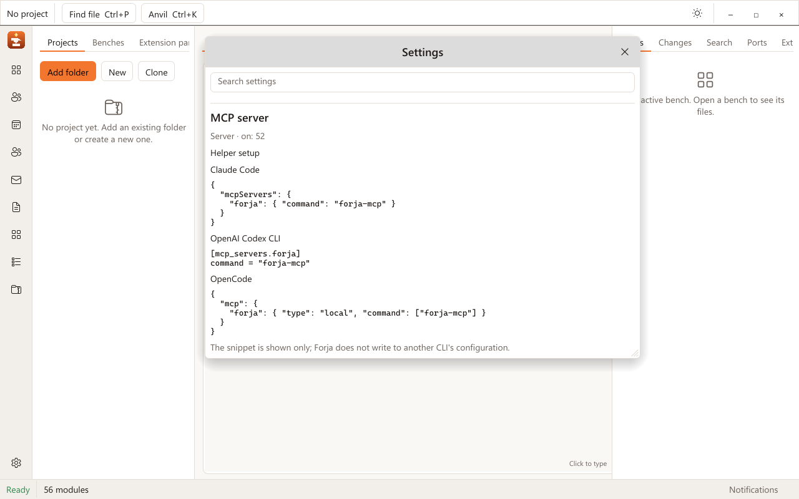

# Ajustes — Servidor MCP (en, light)

Tela de configurações que mostra, na seção "MCP server", como registrar o servidor MCP da Forja nos ajudantes de código (Claude Code, OpenAI Codex CLI e OpenCode), por meio de snippets de configuração.

## Como chegar
Clicar no botão "Settings" (ícone de engrenagem na base do trilho à esquerda, (8,1004)–(44,1040)) e abrir a seção "MCP server" na janela "Settings". Comando de captura: `forja-app --locale en --theme light --settings mcp`.

## Regiões
- **Barra superior** (0,0)–(1920,37): rótulo "No project" à esquerda, botões "Find file  Ctrl+P" e "Anvil  Ctrl+K", botão de tema (ícone de sol) e botões de janela "–", "□", "×".
- **Trilho à esquerda** (0,42)–(52,1048): logotipo da Forja no topo e uma coluna de botões de ícone — "Board", "Helpers", "Routines", "Muster", "Requests", "Skills", "Usage", "Extensions", "Archive" — com "Settings" fixado embaixo.
- **Painel lateral esquerdo** (52,42)–(318,1048): abas "Projects" (marcada, com sublinhado laranja), "Bench" e "Extension panels"; botões "Add folder", "New project" e "Clone"; estado vazio com ícone de pasta e o texto "No project yet. Add an existing folder or create a new one.".
- **Área central** (318,42)–(1612,1048): faixa de abas "Terminal" (marcada), "Editor", "Browser", "Changes", "Preview", "Bench", "Review", "History" e "Extension panels", com a barra de ferramentas "+", "Recipes" e "Shell" logo abaixo; aba de terminal "pwsh · Running". Quase toda a área é coberta pela janela modal "Settings".
- **Janela "Settings" (modal)** (328,58)–(1026,496): título "Settings" e botão "Close window"; campo de busca ("Search settings"); título "MCP server", contador "Server · on: 53", rótulo "Helper setup" e três blocos de snippet em fonte monoespaçada ("Claude Code" em JSON, "OpenAI Codex CLI" em TOML, "OpenCode" em JSON). O conteúdo estende-se abaixo do limite visível do modal, que tem canto de redimensionamento; o aviso sobre o snippet aparece logo abaixo da janela.
- **Painel direito** (1628,42)–(1920,1048): abas "Files" (marcada), "Changes", "Helper (chat)"; ícone de grade e o estado vazio "No active bench. Open a bench to see its files.".
- **Barra de status** (0,1048)–(1920,1080): "Ready", "56 modules" e "Notifications" à direita.

## Elementos
| Elemento | Tipo | Posição (px) | Estado | O que faz |
|---|---|---|---|---|
| "Find file  Ctrl+P" | Button | (99,5)–(218,37) | — | Abre a busca rápida de arquivos (atalho Ctrl+P). |
| "Anvil  Ctrl+K" | Button | (226,5)–(327,37) | — | Abre a paleta de comandos (atalho Ctrl+K). |
| Elemento sem nome (ícone de sol) | Unknown | (1741,5)–(1773,37) | — | Alterna o tema claro/escuro. |
| "–" | Button | (1795,5)–(1827,37) | — | Minimiza a janela. |
| "□" | Button | (1835,5)–(1867,37) | — | Maximiza/restaura a janela. |
| "×" | Button | (1875,5)–(1909,37) | — | Fecha a janela. |
| "No project" | Label | (11,12)–(77,31) | — | Mostra que não há projeto aberto. |
| Elemento sem nome (divisória vertical) | Unknown | (304,42)–(320,1048) | — | Separa o painel esquerdo da área central; arrastável. |
| Elemento sem nome (divisória vertical) | Unknown | (1612,42)–(1628,1048) | — | Separa a área central do painel direito; arrastável. |
| Elemento sem nome (peça de canto) | Unknown | (319,49)–(339,69) | — | Alça/rolagem no canto superior esquerdo da área central. |
| Elemento sem nome (peça de canto) | Unknown | (1016,49)–(1036,69) | — | Alça/rolagem no canto superior direito da área central. |
| Elemento sem nome (logotipo) | Image | (12,50)–(40,78) | — | Marca da Forja (bigorna laranja) no topo do trilho. |
| "More tabs" | Button | (64,50)–(151,85) | — | Menu com as abas que não couberam na faixa do painel esquerdo. |
| "More tabs" | Button | (324,50)–(411,85) | — | Menu com as abas que não couberam na faixa da área central. |
| "More tabs" | Button | (1632,50)–(1719,85) | — | Menu com as abas que não couberam na faixa do painel direito. |
| Elemento sem nome (faixa de abas) | Unknown | (339,51)–(1016,67) | — | Contêiner das abas da área central. |
| "Projects" | Button | (159,52)–(231,84) | marcado=True | Aba do painel esquerdo; seleciona a lista de projetos. |
| "Terminal" | Button | (419,52)–(496,84) | marcado=True | Aba da área central; seleciona o painel de terminal. |
| "Editor" | Button | (496,52)–(556,84) | marcado=False | Aba do editor de arquivos. |
| "Browser" | Button | (556,52)–(629,84) | marcado=False | Aba do painel de navegador. |
| "Changes" | Button | (629,52)–(706,84) | marcado=False | Aba de comparação de diffs. |
| "Preview" | Button | (706,52)–(777,84) | marcado=False | Aba de visualização de arquivos. |
| "Bench" | Button | (777,52)–(838,84) | marcado=False | Aba da bancada ativa. |
| "Review" | Button | (838,52)–(905,84) | marcado=False | Aba de revisão. |
| "History" | Button | (905,52)–(973,84) | marcado=False | Aba de histórico. |
| "Extension panels" | Button | (973,52)–(1099,84) | marcado=False | Aba com retângulo deslocado; repete a aba de extensões sobre a faixa do painel direito. |
| "Helper (chat)" | Button | (1099,52)–(1202,84) | marcado=False | Aba de chat com o ajudante, com retângulo deslocado sobre a área do painel direito. |
| Elemento sem nome (faixa de abas) | Unknown | (339,51)–(1016,67) | — | Contêiner das abas da área central. |
| "Files" | Button | (1727,52)–(1778,84) | marcado=True | Aba do painel direito; lista de arquivos da bancada. |
| "Changes" | Button | (1778,52)–(1855,84) | marcado=False | Aba de mudanças da bancada. |
| "Settings" | Window | (328,58)–(1026,496) | foco | Janela modal de configurações sobre a área central. |
| "Close window" | Button | (985,67)–(1017,99) | — | Fecha a janela "Settings" (ícone "×"). |
| Elemento sem nome (borda) | Unknown | (321,69)–(337,486) | — | Borda/rolagem esquerda do modal. |
| Elemento sem nome (borda) | Unknown | (1018,69)–(1034,486) | — | Borda/rolagem direita do modal. |
| "Settings" | Label | (337,71)–(403,95) | — | Título da janela modal. |
| "Board" | Button | (8,94)–(44,130) | marcado=False | Botão de ícone do trilho; abre o quadro de projetos. |
| "Add folder" | Button | (64,101)–(154,133) | — | Ação destacada (laranja) para importar uma pasta como projeto. |
| "New project" | Button | (162,101)–(261,133) | — | Cria um projeto novo. |
| "+" | Button | (407,113)–(441,145) | — | Nova aba de terminal; oculto atrás da janela "Settings". |
| Elemento sem nome (ícone) | Unknown | (444,113)–(476,145) | — | Botão de ícone da barra do terminal; oculto atrás do modal. |
| Elemento sem nome (ícone) | Unknown | (479,113)–(511,145) | — | Botão de ícone da barra do terminal; oculto atrás do modal. |
| Elemento sem nome (ícone) | Unknown | (514,113)–(546,145) | — | Botão de ícone da barra do terminal; oculto atrás do modal. |
| Elemento sem nome (ícone) | Unknown | (549,113)–(581,145) | — | Botão de ícone da barra do terminal; oculto atrás do modal. |
| "Recipes" | Button | (584,113)–(655,145) | — | Abre receitas no terminal; oculto atrás do modal. |
| "Shell" | Button | (658,113)–(711,145) | — | Abre um shell no terminal; oculto atrás do modal. |
| Elemento sem nome (ícone) | Label | (1756,117)–(1784,145) | — | Ícone de grade do estado vazio no painel direito. |
| "pwsh · Running" | Button | (328,118)–(404,140) | — | Aba de terminal pwsh em execução; coberta parcialmente pela janela "Settings". |
| Elemento sem nome (campo de busca) | TextInput | (337,121)–(1017,153) | — | Campo de texto "Search settings" dentro do modal. |
| "Close pwsh" | Button | (385,121)–(401,137) | — | Fecha a aba de terminal pwsh; sobreposto pelo campo de busca do modal. |
| "Helpers" | Button | (8,138)–(44,174) | marcado=False | Botão de ícone do trilho; abre os ajudantes. |
| "Clone" | Button | (64,141)–(123,173) | — | Clona um repositório para criar um projeto. |
| Elemento sem nome (área de conteúdo) | Unknown | (328,150)–(1604,1036) | — | Área central (terminal) sob a janela modal; clicável. |
| "No active bench. Open a bench to see its files." | Label | (1644,153)–(1896,191) | — | Estado vazio do painel de arquivos. |
| Elemento sem nome (área de conteúdo do modal) | Unknown | (337,167)–(1017,487) | — | Conteúdo rolável da seção dentro do modal. |
| Elemento sem nome (barra de rolagem) | Unknown | (1015,167)–(1017,487) | — | Barra de rolagem fina à direita do conteúdo do modal. |
| "MCP server" | Label | (337,181)–(430,205) | — | Título da seção de configurações exibida. |
| "Routines" | Button | (8,182)–(44,218) | marcado=False | Botão de ícone do trilho; abre rotinas. |
| Elemento sem nome (ícone) | Label | (168,201)–(196,229) | — | Ícone de pasta do estado vazio do painel esquerdo. |
| "Server · on: 53" | Label | (337,213)–(424,232) | — | Estado do servidor MCP: ligado, 53 conexões/unidades. |
| "Muster" | Button | (8,226)–(44,262) | marcado=False | Botão de ícone do trilho; abre o mutirão. |
| "No project yet. Add an existing folder or create a new one." | Label | (67,237)–(297,275) | — | Estado vazio da lista de projetos. |
| "Helper setup" | Label | (337,240)–(415,259) | — | Subtítulo da seção. |
| "Claude Code" | Label | (337,267)–(415,286) | — | Nome do primeiro ajudante listado. |
| "Requests" | Button | (8,270)–(44,306) | marcado=False | Botão de ícone do trilho; abre pedidos. |
| "{
  "mcpServers": {
    "forja": { "command": "forja-mcp" }
  }
}" | Label | (337,294)–(634,369) | — | Snippet JSON de configuração do MCP no Claude Code (somente exibição). |
| "Skills" | Button | (8,314)–(44,350) | marcado=False | Botão de ícone do trilho; abre skills. |
| "Usage" | Button | (8,358)–(44,394) | marcado=False | Botão de ícone do trilho; abre o uso. |
| "OpenAI Codex CLI" | Label | (337,377)–(449,396) | — | Nome do segundo ajudante listado. |
| "[mcp_servers.forja]
command = "forja-mcp"" | Label | (337,404)–(497,434) | — | Snippet TOML de configuração do MCP no Codex CLI (somente exibição). |
| "Extensions" | Button | (8,402)–(44,438) | marcado=False | Botão de ícone do trilho; abre extensões. |
| "OpenCode" | Label | (337,442)–(403,461) | — | Nome do terceiro ajudante listado. |
| "Archive" | Button | (8,446)–(44,482) | marcado=False | Botão de ícone do trilho; abre o acervo. |
| "{
  "mcp": {
    "forja": { "type": "local", "command": ["forja-mcp"] }
  }
}" | Label | (337,469)–(779,544) | — | Snippet JSON de configuração do MCP no OpenCode (somente exibição); estende-se abaixo do limite do modal, corte visível na imagem. |
| Elemento sem nome (alça) | Unknown | (319,486)–(339,506) | — | Alça de redimensionamento inferior esquerda do modal. |
| Elemento sem nome (alça) | Unknown | (1016,486)–(1036,506) | — | Alça de redimensionamento inferior direita do modal. |
| Elemento sem nome (borda inferior) | Unknown | (339,488)–(1016,504) | — | Borda inferior do modal para redimensionar. |
| "The snippet is shown only; Forja does not write to another CLI's configuration." | Label | (337,552)–(816,571) | — | Aviso de que a Forja não edita a configuração de outro CLI; renderizado fora/abaixo da janela modal. |
| "Settings" | Button | (8,1004)–(44,1040) | marcado=False | Botão de engrenagem na base do trilho; abre esta tela. |
| "Ready" | Label | (10,1055)–(48,1074) | — | Status geral do app, em verde. |
| "56 modules" | Label | (70,1055)–(142,1074) | — | Quantidade de módulos carregados. |
| "Notifications" | Label | (1808,1055)–(1886,1074) | — | Acesso às notificações na barra de status. |

## Aparência
Variante em inglês e tema claro (página de referência: pt-BR.dark). Fundo geral creme/off-white, sem gradientes; trilho e painéis em tons levemente mais claros. Cor de destaque laranja (identidade "Brasa") usada no logotipo, no botão primário "Add folder", nos sublinhados das abas ativas ("Projects", "Terminal", "Files") e no "×" do modal. Tipografia: sans-serif para a interface (título "Settings" em negrito, corpos em ~13 px) e monoespaçada para os três snippets de configuração, cada um precedido do nome do CLI. O status "Ready" aparece em verde. Espaçamento regular: ~16 px entre blocos do modal, ~24 px entre as seções de CLI, snippets recuados em ~8 px. Abas alinhadas em faixas horizontais nas três colunas; divisórias verticais separam painel esquerdo, área central e painel direito. Contraste entre texto escuro e fundo claro é alto; textos secundários ("Server · on: 53", aviso do modal) em cinza médio.

## Problemas encontrados
- A janela modal "Settings" termina em y=496, mas o snippet do OpenCode ((337,469)–(779,544)) e o aviso "The snippet is shown only; Forja does not write to another CLI's configuration." ((337,552)–(816,571)) estendem-se abaixo do limite da janela; o conteúdo aparece cortado/fora do modal na imagem.
- O campo de busca do modal é um TextInput sem nome acessível (só o texto de apoio "Search settings" é visível).
- Botões sem nome acessível: o alternador de tema (ícone de sol, (1741,5)) e os quatro botões de ícone da barra do terminal ((444,113)–(581,145)).
- Ícones registrados apenas como "(ícone)" ((168,201) e (1756,117)) sem texto alternativo descritivo.
- As abas "Extension panels" ((973,52)–(1099,84)) e "Helper (chat)" ((1099,52)–(1202,84)) têm retângulos que se estendem sobre a faixa do painel direito (até x≈1202), muito além do limite da área central (x≈1612); indicam sobreposição/desalinhamento da faixa de abas.
- O botão "Close pwsh" ((385,121)–(401,137)) fica sobreposto pelo campo de busca do modal, e a aba "pwsh · Running" é parcialmente coberta pela janela "Settings".
- Os botões "+", os quatro ícones sem nome, "Recipes" e "Shell" da barra do terminal ficam ocultos atrás da janela modal.
