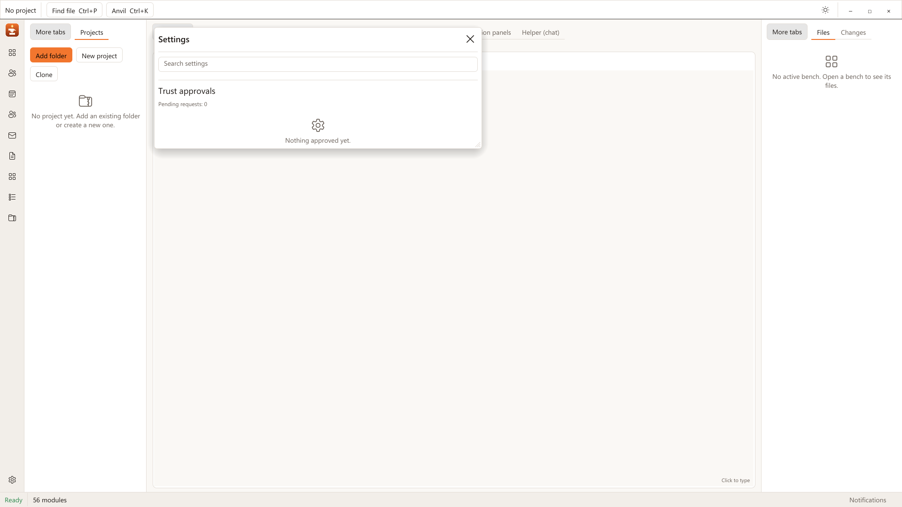

state: en.light.settings.trust
capture_sha: (ver cabeçalho da captura)
model: opencode/glm-5.3-flash-free
---

# Settings — Trust approvals

Tela de configurações da Forja que mostra a seção "Trust approvals", exibida como diálogo modal sobre a janela principal (variante em inglês, tema claro).

## Como chegar
Abra a janela de Settings pelo botão "Settings" (engrenagem) na base do trilho de ícones à esquerda e selecione a seção "Trust approvals". Captura obtida com `forja-app --locale en --theme light --settings trust`.

## Regiões
Esta variante foi capturada em janela de 1920×1080 px (a referência pt-BR/dark usa 1280×800); as coordenadas abaixo seguem esta captura.

- **Barra de título superior** — (0,0)–(1920,42): rótulo "No project" à esquerda, botões "Find file  Ctrl+P" e "Anvil  Ctrl+K", alternador de tema (ícone de sol, sem nome) e os botões de janela "–", "□" e "×".
- **Trilho à esquerda** — (0,42)–(56,1048): logotipo da Forja (imagem em (12,50)–(40,78)) e coluna de botões-ícone: "Board", "Helpers", "Routines", "Muster", "Requests", "Skills", "Usage", "Extensions", "Archive" e, na base, "Settings".
- **Painel esquerdo (Projects)** — (56,42)–(304,1048): botão "More tabs", aba "Projects" (marcada); botões "Add folder" (destaque laranja), "New project" e "Clone"; mensagem de vazio "No project yet. Add an existing folder or create a new one." com ícone de pasta.
- **Área central** — (320,42)–(1612,1048): linha de abas "Terminal" (marcada), "Editor", "Browser", "Changes", "Preview", "Bench", "Review", "History", "Extension panels" e "Helper (chat)"; barra de ferramentas com "+", quatro ícones sem nome, "Recipes" e "Shell"; grande área de texto com o aviso "Click to type" no canto inferior direito. A parte superior é coberta pelo diálogo "Settings" (328,58)–(1026,317).
- **Diálogo "Settings"** — (328,58)–(1026,317): janela modal com título "Settings", botão "Close window" no canto, campo de busca sem nome acessível (texto de apoio "Search settings"), título "Trust approvals", contador "Pending requests: 0", ícone de engrenagem e texto "Nothing approved yet.".
- **Painel direito** — (1628,42)–(1920,1048): botão "More tabs", abas "Files" (marcada) e "Changes"; ícone de grade e mensagem "No active bench. Open a bench to see its files.".
- **Barra de status** — (0,1048)–(1920,1080): "Ready" e "56 modules" à esquerda, "Notifications" à direita.

## Elementos
| Elemento | Tipo | Posição (px) | Estado | O que faz |
|---|---|---|---|---|
| "Find file  Ctrl+P" | Button | (99,5)–(218,37) | — | Abre a busca rápida de arquivos (atalho Ctrl+P). |
| "Anvil  Ctrl+K" | Button | (226,5)–(327,37) | — | Abre a paleta de comandos (atalho Ctrl+K). |
| (sem nome acessível) | Unknown | (1741,5)–(1773,37) | — | Ícone de sol: alternador de tema claro/escuro. |
| "–" | Button | (1795,5)–(1827,37) | — | Minimiza a janela. |
| "□" | Button | (1835,5)–(1867,37) | — | Maximiza/restaura a janela. |
| "×" | Button | (1875,5)–(1909,37) | — | Fecha a janela do app. |
| "No project" | Label | (11,12)–(77,31) | — | Indica que não há projeto aberto. |
| (sem nome acessível) | Unknown | (304,42)–(320,1048) | — | Divisor vertical entre o painel esquerdo e a área central. |
| (sem nome acessível) | Unknown | (1612,42)–(1628,1048) | — | Divisor vertical entre a área central e o painel direito. |
| (sem nome acessível) | Unknown | (319,49)–(339,69) | — | Canto superior esquerdo do diálogo "Settings". |
| (sem nome acessível) | Unknown | (1016,49)–(1036,69) | — | Canto superior direito do diálogo "Settings". |
| (sem nome acessível) | Image | (12,50)–(40,78) | — | Logotipo da Forja (bigorna laranja). |
| "More tabs" | Button | (64,50)–(151,85) | — | Lista as abas ocultas do painel esquerdo. |
| "More tabs" | Button | (324,50)–(411,85) | — | Lista as abas ocultas da área central. |
| "More tabs" | Button | (1632,50)–(1719,85) | — | Lista as abas ocultas do painel direito. |
| (sem nome acessível) | Unknown | (339,51)–(1016,67) | — | Barra de título interna do diálogo "Settings". |
| "Projects" | Button | (159,52)–(231,84) | marcado=True | Aba ativa do painel esquerdo; mostra o painel de projetos. |
| "Terminal" | Button | (419,52)–(496,84) | marcado=True | Aba ativa da área central; mostra o terminal. |
| "Editor" | Button | (496,52)–(556,84) | marcado=False | Aba do editor de texto. |
| "Browser" | Button | (556,52)–(629,84) | marcado=False | Aba do painel de navegador. |
| "Changes" | Button | (629,52)–(706,84) | marcado=False | Aba de visualização de diferenças (primeira ocorrência). |
| "Preview" | Button | (706,52)–(777,84) | marcado=False | Aba do visualizador de arquivos. |
| "Bench" | Button | (777,52)–(838,84) | marcado=False | Aba da visão de bancada. |
| "Review" | Button | (838,52)–(905,84) | marcado=False | Aba de revisão. |
| "History" | Button | (905,52)–(973,84) | marcado=False | Aba de histórico. |
| "Extension panels" | Button | (973,52)–(1099,84) | marcado=False | Grupo de painéis de extensões da área central; parcialmente encoberto pelo diálogo. |
| "Helper (chat)" | Button | (1099,52)–(1202,84) | marcado=False | Aba do chat com o ajudante. |
| "Files" | Button | (1727,52)–(1778,84) | marcado=True | Aba ativa do painel direito; lista de arquivos. |
| "Changes" | Button | (1778,52)–(1855,84) | marcado=False | Aba de mudanças pendentes (segunda ocorrência). |
| "Settings" | Window | (328,58)–(1026,317) | foco | Diálogo modal de configurações exibindo a seção "Trust approvals". |
| "Close window" | Button | (985,67)–(1017,99) | — | Ícone "×" que fecha o diálogo de Settings. |
| (sem nome acessível) | Unknown | (321,69)–(337,307) | — | Borda/pegador esquerdo do diálogo. |
| (sem nome acessível) | Unknown | (1018,69)–(1034,307) | — | Borda/pegador direito do diálogo. |
| "Settings" | Label | (337,71)–(403,95) | — | Título do diálogo. |
| "Board" | Button | (8,94)–(44,130) | marcado=False | Ícone do quadro (visão geral) no trilho esquerdo. |
| "Add folder" | Button | (64,101)–(154,133) | — | Botão destacado em laranja para adicionar uma pasta de projeto. |
| "New project" | Button | (162,101)–(261,133) | — | Cria um projeto novo. |
| "+" | Button | (407,113)–(441,145) | — | Abre nova aba/ação na área central. |
| (sem nome acessível) | Unknown | (444,113)–(476,145) | — | Ícone de ferramenta da barra central, sem nome. |
| (sem nome acessível) | Unknown | (479,113)–(511,145) | — | Ícone de ferramenta da barra central, sem nome. |
| (sem nome acessível) | Unknown | (514,113)–(546,145) | — | Ícone de ferramenta da barra central, sem nome. |
| (sem nome acessível) | Unknown | (549,113)–(581,145) | — | Ícone de ferramenta da barra central, sem nome. |
| "Recipes" | Button | (584,113)–(655,145) | — | Abre a lista de receitas. |
| "Shell" | Button | (658,113)–(711,145) | — | Abre o terminal shell. |
| (ícone) | Label | (1756,117)–(1784,145) | — | Ícone de grade do painel direito (vazio de bancada). |
| "pwsh · Running" | Button | (328,118)–(404,140) | — | Aba do terminal pwsh em execução; quase toda encoberta pelo diálogo. |
| (sem nome acessível) | TextInput | (337,121)–(1017,153) | — | Campo "Search settings": filtra as seções de configuração. |
| "Close pwsh" | Button | (385,121)–(401,137) | — | Fecha a aba do terminal pwsh; encoberto pelo diálogo. |
| "Helpers" | Button | (8,138)–(44,174) | marcado=False | Ícone do painel de ajudantes no trilho esquerdo. |
| "Clone" | Button | (64,141)–(123,173) | — | Clona um projeto existente. |
| (sem nome acessível) | Unknown | (328,150)–(1604,1036) | — | Área central de texto (terminal/editor), com o aviso "Click to type" na base direita. |
| "No active bench. Open a bench to see its files." | Label | (1644,153)–(1896,191) | — | Mensagem de vazio do painel de arquivos. |
| "Trust approvals" | Label | (337,181)–(458,205) | — | Título da seção de configuração em exibição. |
| "Routines" | Button | (8,182)–(44,218) | marcado=False | Ícone do painel de rotinas no trilho esquerdo. |
| "Pending requests: 0" | Label | (337,213)–(440,229) | — | Contador de pedidos de aprovação pendentes. |
| "Muster" | Button | (8,226)–(44,262) | marcado=False | Ícone do painel de mutirão no trilho esquerdo. |
| "No project yet. Add an existing folder or create a new one." | Label | (67,237)–(297,275) | — | Mensagem de vazio do painel de projetos. |
| (ícone) | Label | (663,253)–(691,281) | — | Ícone de engrenagem central do diálogo. |
| "Requests" | Button | (8,270)–(44,306) | marcado=False | Ícone do painel de pedidos no trilho esquerdo. |
| "Nothing approved yet." | Label | (608,289)–(747,308) | — | Mensagem de vazio da lista de aprovações. |
| (sem nome acessível) | Unknown | (319,307)–(339,327) | — | Canto inferior esquerdo do diálogo. |
| (sem nome acessível) | Unknown | (1016,307)–(1036,327) | — | Canto inferior direito do diálogo. |
| (sem nome acessível) | Unknown | (339,309)–(1016,325) | — | Borda inferior do diálogo. |
| "Skills" | Button | (8,314)–(44,350) | marcado=False | Ícone do painel de skills no trilho esquerdo. |
| "Usage" | Button | (8,358)–(44,394) | marcado=False | Ícone do painel de uso no trilho esquerdo. |
| "Extensions" | Button | (8,402)–(44,438) | marcado=False | Ícone do painel de extensões no trilho esquerdo. |
| "Archive" | Button | (8,446)–(44,482) | marcado=False | Ícone do painel de acervo no trilho esquerdo. |
| "Settings" | Button | (8,1004)–(44,1040) | marcado=False | Ícone que abre esta tela de Settings. |
| "Ready" | Label | (10,1055)–(48,1074) | — | Status geral do app na barra de status. |
| "56 modules" | Label | (70,1055)–(142,1074) | — | Quantidade de módulos carregados. |
| "Notifications" | Label | (1808,1055)–(1886,1074) | — | Atalho para a área de notificações. |

## Aparência
Tema claro: fundo geral em creme/off-white (painel de projetos e área central em tom levemente mais escuro que o diálogo), barra de título no topo em tom ainda mais claro. A cor de destaque é o laranja, visível no logotipo, no botão "Add folder" (laranja cheio com texto branco) e no sublinhado das abas ativas ("Projects", "Terminal", "Files"). O diálogo "Settings" é branco, com cantos arredondados e sombra, centralizado sobre a área central. A tipografia é uma sans-serif pequena; os títulos ("Settings", "Trust approvals") têm tamanho e peso maiores que rótulos e mensagens de vazio. Textos secundários ("Pending requests: 0", "Nothing approved yet.", avisos de vazio, "Click to type") aparecem em cinza médio com contraste reduzido; "Ready" na barra de status aparece em tom esverdeado. Diferenças em relação à referência pt-BR/dark: textos em inglês, paleta invertida (fundo claro, texto escuro) e, no layout, abas extras visíveis ("Bench" na área central) e botões "More tabs" no início de cada linha de abas, já que esta captura usa janela maior (1920×1080).

## Problemas encontrados
- O diálogo "Settings" se sobrepõe à linha de abas da área central: "Extension panels" aparece cortado no texto visível ("ion panels") e "Helper (chat)" fica parcialmente encoberto na captura.
- A aba "pwsh · Running" e o botão "Close pwsh" (328–404, y 118–140) ficam quase totalmente atrás do diálogo, invisíveis para o usuário.
- O TextInput do campo de busca de ajustes (337,121)–(1017,153) não tem nome acessível, embora exiba o texto de apoio "Search settings".
- O alternador de tema do topo (1741,5)–(1773,37) e quatro ícones da barra de ferramentas central (444–581, y 113–145) não têm nome acessível.
- O nome "More tabs" se repete em três botões distintos (painel esquerdo, área central e painel direito), o que dificulta a identificação por leitores de tela.
- O nome "Changes" se repete em duas abas diferentes (área central e painel direito).
- Os ícones de grade do painel direito e de engrenagem do diálogo são expostos apenas como Label "(ícone)", sem papel ou nome descritivo.
- Textos secundários em cinza médio sobre fundo claro ("Nothing approved yet.", "Pending requests: 0", avisos de vazio e "Click to type") têm baixo contraste.
