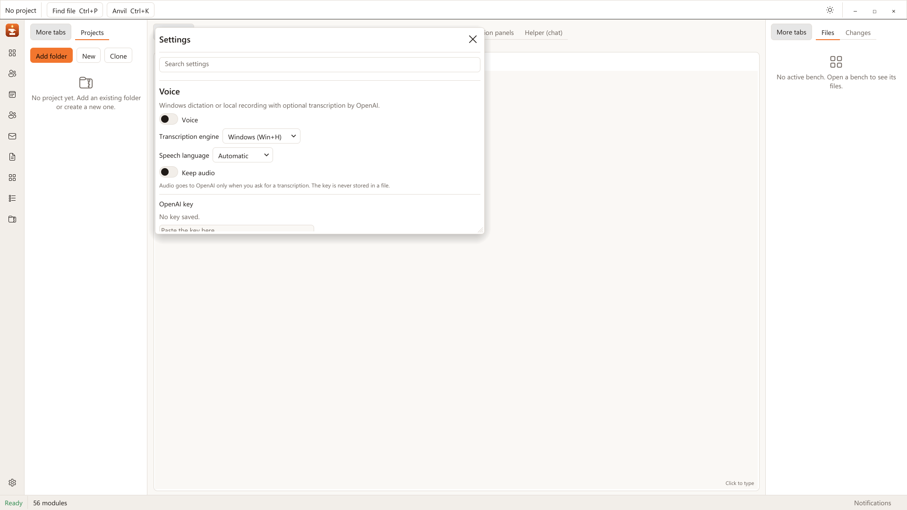

# Ajustes — Voz (en / light)

Tela de configurações do app, exibida como janela modal "Settings" sobre a área de trabalho, com a seção **Voice** (ditado e transcrição) aberta. Variante em inglês e tema claro da página de referência `pt-BR.dark.settings.voice`: mudam idioma, cores, o tamanho da modal (mais curta, cortando o fim do formulário) e o título, que aqui fica alinhado à esquerda.

## Como chegar
No app, clique no botão "Settings" na base do trilho de ícones à esquerda; dentro da janela, a seção "Voice" aparece na lista de seções. Captura: `forja-app --locale en --theme light --settings voice`.

## Regiões
- **Barra superior** (0,0)–(1920,42): rótulo "No project", botões "Find file  Ctrl+P" e "Anvil  Ctrl+K" à esquerda; ícone de tema (sem nome, sol) em (1741,5)–(1773,37) e botões de janela "–", "□", "×" à direita.
- **Trilho à esquerda** (0,42)–(48,1048): logo da Forja no topo (12,50)–(40,78), depois "Board", "Helpers", "Routines", "Muster", "Requests", "Skills", "Usage", "Extensions", "Archive" e, na base, "Settings" (8,1004)–(44,1040).
- **Painel lateral esquerdo** (48,42)–(304,1048): abas "More tabs" e "Projects" (marcada); botões "Add folder" (destaque laranja), "New project" e "Clone"; estado vazio com ícone de pasta (168,201)–(196,229) e a mensagem "No project yet. Add an existing folder or create a new one.".
- **Faixa de abas central** (304,42)–(1612,84): "More tabs" (encoberto pela modal), abas "Terminal" (marcada), "Editor", "Browser", "Changes", "Preview", "Bench", "Review", "History", "Extension panels" e "Helper (chat)"; abaixo, barra de ferramentas com "+", três botões-ícone sem nome, "Recipes" e "Shell"; aba do terminal "pwsh · Running" com "Close pwsh".
- **Área central** (304,84)–(1612,1048): conteúdo do terminal atrás da modal (campo vazio com a dica "Click to type" no canto inferior direito, ~ (1506,1015)–(1599,1031)).
- **Painel direito** (1628,42)–(1920,1048): abas "More tabs", "Files" (marcada) e "Changes"; estado vazio com ícone de grade (1756,117)–(1784,145) e a mensagem "No active bench. Open a bench to see its files.".
- **Janela modal "Settings"** (328,58)–(1026,496): título "Settings" à esquerda, botão "Close window" (985,67)–(1017,99), campo de busca "Search settings" (337,121)–(1017,153) e a seção "Voice" com interruptores, seletores e campo de chave; barra de rolagem interna (1015,167)–(1017,487).
- **Barra de status** (0,1048)–(1920,1080): "Ready" (em verde) e "56 modules" à esquerda; "Notifications" à direita.

## Elementos
| Elemento | Tipo | Posição (px) | Estado | O que faz |
|---|---|---|---|---|
| "Find file  Ctrl+P" | Button | (99,5)–(218,37) | — | Abre a busca rápida de arquivos (Ctrl+P). |
| "Anvil  Ctrl+K" | Button | (226,5)–(327,37) | — | Abre a paleta de comandos (Ctrl+K). |
| (sem nome acessível) | Unknown | (1741,5)–(1773,37) | — | Ícone de alternância de tema (sol) na barra superior. |
| "–" | Button | (1795,5)–(1827,37) | — | Minimiza a janela. |
| "□" | Button | (1835,5)–(1867,37) | — | Maximiza/restaura a janela. |
| "×" | Button | (1875,5)–(1909,37) | — | Fecha a janela do app. |
| "No project" | Label | (11,12)–(77,31) | — | Indica que nenhum projeto está aberto. |
| (sem nome acessível) | Unknown | (304,42)–(320,1048) | — | Divisor vertical entre o painel esquerdo e a área central. |
| (sem nome acessível) | Unknown | (1612,42)–(1628,1048) | — | Divisor vertical entre a área central e o painel direito. |
| (sem nome acessível) | Unknown | (319,49)–(339,69) | — | Canto/ornamento da faixa de abas central. |
| (sem nome acessível) | Unknown | (1016,49)–(1036,69) | — | Canto/ornamento da faixa de abas do painel direito. |
| (sem nome acessível) | Image | (12,50)–(40,78) | — | Logo da Forja no topo do trilho. |
| "More tabs" | Button | (64,50)–(151,85) | — | Lista as abas ocultas do painel esquerdo. |
| "More tabs" | Button | (324,50)–(411,85) | — | Lista as abas ocultas da área central; encoberto pela modal. |
| "More tabs" | Button | (1632,50)–(1719,85) | — | Lista as abas ocultas do painel direito. |
| (sem nome acessível) | Unknown | (339,51)–(1016,67) | — | Linha da faixa de abas central. |
| "Projects" | Button | (159,52)–(231,84) | marcado=True | Aba ativa do painel esquerdo; mostra a lista de projetos. |
| "Terminal" | Button | (419,52)–(496,84) | marcado=True | Aba ativa da área central; mostra o terminal. |
| "Editor" | Button | (496,52)–(556,84) | marcado=False | Aba do editor de arquivos. |
| "Browser" | Button | (556,52)–(629,84) | marcado=False | Aba do navegador de arquivos. |
| "Changes" | Button | (629,52)–(706,84) | marcado=False | Aba de diffs (git). |
| "Preview" | Button | (706,52)–(777,84) | marcado=False | Aba do visualizador. |
| "Bench" | Button | (777,52)–(838,84) | marcado=False | Aba da bancada. |
| "Review" | Button | (838,52)–(905,84) | marcado=False | Aba de revisão. |
| "History" | Button | (905,52)–(973,84) | marcado=False | Aba de histórico. |
| "Extension panels" | Button | (973,52)–(1099,84) | marcado=False | Aba de painéis de extensões; parcialmente encoberta pela modal (só "…ion panels" aparece). |
| "Helper (chat)" | Button | (1099,52)–(1202,84) | marcado=False | Aba do chat com o ajudante de IA. |
| "Files" | Button | (1727,52)–(1778,84) | marcado=True | Aba ativa do painel direito; lista de arquivos. |
| "Changes" | Button | (1778,52)–(1855,84) | marcado=False | Aba de mudanças (git) do painel direito. |
| "Settings" | Window | (328,58)–(1026,496) | focus | Janela modal de configurações em foco. |
| "Close window" | Button | (985,67)–(1017,99) | — | Ícone × que fecha a janela "Settings". |
| (sem nome acessível) | Unknown | (321,69)–(337,486) | — | Borda/sombra esquerda da modal. |
| (sem nome acessível) | Unknown | (1018,69)–(1034,486) | — | Borda/sombra direita da modal. |
| "Settings" | Label | (337,71)–(403,95) | — | Título da modal, alinhado à esquerda (na referência escura aparecia centrado). |
| "Board" | Button | (8,94)–(44,130) | marcado=False | Ícone do quadro (board) no trilho. |
| "Add folder" | Button | (64,101)–(154,133) | — | Adiciona uma pasta de projeto (botão de destaque laranja). |
| "New project" | Button | (162,101)–(261,133) | — | Cria um novo projeto. |
| "+" | Button | (407,113)–(441,145) | — | Abre nova aba/ação na área central. |
| (sem nome acessível) | Unknown | (444,113)–(476,145) | — | Botão-ícone da barra de ferramentas central (navegação de abas). |
| (sem nome acessível) | Unknown | (479,113)–(511,145) | — | Botão-ícone da barra de ferramentas central. |
| (sem nome acessível) | Unknown | (514,113)–(546,145) | — | Botão-ícone da barra de ferramentas central. |
| (sem nome acessível) | Unknown | (549,113)–(581,145) | — | Botão-ícone da barra de ferramentas central. |
| "Recipes" | Button | (584,113)–(655,145) | — | Acesso a receitas (fluxos prontos). |
| "Shell" | Button | (658,113)–(711,145) | — | Controle de shell do terminal. |
| (ícone) | Label | (1756,117)–(1784,145) | — | Ícone de grade (sem bancada) do painel direito. |
| "pwsh · Running" | Button | (328,118)–(404,140) | — | Aba do terminal pwsh em execução; totalmente encoberta pela modal. |
| (sem nome acessível) | TextInput | (337,121)–(1017,153) | — | Campo "Search settings" para filtrar seções da modal. |
| "Close pwsh" | Button | (385,121)–(401,137) | — | × de fechar da aba do terminal; encoberto pela modal. |
| "Helpers" | Button | (8,138)–(44,174) | marcado=False | Ícone de ajudantes no trilho. |
| "Clone" | Button | (64,141)–(123,173) | — | Clona um projeto existente. |
| (sem nome acessível) | Unknown | (328,150)–(1604,1036) | — | Área central atrás da modal (conteúdo do terminal). |
| "No active bench. Open a bench to see its files." | Label | (1644,153)–(1896,191) | — | Estado vazio do painel de arquivos. |
| (sem nome acessível) | Unknown | (337,167)–(1017,487) | — | Área de conteúdo da seção "Voice" dentro da modal. |
| (sem nome acessível) | Unknown | (1015,167)–(1017,487) | — | Barra de rolagem interna da modal (indica conteúdo cortado). |
| "Voice" | Label | (337,181)–(381,205) | — | Título da seção de configurações de voz. |
| "Routines" | Button | (8,182)–(44,218) | marcado=False | Ícone de rotinas no trilho. |
| (ícone) | Label | (168,201)–(196,229) | — | Ícone de pasta do estado vazio de projetos. |
| "Windows dictation or local recording with optional transcription by OpenAI." | Label | (337,213)–(803,232) | — | Descrição da seção Voice. |
| "Muster" | Button | (8,226)–(44,262) | marcado=False | Ícone de mutirão no trilho. |
| "No project yet. Add an existing folder or create a new one." | Label | (67,237)–(297,275) | — | Estado vazio do painel de projetos. |
| "Voice" | CheckBox | (337,240)–(418,264) | marcado=False | Interruptor que liga/desliga a voz (aparece como toggle desligado). |
| "Requests" | Button | (8,270)–(44,306) | marcado=False | Ícone de pedidos no trilho. |
| "Transcription engine" | Label | (337,272)–(463,304) | — | Rótulo do seletor de motor de transcrição. |
| "Windows (Win+H)" | ComboBox | (471,272)–(636,304) | — | Seletor do motor de transcrição, com o valor "Windows (Win+H)". |
| "Speech language" | Label | (337,312)–(442,344) | — | Rótulo do seletor de idioma. |
| "Automatic" | ComboBox | (450,312)–(578,344) | — | Seletor de idioma da fala, com o valor "Automatic". |
| "Skills" | Button | (8,314)–(44,350) | marcado=False | Ícone de skills no trilho. |
| "Keep audio" | CheckBox | (337,352)–(454,376) | marcado=False | Interruptor para guardar o áudio das gravações (desligado). |
| "Usage" | Button | (8,358)–(44,394) | marcado=False | Ícone de uso no trilho. |
| "Audio goes to OpenAI only when you ask for a transcription. The key is never stored in a file." | Label | (337,384)–(825,400) | — | Nota de privacidade da transcrição. |
| "Extensions" | Button | (8,402)–(44,438) | marcado=False | Ícone de extensões no trilho. |
| "OpenAI key" | Label | (337,422)–(409,441) | — | Título do bloco de chave de API. |
| "Archive" | Button | (8,446)–(44,482) | marcado=False | Ícone de acervo no trilho. |
| "No key saved." | Label | (337,449)–(422,468) | — | Estado atual da chave (nenhuma salva). |
| (sem nome acessível) | PasswordInput | (337,476)–(665,499) | — | Campo para colar a chave (placeholder "Paste the key here", cortado pela borda da modal). |
| (sem nome acessível) | Unknown | (319,486)–(339,506) | — | Canto inferior esquerdo da modal. |
| (sem nome acessível) | Unknown | (1016,486)–(1036,506) | — | Canto inferior direito da modal. |
| (sem nome acessível) | Unknown | (339,488)–(1016,504) | — | Borda inferior da modal. |
| "Save key" | Button | (337,507)–(414,539) | — | Salva a chave informada; fora do retângulo da janela e não visível na captura. |
| "Delete key" | Button | (422,507)–(511,539) | — | Remove a chave guardada; fora do retângulo da janela e não visível na captura. |
| "Settings" | Button | (8,1004)–(44,1040) | marcado=False | Ícone que abre esta janela de ajustes (o estado "marcado" continua falso mesmo com a modal aberta). |
| "Ready" | Label | (10,1055)–(48,1074) | — | Status atual na barra inferior ("Ready"), em verde. |
| "56 modules" | Label | (70,1055)–(142,1074) | — | Contagem de módulos carregados. |
| "Notifications" | Label | (1808,1055)–(1886,1074) | — | Área/atalho de notificações na barra inferior. |

## Aparência
Tema claro em tons quentes: fundos creme/off-white na barra superior, painéis e área central, modal branca com sombra suave e cantos arredondados. Acento laranja ("Brasa") em "Add folder" (botão preenchido), na sublinha das abas ativas ("Projects", "Terminal", "Files") e no trilho; toggles desligados com knob escuro à esquerda. Texto em marrom-cinza escuro, rótulos secundários em cinza médio, "Ready" na barra de status em verde. Tipografia sem serifa, corpos entre ~12 e 16 px; título "Settings" à esquerda em peso maior (na referência escura era centrado). Campo de busca ocupando toda a largura da modal (337–1017) e espaçamento vertical consistente (~30–40 px) entre as linhas da seção "Voice"; seletores "Windows (Win+H)" e "Automatic" alinhados à direita de seus rótulos. Comparada à referência, a modal é mais curta (termina em y=496 contra 543) e corta o fim do formulário.

## Problemas encontrados
- A janela "Settings" termina em y=496, mas os botões "Save key" (337,507)–(414,539) e "Delete key" (422,507)–(511,539) ficam abaixo/fora do retângulo dela e não aparecem na captura: o formulário da seção Voice é truncado (a barra de rolagem interna em (1015,167)–(1017,487) confirma conteúdo cortado).
- O PasswordInput (337,476)–(665,499) ultrapassa ~3 px a borda inferior da modal (496); o placeholder "Paste the key here" aparece cortado pela borda.
- O botão "More tabs" central (324,50)–(411,85) fica encoberto pela modal.
- A aba "pwsh · Running" (328,118)–(404,140) e o botão "Close pwsh" (385,121)–(401,137) ficam totalmente cobertos pela modal.
- A aba "Extension panels" (973,52)–(1099,84) é parcialmente encoberta pela modal, ficando visível apenas "…ion panels".
- O TextInput de busca de ajustes (337,121)–(1017,153) e o PasswordInput da chave (337,476)–(665,499) não têm nome acessível; dependem apenas do placeholder.
- O botão de alternância de tema (1741,5)–(1773,37) não tem nome acessível.
- Botões-ícone sem nome acessível na barra de ferramentas central (444–581, y 113–145), o que impede identificação por leitor de tela.
- O botão "Settings" do trilho permanece marcado=False enquanto a janela "Settings" está aberta em foco, inconsistência de estado de seleção.
