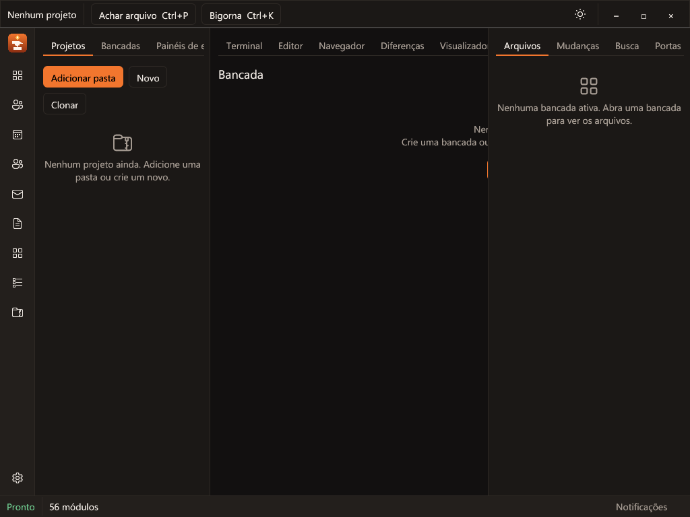

# Bancada — detalhe (sem bancada ativa)

Tela inicial da área de bancada, mostrada sem projeto e sem bancada ativa: à esquerda o painel de projetos vazio, no centro o aviso de bancada inativa e à direita o painel "Arquivos" com estado vazio.

## Como chegar
Abrir o aplicativo Forja (`forja-app --locale pt-BR --theme dark --bench-tab bench.detail`); por padrão a tela inicial já cai nesta visão. Também se chega por `Ctrl+K` (Bigorna) ou clicando em "Projetos" no trilho esquerdo e depois na aba "Bancada" do painel direito. Comando de captura: `forja atlas capture --bench-tab bench.detail --locale pt-BR --theme dark`.

## Regiões
- **Barra superior** (0,0)–(1024,40): rótulo "Nenhum projeto", botões "Achar arquivo Ctrl+P" e "Bigorna Ctrl+K", botão de alternância de tema (ícone de sol, sem nome acessível) e botões de janela (–, □, ×).
- **Trilho esquerdo de ícones** (0,40)–(50,736): coluna de botões-ícone (Quadro, Ajudantes, Rotinas, Mutirão, Pedidos, Skills, Uso, Extensões, Acervo) e, no rodapé, "Ajustes".
- **Painel de projetos** (50,40)–(304,736): abas "Projetos" (marcada), "Bancadas" e "Painéis de extensões" (cortada); ações "Adicionar pasta", "Novo" e "Clonar"; estado vazio com ícone de pasta e o texto "Nenhum projeto ainda. Adicione uma pasta ou crie um novo.".
- **Área central** (320,40)–(716,736): título "Bancada" e a mensagem central "Nenhuma bancada ativa. Crie uma bancada ou escolha uma na lateral ou no Quadro.", truncada pela divisória direita.
- **Painel direito (Arquivos)** (732,40)–(1024,736): fileira de abas (visíveis: "Arquivos", "Mudanças", "Busca", "Portas"; várias outras empilhadas por baixo), ícone de grade, mensagem "Nenhuma bancada ativa. Abra uma bancada para ver os arquivos." e botões "Nova bancada" e "Atualizar".
- **Barra de status** (0,736)–(1024,768): "Pronto" em verde, "56 módulos" e, à direita, "Notificações".

## Elementos
| Elemento | Tipo | Posição (px) | Estado | O que faz |
|---|---|---|---|---|
| "Achar arquivo  Ctrl+P" | Button | (135,5)–(291,37) | — | Abre a busca de arquivos pelo atalho Ctrl+P |
| "Bigorna  Ctrl+K" | Button | (299,5)–(417,37) | — | Abre a paleta de comandos (Bigorna) pelo atalho Ctrl+K |
| (sem nome acessível) | Unknown | (845,5)–(877,37) | — | Botão-ícone de sol na barra superior; alterna o tema |
| "–" | Button | (899,5)–(931,37) | — | Minimiza a janela |
| "□" | Button | (939,5)–(971,37) | — | Maximiza/restaura a janela |
| "×" | Button | (979,5)–(1013,37) | — | Fecha a janela |
| "Nenhum projeto" | Label | (11,12)–(113,31) | — | Mostra que nenhum projeto está aberto |
| (sem nome acessível) | Unknown | (304,42)–(320,736) | focus | Divisória vertical entre painel de projetos e área central |
| (sem nome acessível) | Unknown | (716,42)–(732,736) | focus | Divisória vertical entre área central e painel direito |
| (sem nome acessível) | Image | (12,50)–(40,78) | — | Ícone/logo no topo do trilho esquerdo |
| "Projetos" | Button | (64,50)–(138,82) | marcado=True | Aba ativa do painel esquerdo; mostra a lista de projetos |
| (sem nome acessível) | Unknown | (64,50)–(300,82) | focus | Barra/fundo da fileira de abas do painel esquerdo |
| "Bancadas" | Button | (138,50)–(220,82) | marcado=False | Aba para alternar para a lista de bancadas |
| "Painéis de extensões" | Button | (220,50)–(371,82) | marcado=False | Aba de painéis de extensões; texto cortado pela divisória |
| "Terminal" | Button | (324,50)–(401,82) | marcado=False | Aba oculta empilhada sob a barra do painel direito |
| "Editor" | Button | (401,50)–(461,82) | marcado=False | Aba oculta empilhada |
| "Navegador" | Button | (461,50)–(553,82) | marcado=False | Aba oculta empilhada |
| "Diferenças" | Button | (553,50)–(641,82) | marcado=False | Aba oculta empilhada |
| "Visualizador" | Button | (641,50)–(739,82) | marcado=False | Aba oculta empilhada |
| (sem nome acessível) | Unknown | (736,50)–(1012,82) | focus | Barra/fundo da fileira de abas do painel direito |
| "Arquivos" | Button | (736,50)–(814,82) | marcado=True | Aba ativa do painel direito; exibe o explorador de arquivos |
| "Bancada" | Button | (739,50)–(815,82) | marcado=True | Aba empilhada sobre "Arquivos" (não visível) |
| "Mudanças" | Button | (814,50)–(901,82) | marcado=False | Aba visível; mostraria as mudanças da bancada |
| "Revisão" | Button | (815,50)–(885,82) | marcado=False | Aba empilhada sobre "Mudanças" (não visível) |
| "Histórico" | Button | (885,50)–(965,82) | marcado=False | Aba empilhada sobre "Busca" (não visível) |
| "Busca" | Button | (901,50)–(960,82) | marcado=False | Aba visível; busca no conteúdo |
| "Portas" | Button | (960,50)–(1022,82) | marcado=False | Aba visível; lista de portas/terminais |
| "Painéis de extensões" | Button | (965,50)–(1115,82) | marcado=False | Aba empilhada; retângulo passa da largura da janela |
| "Painéis de extensões" | Button | (1022,50)–(1173,82) | marcado=False | Segunda ocorrência empilhada; totalmente fora da janela |
| "Ajudante (chat)" | Button | (1115,50)–(1234,82) | marcado=False | Aba empilhada; totalmente fora da janela |
| (sem nome acessível) | Unknown | (64,80)–(300,82) | — | Separador sob as abas do painel esquerdo |
| (sem nome acessível) | Unknown | (736,80)–(1012,82) | — | Separador sob as abas do painel direito |
| "Quadro" | Button | (8,94)–(44,130) | marcado=False | Botão-ícone do trilho; abre o quadro de bancadas |
| "Adicionar pasta" | Button | (64,98)–(183,130) | — | Destaque laranja; adiciona uma pasta de projeto |
| "Novo" | Button | (191,98)–(248,130) | — | Cria um novo projeto |
| "Bancada" | Label | (324,98)–(390,122) | — | Título da área central |
| (ícone) | Label | (860,114)–(888,142) | — | Ícone de grade do estado vazio do painel Arquivos |
| "Ajudantes" | Button | (8,138)–(44,174) | marcado=False | Botão-ícone do trilho; abre a lista de ajudantes |
| "Clonar" | Button | (64,138)–(128,170) | — | Clona um projeto |
| (ícone) | Label | (765,146)–(793,174) | — | Ícone de pasta acima da mensagem do painel Arquivos |
| "Nenhuma bancada ativa. Abra uma bancada para ver os arquivos." | Label | (738,150)–(1010,188) | — | Estado vazio do painel Arquivos |
| "Rotinas" | Button | (8,182)–(44,218) | marcado=False | Botão-ícone do trilho; abre rotinas |
| "Nenhuma bancada ativa.\nCrie uma bancada ou escolha uma na lateral ou no Quadro." | Label | (596,182)–(962,220) | — | Mensagem central; texto truncado pela divisória |
| (ícone) | Label | (168,198)–(196,226) | — | Ícone de pasta do estado vazio do painel de projetos |
| "Mutirão" | Button | (8,226)–(44,262) | marcado=False | Botão-ícone do trilho; abre o mutirão |
| "Nenhum projeto ainda. Adicione uma pasta ou crie um novo." | Label | (66,234)–(298,272) | — | Estado vazio do painel de projetos |
| "Nova bancada" | Button | (723,236)–(835,268) | — | Cria uma bancada; borda esquerda invade a divisória |
| "Pedidos" | Button | (8,270)–(44,306) | marcado=False | Botão-ícone do trilho; abre pedidos |
| "Atualizar" | Button | (740,276)–(818,308) | — | Recarrega o conteúdo do painel Arquivos |
| "Skills" | Button | (8,314)–(44,350) | marcado=False | Botão-ícone do trilho; abre skills |
| "Uso" | Button | (8,358)–(44,394) | marcado=False | Botão-ícone do trilho; abre uso |
| "Extensões" | Button | (8,402)–(44,438) | marcado=False | Botão-ícone do trilho; abre extensões |
| "Acervo" | Button | (8,446)–(44,482) | marcado=False | Botão-ícone do trilho; abre o acervo |
| "Ajustes" | Button | (8,692)–(44,728) | marcado=False | Botão-ícone do rodapé do trilho; abre os ajustes |
| "Pronto" | Label | (10,743)–(51,762) | — | Status geral, exibido em verde |
| "56 módulos" | Label | (73,743)–(146,762) | — | Contagem de módulos carregados |
| "Notificações" | Label | (914,743)–(990,762) | — | Abre as notificações |

## Aparência
Tema escuro: fundo quase preto com variações de cinza-escuro por painel; divisórias verticais claras separam as regiões. A cor de destaque é o laranja, usado no botão "Adicionar pasta", no texto da aba marcada "Projetos", no sublinhado das abas "Projetos" e "Arquivos" e no "Pronto" da barra de status (em verde). Tipografia sem serifa em dois tamanhos: títulos de aba/ação em ~13–15 px e rótulos de estado vazio em ~14 px, cinza-claro de baixo contraste sobre o fundo escuro. O trilho esquerdo usa botões quadrados de 36 px só com ícones, espaçados regularmente a cada 44 px. Alinhamento consistente: ações do painel de projetos em coluna, textos de estado vazio centralizados no painel Arquivos e centralizados verticalmente na área central.

## Problemas encontrados
- A área central tem largura efetiva de ~396 px, mas a mensagem "Nenhuma bancada ativa.\nCrie uma bancada ou escolha uma na lateral ou no Quadro." ocupa (596,182)–(962,220): o texto invade a divisória do painel direito e é truncado visualmente ("Nen...", "Crie uma bancada ou...").
- Na fileira de abas do painel direito, as abas "Bancada", "Revisão", "Histórico" e "Painéis de extensões" ficam empilhadas com retângulos sobrepostos às abas visíveis ("Arquivos", "Mudanças", "Busca") e não aparecem na imagem.
- Duas ocorrências de "Painéis de extensões" (965–1115 e 1022–1173) e "Ajudante (chat)" (1115–1234) têm retângulos além da largura da imagem (1024 px): ficam fora da janela, parcial ou totalmente.
- A aba "Painéis de extensões" do painel de projetos se estende até x=371, além da divisória do painel (x=304); o texto aparece cortado ("Painéis de e...").
- O botão de tema na barra superior (845,5)–(877,37) é um Unknown sem nome acessível; só é identificável pelo ícone de sol.
- O botão "Nova bancada" começa em x=723, invadindo a faixa da divisória (716,42)–(732,736).
- A aba "Bancada" do painel direito aparece com marcado=True ao mesmo tempo que "Arquivos", sugerindo estado de seleção ambíguo.
- Vários elementos da árvore estão sem nome acessível (divisórias, barras de abas, separadores, ícones), o que reduz a navegabilidade por leitor de tela.
