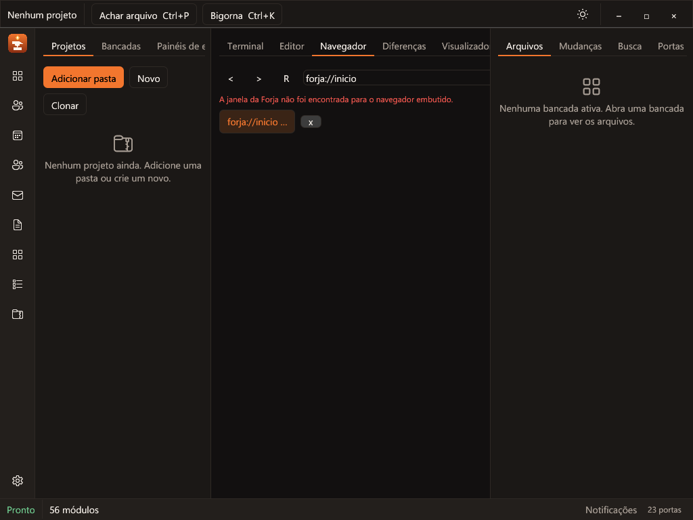

# Aba de bancada — painel Navegador (browser.tab)

Tela principal do app em uma bancada com o painel central na aba **Navegador**, que embute um navegador de URLs `forja://`; nesta captura o navegador não pôde ser iniciado e os painéis de projetos e arquivos estão vazios.

## Como chegar
Na janela principal, clique na aba **Navegador** da faixa de abas do painel central (461,50)–(553,82). A tela foi aberta com `forja-app --locale pt-BR --theme dark --bench-tab browser.tab`; a captura do Atlas está em `captures/pt-BR.dark.bench-tab.browser.tab.png`.

## Regiões
- **Barra superior** (0,0)–(1024,42): pílula "Nenhum projeto" à esquerda; botões "Achar arquivo Ctrl+P" e "Bigorna Ctrl+K"; ícone de alternância de tema (sol) em (845,5)–(877,37); botões de janela "–", "□", "×" à direita.
- **Trilho à esquerda** (0,42)–(48,736): logotipo (12,50)–(40,78) no topo e coluna de botões-ícone: "Quadro", "Ajudantes", "Rotinas", "Mutirão", "Pedidos", "Skills", "Uso", "Extensões", "Acervo" e, no rodapé do trilho, "Ajustes".
- **Painel esquerdo (Projetos)** (48,42)–(304,736): abas "Projetos" (marcada), "Bancadas" e "Painéis de extensões"; botões "Adicionar pasta", "Novo" e "Clonar"; estado vazio com ícone de pasta (168,198)–(196,226) e o texto "Nenhum projeto ainda. Adicione uma pasta ou crie um novo.".
- **Divisor** (304,42)–(320,736): faixa vertical sem nome entre os painéis esquerdo e central.
- **Painel central (Navegador)** (320,42)–(716,736): abas "Terminal", "Editor", "Navegador" (marcada), "Diferenças" e "Visualizador"; barra de navegação com " <", " >", "R", campo de endereço "forja://inicio", "Ir", "Histórico" e "Nova aba"; mensagem de erro "A janela da Forja não foi encontrada para o navegador embutido."; chip "forja://inicio …" com botão de fechar "x"; dica "A página fica oculta enquanto um painel ou janela estiver por cima.".
- **Divisor** (716,42)–(732,736): faixa vertical sem nome entre os painéis central e direito.
- **Painel direito (Arquivos)** (732,42)–(1024,736): abas "Arquivos" (marcada), "Bancada", "Mudanças", "Revisão", "Histórico", "Busca", "Portas", "Painéis de extensões" (duas ocorrências) e "Ajudante (chat)"; estado vazio com ícone de grade e o texto "Nenhuma bancada ativa. Abra uma bancada para ver os arquivos.".
- **Barra de status** (0,736)–(1024,768): "Pronto", "56 módulos", "Notificações" e "23 portas".

## Elementos
| Elemento | Tipo | Posição (px) | Estado | O que faz |
|---|---|---|---|---|
| "Achar arquivo  Ctrl+P" | Button | (135,5)–(291,37) | click,focus | Abre a busca rápida de arquivos (atalho Ctrl+P). |
| "Bigorna  Ctrl+K" | Button | (299,5)–(417,37) | click,focus | Abre a paleta de comandos (atalho Ctrl+K). |
| (sem nome acessível) | Unknown | (845,5)–(877,37) | click,focus | Ícone de sol: alterna o tema da interface. |
| "–" | Button | (899,5)–(931,37) | click,focus | Minimiza a janela. |
| "□" | Button | (939,5)–(971,37) | click,focus | Restaura/maximiza a janela. |
| "×" | Button | (979,5)–(1013,37) | click,focus | Fecha a janela. |
| "Nenhum projeto" | Label | (11,12)–(113,31) | click,focus | Indica que nenhum projeto está aberto; provavelmente abre a lista de projetos. |
| (sem nome acessível) | Unknown | (304,42)–(320,736) | focus | Divisor vertical entre painel esquerdo e central. |
| (sem nome acessível) | Unknown | (716,42)–(732,736) | focus | Divisor vertical entre painel central e direito. |
| (sem nome acessível) | Image | (12,50)–(40,78) | click,focus | Logotipo da Forja no topo do trilho. |
| "Projetos" | Button | (64,50)–(138,82) | click,focus | marcado=True — aba ativa do painel esquerdo, mostra a lista de projetos. |
| (sem nome acessível) | Unknown | (64,50)–(300,82) | focus | Faixa de fundo das abas do painel esquerdo. |
| "Bancadas" | Button | (138,50)–(220,82) | click,focus | marcado=False — troca o painel esquerdo para a lista de bancadas. |
| "Painéis de extensões" | Button | (220,50)–(371,82) | click,focus | marcado=False — troca o painel esquerdo para painéis de extensões; aparece truncado ("Painéis de e…") na borda do divisor. |
| "Terminal" | Button | (324,50)–(401,82) | click,focus | marcado=False — aba do painel central para o terminal. |
| "Editor" | Button | (401,50)–(461,82) | click,focus | marcado=False — aba do painel central para o editor. |
| "Navegador" | Button | (461,50)–(553,82) | click,focus | marcado=False→ativa — aba atual, mostra o navegador embutido. |
| "Diferenças" | Button | (553,50)–(641,82) | click,focus | marcado=False — aba de visualização de diffs. |
| "Visualizador" | Button | (641,50)–(739,82) | click,focus | marcado=False — aba de visualizador de arquivos. |
| (sem nome acessível) | Unknown | (736,50)–(1012,82) | focus | Faixa de fundo das abas do painel direito. |
| "Arquivos" | Button | (736,50)–(814,82) | click,focus | marcado=True — aba ativa do painel direito, lista de arquivos da bancada. |
| "Bancada" | Button | (739,50)–(815,82) | click,focus | marcado=False — aba de detalhes da bancada. |
| "Mudanças" | Button | (814,50)–(901,82) | click,focus | marcado=False — aba de mudanças da bancada. |
| "Revisão" | Button | (815,50)–(885,82) | click,focus | marcado=False — aba de revisão. |
| "Histórico" | Button | (885,50)–(965,82) | click,focus | marcado=False — aba de histórico. |
| "Busca" | Button | (901,50)–(960,82) | click,focus | marcado=False — aba de busca. |
| "Portas" | Button | (960,50)–(1022,82) | click,focus | marcado=False — aba de portas da bancada. |
| "Painéis de extensões" | Button | (965,50)–(1115,82) | click,focus | marcado=False — aba de painéis de extensões; retângulo ultrapassa a janela. |
| "Painéis de extensões" | Button | (1022,50)–(1173,82) | click,focus | marcado=False — segunda ocorrência do mesmo nome; fora da janela. |
| "Ajudante (chat)" | Button | (1115,50)–(1234,82) | click,focus | marcado=False — aba do chat do ajudante; fora da janela. |
| (sem nome acessível) | Unknown | (64,80)–(300,82) | click,focus | Linha divisória fina sob as abas do painel esquerdo. |
| (sem nome acessível) | Unknown | (736,80)–(1012,82) | click,focus | Linha divisória fina sob as abas do painel direito. |
| "Quadro" | Button | (8,94)–(44,130) | click,focus | marcado=False — botão-ícone do trilho para o quadro. |
| "Adicionar pasta" | Button | (64,98)–(183,130) | click,focus | Ação destacada (laranja) para importar uma pasta como projeto. |
| "Novo" | Button | (191,98)–(248,130) | click,focus | Cria um novo projeto. |
| "<" | Button | (324,98)–(399,130) | click,focus | Navega para a página anterior do navegador (retângulo declarado (324,98)–(358,130)). |
| ">" | Button | (366,98)–(399,130) | click,focus | Navega para a página seguinte do navegador. |
| "R" | Button | (407,98)–(440,130) | click,focus | Recarrega a página atual do navegador. |
| "Ir" | Button | (884,98)–(916,130) | click,focus | Confirma/navega para a URL digitada no campo de endereço. |
| "Histórico" | Button | (924,98)–(1003,130) | click,focus | Abre o histórico do navegador embutido. |
| "Nova aba" | Button | (1011,98)–(1093,130) | click,focus | Abre uma nova aba do navegador; fora da janela. |
| "100%" | Label | (1100,98)–(1128,130) | click | Indicador de zoom da página; fora da janela. |
| "forja://inicio" | TextInput | (448,103)–(876,126) | click,focus | Campo de endereço do navegador, com a URL inicial. |
| (ícone) | Label | (860,114)–(888,142) | click | Ícone junto ao campo de endereço (sobrepõe o retângulo do campo). |
| "Ajudantes" | Button | (8,138)–(44,174) | click,focus | marcado=False — botão-ícone do trilho para ajudantes. |
| "Clonar" | Button | (64,138)–(128,170) | click,focus | Abre o fluxo de clonagem de repositório/projeto. |
| "A janela da Forja não foi encontrada para o navegador embutido." | Label | (324,138)–(669,154) | click | Mensagem de erro: o navegador embutido não encontrou a janela da Forja. |
| "Nenhuma bancada ativa. Abra uma bancada para ver os arquivos." | Label | (738,150)–(1010,188) | click | Estado vazio do painel de arquivos. |
| "forja://inicio …" | Button | (324,162)–(436,197) | click,focus | Chip da aba "forja://inicio" aberta no navegador (sem conteúdo carregado). |
| "x" | Button | (444,170)–(475,189) | click,focus | Fecha o chip/aba "forja://inicio". |
| "Rotinas" | Button | (8,182)–(44,218) | click,focus | marcado=False — botão-ícone do trilho para rotinas. |
| (ícone) | Label | (168,198)–(196,226) | click | Ícone de pasta do estado vazio do painel de projetos. |
| "Mutirão" | Button | (8,226)–(44,262) | click,focus | marcado=False — botão-ícone do trilho para o mutirão. |
| "Nenhum projeto ainda. Adicione uma pasta ou crie um novo." | Label | (66,234)–(298,272) | click | Estado vazio do painel de projetos. |
| "Pedidos" | Button | (8,270)–(44,306) | click,focus | marcado=False — botão-ícone do trilho para pedidos. |
| "Skills" | Button | (8,314)–(44,350) | click,focus | marcado=False — botão-ícone do trilho para skills. |
| "Uso" | Button | (8,358)–(44,394) | click,focus | marcado=False — botão-ícone do trilho para uso. |
| "Extensões" | Button | (8,402)–(44,438) | click,focus | marcado=False — botão-ícone do trilho para extensões. |
| "Acervo" | Button | (8,446)–(482) | click,focus | marcado=False — botão-ícone do trilho para o acervo. |
| "Ajustes" | Button | (8,692)–(44,728) | click,focus | marcado=False — botão-ícone do trilho para os ajustes, no rodapé do trilho. |
| "A página fica oculta enquanto um painel ou janela estiver por cima." | Label | (324,736)–(680,752) | click | Aviso do navegador embutido: a página é pausada quando coberta. |
| "Pronto" | Label | (10,743)–(51,762) | click | Status geral na barra inferior. |
| "56 módulos" | Label | (73,743)–(146,762) | click | Quantidade de módulos carregados. |
| "Notificações" | Label | (865,743)–(941,762) | click,focus | Área/atalho de notificações na barra de status. |
| "23 portas" | Label | (957,744)–(1006,760) | click | Quantidade de portas ativas. |

## Aparência
Tema escuro de fundo marrom-escuro quase preto (tons próximos de #1f1814 a #2a211c), com painéis em variação sutil de tom e divisores escuros de 16 px. A cor de destaque é o laranja ("Brasa"): fundo laranja no botão "Adicionar pasta", texto laranja na aba marcada "Projetos", sublinhado laranja sob a aba "Navegador" e sob "Arquivos", borda e texto laranja no chip "forja://inicio …". A mensagem de erro do navegador aparece em laranja-avermelhado. Os textos são em cinza claro sobre fundo escuro, sans-serif de ~12–14 px; abas e botões de barra têm ~32 px de altura com espaçamento uniforme, alinhados à esquerda nas faixas de abas e centralizados nos botões-ícone do trilho. A barra de status usa texto menor (~12 px) e mantém "Pronto" à esquerda e contadores/atalhos à direita.

## Problemas encontrados
- Vários retângulos vão além da largura da janela (1024 px) e ficam cortados: "Painéis de extensões" (965,50)–(1115,82), "Painéis de extensões" (1022,50)–(1173,82), "Ajudante (chat)" (1115,50)–(1234,82), "Nova aba" (1011,98)–(1093,130) e o rótulo "100%" (1100,98)–(1128,130).
- O TextInput "forja://inicio" declara o retângulo (448,103)–(876,126), que atravessa o divisor (716,42)–(732,736) e invade o painel direito; na imagem o campo termina antes do divisor — coordenadas desatualizadas. "Ir" (884,98)–(916,130) e "Histórico" (924,98)–(1003,130) também ficam fora do painel central na árvore.
- O rótulo "(ícone)" (860,114)–(888,142) sobrepõe o retângulo do campo de endereço (448,103)–(876,126).
- Retângulos sobrepostos entre abas de grupos diferentes: "Terminal" (324,50)–(401,82) dentro de "Painéis de extensões" (220,50)–(371,82); "Arquivos" (736,50)–(814,82) sobrepõe "Bancada" (739,50)–(815,82); "Mudanças" (814,50)–(901,82) sobrepõe "Revisão" (815,50)–(885,82), que sobrepõe "Histórico" (885,50)–(965,82) e "Busca" (901,50)–(960,82).
- A aba "Painéis de extensões" do painel esquerdo aparece truncada na imagem ("Painéis de e…") junto ao divisor (304,42)–(320,736).
- Botões de janela nomeados apenas por símbolo: "–", "□" e "×", sem nomes acessíveis descritivos (Minimizar/Maximizar/Fechar).
- Elementos sem nome acessível: alternador de tema (845,5)–(877,37), os dois divisores verticais, as faixas de abas (64,50)–(300,82) e (736,50)–(1012,82), as linhas (64,80)–(300,82) e (736,80)–(1012,82) e os dois rótulos "(ícone)".
- Botão "R" da barra de navegação tem nome não descritivo (não indica "Recarregar").
- O nome "Painéis de extensões" aparece três vezes na árvore sem diferenciação entre as abas.
- Baixo contraste nos textos de estado vazio ("Nenhum projeto ainda…", "Nenhuma bancada ativa…") e nas abas inativas, em cinza escuro sobre fundo escuro.
