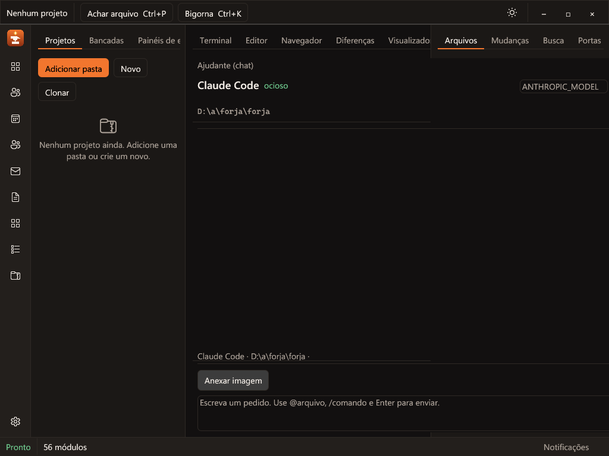

# Bancada — aba Ajudante (chat)

Tela da bancada com a aba "Ajudante (chat)" ativa: painel central de conversa com o agente de código, flanqueado pelo painel de projetos à esquerda e pelo painel de arquivos da bancada à direita. Variante pt-BR, tema escuro.

## Como chegar
Na janela principal, abra uma bancada e, no grupo de abas do cabeçalho da bancada (faixa superior direita), clique em "Ajudante (chat)". Como a tela foi capturada diretamente nessa aba, o comando é: `forja-app --locale pt-BR --theme dark --bench-tab chat.tab`.

## Regiões
- **Barra de título** (0,0)–(1024,37): rótulo do projeto ("Nenhum projeto"), botões "Achar arquivo  Ctrl+P" e "Bigorna  Ctrl+K", botão-ícone de tema (sol) e os botões de janela "–", "□" e "×".
- **Trilho à esquerda** (0,37)–(52,768): logotipo da Forja (imagem laranja, 12,50–40,78) e coluna de botões-ícone: "Quadro", "Ajudantes", "Rotinas", "Mutirão", "Pedidos", "Skills", "Uso", "Extensões", "Acervo" e, no pé, "Ajustes".
- **Painel lateral esquerdo** (52,37)–(304,768): grupo de abas "Projetos" (marcado), "Bancadas" e "Painéis de extensões"; botões "Adicionar pasta" (destacado em laranja), "Novo" e "Clonar"; estado vazio com ícone de pasta e o texto "Nenhum projeto ainda. Adicione uma pasta ou crie um novo.".
- **Divisor 1** (304,42)–(320,736): separador vertical arrastável entre o painel esquerdo e a área central.
- **Área central** (320,37)–(716,768): faixa de abas "Terminal", "Editor", "Navegador", "Diferenças", "Visualizador"; cabeçalho do chat com "Ajudante (chat)", "Claude Code", status "ocioso" (verde) e o caminho "D:\a\forja\forja" em fonte monoespaçada; área de mensagens vazia; rodapé com "Claude Code · D:\a\forja\forja ·", botão "Anexar imagem" e campo de texto multilinha.
- **Divisor 2** (716,42)–(732,736): separador vertical arrastável entre a área central e o painel direito.
- **Painel direito** (732,37)–(1024,768): grupo de abas "Arquivos" (marcado), "Mudanças", "Busca", "Portas" (e, invisíveis por estouro, "Bancada", "Revisão", "Histórico", "Painéis de extensões" e "Ajudante (chat)"); cabeçalho com campo de texto mostrando "ANTHROPIC_MODEL", ComboBox "Esforço" e botão "Terminal"; mensagem "Nenhuma bancada ativa. Abra uma bancada para ver os arquivos."; botão "Enviar" (fora da área visível).
- **Barra de status** (0,743)–(1024,768): "Pronto", "56 módulos" à esquerda e "Notificações" à direita.

## Elementos
| Elemento | Tipo | Posição (px) | Estado | O que faz |
|---|---|---|---|---|
| "Achar arquivo  Ctrl+P" | Button | (135,5)–(291,37) | — | Abre a busca rápida de arquivos (atalho Ctrl+P). |
| "Bigorna  Ctrl+K" | Button | (299,5)–(417,37) | — | Abre a paleta de comandos (atalho Ctrl+K). |
| (sem nome acessível) | Unknown | (845,5)–(877,37) | — | Ícone de sol: alterna o tema da interface. |
| "–" | Button | (899,5)–(931,37) | — | Minimiza a janela. |
| "□" | Button | (939,5)–(971,37) | — | Maximiza/restaura a janela. |
| "×" | Button | (979,5)–(1013,37) | — | Fecha a janela. |
| "Nenhum projeto" | Label | (11,12)–(113,31) | — | Mostra o projeto corrente; vazio porque nenhum projeto está aberto. |
| (sem nome acessível) | Unknown | (304,42)–(320,736) | — | Divisor vertical entre painel esquerdo e área central. |
| (sem nome acessível) | Unknown | (716,42)–(732,736) | — | Divisor vertical entre área central e painel direito. |
| (sem nome acessível) | Image | (12,50)–(40,78) | — | Logotipo da Forja no topo do trilho. |
| "Projetos" | Button | (64,50)–(138,82) | marcado=True | Aba ativa do painel esquerdo; mostra a lista de projetos. |
| (sem nome acessível) | Unknown | (64,50)–(300,82) | — | Contêiner/faixa do grupo de abas do painel esquerdo. |
| "Bancadas" | Button | (138,50)–(220,82) | marcado=False | Aba que alterna para a lista de bancadas. |
| "Painéis de extensões" | Button | (220,50)–(371,82) | marcado=False | Aba do grupo esquerdo; texto cortado no divisor (x≈304). |
| (sem nome acessível) | Unknown | (736,50)–(1012,82) | — | Contêiner/faixa do grupo de abas do cabeçalho da bancada. |
| "Arquivos" | Button | (736,50)–(814,82) | marcado=True | Aba ativa do painel direito; lista os arquivos da bancada. |
| "Bancada" | Button | (739,50)–(815,82) | marcado=False | Aba sobreposta a "Arquivos" (fora da área visível). |
| "Mudanças" | Button | (814,50)–(901,82) | marcado=False | Aba de alterações da bancada. |
| "Revisão" | Button | (815,50)–(885,82) | marcado=False | Aba sobreposta a "Mudanças" (invisível). |
| "Histórico" | Button | (885,50)–(965,82) | marcado=False | Aba sobreposta a "Busca" (invisível). |
| "Busca" | Button | (901,50)–(960,82) | marcado=False | Aba de busca na bancada. |
| "Portas" | Button | (960,50)–(1022,82) | marcado=False | Aba de portas/serviços da bancada. |
| "Painéis de extensões" | Button | (965,50)–(1115,82) | marcado=False | Aba além da borda direita da janela. |
| "Painéis de extensões" | Button | (1022,50)–(1173,82) | marcado=False | Segunda ocorrência, sobreposta à anterior e fora da janela. |
| "Ajudante (chat)" | Button | (1115,50)–(1234,82) | marcado=True | Aba selecionada desta tela; está fora da área visível (x>1024). |
| (sem nome acessível) | Unknown | (64,80)–(300,82) | — | Indicador/sublinhado da aba ativa do grupo esquerdo. |
| (sem nome acessível) | Unknown | (736,80)–(1012,82) | — | Indicador/sublinhado da aba ativa do grupo direito. |
| "Quadro" | Button | (8,94)–(44,130) | marcado=False | Botão-ícone do trilho; abre o quadro (board). |
| "Adicionar pasta" | Button | (64,98)–(183,130) | — | Ação destacada para adicionar uma pasta de projeto. |
| "Novo" | Button | (191,98)–(248,130) | — | Cria um novo projeto. |
| "Ajudante (chat)" | Label | (332,100)–(426,119) | — | Título do painel de chat. |
| (ícone) | Label | (860,114)–(888,142) | — | Ícone no cabeçalho do painel direito (sem nome acessível). |
| "Terminal" | Button | (1148,127)–(1226,162) | — | Botão no cabeçalho do painel direito (fora da área visível). |
| "Esforço" | ComboBox | (1030,129)–(1140,164) | — | Seletor do nível de esforço do ajudante (fora da área visível). |
| "Claude Code" | Label | (332,131)–(436,155) | — | Nome do ajudante/agent em uso no chat. |
| "ocioso" | Label | (444,134)–(484,153) | — | Status do ajudante, exibido em verde. |
| (sem nome acessível) | TextInput | (874,134)–(1022,157) | — | Campo de texto do cabeçalho do painel direito, exibindo "ANTHROPIC_MODEL". |
| "Ajudantes" | Button | (8,138)–(44,174) | marcado=False | Botão-ícone do trilho; abre a seção de ajudantes. |
| "Clonar" | Button | (64,138)–(128,170) | — | Clona um repositório/projeto. |
| "Nenhuma bancada ativa. Abra uma bancada para ver os arquivos." | Label | (738,150)–(1010,188) | — | Estado vazio do painel de arquivos da bancada. |
| "D:\a\forja\forja" | Label | (332,180)–(454,195) | — | Caminho do projeto da conversa, em fonte monoespaçada. |
| "Rotinas" | Button | (8,182)–(44,218) | marcado=False | Botão-ícone do trilho; abre a seção de rotinas. |
| (ícone) | Label | (168,198)–(196,226) | — | Ícone de pasta do estado vazio do painel de projetos. |
| "Mutirão" | Button | (8,226)–(44,262) | marcado=False | Botão-ícone do trilho; abre a seção Mutirão. |
| "Nenhum projeto ainda. Adicione uma pasta ou crie um novo." | Label | (66,234)–(298,272) | — | Mensagem de estado vazio da lista de projetos. |
| "Pedidos" | Button | (8,270)–(44,306) | marcado=False | Botão-ícone do trilho; abre a seção de pedidos. |
| "Skills" | Button | (8,314)–(44,350) | marcado=False | Botão-ícone do trilho; abre a seção de skills. |
| "Uso" | Button | (8,358)–(44,394) | marcado=False | Botão-ícone do trilho; abre a seção de uso. |
| "Extensões" | Button | (8,402)–(44,438) | marcado=False | Botão-ícone do trilho; abre a seção de extensões. |
| "Acervo" | Button | (8,446)–(44,482) | marcado=False | Botão-ícone do trilho; abre a seção de acervo. |
| "Claude Code · D:\a\forja\forja ·" | Label | (332,590)–(524,609) | — | Rodapé do chat com o contexto da conversa (ajudante e caminho). |
| "Anexar imagem" | Button | (332,623)–(452,658) | — | Anexa uma imagem à mensagem do chat. |
| "Enviar" | Button | (1165,623)–(1226,658) | — | Envia a mensagem; está fora da área visível (x>1024). |
| (sem nome acessível) | MultilineTextInput | (332,666)–(1226,726) | — | Campo multilinha para digitar o pedido ao ajudante; estende-se além da borda da janela. |
| "Ajustes" | Button | (8,692)–(44,728) | marcado=False | Botão-ícone do pé do trilho; abre os ajustes. |
| "Pronto" | Label | (10,743)–(51,762) | — | Estado geral do app na barra de status. |
| "56 módulos" | Label | (73,743)–(146,762) | — | Quantidade de módulos carregados. |
| "Notificações" | Label | (914,743)–(990,762) | — | Abre a área de notificações. |

## Aparência
Tema escuro: fundo marrom-quase-preto nas três colunas, com a área central do chat ligeiramente mais escura. Texto em cinza-claro; abas inativas em cinza médio. Destaques em laranja: o logotipo do trilho, o botão "Adicionar pasta" (fundo laranja com texto escuro) e os sublinhados das abas ativas "Projetos" e "Arquivos". O status "ocioso" aparece em verde. O caminho "D:\a\forja\forja" usa fonte monoespaçada. Botões têm contorno arredondado fino e fundo levemente elevado; os do trilho são quadrados de 36 px, só com ícone. Abas com altura uniforme (~32 px), sublinhado laranja de 2 px na ativa. Barra de status com uma linha, ~25 px, texto pequeno.

## Problemas encontrados
- O grupo de abas do cabeçalho da bancada estoura a largura da janela (≈1024 px): "Bancada", "Revisão", "Histórico", duas ocorrências de "Painéis de extensões" e a aba selecionada "Ajudante (chat)" (1115–1234) ficam fora da área visível.
- A aba ativa "Ajudante (chat)" (marcado=True) não aparece na tela; não é possível ver qual aba do grupo direito está selecionada.
- Dois conjuntos de abas ocupam a mesma faixa e se sobrepõem na árvore: "Arquivos" (736–814) sobre "Bancada" (739–815), "Mudanças" (814–901) sobre "Revisão" (815–885) e "Busca" (901–960) sobre "Histórico" (885–965).
- "Painéis de extensões" aparece três vezes, sendo duas sobrepostas (965–1115 e 1022–1173).
- A aba "Painéis de extensões" do grupo esquerdo (220–371) passa do divisor em x≈304 e o texto aparece truncado ("Painéis de e").
- O ComboBox "Esforço" (1030–1140), o botão "Terminal" (1148–1226), o botão "Enviar" (1165–1226) e o campo multilinha (até x=1226) também ultrapassam a borda direita da janela; "Enviar" não é visível.
- Campo de texto sem nome acessível exibe o texto em inglês "ANTHROPIC_MODEL" (não traduzido para pt-BR).
- TextInput e MultilineTextInput sem nome acessível.
- Botão de tema (sol, 845–877) e os rótulos de ícone em (860,114) e (168,198) sem nome acessível.
- O rótulo "Claude Code · D:\a\forja\forja ·" termina com um separador "·" solto.
