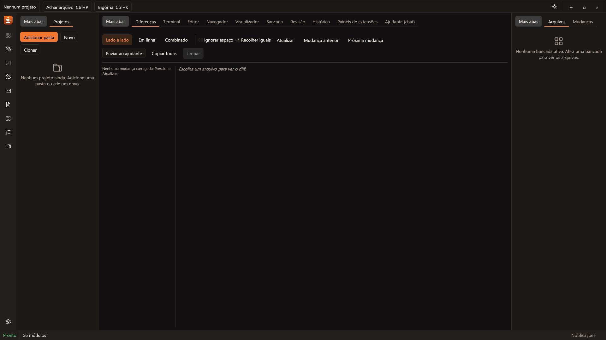

# Aba Diferenças da bancada (painel central) — estado vazio

Tela principal do app com a aba "Diferenças" aberta no painel central, sem projeto nem bancada ativa: as áreas mostram apenas mensagens de estado vazio.

## Como chegar
Abrir o app com `forja-app --locale pt-BR --theme dark --bench-tab diff.tab`; na interface, clicar na aba "Diferenças" na faixa de abas do painel central (a captura usa o comando acima).

## Regiões
- **Barra superior (título/comandos)**: (0,0)–(1053,42). Rótulo do projeto ("Nenhum projeto"), botões "Achar arquivo Ctrl+P" e "Bigorna Ctrl+K", alternador de tema (ícone de sol) e botões de janela (–, □, ×).
- **Trilho à esquerda**: (0,42)–(56,736). Coluna de ícones: logo da Forja no topo e botões "Quadro", "Ajudantes", "Rotinas", "Mutirão", "Pedidos", "Skills", "Uso", "Extensões", "Acervo", com "Ajustes" fixado embaixo.
- **Painel lateral esquerdo (Projetos)**: (56,42)–(304,736). Abas "Projetos" (ativa), "Bancadas", "Painéis de extensões"; botões "Adicionar pasta" (destaque laranja), "Novo", "Clonar"; mensagem "Nenhum projeto ainda. Adicione uma pasta ou crie um novo." com ícone de pasta.
- **Divisor 1**: (304,42)–(320,736). Separador vertical redimensionável entre o painel esquerdo e a área central.
- **Área central (Diferenças)**: (320,42)–(716,736). Abas "Terminal", "Editor", "Navegador", "Diferenças" (ativa), "Visualizador"; barra de modo ("Lado a lado", "Em linha", "Combinado"), caixas "Ignorar espaço" e "Recolher iguais", botões "Atualizar", "Mudança anterior", "Próxima mudança" (estes fora da janela); segunda linha com "Enviar ao ajudante", "Copiar todas", "Limpar" (desativado); mensagens "Nenhuma mudança carregada. Pressione Atualizar." e "Escolha um arquivo para ver o diff.".
- **Divisor 2**: (716,42)–(732,736). Separador vertical entre a área central e o painel direito.
- **Painel direito (Arquivos)**: (732,42)–(1053,736). Abas "Arquivos" (ativa), "Bancada", "Mudanças", "Revisão", "Histórico", "Busca", "Portas", "Painéis de extensões", "Ajudante (chat)" (várias além da borda); ícone de grade e mensagem "Nenhuma bancada ativa. Abra uma bancada para ver os arquivos.".
- **Barra de status**: (0,736)–(1053,768). "Pronto" à esquerda, "56 módulos" ao lado e "Notificações" à direita.

## Elementos
| Elemento | Tipo | Posição (px) | Estado | O que faz |
|---|---|---|---|---|
| "Nenhum projeto" | Rótulo | (11,12)–(113,31) | — | Mostra o projeto atual (nenhum aberto); clicável. |
| "Achar arquivo  Ctrl+P" | Botão | (135,5)–(291,37) | — | Abre a busca rápida de arquivos (atalho Ctrl+P). |
| "Bigorna  Ctrl+K" | Botão | (299,5)–(417,37) | — | Abre a paleta de comandos (atalho Ctrl+K). |
| (sem nome acessível) | Desconhecido | (845,5)–(877,37) | — | Ícone de sol na barra superior; alternador de tema. |
| "–" | Botão | (899,5)–(931,37) | — | Minimiza a janela. |
| "□" | Botão | (939,5)–(971,37) | — | Maximiza/restaura a janela. |
| "×" | Botão | (979,5)–(1013,37) | — | Fecha a janela. |
| (sem nome acessível) | Desconhecido | (304,42)–(320,736) | — | Divisor vertical entre o painel esquerdo e a área central. |
| (sem nome acessível) | Desconhecido | (716,42)–(732,736) | — | Divisor vertical entre a área central e o painel direito. |
| (sem nome acessível) | Imagem | (12,50)–(40,78) | — | Ícone/logo da Forja no topo do trilho. |
| "Projetos" | Botão | (64,50)–(138,82) | marcado=True | Aba ativa do painel esquerdo; mostra a lista de projetos. |
| (sem nome acessível) | Desconhecido | (64,50)–(300,82) | — | Faixa que contém as abas do painel esquerdo. |
| "Bancadas" | Botão | (138,50)–(220,82) | marcado=False | Aba do painel esquerdo; lista de bancadas. |
| "Painéis de extensões" | Botão | (220,50)–(371,82) | marcado=False | Aba do painel esquerdo; texto cortado na borda do painel ("Painéis de e…"). |
| (sem nome acessível) | Desconhecido | (64,80)–(300,82) | — | Sublinhado da aba ativa no painel esquerdo. |
| "Quadro" | Botão | (8,94)–(44,130) | marcado=False | Botão-ícone do trilho; abre o quadro. |
| "Adicionar pasta" | Botão | (64,98)–(183,130) | — | Ação primária (laranja) para adicionar uma pasta de projeto. |
| "Novo" | Botão | (191,98)–(248,130) | — | Cria um novo projeto. |
| "Ajudantes" | Botão | (8,138)–(44,174) | marcado=False | Botão-ícone do trilho; abre os ajudantes. |
| "Clonar" | Botão | (64,138)–(128,170) | — | Clona um repositório como projeto. |
| "Rotinas" | Botão | (8,182)–(44,218) | marcado=False | Botão-ícone do trilho; abre as rotinas. |
| "Mutirão" | Botão | (8,226)–(44,262) | marcado=False | Botão-ícone do trilho; abre o mutirão. |
| "Pedidos" | Botão | (8,270)–(44,306) | marcado=False | Botão-ícone do trilho; abre os pedidos. |
| "Skills" | Botão | (8,314)–(44,350) | marcado=False | Botão-ícone do trilho; abre as skills. |
| "Uso" | Botão | (8,358)–(44,394) | marcado=False | Botão-ícone do trilho; abre o uso. |
| "Extensões" | Botão | (8,402)–(44,438) | marcado=False | Botão-ícone do trilho; abre as extensões. |
| "Acervo" | Botão | (8,446)–(44,482) | marcado=False | Botão-ícone do trilho; abre o acervo. |
| "Terminal" | Botão | (324,50)–(401,82) | marcado=False | Aba do painel central; abre o terminal. |
| "Editor" | Botão | (401,50)–(461,82) | marcado=False | Aba do painel central; abre o editor. |
| "Navegador" | Botão | (461,50)–(553,82) | marcado=False | Aba do painel central; abre o navegador. |
| "Diferenças" | Botão | (553,50)–(641,82) | marcado=True | Aba ativa do painel central; exibe o diff. |
| "Visualizador" | Botão | (641,50)–(739,82) | marcado=False | Aba do painel central; abre o visualizador. |
| "Lado a lado" | Botão | (324,98)–(419,133) | — | Modo de exibição do diff em duas colunas (aparece destacado em laranja na imagem). |
| "Em linha" | Botão | (427,98)–(503,133) | — | Modo de diff em linha única. |
| "Combinado" | Botão | (511,98)–(607,133) | — | Modo de diff combinado. |
| "Ignorar espaço" | Caixa de seleção | (629,100)–(738,132) | marcado=False | Ignora diferenças de espaço em branco; texto cortado pelo divisor. |
| "Recolher iguais" | Caixa de seleção | (746,100)–(857,132) | marcado=True | Recolhe trechos sem mudanças; fica além do divisor, não visível na imagem. |
| "Atualizar" | Botão | (865,100)–(943,132) | — | Recarrega o diff; fora da largura da janela. |
| "Mudança anterior" | Botão | (951,100)–(1083,132) | — | Navega à mudança anterior; fora da largura da janela. |
| "Próxima mudança" | Botão | (1091,100)–(1226,132) | — | Navega à próxima mudança; fora da largura da janela. |
| "Enviar ao ajudante" | Botão | (324,141)–(461,173) | — | Envia o diff atual ao ajudante de código. |
| "Copiar todas" | Botão | (469,141)–(571,173) | — | Copia todas as diferenças para a área de transferência. |
| "Limpar" | Botão | (579,141)–(645,176) | desativado | Limpa a seleção/diff atual; indisponível sem conteúdo. |
| (ícone) | Rótulo | (168,198)–(196,226) | — | Ícone de pasta do estado vazio do painel de projetos. |
| "Nenhuma mudança carregada. Pressione Atualizar." | Rótulo | (324,198)–(543,230) | — | Mensagem de estado vazio da área de diff. |
| "Escolha um arquivo para ver o diff." | Rótulo | (566,198)–(779,217) | — | Mensagem em itálico do lado direito do diff; texto cortado pelo divisor. |
| "Arquivos" | Botão | (736,50)–(814,82) | marcado=True | Aba ativa do painel direito; lista de arquivos da bancada. |
| (sem nome acessível) | Desconhecido | (736,50)–(1012,82) | — | Faixa que contém as abas do painel direito. |
| "Bancada" | Botão | (739,50)–(815,82) | marcado=False | Aba do painel direito (sobrepõe "Arquivos"). |
| "Mudanças" | Botão | (814,50)–(901,82) | marcado=False | Aba do painel direito; lista de mudanças. |
| "Revisão" | Botão | (815,50)–(885,82) | marcado=False | Aba do painel direito (sobrepõe "Mudanças"/"Busca"). |
| "Histórico" | Botão | (885,50)–(965,82) | marcado=False | Aba do painel direito; histórico da bancada. |
| "Busca" | Botão | (901,50)–(960,82) | marcado=False | Aba do painel direito; busca. |
| "Portas" | Botão | (960,50)–(1022,82) | marcado=False | Aba do painel direito; portas ativas. |
| "Painéis de extensões" | Botão | (965,50)–(1115,82) | marcado=False | Aba do painel direito; além da borda direita da janela. |
| "Painéis de extensões" | Botão | (1022,50)–(1173,82) | marcado=False | Segunda aba com o mesmo nome, também além da borda. |
| "Ajudante (chat)" | Botão | (1115,50)–(1234,82) | marcado=False | Aba do painel direito; além da borda direita da janela. |
| (sem nome acessível) | Desconhecido | (736,80)–(1012,82) | — | Sublinhado da aba ativa no painel direito. |
| (ícone) | Rótulo | (860,114)–(888,142) | — | Ícone de grade do estado vazio do painel de arquivos. |
| "Nenhuma bancada ativa. Abra uma bancada para ver os arquivos." | Rótulo | (738,150)–(1010,188) | — | Mensagem de estado vazio do painel de arquivos. |
| "Ajustes" | Botão | (8,692)–(44,728) | marcado=False | Botão-ícone do trilho fixo embaixo; abre os ajustes. |
| "Pronto" | Rótulo | (10,743)–(51,762) | — | Status atual na barra de status. |
| "56 módulos" | Rótulo | (73,743)–(146,762) | — | Quantidade de módulos carregados. |
| "Notificações" | Rótulo | (914,743)–(990,762) | — | Abre a área de notificações. |

## Aparência
Tema escuro: fundo quase preto (marrom-escuro) nas barras e painéis, com a área central e o painel direito em tom levemente mais escuro que o painel esquerdo. Cor de destaque laranja, usada na ação primária "Adicionar pasta", na aba ativa "Diferenças" (texto e sublinhado), no botão "Lado a lado" (fundo laranja) e no status "Pronto" em verde. Tipografia sans-serif em dois tamanhos: rótulos pequenos na barra de status e mensagens de estado vazio em cinza claro/itálico. Alinhamento consistente: trilho de ícones de 36 px de largura, faixas de abas com sublinhado na base (y≈80), barras de ferramentas do painel central em duas linhas (y≈98 e y≈141) e divisores verticais de 16 px separando os três painéis. Muito espaço vazio nos painéis por serem estados sem conteúdo.

## Problemas encontrados
- Vários elementos têm retângulos além da largura da janela (1053 px) e aparecem cortados: "Painéis de extensões" (965–1115) e (1022–1173), "Ajudante (chat)" (1115–1234) na faixa de abas do painel direito; "Mudança anterior" (951–1083) e "Próxima mudança" (1091–1226) na barra do diff.
- Sobreposição de abas no painel direito: "Bancada" (739–815) sobre "Arquivos" (736–814), "Revisão" (815–885) sobre "Mudanças" (814–901) e "Busca" (901–960), "Painéis de extensões" (965–1115) sobre "Histórico" (885–965) e "Portas" (960–1022); "Arquivos" aparece duas vezes com estados conflitantes (marcado=True em 736–814 e marcado=False em 739–815).
- Texto cortado pelo divisor central/direito: "Ignorar espaço" (629–738) aparece como "Ignorar espa…"; "Recolher iguais" (746–857) fica inteiramente depois do divisor e não é visível; "Escolha um arquivo para ver o diff." (566–779) é cortado no meio.
- Aba "Painéis de extensões" do painel esquerdo (220–371) é cortada pela borda do painel em x≈310, exibindo "Painéis de e…".
- Botão da barra superior sem nome acessível em (845,5)–(877,37) (ícone de sol, alternador de tema); divisores, faixas de abas, sublinhados, logo e ícones de estado vazio também não têm nome acessível.
- Mensagens de estado vazio em cinza itálico ("Escolha um arquivo para ver o diff.") têm contraste baixo sobre o fundo escuro; "Limpar" desativado também apresenta contraste reduzido (esperado para estado desabilitado).
