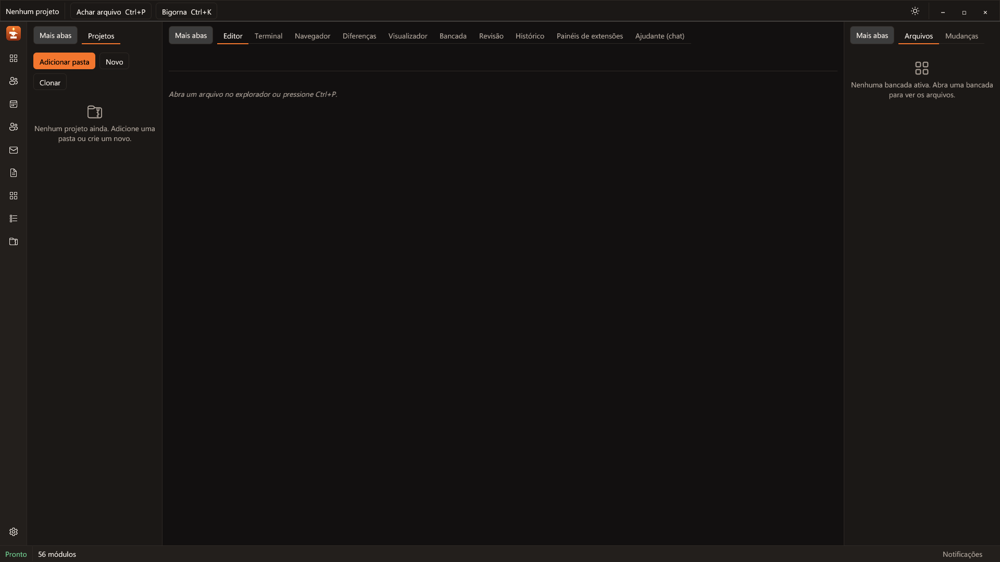

# Tela principal — aba Editor sem projeto (bench-tab editor.tab)

Janela principal da Forja no estado inicial, sem projeto aberto, com o painel central na aba "Editor" e o painel direito em "Arquivos", ambos exibindo mensagens de vazio.

## Como chegar
Abrir o app já leva a esta tela quando nenhum projeto está ativo: `forja-app --locale pt-BR --theme dark --bench-tab editor.tab`. Pela interface, é a janela inicial; a aba "Editor" do grupo central e a aba "Arquivos" do grupo direito estão selecionadas.

## Regiões
- **Barra superior** (0,0)–(1024,42): à esquerda o rótulo "Nenhum projeto" e os botões "Achar arquivo Ctrl+P" e "Bigorna Ctrl+K"; à direita um ícone de tema (sol) sem nome acessível e os botões de janela "–", "□" e "×".
- **Trilho à esquerda** (0,42)–(52,736): logotipo da Forja no topo e uma coluna de ícones-quadrados: "Quadro", "Ajudantes", "Rotinas", "Mutirão", "Pedidos", "Skills", "Uso", "Extensões", "Acervo" e, no rodapé do trilho, "Ajustes".
- **Painel lateral esquerdo** (52,42)–(304,736): abas "Projetos" (selecionada), "Bancadas" e "Painéis de extensões"; botões "Adicionar pasta" (destacado em laranja), "Novo" e "Clonar"; ícone de pasta e a mensagem "Nenhum projeto ainda. Adicione uma pasta ou crie um novo."
- **Área central** (320,42)–(716,736): grupo de abas com "Terminal", "Editor" (selecionada, com sublinhado laranja), "Navegador", "Diferenças" e "Visualizador"; abaixo, uma régua horizontal e a mensagem em itálico "Abra um arquivo no explorador ou pressione Ctrl+P." sobre fundo vazio.
- **Painel direito** (732,42)–(1024,736): grupo de abas com "Arquivos" (selecionada) e outras abas parcialmente sobrepostas; ícone de grade e a mensagem "Nenhuma bancada ativa. Abra uma bancada para ver os arquivos."
- **Barra de status** (0,736)–(1024,768): à esquerda "Pronto" (em verde) e "56 módulos"; à direita "Notificações".

## Elementos
| Elemento | Tipo | Posição (px) | Estado | O que faz |
|---|---|---|---|---|
| "Achar arquivo Ctrl+P" | Button | (135,5)–(291,37) | — | Abre a busca rápida de arquivos pelo nome (atalho Ctrl+P). |
| "Bigorna Ctrl+K" | Button | (299,5)–(417,37) | — | Abre a paleta de comandos (atalho Ctrl+K). |
| (sem nome acessível) | Unknown | (845,5)–(877,37) | — | Ícone de sol; alterna o tema da interface. |
| "–" | Button | (899,5)–(931,37) | — | Minimiza a janela. |
| "□" | Button | (939,5)–(971,37) | — | Maximiza/restaura a janela. |
| "×" | Button | (979,5)–(1013,37) | — | Fecha a janela. |
| "Nenhum projeto" | Label | (11,12)–(113,31) | — | Mostra que não há projeto aberto; abre a lista de projetos. |
| (sem nome acessível) | Unknown | (304,42)–(320,736) | foco | Divisor arrastável entre o painel esquerdo e a área central. |
| (sem nome acessível) | Unknown | (716,42)–(732,736) | foco | Divisor arrastável entre a área central e o painel direito. |
| (sem nome acessível) | Image | (12,50)–(40,78) | — | Logotipo da Forja no topo do trilho. |
| "Projetos" | Button | (64,50)–(138,82) | marcado=True | Aba selecionada do painel esquerdo; mostra a lista de projetos. |
| (sem nome acessível) | Unknown | (64,50)–(300,82) | foco | Faixa de fundo do grupo de abas do painel esquerdo. |
| "Bancadas" | Button | (138,50)–(220,82) | marcado=False | Aba que mostraria a lista de bancadas. |
| "Painéis de extensões" | Button | (220,50)–(371,82) | marcado=False | Aba do painel esquerdo; estende-se por baixo da área central. |
| "Terminal" | Button | (324,50)–(401,82) | marcado=False | Aba central que abriria o terminal integrado. |
| "Editor" | Button | (401,50)–(461,82) | marcado=True | Aba central selecionada; mostra o editor de arquivos. |
| "Navegador" | Button | (461,50)–(553,82) | marcado=False | Aba central do navegador de código/estrutura. |
| "Diferenças" | Button | (553,50)–(641,82) | marcado=False | Aba central de comparação de arquivos. |
| "Visualizador" | Button | (641,50)–(739,82) | marcado=False | Aba central de pré-visualização. |
| (sem nome acessível) | Unknown | (736,50)–(1012,82) | foco | Faixa de fundo do grupo de abas do painel direito. |
| "Arquivos" | Button | (736,50)–(814,82) | marcado=True | Aba selecionada do painel direito; mostra o explorador de arquivos. |
| "Bancada" | Button | (739,50)–(815,82) | marcado=False | Aba sobreposta a "Arquivos"; mostraria o conteúdo da bancada. |
| "Mudanças" | Button | (814,50)–(901,82) | marcado=False | Aba de alterações da bancada; sobreposta a "Revisão". |
| "Revisão" | Button | (815,50)–(885,82) | marcado=False | Aba de revisão de código; sobreposta a "Mudanças". |
| "Histórico" | Button | (885,50)–(965,82) | marcado=False | Aba de histórico; sobreposta a "Busca". |
| "Busca" | Button | (901,50)–(960,82) | marcado=False | Aba de busca; sobreposta a "Histórico". |
| "Portas" | Button | (960,50)–(1022,82) | marcado=False | Aba de portas em uso; parcialmente fora da faixa. |
| "Painéis de extensões" | Button | (965,50)–(1115,82) | marcado=False | Aba do grupo direito; ultrapassa a borda direita da janela. |
| "Painéis de extensões" | Button | (1022,50)–(1173,82) | marcado=False | Segunda aba de mesmo nome; quase toda fora da janela. |
| "Ajudante (chat)" | Button | (1115,50)–(1234,82) | marcado=False | Aba do chat do ajudante; inteiramente fora da janela. |
| (sem nome acessível) | Unknown | (64,80)–(300,82) | — | Sublinhado da aba selecionada no grupo esquerdo. |
| (sem nome acessível) | Unknown | (736,80)–(1012,82) | — | Sublinhado da aba selecionada no grupo direito. |
| "Quadro" | Button | (8,94)–(44,130) | marcado=False | Atalho do trilho para o quadro de tarefas. |
| "Adicionar pasta" | Button | (64,98)–(183,130) | — | Abre o seletor para adicionar uma pasta como projeto. |
| "Novo" | Button | (191,98)–(248,130) | — | Cria um projeto novo. |
| (ícone) | Label | (860,114)–(888,142) | — | Ícone de grade do estado vazio do painel "Arquivos". |
| "Ajudantes" | Button | (8,138)–(44,174) | marcado=False | Atalho do trilho para a lista de ajudantes. |
| "Clonar" | Button | (64,138)–(128,170) | — | Clona um repositório para criar um projeto. |
| "Nenhuma bancada ativa. Abra uma bancada para ver os arquivos." | Label | (738,150)–(1010,188) | — | Mensagem de vazio do explorador de arquivos. |
| "Abra um arquivo no explorador ou pressione Ctrl+P." | Label | (324,160)–(647,179) | — | Mensagem de vazio da área do editor. |
| "Rotinas" | Button | (8,182)–(44,218) | marcado=False | Atalho do trilho para rotinas. |
| (ícone) | Label | (168,198)–(196,226) | — | Ícone de pasta do estado vazio da lista de projetos. |
| "Mutirão" | Button | (8,226)–(44,262) | marcado=False | Atalho do trilho para o mutirão de ajudantes. |
| "Nenhum projeto ainda. Adicione uma pasta ou crie um novo." | Label | (66,234)–(298,272) | — | Mensagem de vazio da lista de projetos. |
| "Pedidos" | Button | (8,270)–(44,306) | marcado=False | Atalho do trilho para pedidos. |
| "Skills" | Button | (8,314)–(44,350) | marcado=False | Atalho do trilho para skills. |
| "Uso" | Button | (8,358)–(44,394) | marcado=False | Atalho do trilho para o consumo de tokens. |
| "Extensões" | Button | (8,402)–(44,438) | marcado=False | Atalho do trilho para extensões. |
| "Acervo" | Button | (8,446)–(44,482) | marcado=False | Atalho do trilho para o acervo. |
| "Ajustes" | Button | (8,692)–(44,728) | marcado=False | Atalho do trilho para os ajustes, fixado no fim do trilho. |
| "Pronto" | Label | (10,743)–(51,762) | — | Estado geral do app na barra de status. |
| "56 módulos" | Label | (73,743)–(146,762) | — | Contagem de módulos carregados. |
| "Notificações" | Label | (914,743)–(990,762) | — | Abre o painel de notificações. |

## Aparência
Tema escuro: fundo geral marrom-escuro quase preto (tons de #1a–#20), com painéis levemente mais claros que a área central. Cor de destaque laranja, usada no botão primário "Adicionar pasta", no sublinhado das abas selecionadas ("Projetos", "Editor", "Arquivos") e no texto "Pronto" da barra de status. Tipografia sans-serif de corpo pequeno (aprox. 12–13 px); a mensagem do editor vem em itálico e cinza. Abas selecionadas em texto claro, não selecionadas em cinza médio. Os três grupos de abas (esquerdo, central, direito) ficam alinhados na mesma faixa (y 50–82), separados por divisores verticais de 16 px. Botões de ação têm fundo levemente elevado e cantos arredondados; o trilho esquerdo usa apenas ícones quadrados de 36 px centralizados.

## Problemas encontrados
- Sobreposição de abas: no grupo central, "Painéis de extensões" do painel esquerdo (220,50)–(371,82) invade a faixa do grupo central e passa por baixo de "Terminal" (324,50)–(401,82).
- Grupo de abas direito com duas fileiras sobrepostas: "Arquivos" (736,50)–(814,82) sobre "Bancada" (739,50)–(815,82), "Mudanças" (814,50)–(901,82) sobre "Revisão" (815,50)–(885,82), "Histórico" (885,50)–(965,82) sobre "Busca" (901,50)–(960,82) e "Portas" (960,50)–(1022,82) sobre "Painéis de extensões" (965,50)–(1115,82).
- Elementos fora da janela: "Painéis de extensões" (1022,50)–(1173,82) e "Ajudante (chat)" (1115,50)–(1234,82) estendem-se além da largura de 1024 px e não aparecem na imagem.
- Botões sem nome acessível: o ícone de tema na barra superior (845,5)–(877,37) é um Unknown clicável sem rótulo.
- Ícones/imagens sem alternativa textual: logotipo (12,50)–(40,78) e os ícones de estado vazio (860,114) e (168,198) aparecem como "(sem nome acessível)".
- Divisores verticais (304,42)–(320,736) e (716,42)–(732,736) são Unknown sem nome acessível, o que dificulta identificação por leitor de tela.
- Textos de estado vazio em cinza sobre fundo escuro têm contraste baixo ("Abra um arquivo no explorador ou pressione Ctrl+P.").
