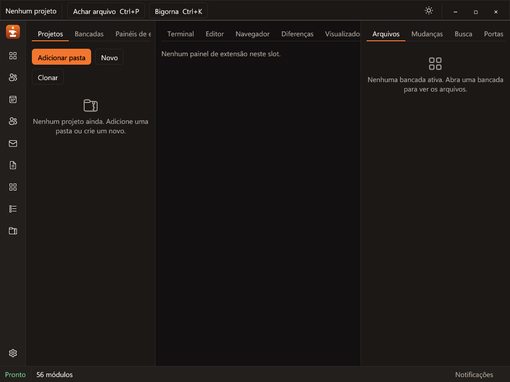

# Aba de bancada — Painéis de extensões (slot vazio)

Tela da aba de bancada com o painel central apontando para o slot `extension.panels.bench`, sem painel de extensão carregado, e os painéis laterais (Projetos e Arquivos) também em estado vazio.

## Como chegar
Abrir o app sem projeto ativo e com a aba de bancada selecionada: `forja-app --locale pt-BR --theme dark --bench-tab extension.panels.bench`. Na interface: na faixa de abas à esquerda clicar em "Painéis de extensões" (ou manter a aba de bancada ativa) — o painel central exibe a mensagem de slot vazio. Comando de captura: captura do estado `pt-BR.dark.bench-tab.extension.panels.bench` (tema dark, idioma pt-BR), imagem `captures/pt-BR.dark.bench-tab.extension.panels.bench.png` (1053×768 px, escala 1.0).

## Regiões
- **Barra superior** (0,0)–(1053,42): rótulo do projeto ("Nenhum projeto"), botões "Achar arquivo  Ctrl+P" e "Bigorna  Ctrl+K", alternador de tema (ícone de sol, sem nome) e botões de janela (–, □, ×).
- **Trilho à esquerda** (0,42)–(52,736): logotipo da Forja (imagem laranja) e botões-ícone na vertical: "Quadro", "Ajudantes", "Rotinas", "Mutirão", "Pedidos", "Skills", "Uso", "Extensões", "Acervo" e, no rodapé, "Ajustes".
- **Painel lateral esquerdo** (52,42)–(310,736): abas "Projetos" (ativa, com sublinhado), "Bancadas" e "Painéis de extensões" (cortada); botões "Adicionar pasta" (destaque laranja), "Novo" e "Clonar"; estado vazio com ícone de pasta e o texto "Nenhum projeto ainda. Adicione uma pasta ou crie um novo.".
- **Divisor** (304,42)–(320,736): separador redimensionável entre o painel esquerdo e a área central (sem nome acessível).
- **Área central** (320,42)–(716,736): faixa de abas "Terminal", "Editor", "Navegador", "Diferenças", "Visualizador" e a mensagem "Nenhum painel de extensão neste slot." — conteúdo vazio do slot `extension.panels.bench`.
- **Divisor** (716,42)–(732,736): separador redimensionável entre a área central e o painel direito (sem nome acessível).
- **Painel lateral direito** (732,42)–(1053,736): grupo de abas ("Arquivos" ativa, "Mudanças", "Busca", "Portas" visíveis; outras sobrepostas/cortadas), ícone de grade e a mensagem "Nenhuma bancada ativa. Abra uma bancada para ver os arquivos.".
- **Barra de status** (0,736)–(1053,768): "Pronto" (em verde), "56 módulos" e, à direita, "Notificações".

## Elementos
| Elemento | Tipo | Posição (px) | Estado | O que faz |
|---|---|---|---|---|
| "Nenhum projeto" | Label | (11,12)–(113,31) | — | Rótulo na barra superior indicando ausência de projeto aberto |
| "Achar arquivo  Ctrl+P" | Button | (135,5)–(291,37) | click,focus | Abre a busca rápida de arquivos (atalho Ctrl+P) |
| "Bigorna  Ctrl+K" | Button | (299,5)–(417,37) | click,focus | Abre a paleta de comandos (atalho Ctrl+K) |
| (sem nome acessível) | Unknown | (845,5)–(877,37) | click,focus | Ícone de sol: alternador de tema claro/escuro |
| "–" | Button | (899,5)–(931,37) | click,focus | Minimiza a janela |
| "□" | Button | (939,5)–(971,37) | click,focus | Maximiza/restaura a janela |
| "×" | Button | (979,5)–(1013,37) | click,focus | Fecha a janela |
| (sem nome acessível) | Image | (12,50)–(40,78) | click,focus | Logotipo da Forja (bigorna laranja) no topo do trilho |
| "Projetos" | Button | (64,50)–(138,82) | click,focus; marcado=True | Aba ativa do painel esquerdo; mostra a lista de projetos |
| (sem nome acessível) | Unknown | (64,50)–(300,82) | focus | Faixa/sublinhado do grupo de abas do painel esquerdo |
| "Bancadas" | Button | (138,50)–(220,82) | click,focus; marcado=False | Aba que alterna para a lista de bancadas |
| "Painéis de extensões" | Button | (220,50)–(371,82) | click,focus; marcado=False | Aba do painel esquerdo; retângulo avança para a área central e o texto aparece cortado ("Painéis de e") |
| "Terminal" | Button | (324,50)–(401,82) | click,focus; marcado=False | Aba do painel central que mostra o terminal |
| "Editor" | Button | (401,50)–(461,82) | click,focus; marcado=False | Aba que mostra o editor de arquivos |
| "Navegador" | Button | (461,50)–(553,82) | click,focus; marcado=False | Aba que mostra o navegador |
| "Diferenças" | Button | (553,50)–(641,82) | click,focus; marcado=False | Aba que mostra o visor de diferenças |
| "Visualizador" | Button | (641,50)–(739,82) | click,focus; marcado=False | Aba que mostra o visualizador |
| (sem nome acessível) | Unknown | (736,50)–(1012,82) | focus | Faixa do grupo de abas do painel direito |
| "Arquivos" | Button | (736,50)–(814,82) | click,focus; marcado=True | Aba ativa do painel direito; lista de arquivos da bancada |
| "Bancada" | Button | (739,50)–(815,82) | click,focus; marcado=False | Aba sobreposta a "Arquivos" (grupo de outra barra) |
| "Mudanças" | Button | (814,50)–(901,82) | click,focus; marcado=False | Aba de mudanças; sobreposta a "Revisão" |
| "Revisão" | Button | (815,50)–(885,82) | click,focus; marcado=False | Aba de revisão, sob "Mudanças" |
| "Histórico" | Button | (885,50)–(965,82) | click,focus; marcado=False | Aba de histórico, sob "Busca" |
| "Busca" | Button | (901,50)–(960,82) | click,focus; marcado=False | Aba de busca |
| "Portas" | Button | (960,50)–(1022,82) | click,focus; marcado=False | Aba de portas; sobreposta a "Painéis de extensões" |
| "Painéis de extensões" | Button | (965,50)–(1115,82) | click,focus; marcado=True | Aba do painel direito marcada como ativa; retângulo ultrapassa a largura da janela (1053 px) e não é visível por completo |
| "Painéis de extensões" | Button | (1022,50)–(1173,82) | click,focus; marcado=False | Segunda aba com o mesmo nome, fora da janela |
| "Ajudante (chat)" | Button | (1115,50)–(1234,82) | click,focus; marcado=False | Aba do chat do ajudante; inteiramente fora da largura da janela |
| (sem nome acessível) | Unknown | (64,80)–(300,82) | click,focus | Indicador de sublinhado da aba ativa do painel esquerdo |
| (sem nome acessível) | Unknown | (736,80)–(1012,82) | click,focus | Indicador de sublinhado da aba ativa do painel direito |
| "Quadro" | Button | (8,94)–(44,130) | click,focus; marcado=False | Botão-ícone do trilho para o quadro |
| "Adicionar pasta" | Button | (64,98)–(183,130) | click,focus | Adiciona uma pasta de projeto (botão em destaque laranja) |
| "Novo" | Button | (191,98)–(248,130) | click,focus | Cria um novo projeto |
| "Nenhum painel de extensão neste slot." | Label | (324,98)–(563,117) | click | Mensagem de estado vazio do slot `extension.panels.bench` |
| (ícone) | Label | (860,114)–(888,142) | click | Ícone de grade do estado vazio do painel direito |
| "Ajudantes" | Button | (8,138)–(44,174) | click,focus; marcado=False | Botão-ícone do trilho para a lista de ajudantes |
| "Clonar" | Button | (64,138)–(128,170) | click,focus | Clona um projeto/bancada |
| "Nenhuma bancada ativa. Abra uma bancada para ver os arquivos." | Label | (738,150)–(1010,188) | click | Mensagem de estado vazio do painel de arquivos |
| "Rotinas" | Button | (8,182)–(44,218) | click,focus; marcado=False | Botão-ícone do trilho para rotinas |
| (ícone) | Label | (168,198)–(196,226) | click | Ícone de pasta do estado vazio do painel de projetos |
| "Mutirão" | Button | (8,226)–(44,262) | click,focus; marcado=False | Botão-ícone do trilho para o mutirão |
| "Nenhum projeto ainda. Adicione uma pasta ou crie um novo." | Label | (66,234)–(298,272) | click | Mensagem de estado vazio da lista de projetos |
| "Pedidos" | Button | (8,270)–(44,306) | click,focus; marcado=False | Botão-ícone do trilho para pedidos |
| "Skills" | Button | (8,314)–(44,350) | click,focus; marcado=False | Botão-ícone do trilho para skills |
| "Uso" | Button | (8,358)–(44,394) | click,focus; marcado=False | Botão-ícone do trilho para uso |
| "Extensões" | Button | (8,402)–(44,438) | click,focus; marcado=False | Botão-ícone do trilho para extensões |
| "Acervo" | Button | (8,446)–(44,482) | click,focus; marcado=False | Botão-ícone do trilho para o acervo |
| "Ajustes" | Button | (8,692)–(44,728) | click,focus; marcado=False | Botão-ícone do trilho para os ajustes, fixado no rodapé |
| "Pronto" | Label | (10,743)–(51,762) | click | Status geral na barra inferior, em verde |
| "56 módulos" | Label | (73,743)–(146,762) | click | Contagem de módulos carregados |
| "Notificações" | Label | (914,743)–(990,762) | click,focus | Atalho para notificações, à direita da barra de status |

## Aparência
Tema dark com fundo marrom-escuro quase preto (tonalidade quente, coerente com o sistema "Brasa"); barra superior levemente mais escura que o conteúdo. O destaque é laranja: logotipo no trilho, botão primário "Adicionar pasta" e o sublinhado das abas ativas ("Projetos" e "Arquivos"). Texto em cinza-claro sobre fundo escuro, com bom contraste nas mensagens; ícones e textos de estado vazio em cinza médio (contraste menor). Tipografia sem serifa, corpo em torno de 14 px (abas e botões) e 13 px na barra de status. Espaçamento uniforme: abas com ~34 px de altura na faixa y=50–82, botões-ícone do trilho de 36×36 px com passo de 44 px, e mensagens de estado vazio centralizadas no painel correspondente. Linhas divisórias verticais separam painel esquerdo, área central e painel direito; a barra de status é separada por um traço horizontal fino.

## Problemas encontrados
- Estouro de largura: os botões "Painéis de extensões" (até x=1115 e x=1173) e "Ajudante (chat)" (até x=1234) do painel direito têm retângulos além da largura da janela (1053 px) e ficam cortados ou invisíveis.
- Sobreposição de abas no painel direito: "Arquivos"/"Bancada", "Mudanças"/"Revisão", "Histórico"/"Busca" e "Portas"/"Painéis de extensões" ocupam retângulos que se sobrepõem, indicando dois grupos de abas desenhados na mesma faixa.
- Nome acessível duplicado e ambíguo: dois botões "Painéis de extensões" no grupo do painel direito, além de um terceiro no painel esquerdo, com o mesmo texto.
- Estado inconsistente: no painel direito, "Painéis de extensões" está marcado=True enquanto a aba visivelmente ativa é "Arquivos" (marcado=True também), sugerindo dois grupos de abas com ativos simultâneos.
- Texto cortado por transbordo de painel: a aba "Painéis de extensões" do painel esquerdo (220,50)–(371,82) cruza o divisor em x≈310 e aparece truncada ("Painéis de e") na borda do painel.
- Elementos sem nome acessível: alternador de tema (845,5), os dois divisores verticais (304,42 e 716,42), as faixas dos grupos de abas e os indicadores de sublinhado — apenas "Unknown"/(sem nome acessível) na árvore.
- Botões de janela nomeados apenas pelos símbolos "–", "□" e "×", sem rótulo descritivo (minimizar/maximizar/fechar).
