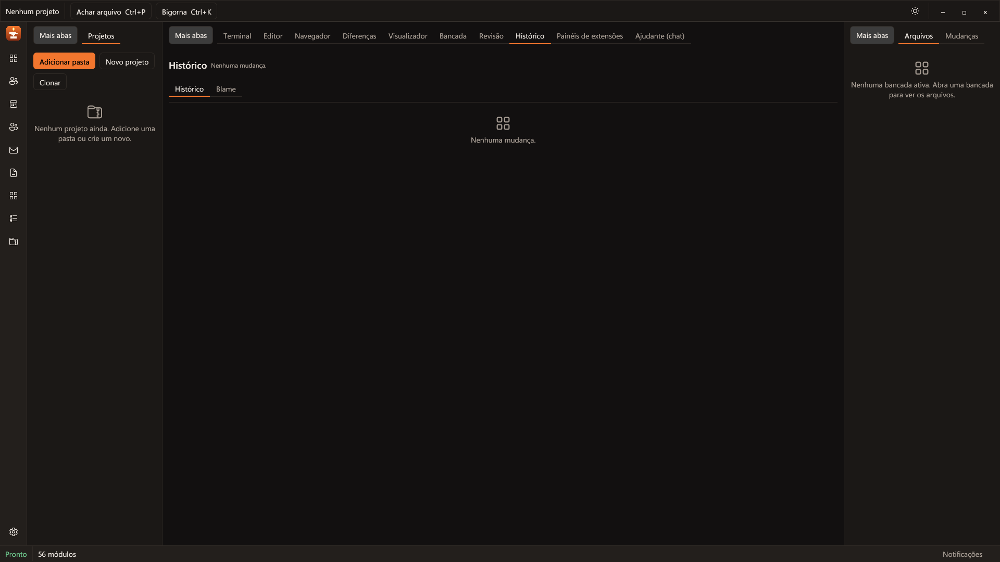

# Bancada — aba Histórico (Git)

Tela da bancada que mostra a visão de histórico Git no painel central; nesta captura não há projeto nem bancada ativa, então histórico, projetos e arquivos aparecem vazios.

## Como chegar
Abrir a Forja, abrir uma bancada e, na faixa de abas do painel central, escolher a visão "Histórico" (com a sub-visão "Histórico" ativa ao lado de "Blame"). Comando de captura: `forja-app --locale pt-BR --theme dark --bench-tab git.history`.

## Regiões
- **Barra superior** (0,0)–(1024,42): rótulo "Nenhum projeto" à esquerda, botões "Achar arquivo Ctrl+P" e "Bigorna Ctrl+K"; à direita, botão sem nome (ícone de sol, alternar tema) e os botões de janela "–", "□" e "×".
- **Trilho à esquerda** (0,42)–(52,738): logotipo da Forja no topo e, abaixo, ícones de navegação: "Quadro", "Ajudantes", "Rotinas", "Mutirão", "Pedidos", "Skills", "Uso", "Extensões", "Acervo" e, na base, "Ajustes".
- **Faixa de abas esquerda + painel Projetos** (52,42)–(304,738): abas "Projetos" (ativa, com sublinhado laranja), "Bancadas" e "Painéis de extensões"; abaixo, os botões "Adicionar pasta" (destaque laranja), "Novo" e "Clonar" e o estado vazio com ícone de pasta e o texto "Nenhum projeto ainda. Adicione uma pasta ou crie um novo.".
- **Divisor vertical** (304,42)–(320,736): separador sem nome entre o painel de projetos e o painel central.
- **Painel central** (320,42)–(716,738): faixa de abas "Terminal", "Editor", "Navegador", "Diferenças" e "Visualizador" (cortada pela borda do painel); abaixo, o cabeçalho "Histórico" com a nota "Nenhuma mudança.", as sub-abas "Histórico" (ativa) e "Blame", e uma grande área vazia.
- **Divisor vertical** (716,42)–(732,736): separador sem nome entre o painel central e o painel direito; sobre ele aparece apenas o "N" inicial de um texto cortado em (~718,255).
- **Painel direito (Arquivos)** (732,42)–(1024,738): abas "Arquivos" (ativa), "Mudanças", "Busca" e "Portas"; abaixo, ícone de grade (quatro quadrados) e o estado vazio "Nenhuma bancada ativa. Abra uma bancada para ver os arquivos.".
- **Barra de status** (0,738)–(1024,768): "Pronto" em verde à esquerda, "56 módulos" ao lado e "Notificações" à direita.

## Elementos
| Elemento | Tipo | Posição (px) | Estado | O que faz |
|---|---|---|---|---|
| "Nenhum projeto" | Label | (11,12)–(113,31) | — | Indica que não há projeto aberto; clicável. |
| "Achar arquivo  Ctrl+P" | Button | (135,5)–(291,37) | — | Abre a busca de arquivos pelo atalho Ctrl+P. |
| "Bigorna  Ctrl+K" | Button | (299,5)–(417,37) | — | Abre a paleta de comandos pelo atalho Ctrl+K. |
| (sem nome acessível) | Unknown | (845,5)–(877,37) | focável | Botão com ícone de sol: alterna o tema claro/escuro. |
| "–" | Button | (899,5)–(931,37) | — | Minimiza a janela. |
| "□" | Button | (939,5)–(971,37) | — | Maximiza/restaura a janela. |
| "×" | Button | (979,5)–(1013,37) | — | Fecha a janela. |
| (sem nome acessível) | Unknown | (304,42)–(320,736) | focável | Divisor vertical entre os painéis esquerdo e central. |
| (sem nome acessível) | Unknown | (716,42)–(732,736) | focável | Divisor vertical entre os painéis central e direito. |
| (sem nome acessível) | Image | (12,50)–(40,78) | clicável, focável | Logotipo da Forja no topo da trilho. |
| "Projetos" | Button | (64,50)–(138,82) | marcado=True | Aba ativa do grupo esquerdo; mostra o painel de projetos. |
| (sem nome acessível) | Unknown | (64,50)–(300,82) | focável | Faixa de abas do grupo esquerdo. |
| "Bancadas" | Button | (138,50)–(220,82) | marcado=False | Aba para o painel de bancadas. |
| "Painéis de extensões" | Button | (220,50)–(371,82) | marcado=False | Aba do grupo esquerdo; rótulo truncado visualmente em "Painéis de e…". |
| "Terminal" | Button | (324,50)–(324+77,82) ou seja (324,50)–(401,82) | marcado=False | Aba do painel central para a visão de terminal. |
| "Editor" | Button | (401,50)–(461,82) | marcado=False | Aba do painel central para a visão de editor. |
| "Navegador" | Button | (461,50)–(553,82) | marcado=False | Aba do painel central para a visão de navegador. |
| "Diferenças" | Button | (553,50)–(641,82) | marcado=False | Aba do painel central para a visão de diferenças. |
| "Visualizador" | Button | (641,50)–(739,82) | marcado=False | Aba do painel central; rótulo truncado em "Visualizado". |
| (sem nome acessível) | Unknown | (736,50)–(1012,82) | focável | Faixa de abas do grupo direito. |
| "Arquivos" | Button | (736,50)–(814,82) | marcado=True | Aba ativa do painel direito; mostra o explorador de arquivos da bancada. |
| "Bancada" | Button | (739,50)–(815,82) | marcado=False | Aba do grupo direito; retângulo sobreposto ao de "Arquivos". |
| "Mudanças" | Button | (814,50)–(901,82) | marcado=False | Aba do grupo direito para mudanças da bancada. |
| "Revisão" | Button | (815,50)–(885,82) | marcado=False | Aba do grupo direito; retângulo sobreposto ao de "Mudanças". |
| "Histórico" | Button | (885,50)–(965,82) | marcado=True | Aba do grupo direito para o histórico Git; sobrepõe "Busca". |
| "Busca" | Button | (901,50)–(960,82) | marcado=False | Aba do grupo direito de busca. |
| "Portas" | Button | (960,50)–(1022,82) | marcado=False | Aba do grupo direito para portas/terminais. |
| "Painéis de extensões" | Button | (965,50)–(1115,82) | marcado=False | Aba fora da janela (vai além de x=1024). |
| "Painéis de extensões" | Button | (1022,50)–(1173,82) | marcado=False | Aba fora da janela. |
| "Ajudante (chat)" | Button | (1115,50)–(1234,82) | marcado=False | Aba fora da janela (vai até x=1234). |
| (sem nome acessível) | Unknown | (64,80)–(300,82) | clicável, focável | Linha de sublinhado/rodapé da faixa de abas esquerda. |
| (sem nome acessível) | Unknown | (736,80)–(1012,82) | clicável, focável | Linha de sublinhado/rodapé da faixa de abas direita. |
| "Quadro" | Button | (8,94)–(44,130) | marcado=False | Ícone da trilho: abre o quadro geral. |
| "Adicionar pasta" | Button | (64,98)–(183,130) | — | Adiciona uma pasta de projeto existente (botão laranja em destaque). |
| "Novo" | Button | (191,98)–(248,130) | — | Cria um projeto novo. |
| "Histórico" | Label | (324,102)–(397,126) | clicável | Título do painel central (visão de histórico Git). |
| "Nenhuma mudança." | Label | (405,106)–(511,122) | clicável | Nota ao lado do título: sem mudanças no histórico. |
| (ícone) | Label | (860,114)–(888,142) | clicável | Ícone de grade (quatro quadrados) do estado vazio do painel direito. |
| "Ajudantes" | Button | (8,138)–(44,174) | marcado=False | Ícone da trilho: abre a lista de ajudantes. |
| "Clonar" | Button | (64,138)–(128,170) | — | Clona um repositório como projeto. |
| "Histórico" | Button | (324,142)–(403,174) | marcado=True | Sub-aba ativa da visão Git: lista de commits. |
| "Blame" | Button | (403,142)–(465,174) | marcado=False | Sub-aba da visão Git: blame por linha. |
| "Nenhuma bancada ativa. Abra uma bancada para ver os arquivos." | Label | (738,150)–(1010,188) | clicável | Estado vazio do painel de arquivos. |
| "Rotinas" | Button | (8,182)–(44,218) | marcado=False | Ícone da trilho: abre as rotinas. |
| (ícone) | Label | (168,198)–(196,226) | clicável | Ícone de pasta do estado vazio do painel de projetos. |
| (ícone) | Label | (765,212)–(793,240) | clicável | Ícone sem nome no painel direito; não identificável na imagem. |
| "Mutirão" | Button | (8,226)–(44,262) | marcado=False | Ícone da trilho: abre o mutirão. |
| "Nenhum projeto ainda. Adicione uma pasta ou crie um novo." | Label | (66,234)–(298,272) | clicável | Estado vazio do painel de projetos. |
| "Nenhuma mudança." | Label | (717,248)–(841,267) | clicável | Rótulo do painel direito; na imagem só o "N" inicial aparece, cortado no divisor. |
| "Pedidos" | Button | (8,270)–(44,306) | marcado=False | Ícone da trilho: abre os pedidos. |
| "Skills" | Button | (8,314)–(44,350) | marcado=False | Ícone da trilho: abre as skills. |
| "Uso" | Button | (8,358)–(44,394) | marcado=False | Ícone da trilho: abre o uso. |
| "Extensões" | Button | (8,402)–(44,438) | marcado=False | Ícone da trilho: abre as extensões. |
| "Acervo" | Button | (8,446)–(44,482) | marcado=False | Ícone da trilho: abre o acervo. |
| "Ajustes" | Button | (8,692)–(44,728) | marcado=False | Ícone da trilho: abre os ajustes, fixado na base. |
| "Pronto" | Label | (10,743)–(51,762) | clicável | Status geral na barra de status, em verde. |
| "56 módulos" | Label | (73,743)–(146,762) | clicável | Contagem de módulos carregados. |
| "Notificações" | Label | (914,743)–(990,762) | clicável, focável | Acesso às notificações, à direita da barra de status. |

## Aparência
Tema escuro: fundo geral quase preto com leve tom quente, painéis em variação um pouco mais clara e divisores discretos entre eles. Texto principal em cinza-claro; textos secundários ("Nenhuma mudança.", estados vazios) em cinza médio. O acento laranja (identidade "Brasa") aparece no botão "Adicionar pasta" (fundo laranja, texto escuro) e nos sublinhados das abas ativas "Projetos", "Arquivos" e da sub-aba "Histórico", além de no título "Histórico". "Pronto" na barra de status aparece em verde. Tipografia sem serifa, corpo em torno de 13–14 px e títulos em ~17–18 px seminegrito. Botões com cantos arredondados, fundo levemente elevado e contorno sutil; ícones da trilho em traço fino, centralizados em coluna de ~36 px; abas alinhadas em linha única com sublinhado inferior marcando a ativa. Estados vazios são centralizados horizontalmente no painel, com ícone acima do texto.

## Problemas encontrados
- Abas "Painéis de extensões" (965,50)–(1115,82), "Painéis de extensões" (1022,50)–(1173,82) e "Ajudante (chat)" (1115,50)–(1234,82) têm retângulos além da largura da janela (1024 px): ficam fora da área visível e inalcançáveis.
- Retângulos de abas sobrepostos no grupo direito: "Arquivos"/"Bancada" (736–815), "Mudanças"/"Revisão" (814–901) e "Histórico"/"Busca" (885–965); também "Terminal" (324–401) sobre "Painéis de extensões" (220–371) — indício de elementos duplicados ou de grupos de abas sobrepostos na árvore.
- Nomes ambíguos para leitores de tela: três botões chamados "Painéis de extensões" e dois chamados "Histórico" (aba do grupo direito e sub-aba do painel Git).
- Texto cortado: no painel direito aparece apenas o "N" inicial em (~718,255) na borda do divisor (716,42)–(732,736); corresponde ao rótulo "Nenhuma mudança." (717,248)–(841,267) parcialmente ocluído.
- Rótulos de aba truncados pelos divisores de painel: "Painéis de e…" (grupo esquerdo, corte em x≈300) e "Visualizado" (painel central, corte em x≈723).
- Quatro elementos sem nome acessível além dos ícones declarados: os dois divisores verticais (304,42)–(320,736) e (716,42)–(732,736), a faixa de abas esquerda (64,50)–(300,82) e a faixa de abas direita (736,50)–(1012,82); a Image do logotipo (12,50)–(40,78) também não tem nome.
- Três Labels declarados como "(ícone)"; o de (765,212)–(793,240) não corresponde a nada visível na captura e carece de nome acessível.
- O botão de alternar tema (845,5)–(877,37) é um "Unknown" sem nome acessível, identificável apenas pelo ícone de sol.
