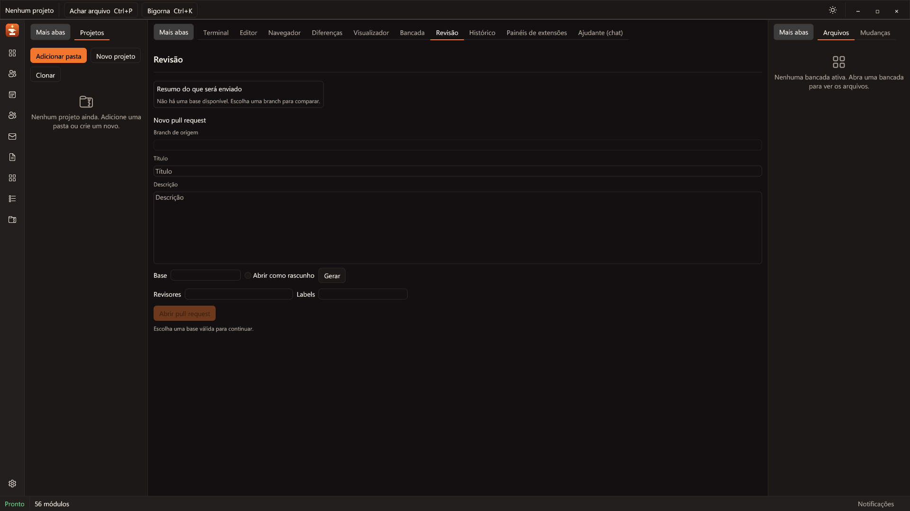

# Revisão (aba de bancada)

Tela da aba "Revisão" de uma bancada da Forja, que concentra a criação de um novo pull request; capturada sem projeto aberto, por isso os painéis laterais mostram estados vazios.

## Como chegar
Abrir o app sem projeto carregado (rótulo "Nenhum projeto" na barra superior), entrar na bancada e clicar na aba "Revisão" do conjunto de abas da bancada ("Arquivos", "Bancada", "Mudanças", "Revisão", "Histórico"…). Comando de captura: `forja-app --locale pt-BR --theme dark --bench-tab review.tab`.

## Regiões
- **Barra superior** — (0,0)–(1054,42): rótulo "Nenhum projeto", botões "Achar arquivo  Ctrl+P" e "Bigorna  Ctrl+K", ícone de tema (sol, sem nome acessível) e botões de janela "–", "□", "×".
- **Trilho à esquerda** — (0,42)–(56,736): logotipo da Forja (imagem) no topo, seguido dos botões-ícone "Quadro", "Ajudantes", "Rotinas", "Mutirão", "Pedidos", "Skills", "Uso", "Extensões", "Acervo" e, na base, "Ajustes".
- **Painel esquerdo (Projetos)** — (56,42)–(312,736): abas "Projetos" (ativa), "Bancadas" e "Painéis de extensões"; botões "Adicionar pasta", "Novo" e "Clonar"; estado vazio com ícone de pasta e o texto "Nenhum projeto ainda. Adicione uma pasta ou crie um novo.".
- **Área central (Revisão)** — (312,42)–(724,736): cabeçalho com abas "Terminal", "Editor", "Navegador", "Diferenças" e "Visualizador"; título "Revisão" com o botão "Atualizar revisão"; formulário "Novo pull request" com rótulo "Branch de origem:", campo "Título", campo multilinha "Descrição", campo "Base", caixa "Abrir como rascunho", botão "Gerar", campos "Revisores" e "Labels" e o botão "Abrir pull request".
- **Painel direito (Arquivos)** — (724,42)–(1054,736): abas "Arquivos" (ativa, sublinhada), "Mudanças", "Revisão", "Histórico", "Busca", "Portas", "Painéis de extensões" e "Ajudante (chat)"; estado vazio com ícone de grade e o texto "Nenhuma bancada ativa. Abra uma bancada para ver os arquivos.".
- **Barra de status** — (0,736)–(1054,768): "Pronto" em verde, "56 módulos" à esquerda e "Notificações" à direita.
- Dois divisores verticais sem nome acessível separam os painéis: (304,42)–(320,736) e (716,42)–(732,736).

## Elementos
| Elemento | Tipo | Posição (px) | Estado | O que faz |
|---|---|---|---|---|
| "Achar arquivo  Ctrl+P" | Botão | (135,5)–(291,37) | — | Abre o seletor rápido de arquivos (atalho Ctrl+P) |
| "Bigorna  Ctrl+K" | Botão | (299,5)–(417,37) | — | Abre a paleta de comandos da Forja (atalho Ctrl+K) |
| "Nenhum projeto" | Rótulo | (11,12)–(113,31) | — | Indica que nenhum projeto está aberto |
| (sem nome acessível) | Desconhecido | (845,5)–(877,37) | — | Ícone de sol; alterna o tema da interface |
| "–" | Botão | (899,5)–(931,37) | — | Minimiza a janela |
| "□" | Botão | (939,5)–(971,37) | — | Maximiza/restaura a janela |
| "×" | Botão | (979,5)–(1013,37) | — | Fecha a janela |
| (sem nome acessível) | Desconhecido | (304,42)–(320,736) | — | Divisor vertical entre o painel esquerdo e a área central |
| (sem nome acessível) | Desconhecido | (716,42)–(732,736) | — | Divisor vertical entre a área central e o painel direito |
| (sem nome acessível) | Imagem | (12,50)–(40,78) | — | Logotipo da Forja (bigorna) no topo do trilho |
| "Projetos" | Botão | (64,50)–(138,82) | marcado=True | Aba ativa do painel esquerdo; mostra a lista de projetos |
| (sem nome acessível) | Desconhecido | (64,50)–(300,82) | — | Faixa de fundo do conjunto de abas do painel esquerdo |
| "Bancadas" | Botão | (138,50)–(220,82) | marcado=False | Aba do painel esquerdo; lista as bancadas |
| "Painéis de extensões" | Botão | (220,50)–(371,82) | marcado=False | Aba do painel esquerdo; painéis de extensões (texto truncado na imagem) |
| "Terminal" | Botão | (324,50)–(401,82) | marcado=False | Aba do cabeçalho central; abre o terminal da bancada |
| "Editor" | Botão | (401,50)–(461,82) | marcado=False | Aba do cabeçalho central; abre o editor |
| "Navegador" | Botão | (461,50)–(553,82) | marcado=False | Aba do cabeçalho central; abre o navegador |
| "Diferenças" | Botão | (553,50)–(641,82) | marcado=False | Aba do cabeçalho central; mostra diffs |
| "Visualizador" | Botão | (641,50)–(739,82) | marcado=False | Aba do cabeçalho central; abre o visualizador (texto truncado na imagem) |
| (sem nome acessível) | Desconhecido | (736,50)–(1012,82) | — | Faixa de fundo do conjunto de abas da bancada |
| "Arquivos" | Botão | (736,50)–(814,82) | marcado=True | Aba da bancada; lista de arquivos (ativa, sublinhada) |
| "Bancada" | Botão | (739,50)–(815,82) | marcado=False | Aba da bancada; visão geral da bancada |
| "Mudanças" | Botão | (814,50)–(901,82) | marcado=False | Aba da bancada; mudanças não commitadas |
| "Revisão" | Botão | (815,50)–(885,82) | marcado=True | Aba da bancada; abre a tela documentada (criação de pull request) |
| "Histórico" | Botão | (885,50)–(965,82) | marcado=False | Aba da bancada; histórico de commits |
| "Busca" | Botão | (901,50)–(960,82) | marcado=False | Aba da bancada; busca no projeto |
| "Portas" | Botão | (960,50)–(1022,82) | marcado=False | Aba da bancada; portas em uso |
| "Painéis de extensões" | Botão | (965,50)–(1115,82) | marcado=False | Aba da bancada; painéis de extensões (estende-se além da janela) |
| "Painéis de extensões" | Botão | (1022,50)–(1173,82) | marcado=False | Segunda aba homônima, sobreposta à anterior e fora da janela |
| "Ajudante (chat)" | Botão | (1115,50)–(1234,82) | marcado=False | Aba da bancada; chat do ajudante (fora da janela) |
| (sem nome acessível) | Desconhecido | (64,80)–(300,82) | — | Linha de sublinhado da aba ativa do painel esquerdo |
| (sem nome acessível) | Desconhecido | (736,80)–(1012,82) | — | Linha de sublinhado da aba ativa da bancada |
| "Quadro" | Botão | (8,94)–(44,130) | marcado=False | Ícone do trilho; abre o quadro de projetos |
| "Adicionar pasta" | Botão | (64,98)–(183,130) | — | Adiciona uma pasta de projeto existente |
| "Novo" | Botão | (191,98)–(248,130) | — | Cria um projeto novo |
| "Revisão" | Rótulo | (324,98)–(386,130) | — | Título da tela central |
| "Atualizar revisão" | Botão | (394,98)–(519,130) | — | Recarrega os dados da revisão |
| (ícone) | Rótulo | (860,114)–(888,142) | — | Ícone de grade acima da mensagem de estado vazio do painel direito |
| "Ajudantes" | Botão | (8,138)–(44,174) | marcado=False | Ícone do trilho; abre a lista de ajudantes de código |
| "Clonar" | Botão | (64,138)–(128,170) | — | Clona um repositório como novo projeto |
| "Nenhuma bancada ativa. Abra uma bancada para ver os arquivos." | Rótulo | (738,150)–(1010,188) | — | Estado vazio do painel de arquivos |
| "Novo pull request" | Rótulo | (324,160)–(434,179) | — | Título do formulário de criação de pull request |
| "Rotinas" | Botão | (8,182)–(44,218) | marcado=False | Ícone do trilho; abre as rotinas |
| "Branch de origem:" | Rótulo | (324,187)–(423,203) | — | Rótulo do campo de branch de origem do pull request |
| (ícone) | Rótulo | (168,198)–(196,226) | — | Ícone de pasta do estado vazio do painel esquerdo |
| (sem nome acessível) | Campo de texto | (324,211)–(1234,234) | — | Campo de uma linha; exibe o texto "Título" e é cortado na borda do painel |
| "Mutirão" | Botão | (8,226)–(44,262) | marcado=False | Ícone do trilho; abre o mutirão |
| "Nenhum projeto ainda. Adicione uma pasta ou crie um novo." | Rótulo | (66,234)–(298,272) | — | Estado vazio do painel de projetos |
| (sem nome acessível) | Campo de texto multilinha | (324,242)–(1234,395) | — | Campo "Descrição" do pull request; cortado na borda do painel |
| "Pedidos" | Botão | (8,270)–(44,306) | marcado=False | Ícone do trilho; abre os pedidos (pull requests) |
| "Skills" | Botão | (8,314)–(44,350) | marcado=False | Ícone do trilho; abre as skills |
| "Uso" | Botão | (8,358)–(44,394) | marcado=False | Ícone do trilho; abre o uso de recursos |
| "Extensões" | Botão | (8,402)–(44,438) | marcado=False | Ícone do trilho; abre as extensões |
| "Abrir como rascunho" | Caixa de seleção | (516,403)–(664,435) | marcado=False | Marca o pull request como rascunho |
| "Gerar" | Botão | (672,403)–(729,435) | — | Gera o título/descrição do pull request (parcialmente cortado) |
| (sem nome acessível) | Campo de texto | (360,407)–(508,430) | — | Campo do valor "Base" do pull request |
| "Base" | Rótulo | (324,409)–(352,428) | — | Rótulo do campo Base |
| "Acervo" | Botão | (8,446)–(44,482) | marcado=False | Ícone do trilho; abre o acervo |
| (sem nome acessível) | Campo de texto | (390,447)–(618,470) | — | Campo de revisores do pull request |
| (sem nome acessível) | Campo de texto | (672,447)–(860,470) | — | Campo de labels do pull request (fora do painel visível) |
| "Revisores" | Rótulo | (324,449)–(382,468) | — | Rótulo do campo de revisores |
| "Labels" | Rótulo | (626,449)–(664,468) | — | Rótulo do campo de labels |
| "Abrir pull request" | Botão | (324,483)–(455,515) | — | Cria o pull request com os dados do formulário |
| "Ajustes" | Botão | (8,692)–(44,728) | marcado=False | Ícone do trilho; abre os ajustes (base do trilho) |
| "Pronto" | Rótulo | (10,743)–(51,762) | — | Estado geral do app na barra de status |
| "56 módulos" | Rótulo | (73,743)–(146,762) | — | Quantidade de módulos carregados |
| "Notificações" | Rótulo | (914,743)–(990,762) | — | Acesso às notificações na barra de status |

## Aparência
Tema escuro: fundo quase preto nos painéis e barra de status, com a área central levemente mais escura e separada por divisores finos. A cor de destaque é o laranja (accent "Brasa"), visto no logotipo, no sublinhado das abas ativas ("Projetos", "Arquivos") e nos botões primários "Adicionar pasta" e "Abrir pull request"; os demais botões têm contorno cinza sutil. Texto em cinza claro para títulos e cinza médio para textos secundários; "Pronto" na barra de status em verde. Tipografia sans-serif em dois níveis (títulos maiores, rótulos menores). O painel esquerdo centraliza o estado vazio verticalmente, com ícone e texto em duas linhas; o painel direito faz o mesmo. Formulário central usa rótulos à esquerda e campos ocupando toda a largura disponível, com espaçamento vertical constante entre as linhas.

## Problemas encontrados
- O formulário "Novo pull request" está cortado: os campos "Título" e "Descrição" têm retângulos até x=1234, enquanto o painel visível termina em ~724 px, e "Abrir como rascunho", "Gerar" e o campo de "Labels" ficam na borda do painel, parcialmente fora da área visível.
- As abas "Painéis de extensões" (1022,50)–(1173,82) e "Ajudante (chat)" (1115,50)–(1234,82) estendem-se além da largura da janela (~1054 px) e ficam fora da imagem.
- Há duas abas com o mesmo nome "Painéis de extensões" no conjunto da bancada, com retângulos sobrepostos entre si e com "Portas" ((965,50)–(1115,82) sobre (1022,50)–(1173,82) e (960,50)–(1022,82)).
- Sobreposição de retângulos no conjunto de abas da bancada: "Arquivos"/"Bancada" (736–814 vs 739–815), "Mudanças"/"Revisão" (814–901 vs 815–885) e "Histórico"/"Busca" (885–965 vs 901–960).
- No conjunto de abas do painel esquerdo, "Painéis de extensões" (220,50)–(371,82) se sobrepõe às abas centrais "Terminal", "Editor", "Navegador", "Diferenças" e "Visualizador"; na imagem o texto aparece truncado como "Painéis de e".
- A aba "Visualizador" aparece truncada na imagem ("Visualizado…") por colidir com a borda do painel central.
- As duas abas "Arquivos" e "Revisão" estão marcadas como ativas ao mesmo tempo (marcado=True), mas só "Arquivos" aparece sublinhada.
- O rótulo "Branch de origem:" é seguido diretamente do campo que exibe o texto "Título"; não há campo visível para informar a branch de origem.
- Campos de texto sem nome acessível: "Título" (324,211), "Descrição" (324,242), Base (360,407), Revisores (390,447) e Labels (672,447).
- Elementos interativos sem nome acessível: ícone de tema na barra superior (845,5), divisores dos painéis (304,42) e (716,42) e faixas de abas (64,50) e (736,50).
- Os divisores verticais (304,42) e (716,42) e as faixas de abas só expõem a ação "focus", sem ação de arrastar/clique associada.
