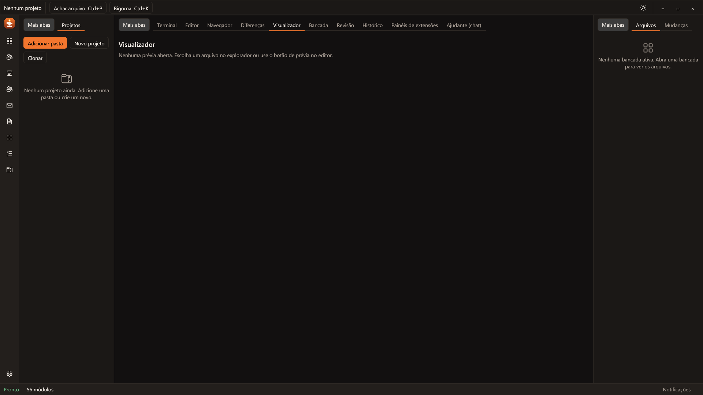

# Visualizador (aba da bancada) — estado vazio

Tela da aba "Visualizador" da bancada, que mostra prévias de arquivos; neste estado nenhum projeto está aberto e nenhuma prévia foi solicitada.

## Como chegar
Abra o app (`forja-app`), clique na aba "Visualizador" na faixa de abas da bancada. Comando de captura: `forja-app --locale pt-BR --theme dark --bench-tab viewers.tab`.

## Regiões
- **Barra superior** (0,0)–(1024,42): chip "Nenhum projeto", botões "Achar arquivo  Ctrl+P" e "Bigorna  Ctrl+K" à esquerda; ícone sem nome (tema/claro) e os botões de janela "–", "□" e "×" à direita.
- **Trilho à esquerda** (0,42)–(52,736): coluna de botões-ícone ("Quadro", "Ajudantes", "Rotinas", "Mutirão", "Pedidos", "Skills", "Uso", "Extensões", "Acervo") e, no pé, "Ajustes".
- **Painel lateral esquerdo** (52,42)–(304,736): abas "Projetos", "Bancadas" e "Painéis de extensões" (cortada), botões "Adicionar pasta", "Novo" e "Clonar" e a mensagem "Nenhum projeto ainda. Adicione uma pasta ou crie um novo." com ícone de pasta.
- **Área central** (320,42)–(716,736): título "Visualizador" e a mensagem "Nenhuma prévia aberta. Escolha um arquivo no explorador ou use o botão de prévia no editor.", cortada na borda direita.
- **Painel direito** (732,42)–(1024,736): abas "Arquivos", "Mudanças", "Busca" e "Portas"; ícone de grade e a mensagem "Nenhuma bancada ativa. Abra uma bancada para ver os arquivos."
- **Divisores verticais**: faixas sem nome em (304,42)–(320,736) e (716,42)–(732,736) separam painel esquerdo, área central e painel direito.
- **Barra de status** (0,736)–(1024,768): "Pronto" à esquerda, "56 módulos" ao lado e "Notificações" à direita.

## Elementos
| Elemento | Tipo | Posição (px) | Estado | O que faz |
|---|---|---|---|---|
| "Achar arquivo  Ctrl+P" | Button | (135,5)–(291,37) | — | Abre a busca rápida de arquivos (atalho Ctrl+P). |
| "Bigorna  Ctrl+K" | Button | (299,5)–(417,37) | — | Abre a paleta de comandos (atalho Ctrl+K). |
| (sem nome acessível) | Unknown | (845,5)–(877,37) | — | Ícone de sol/tema claro; alterna o tema. |
| "–" | Button | (899,5)–(931,37) | — | Minimiza a janela. |
| "□" | Button | (939,5)–(971,37) | — | Maximiza/restaura a janela. |
| "×" | Button | (979,5)–(1013,37) | — | Fecha a janela. |
| "Nenhum projeto" | Label | (11,12)–(113,31) | — | Indica que não há projeto aberto. |
| (sem nome acessível) | Unknown | (304,42)–(320,736) | — | Divisor vertical entre o painel esquerdo e a área central. |
| (sem nome acessível) | Unknown | (716,42)–(732,736) | — | Divisor vertical entre a área central e o painel direito. |
| (sem nome acessível) | Image | (12,50)–(40,78) | — | Ícone/marca da Forja no topo do trilho. |
| (sem nome acessível) | Unknown | (64,50)–(300,82) | — | Contêiner da faixa de abas do painel esquerdo. |
| "Projetos" | Button | (64,50)–(138,82) | marcado=True | Aba ativa do painel esquerdo; mostra a lista de projetos. |
| "Bancadas" | Button | (138,50)–(220,82) | marcado=False | Troca o painel para a lista de bancadas. |
| "Painéis de extensões" | Button | (220,50)–(371,82) | marcado=False | Aba de painéis de extensões; texto cortado na borda do painel. |
| "Terminal" | Button | (324,50)–(401,82) | marcado=False | Aba do terminal. |
| "Editor" | Button | (401,50)–(461,82) | marcado=False | Aba do editor. |
| "Navegador" | Button | (461,50)–(553,82) | marcado=False | Aba do navegador. |
| "Diferenças" | Button | (553,50)–(641,82) | marcado=False | Aba de diferenças. |
| "Visualizador" | Button | (641,50)–(739,82) | marcado=True | Aba ativa da área central; mostra este visualizador. |
| (sem nome acessível) | Unknown | (736,50)–(1012,82) | — | Contêiner da faixa de abas do painel direito. |
| "Arquivos" | Button | (736,50)–(814,82) | marcado=True | Aba ativa do painel direito; explorador de arquivos. |
| "Bancada" | Button | (739,50)–(815,82) | marcado=False | Sobreposta a "Arquivos"; aba da bancada. |
| "Mudanças" | Button | (814,50)–(901,82) | marcado=False | Aba de mudanças. |
| "Revisão" | Button | (815,50)–(885,82) | marcado=False | Sobreposta a "Mudanças"; aba de revisão. |
| "Histórico" | Button | (885,50)–(965,82) | marcado=False | Aba de histórico. |
| "Busca" | Button | (901,50)–(960,82) | marcado=False | Sobreposta a "Histórico"; aba de busca. |
| "Portas" | Button | (960,50)–(1022,82) | marcado=False | Aba de portas. |
| "Painéis de extensões" | Button | (965,50)–(1115,82) | marcado=False | Ultrapassa a largura da janela (1024 px). |
| "Painéis de extensões" | Button | (1022,50)–(1173,82) | marcado=False | Segunda ocorrência, fora da janela. |
| "Ajudante (chat)" | Button | (1115,50)–(1234,82) | marcado=False | Fora da janela; não visível na captura. |
| (sem nome acessível) | Unknown | (64,80)–(300,82) | — | Linha de sublinhado da aba ativa "Projetos". |
| (sem nome acessível) | Unknown | (736,80)–(1012,82) | — | Linha de sublinhado da aba ativa "Arquivos". |
| "Quadro" | Button | (8,94)–(44,130) | marcado=False | Ícone do trilho; abre o quadro. |
| "Adicionar pasta" | Button | (64,98)–(183,130) | — | Botão laranja em destaque; abre seletor de pasta. |
| "Novo" | Button | (191,98)–(248,130) | — | Cria um projeto novo. |
| "Visualizador" | Label | (324,98)–(423,122) | — | Título da área central. |
| (ícone) | Label | (860,114)–(888,142) | — | Ícone de grade do estado vazio do painel direito. |
| "Nenhuma prévia aberta. Escolha um arquivo no explorador ou use o botão de prévia no editor." | Label | (324,130)–(909,149) | — | Mensagem de estado vazio; visível só até "ou us…", cortada pelo divisor. |
| "Ajudantes" | Button | (8,138)–(44,174) | marcado=False | Ícone do trilho; abre os ajudantes. |
| "Clonar" | Button | (64,138)–(128,170) | — | Clona um repositório. |
| "Nenhuma bancada ativa. Abra uma bancada para ver os arquivos." | Label | (738,150)–(1010,188) | — | Mensagem de estado vazio do painel direito, centralizada em duas linhas. |
| "Rotinas" | Button | (8,182)–(44,218) | marcado=False | Ícone do trilho; abre as rotinas. |
| (ícone) | Label | (168,198)–(196,226) | — | Ícone de pasta ilustrando o estado vazio do painel esquerdo. |
| "Mutirão" | Button | (8,226)–(44,262) | marcado=False | Ícone do trilho; abre o mutirão. |
| "Nenhum projeto ainda. Adicione uma pasta ou crie um novo." | Label | (66,234)–(298,272) | — | Mensagem de estado vazio do painel esquerdo, em duas linhas. |
| "Pedidos" | Button | (8,270)–(44,306) | marcado=False | Ícone do trilho; abre os pedidos. |
| "Skills" | Button | (8,314)–(44,350) | marcado=False | Ícone do trilho; abre as skills. |
| "Uso" | Button | (8,358)–(44,394) | marcado=False | Ícone do trilho; abre o uso. |
| "Extensões" | Button | (8,402)–(44,438) | marcado=False | Ícone do trilho; abre as extensões. |
| "Acervo" | Button | (8,446)–(44,482) | marcado=False | Ícone do trilho; abre o acervo. |
| "Ajustes" | Button | (8,692)–(44,728) | marcado=False | Ícone do trilho; abre os ajustes. |
| "Pronto" | Label | (10,743)–(51,762) | — | Estado geral na barra de status, em verde. |
| "56 módulos" | Label | (73,743)–(146,762) | — | Quantidade de módulos carregados. |
| "Notificações" | Label | (914,743)–(990,762) | — | Abre a área de notificações. |

## Aparência
Tema escuro: fundo geral quase preto, com a barra superior e a de status em tom ainda mais escuro e os painéis em cinza muito escuro; os divisores verticais aparecem como linhas levemente mais claras. A cor de destaque é o laranja da marca (Brasa): preenchimento sólido no botão "Adicionar pasta" e sublinhado sob as abas ativas ("Projetos", "Visualizador" e "Arquivos"). O texto é cinza claro nas mensagens e branco nos títulos e abas; tipografia sem serifa, corpo pequeno (rótulos de aba e status) e médio no título "Visualizador". O trilho à esquerda usa apenas ícones de 36 px alinhados em coluna única; os botões "Adicionar pasta", "Novo" e "Clonar" ficam alinhados à esquerda no painel, e as mensagens de estado vazio são centralizadas horizontalmente em seus painéis. Sem espaçamentos irregulares além do corte descrito abaixo.

## Problemas encontrados
- Sobreposição de abas: "Terminal" (324–401) invade "Painéis de extensões" (220–371) na mesma faixa; no painel direito, "Bancada" (739–815) cobre "Arquivos" (736–814), "Revisão" (815–885) cobre "Mudanças" (814–901) e "Busca" (901–960) invade "Histórico" (885–965).
- Elementos fora da janela (largura da imagem: 1024 px): "Painéis de extensões" (965–1115 e 1022–1173) e "Ajudante (chat)" (1115–1234) têm retângulos além da borda direita.
- Texto cortado na imagem: "Painéis de e…" (aba do painel esquerdo, cortada em x≈300), "Visualizado…" (aba central, cortada em x≈724) e a mensagem do visualizador, visível só até "ou us…" (cortada pelo divisor em x≈724), embora seu retângulo vá até x=909, cruzando para o painel direito.
- Duas faixas de abas reportadas na mesma linha y=50–82 com abas duplicadas ("Arquivos" e "Painéis de extensões" aparecem duas vezes), o que indica abas de painéis distintos empilhadas na mesma posição.
- Botão sem nome acessível: o ícone de tema claro/escuro em (845,5)–(877,37) não tem rótulo.
- A aba "Visualizador" (641–739) e o contêiner direito (736–1012) se sobrepõem levemente em x=736–739.
