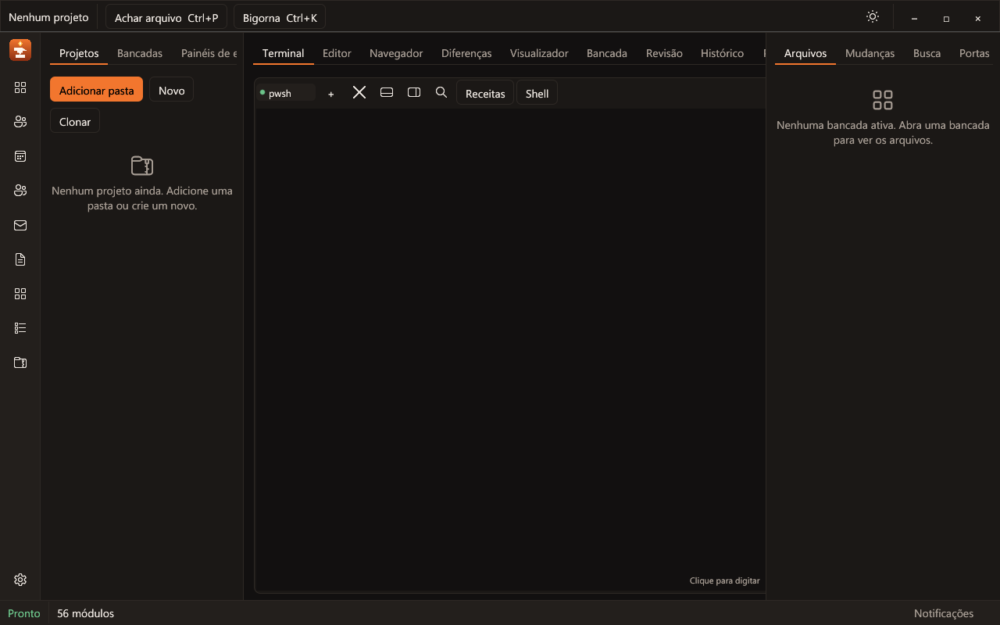

# Tela inicial (home, sem projeto)

É a janela principal da Forja no estado vazio, sem projeto aberto: mostra a trilha de navegação lateral, o painel de Projetos vazio, o Terminal central e o painel Arquivos aguardando uma bancada ativa.

## Como chegar
É a tela padrão do app: iniciar `forja-app --locale pt-BR --theme dark`. Nenhuma interação é necessária — é o estado `pt-BR.dark.home.default`. Comando de captura: rotina do Atlas gravando `captures/pt-BR.dark.home.default.png` (pixels, escala 1.0).

## Regiões
- **Barra superior** (aprox. (0,0)–(1024,42)): rótulo "Nenhum projeto", botões "Achar arquivo  Ctrl+P" e "Bigorna  Ctrl+K", botão de alternância de tema (ícone de sol, sem nome acessível, (845,5)–(877,37)) e os botões de janela "–", "□" e "×" à direita.
- **Trilho à esquerda** (aprox. (0,42)–(52,738)): logotipo (imagem laranja em forma de bigorna, (12,50)–(40,78)) e, de cima para baixo, os ícones "Quadro", "Ajudantes", "Rotinas", "Mutirão", "Pedidos", "Skills", "Uso", "Extensões", "Acervo" e, colado ao rodapé, "Ajustes".
- **Painel lateral esquerdo — Projetos** (aprox. (52,42)–(304,738)): abas "Projetos" (ativa), "Bancadas" e "Painéis de extensões"; botões "Adicionar pasta" (destacado em laranja), "Novo" e "Clonar"; estado vazio com ícone de pasta (rótulo "(ícone)", (168,198)–(196,226)) e o texto "Nenhum projeto ainda. Adicione uma pasta ou crie um novo.".
- **Divisores verticais** (aprox. (304,42)–(320,736) e (716,42)–(732,736)): faixas estreitas sem nome acessível entre o painel esquerdo, a área central e o painel direito (redimensionadores de painel).
- **Área central — Terminal** (aprox. (320,42)–(732,738)): abas "Terminal" (ativa), "Editor", "Navegador", "Diferenças" e "Visualizador"; barra de ferramentas do terminal com "+", quatro botões de ícone sem nome acessível, "Receitas", "Shell" e a pílula de sessão "pwsh" (elemento sem nome acessível, (328,107)–(404,129), com indicador circular pequeno em (385,110)–(401,126)); área vazia de texto do terminal (328,139)–(724,724) com a sugestão "Clique para digitar" no canto inferior direito.
- **Painel direito — Arquivos** (aprox. (732,42)–(1024,738)): abas "Arquivos" (ativa), "Bancada", "Mudanças", "Revisão", "Histórico", "Busca", "Portas" e demais abas que ultrapassam a janela; estado vazio com ícone de grade (rótulo "(ícone)", (860,114)–(888,142)) e o texto "Nenhuma bancada ativa. Abra uma bancada para ver os arquivos.".
- **Barra de status** (aprox. (0,738)–(1024,768)): rótulos "Pronto" e "56 módulos" à esquerda e "Notificações" à direita.

## Elementos
| Elemento | Tipo | Posição (px) | Estado | O que faz |
|---|---|---|---|---|
| "Achar arquivo  Ctrl+P" | Button | (135,5)–(291,37) | normal | Abre o localizador de arquivos (atalho Ctrl+P). |
| "Bigorna  Ctrl+K" | Button | (299,5)–(417,37) | normal | Abre a paleta de comandos (atalho Ctrl+K). |
| (sem nome acessível) | Unknown | (845,5)–(877,37) | normal | Ícone de sol: alterna o tema (claro/escuro). |
| "–" | Button | (899,5)–(931,37) | normal | Minimiza a janela. |
| "□" | Button | (939,5)–(971,37) | normal | Maximiza/restaura a janela. |
| "×" | Button | (979,5)–(1013,37) | normal | Fecha a janela. |
| "Nenhum projeto" | Label | (11,12)–(113,31) | clicável | Mostra o projeto atual (nenhum). |
| (sem nome acessível) | Unknown | (304,42)–(320,736) | foco | Divisor arrastável entre painel esquerdo e área central. |
| (sem nome acessível) | Unknown | (716,42)–(732,736) | foco | Divisor arrastável entre área central e painel direito. |
| (sem nome acessível) | Image | (12,50)–(40,78) | clicável | Logotipo da Forja no topo do trilho. |
| "Projetos" | Button | (64,50)–(138,82) | marcado=True | Aba ativa do painel esquerdo; lista projetos. |
| (sem nome acessível) | Unknown | (64,50)–(300,82) | foco | Contêiner da faixa de abas do painel esquerdo. |
| "Bancadas" | Button | (138,50)–(220,82) | marcado=False | Aba de bancadas do painel esquerdo. |
| "Painéis de extensões" | Button | (220,50)–(371,82) | marcado=False | Aba de painéis de extensões do painel esquerdo. |
| "Terminal" | Button | (324,50)–(401,82) | marcado=True | Aba ativa da área central; mostra o terminal. |
| "Editor" | Button | (401,50)–(461,82) | marcado=False | Aba do editor de arquivos. |
| "Navegador" | Button | (461,50)–(553,82) | marcado=False | Aba do navegador integrado. |
| "Diferenças" | Button | (553,50)–(641,82) | marcado=False | Aba de comparação de diffs. |
| "Visualizador" | Button | (641,50)–(739,82) | marcado=False | Aba do visualizador de arquivos. |
| (sem nome acessível) | Unknown | (736,50)–(1012,82) | foco | Contêiner da faixa de abas do painel direito. |
| "Arquivos" | Button | (736,50)–(814,82) | marcado=True | Aba ativa do painel direito; lista arquivos da bancada. |
| "Bancada" | Button | (739,50)–(815,82) | marcado=False | Aba de informações da bancada. |
| "Mudanças" | Button | (814,50)–(901,82) | marcado=False | Aba de mudanças pendentes. |
| "Revisão" | Button | (815,50)–(885,82) | marcado=False | Aba de revisão. |
| "Histórico" | Button | (885,50)–(965,82) | marcado=False | Aba de histórico. |
| "Busca" | Button | (901,50)–(960,82) | marcado=False | Aba de busca. |
| "Portas" | Button | (960,50)–(1022,82) | marcado=False | Aba de portas em uso. |
| "Painéis de extensões" | Button | (965,50)–(1115,82) | marcado=False | Aba de painéis de extensões do painel direito. |
| "Painéis de extensões" | Button | (1022,50)–(1173,82) | marcado=False | Segunda aba homônima; retângulo além da largura da janela. |
| "Ajudante (chat)" | Button | (1115,50)–(1234,82) | marcado=False | Aba do chat do ajudante; fora da área visível. |
| (sem nome acessível) | Unknown | (64,80)–(300,82) | clicável | Faixa fina sob as abas do painel esquerdo (linha de sublinhado da aba ativa). |
| (sem nome acessível) | Unknown | (736,80)–(1012,82) | clicável | Faixa fina sob as abas do painel direito. |
| "Quadro" | Button | (8,94)–(44,130) | marcado=False | Ícone do quadro geral (projetos/bancadas). |
| "Adicionar pasta" | Button | (64,98)–(183,130) | normal (destaque laranja) | Adiciona uma pasta de projeto existente. |
| "Novo" | Button | (191,98)–(248,130) | normal | Cria um projeto novo. |
| "+" | Button | (407,102)–(441,134) | normal | Abre nova aba/sessão de terminal. |
| (sem nome acessível) | Unknown | (444,102)–(476,134) | clicável | Ícone de fechar (X): encerra o terminal. |
| (sem nome acessível) | Unknown | (479,102)–(511,134) | clicável | Ícone de monitor: alterna a exibição do terminal. |
| (sem nome acessível) | Unknown | (514,102)–(546,134) | clicável | Ícone de retângulo: alterna o terminal em painel dedicado. |
| (sem nome acessível) | Unknown | (549,102)–(581,134) | clicável | Ícone de lupa: busca no terminal. |
| "Receitas" | Button | (584,102)–(658,134) | normal | Abre a lista de receitas de terminal. |
| "Shell" | Button | (661,102)–(714,134) | normal | Seletor do shell da sessão (pwsh). |
| (sem nome acessível) | Unknown | (328,107)–(404,129) | clicável | Pílula da sessão ativa "pwsh" com indicador. |
| (sem nome acessível) | Unknown | (385,110)–(401,126) | clicável | Indicador circular da pílula (ponto de status). |
| (ícone) | Label | (860,114)–(888,142) | clicável | Ícone de grade do estado vazio do painel Arquivos. |
| "Ajudantes" | Button | (8,138)–(44,174) | marcado=False | Ícone do painel de ajudantes (agentes de IA). |
| "Clonar" | Button | (64,138)–(128,170) | normal | Clona um repositório/projeto. |
| (sem nome acessível) | Unknown | (328,139)–(724,724) | clicável | Área de texto do terminal (vazia); clique foca o terminal. |
| "Nenhuma bancada ativa. Abra uma bancada para ver os arquivos." | Label | (738,150)–(1010,188) | clicável | Estado vazio do painel Arquivos. |
| "Rotinas" | Button | (8,182)–(44,218) | marcado=False | Ícone do painel de rotinas. |
| (ícone) | Label | (168,198)–(196,226) | clicável | Ícone de pasta do estado vazio do painel Projetos. |
| "Mutirão" | Button | (8,226)–(44,262) | marcado=False | Ícone do painel de mutirão (tarefas em lote). |
| "Nenhum projeto ainda. Adicione uma pasta ou crie um novo." | Label | (66,234)–(298,272) | clicável | Estado vazio do painel Projetos. |
| "Pedidos" | Button | (8,270)–(44,306) | marcado=False | Ícone do painel de pedidos. |
| "Skills" | Button | (8,314)–(44,350) | marcado=False | Ícone do painel de skills. |
| "Uso" | Button | (8,358)–(44,394) | marcado=False | Ícone do painel de uso. |
| "Extensões" | Button | (8,402)–(44,438) | marcado=False | Ícone do painel de extensões. |
| "Acervo" | Button | (8,446)–(44,482) | marcado=False | Ícone do painel de acervo. |
| "Ajustes" | Button | (8,692)–(44,728) | marcado=False | Ícone de ajustes, no rodapé do trilho. |
| "Pronto" | Label | (10,743)–(51,762) | clicável | Estado geral do app na barra de status. |
| "56 módulos" | Label | (73,743)–(146,762) | clicável | Contagem de módulos carregados. |
| "Notificações" | Label | (914,743)–(990,762) | clicável | Acesso a notificações na barra de status. |

## Aparência
Tema escuro: fundo quase preto (grafite, aproximadamente #1c1c1c) na janela e nos painéis, com a barra superior e a barra de status em tom levemente distinto. Acento laranja ("Brasa"): o botão "Adicionar pasta" tem fundo laranja sólido com texto escuro, a aba ativa de cada faixa ("Projetos", "Terminal", "Arquivos") recebe sublinhado e texto em laranja, e o logotipo do trilho é laranja. Ponto verde pequeno na pílula "pwsh" indica sessão ativa. Tipografia sans-serif compacta (~12–13 px) em cinza claro (#d0d0d0 aprox.), com rótulos de estado vazio em cinza médio, centralizados. Abas e botões têm retângulos alinhados em duas faixas de abas (y≈50–82) e uma linha de ferramentas (y≈102–134); o trilho usa ícones quadrados de 36 px, espaçados de 44 px verticalmente, com "Ajustes" ancorado ao rodapé. Os divisores entre painéis aparecem como linhas verticais discretas de tom mais escuro.

## Problemas encontrados
- A aba "Painéis de extensões" do painel esquerdo (220,50)–(371,82) ultrapassa a borda do painel (x≈304) e o texto aparece cortado ("Painéis de e…") na imagem.
- A aba "Visualizador" (641,50)–(739,82) passa do limite da área central (x≈724) e o texto aparece cortado ("Visualizado…") na imagem.
- A faixa de abas do painel direito transborda a largura da janela: "Painéis de extensões" (1022,50)–(1173,82) e "Ajudante (chat)" (1115,50)–(1234,82) têm retângulos além da largura da imagem (1024 px) e ficam inacessíveis visualmente.
- Retângulos sobrepostos na árvore do painel direito: "Bancada" (739,50)–(815,82) sobrepõe "Arquivos", "Revisão" (815,50)–(885,82) sobrepõe "Mudanças" (814,50)–(901,82) e "Histórico" (885,50)–(965,82) sobrepõe "Busca" (901,50)–(960,82); na imagem apenas "Arquivos", "Mudanças", "Busca" e "Portas" são visíveis, indicando medições inconsistentes da faixa de abas.
- Botões sem nome acessível (acessibilidade): o alternador de tema (845,5)–(877,37), os quatro ícones da barra do terminal (444,102)–(581,134) e a pílula de sessão "pwsh" (328,107)–(404,129) não expõem nome.
- Os botões de ícone do terminal e o alternador de tema dependem de reconhecimento visual, sem rótulo ou tooltip acessível na árvore.
- Estados com pixels idênticos a esta captura incluem modais que deveriam alterar a imagem (pt-BR.dark.modal.bench.dialogs, pt-BR.dark.modal.mcp.approval, pt-BR.dark.modal.notify.toasts, pt-BR.dark.modal.onboarding.wizard, pt-BR.dark.modal.voice.overlay e pt-BR.dark.modal.counter.poller): nessas capturas nenhum diálogo, aviso ou sobreposição aparece renderizado.
- O texto "Clique para digitar" na área do terminal (canto inferior direito, ~(650,705)–(716,716)) não corresponde a nenhum elemento da árvore de acessibilidade.
