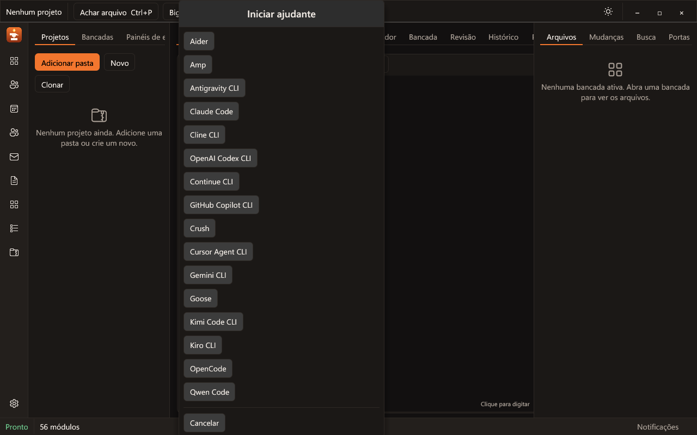

# Iniciar ajudante (modal helper.profile_picker)

Modal central que lista os ajudantes de código (agentes de IA) disponíveis para iniciar uma sessão na bancada atual.

## Como chegar
Na janela principal, acione a ação de iniciar ajudante (o painel de "Ajudantes" fica no trilho à esquerda; o modal abre sobreposto ao app). Captura: `forja-app --locale pt-BR --theme dark --modal helper.profile_picker`.

## Regiões
- **Modal "Iniciar ajudante"** — (328,0)–(706,804). Coluna central escura sobreposta ao app; barra de título com o texto "Iniciar ajudante" (0–49) e corpo (328,139)–(724,724) com a lista vertical de chips de ajudantes, terminando no botão "Cancelar".
- **Barra superior do app** — (0,0)–(1024,42). À esquerda o rótulo "Nenhum projeto" e os botões "Achar arquivo  Ctrl+P" e "Bigorna  Ctrl+K"; à direita um botão de tema sem nome acessível (~845–877) e os botões de janela "–", "□", "×".
- **Trilho à esquerda** — (0,42)–(52,736). Coluna de ícones: "Quadro", "Ajudantes", "Rotinas", "Mutirão", "Pedidos", "Skills", "Uso", "Extensões", "Acervo" e "Ajustes", todos não marcados; acima, um ícone de módulo ativo em laranja (12,50)–(40,78).
- **Painel lateral esquerdo (Projetos)** — (52,42)–(~320,736). Abas "Projetos" (marcada), "Bancadas" e "Painéis de extensões"; ações "Adicionar pasta", "Novo" e "Clonar"; estado vazio com ícone de pasta (168,198)–(196,226) e o rótulo "Nenhum projeto ainda. Adicione uma pasta ou crie um novo.".
- **Área central** — (~320,42)–(~716,736). Abas "Terminal" (marcada), "Editor", "Navegador", "Diferenças" e "Visualizador" e um botão "+" com quatro elementos sem nome ao lado; na prática quase todo coberto pelo modal.
- **Painel direito (Arquivos)** — (~732,42)–(1024,736). Abas "Arquivos" (marcada), "Bancada", "Mudanças", "Revisão", "Histórico", "Busca", "Portas" e mais entradas além da borda da imagem; estado vazio com o rótulo "Nenhuma bancada ativa. Abra uma bancada para ver os arquivos.".
- **Barra de status** — (0,736)–(1024,768). "Pronto" à esquerda, "56 módulos" ao lado e "Notificações" à direita.

## Elementos
| Elemento | Tipo | Posição (px) | Estado | O que faz |
|---|---|---|---|---|
| "Iniciar ajudante" | Janela (modal) | (328,0)–(706,804) | foco | Modal de escolha do ajudante; recebe o foco ao abrir |
| (sem nome acessível) | Desconhecido | (361,1)–(673,49) | clique, foco | Barra de título do modal, sobre a qual se lê "Iniciar ajudante" |
| "Achar arquivo  Ctrl+P" | Botão | (135,5)–(291,37) | clique, foco | Abre a busca rápida de arquivos (atalho Ctrl+P) |
| "Bigorna  Ctrl+K" | Botão | (299,5)–(417,37) | clique, foco | Abre a paleta de comandos (Ctrl+K); parcialmente coberto pelo modal |
| (sem nome acessível) | Desconhecido | (845,5)–(877,37) | clique, foco | Botão de alternância de tema (ícone de sol) |
| "–" | Botão | (899,5)–(931,37) | clique, foco | Minimiza a janela |
| "□" | Botão | (939,5)–(971,37) | clique, foco | Maximiza/restaura a janela |
| "×" | Botão | (979,5)–(1013,37) | clique, foco | Fecha a janela |
| "Nenhum projeto" | Rótulo | (11,12)–(113,31) | clique, foco | Indica ausência de projeto selecionado |
| (sem nome acessível) | Desconhecido | (304,42)–(320,736) | foco | Divisor vertical entre painel esquerdo e área central |
| (sem nome acessível) | Desconhecido | (716,42)–(732,736) | foco | Divisor vertical entre área central e painel direito |
| (sem nome acessível) | Imagem | (12,50)–(40,78) | clique, foco | Ícone do módulo ativo no topo do trilho (laranja) |
| "Projetos" | Botão (aba) | (64,50)–(138,82) | clique, foco; marcado=True | Mostra o painel de projetos |
| (sem nome acessível) | Desconhecido | (64,50)–(300,82) | foco | Faixa de fundo da linha de abas do painel esquerdo |
| "Bancadas" | Botão (aba) | (138,50)–(220,82) | clique, foco; marcado=False | Alterna para a lista de bancadas |
| "Painéis de extensões" | Botão (aba) | (220,50)–(371,82) | clique, foco; marcado=False | Aba de painéis de extensões; texto truncado pelo modal |
| "Terminal" | Botão (aba) | (324,50)–(401,82) | clique, foco; marcado=True | Aba central ativa; coberta pelo modal |
| "Editor" | Botão (aba) | (401,50)–(461,82) | clique, foco; marcado=False | Aba do editor; coberta pelo modal |
| "Navegador" | Botão (aba) | (461,50)–(553,82) | clique, foco; marcado=False | Aba do navegador; coberta pelo modal |
| "Diferenças" | Botão (aba) | (553,50)–(641,82) | clique, foco; marcado=False | Aba de diferenças; coberta pelo modal |
| "Visualizador" | Botão (aba) | (641,50)–(739,82) | clique, foco; marcado=False | Aba do visualizador; coberta pelo modal |
| (sem nome acessível) | Desconhecido | (736,50)–(1012,82) | foco | Faixa de fundo da linha de abas do painel direito |
| "Arquivos" | Botão (aba) | (736,50)–(814,82) | clique, foco; marcado=True | Mostra a lista de arquivos da bancada |
| "Bancada" | Botão (aba) | (739,50)–(815,82) | clique, foco; marcado=False | Aba sobreposta a "Arquivos" |
| "Mudanças" | Botão (aba) | (814,50)–(901,82) | clique, foco; marcado=False | Aba de mudanças; sobrepõe "Revisão" |
| "Revisão" | Botão (aba) | (815,50)–(885,82) | clique, foco; marcado=False | Aba de revisão |
| "Histórico" | Botão (aba) | (885,50)–(965,82) | clique, foco; marcado=False | Aba de histórico; sobrepõe "Busca" |
| "Busca" | Botão (aba) | (901,50)–(960,82) | clique, foco; marcado=False | Aba de busca |
| "Portas" | Botão (aba) | (960,50)–(1022,82) | clique, foco; marcado=False | Aba de portas |
| "Painéis de extensões" | Botão (aba) | (965,50)–(1115,82) | clique, foco; marcado=False | Entrada duplicada que se estende além da largura da imagem |
| "Painéis de extensões" | Botão (aba) | (1022,50)–(1173,82) | clique, foco; marcado=False | Terceira ocorrência, também fora da imagem |
| "Ajudante (chat)" | Botão (aba) | (1115,50)–(1234,82) | clique, foco; marcado=False | Aba do chat do ajudante; fora da imagem |
| "Aider" | Botão (chip) | (337,58)–(394,93) | clique, foco | Seleciona o ajudante Aider |
| (sem nome acessível) | Desconhecido | (64,80)–(300,82) | clique, foco | Linha divisória sob as abas do painel esquerdo |
| (sem nome acessível) | Desconhecido | (736,80)–(1012,82) | clique, foco | Linha divisória sob as abas do painel direito |
| "Quadro" | Botão (ícone) | (8,94)–(44,130) | clique, foco; marcado=False | Abre o quadro no trilho |
| "Adicionar pasta" | Botão | (64,98)–(183,130) | clique, foco | Destaque laranja; abre seletor de pasta para criar projeto |
| "Novo" | Botão | (191,98)–(248,130) | clique, foco | Cria um projeto novo |
| "Amp" | Botão (chip) | (337,101)–(390,136) | clique, foco | Seleciona o ajudante Amp |
| "+" | Botão | (407,102)–(441,134) | clique, foco | Ação adicional da área central; coberto pelo modal |
| (sem nome acessível) | Desconhecido | (444,102)–(476,134) | clique, foco | Controle da barra central, oculto pelo modal |
| (sem nome acessível) | Desconhecido | (479,102)–(511,134) | clique, foco | Controle da barra central, oculto pelo modal |
| (sem nome acessível) | Desconhecido | (514,102)–(546,134) | clique, foco | Controle da barra central, oculto pelo modal |
| (sem nome acessível) | Desconhecido | (549,102)–(581,134) | clique, foco | Controle da barra central, oculto pelo modal |
| "Receitas" | Botão | (584,102)–(658,134) | clique, foco | Abre receitas; oculto pelo modal |
| "Shell" | Botão | (661,102)–(714,134) | clique, foco | Abre o shell; oculto pelo modal |
| (sem nome acessível) | Desconhecido | (328,107)–(404,129) | clique, foco | Elemento do modal sobre a região dos chips |
| (sem nome acessível) | Desconhecido | (385,110)–(401,126) | clique, foco | Elemento interno do modal |
| (ícone) | Rótulo | (860,114)–(888,142) | clique | Ícone de grade do estado vazio do painel direito |
| "Ajudantes" | Botão (ícone) | (8,138)–(44,174) | clique, foco; marcado=False | Abre o painel de ajudantes |
| "Clonar" | Botão | (64,138)–(128,170) | clique, foco | Clona um repositório como projeto |
| (sem nome acessível) | Desconhecido | (328,139)–(724,724) | clique, foco | Corpo do modal, contêiner da lista de ajudantes |
| "Antigravity CLI" | Botão (chip) | (337,144)–(451,179) | clique, foco | Seleciona o ajudante Antigravity CLI |
| "Nenhuma bancada ativa. Abra uma bancada para ver os arquivos." | Rótulo | (738,150)–(1010,188) | clique | Mensagem de estado vazio do painel de arquivos |
| "Rotinas" | Botão (ícone) | (8,182)–(44,218) | clique, foco; marcado=False | Abre o painel de rotinas |
| "Claude Code" | Botão (chip) | (337,187)–(439,222) | clique, foco | Seleciona o ajudante Claude Code |
| (ícone) | Rótulo | (168,198)–(196,226) | clique | Ícone de pasta do estado vazio de projetos |
| "Mutirão" | Botão (ícone) | (8,226)–(44,262) | clique, foco; marcado=False | Abre o painel de mutirão |
| "Cline CLI" | Botão (chip) | (337,230)–(414,265) | clique, foco | Seleciona o ajudante Cline CLI |
| "Nenhum projeto ainda. Adicione uma pasta ou crie um novo." | Rótulo | (66,234)–(298,272) | clique | Mensagem de estado vazio de projetos |
| "Pedidos" | Botão (ícone) | (8,270)–(44,306) | clique, foco; marcado=False | Abre o painel de pedidos |
| "OpenAI Codex CLI" | Botão (chip) | (337,273)–(473,308) | clique, foco | Seleciona o ajudante OpenAI Codex CLI |
| "Skills" | Botão (ícone) | (8,314)–(44,350) | clique, foco; marcado=False | Abre o painel de skills |
| "Continue CLI" | Botão (chip) | (337,316)–(440,351) | clique, foco | Seleciona o ajudante Continue CLI |
| "Uso" | Botão (ícone) | (8,358)–(44,394) | clique, foco; marcado=False | Abre o painel de uso |
| "GitHub Copilot CLI" | Botão (chip) | (337,359)–(476,394) | clique, foco | Seleciona o ajudante GitHub Copilot CLI |
| (sem nome acessível) | Desconhecido | (512,384)–(512,384) | clique, foco | Elemento de dimensão nula (retrôo da árvore) |
| "Extensões" | Botão (ícone) | (8,402)–(44,438) | clique, foco; marcado=False | Abre o painel de extensões |
| "Crush" | Botão (chip) | (337,402)–(396,437) | clique, foco | Seleciona o ajudante Crush |
| "Cursor Agent CLI" | Botão (chip) | (337,445)–(465,480) | clique, foco | Seleciona o ajudante Cursor Agent CLI |
| "Acervo" | Botão (ícone) | (8,446)–(44,482) | clique, foco; marcado=False | Abre o painel de acervo |
| "Gemini CLI" | Botão (chip) | (337,488)–(427,523) | clique, foco | Seleciona o ajudante Gemini CLI |
| "Goose" | Botão (chip) | (337,531)–(400,566) | clique, foco | Seleciona o ajudante Goose |
| "Kimi Code CLI" | Botão (chip) | (337,574)–(447,609) | clique, foco | Seleciona o ajudante Kimi Code CLI |
| "Kiro CLI" | Botão (chip) | (337,617)–(408,652) | clique, foco | Seleciona o ajudante Kiro CLI |
| "OpenCode" | Botão (chip) | (337,660)–(427,695) | clique, foco | Seleciona o ajudante OpenCode |
| "Ajustes" | Botão (ícone) | (8,692)–(44,728) | clique, foco; marcado=False | Abre o painel de ajustes |
| "Qwen Code" | Botão (chip) | (337,703)–(432,738) | clique, foco | Seleciona o ajudante Qwen Code; último chip inteiramente visível |
| "Pronto" | Rótulo | (10,743)–(51,762) | clique | Status geral em verde na barra de status |
| "56 módulos" | Rótulo | (73,743)–(146,762) | clique | Contagem de módulos carregados |
| "Notificações" | Rótulo | (914,743)–(990,762) | clique, foco | Atalho para notificações, à direita da barra de status |
| "Cancelar" | Botão | (337,760)–(414,795) | clique, foco | Fecha o modal sem escolher; cortado pela borda inferior da imagem |

## Aparência
Tema escuro: fundo quase preto no app e no modal, com o painel do modal em cinza-escuro levemente mais claro que o fundo e cantos arredondados. Acento laranja ("Brasa") no botão "Adicionar pasta", no ícone do módulo ativo do trilho e no sublinhado das abas marcadas ("Projetos", "Arquivos"). Os chips de ajudantes são retângulos arredondados cinza-escuro com borda sutil e texto claro, empilhados em coluna única alinhada à esquerda a partir de x≈337, com espaçamento vertical regular de ~43 px. Texto em fonte sem serifa de ~13–15 px, cinza-claro sobre fundo escuro, com contraste bom nos rótulos e mais baixo nas mensagens de estado vazio. "Pronto" aparece em verde na barra de status.

## Problemas encontrados
- A janela do modal vai até y=804 e o botão "Cancelar" até y=795, além da altura da imagem (768): a parte inferior do modal está cortada na captura e "Cancelar" aparece só pela metade.
- Vários elementos da linha de abas do painel direito ("Painéis de extensões" em 965 e 1022 e "Ajudante (chat)" até x=1234) se estendem além da largura da imagem (1024), fora da área visível.
- O modal sobrepõe a área central: as abas "Terminal", "Editor", "Navegador", "Diferenças", "Visualizador" e os botões "+", "Receitas" e "Shell" continuam na árvore de acessibilidade mas estão invisíveis ao usuário.
- O botão "Bigorna  Ctrl+K" é parcialmente coberto pelo modal (só "Big" é visível) e a aba "Painéis de extensões" do painel esquerdo é truncada ("Painéis de e").
- Abas do painel direito com retângulos sobrepostos e entradas duplicadas: "Arquivos"/"Bancada" (736–815 vs 739–815), "Mudanças"/"Revisão" (814–901 vs 815–885), "Histórico"/"Busca" (885–965 vs 901–960) e duas ocorrências extra de "Painéis de extensões" que se sobrepõem entre si.
- Botão de tema na barra superior (~845,5–877,37) e diversos controles da área central e divisores sem nome acessível.
- Rótulos de ícone expostos como "(ícone)" (grade e pasta dos estados vazios), sem nome acessível descritivo.
- Elemento de dimensão nula na árvore em (512,384)–(512,384).
