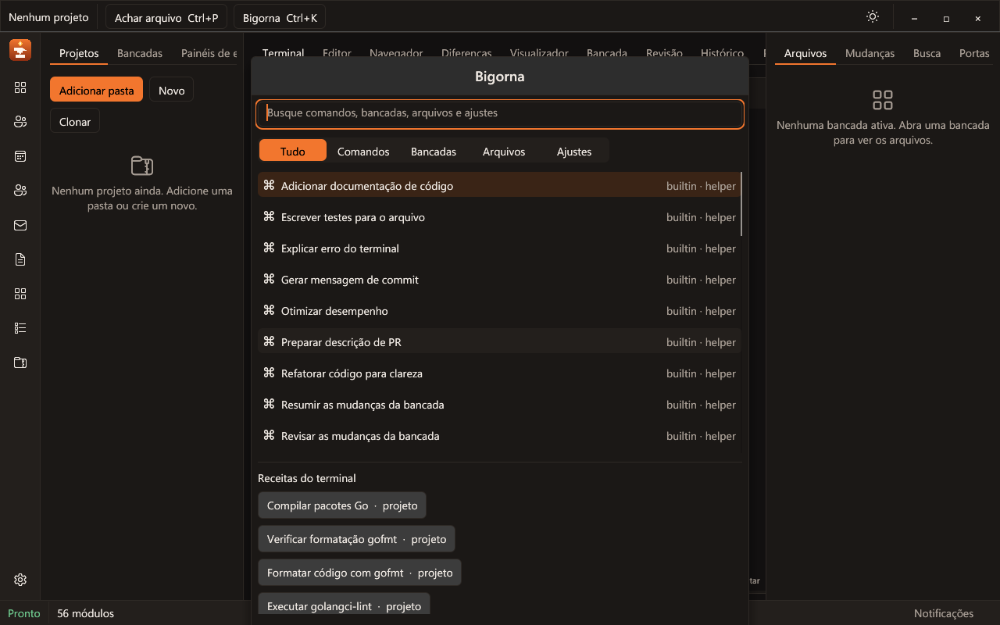

# Bigorna sobre a tela inicial (sem projeto)

Tela inicial da Forja sem projeto aberto, com a sobreposição da Bigorna (paleta de comandos e receitas de terminal) aberta no centro.

## Como chegar
Na barra superior, clique no botão "Bigorna  Ctrl+K" (ou pressione Ctrl+K); o app abre direto nessa tela com `forja-app --locale pt-BR --theme dark --open anvil` (captura em `captures/pt-BR.dark.open.anvil.png`, 1280×800 px).

## Regiões
- **Barra superior** (0,0)–(1280,42): rótulo do projeto ("Nenhum projeto"), botões "Achar arquivo  Ctrl+P" e "Bigorna  Ctrl+K", botão de tema (ícone de sol, sem nome), botões de janela "–", "□", "×".
- **Trilho de ícones à esquerda** (0,42)–(48,768): logo da Forja (imagem em (12,50)–(40,78)) e ícones de navegação: "Quadro", "Ajudantes", "Rotinas", "Mutirão", "Pedidos", "Skills", "Uso", "Extensões", "Acervo" e, no fim, "Ajustes".
- **Painel lateral esquerdo (Projetos)** (48,42)–(310,768): abas "Projetos" (ativa), "Bancadas" e "Painéis de extensões" (cortada), botões "Adicionar pasta", "Novo" e "Clonar", e estado vazio com ícone de pasta e o texto "Nenhum projeto ainda. Adicione uma pasta ou crie um novo.".
- **Divisor central** (304,42)–(320,768): separador arrastável entre o painel esquerdo e a área central.
- **Barra de abas central** (310,42)–(980,82): "Terminal" (ativa), "Editor", "Navegador", "Diferenças", "Visualizador", "Bancada", "Revisão", "Histórico" e "Painéis de extensões" (cortadas na borda).
- **Área central** (310,82)–(980,768): coberta pela janela da Bigorna (321,72)–(959,792) com um pano de fundo (328,139)–(980,756); atrás dela restam botões "Receitas", "Shell" e um "+" ocultos.
- **Divisor direito** (972,42)–(988,768): separador arrastável.
- **Painel lateral direito (Arquivos)** (988,42)–(1280,768): abas "Arquivos" (ativa), "Mudanças", "Ajudante (chat)", "Busca", "Portas" e "Painéis de extensões" (cortada), ícone de grade vazia e o texto "Nenhuma bancada ativa. Abra uma bancada para ver os arquivos.".
- **Barra de status** (0,768)–(1280,800): "Pronto", "56 módulos" e "Notificações".

## Elementos
| Elemento | Tipo | Posição (px) | Estado | O que faz |
|---|---|---|---|---|
| "Nenhum projeto" | Label | (11,12)–(113,31) | — | Indica que não há projeto aberto; clique reabre o painel de projetos. |
| "Achar arquivo  Ctrl+P" | Button | (135,5)–(291,37) | — | Abre a busca de arquivos (atalho Ctrl+P). |
| "Bigorna  Ctrl+K" | Button | (299,5)–(417,37) | — | Abre/fecha a Bigorna (já aberta nesta captura). |
| (sem nome acessível) | Unknown | (1101,5)–(1133,37) | — | Ícone de sol: alterna tema claro/escuro. |
| "–" | Button | (1155,5)–(1187,37) | — | Minimiza a janela. |
| "□" | Button | (1195,5)–(1227,37) | — | Maximiza/restaura a janela. |
| "×" | Button | (1235,5)–(1269,37) | — | Fecha o app. |
| (sem nome acessível) | Image | (12,50)–(40,78) | — | Logo da Forja no topo do trilho. |
| "Projetos" | Button | (64,50)–(138,82) | marcado=True | Aba ativa do painel esquerdo. |
| "Bancadas" | Button | (138,50)–(220,82) | marcado=False | Aba de bancadas do painel esquerdo. |
| "Painéis de extensões" | Button | (220,50)–(371,82) | marcado=False | Aba de painéis de extensões; retângulo invade a área central e o texto aparece cortado ("Painéis de e..."). |
| "Terminal" | Button | (324,50)–(401,82) | marcado=True | Aba ativa da área central. |
| "Editor" | Button | (401,50)–(461,82) | marcado=False | Mostra o editor. |
| "Navegador" | Button | (461,50)–(553,82) | marcado=False | Mostra o navegador de arquivos. |
| "Diferenças" | Button | (553,50)–(641,82) | marcado=False | Mostra as diferenças. |
| "Visualizador" | Button | (641,50)–(739,82) | marcado=False | Mostra o visualizador. |
| "Bancada" | Button | (739,50)–(815,82) | marcado=False | Mostra a bancada. |
| "Revisão" | Button | (815,50)–(885,82) | marcado=False | Mostra a revisão. |
| "Histórico" | Button | (885,50)–(965,82) | marcado=False | Mostra o histórico. |
| "Painéis de extensões" | Button | (965,50)–(1115,82) | marcado=False | Aba de extensões da área central, cortada na borda com o painel direito. |
| "Arquivos" | Button | (992,50)–(1070,82) | marcado=True | Aba ativa do painel direito. |
| "Mudanças" | Button | (1070,50)–(1157,82) | marcado=False | Mostra as mudanças da bancada. |
| "Ajudante (chat)" | Button | (1115,50)–(1234,82) | marcado=False | Abre o chat do ajudante; retângulo sobrepõe "Busca". |
| "Busca" | Button | (1157,50)–(1216,82) | marcado=False | Abre a busca; retângulo sobrepõe "Ajudante (chat)". |
| "Portas" | Button | (1216,50)–(1278,82) | marcado=False | Mostra as portas em uso. |
| "Painéis de extensões" | Button | (1278,50)–(1429,82) | marcado=False | Aba final do painel direito; fica fora da captura (x além de 1280). |
| "Bigorna" | Window | (321,72)–(959,792) | — | Janela de sobreposição da paleta de comandos. |
| (sem nome acessível) | Unknown | (354,73)–(926,121) | — | Faixa de título da Bigorna, com o título centralizado. |
| (sem nome acessível) | Unknown | (64,80)–(300,82) e (992,80)–(1268,82) | — | Sublinhados das abas ativas dos painéis laterais. |
| "Quadro" | Button | (8,94)–(44,130) | marcado=False | Ícone do quadro no trilho. |
| "Adicionar pasta" | Button | (64,98)–(183,130) | — | Botão primário laranja: adiciona uma pasta de projeto. |
| "Novo" | Button | (191,98)–(248,130) | — | Cria um projeto novo. |
| "+" | Button | (407,102)–(441,134) | — | Botão de adicionar da área central; oculto atrás da Bigorna. |
| (sem nome acessível) | Unknown | (444,102)–(581,134) | — | Quatro ícones pequenos de filtro/visão da área central, ocultos atrás da Bigorna. |
| "Receitas" | Button | (584,102)–(658,134) | — | Visão de receitas da área central, oculta atrás da Bigorna. |
| "Shell" | Button | (661,102)–(714,134) | — | Visão de shell da área central, oculta atrás da Bigorna. |
| (sem nome acessível) | Unknown | (328,107)–(404,129) e (385,110)–(401,126) | — | Elementos do cabeçalho da Bigorna sob o título. |
| "(ícone)" | Label | (1116,114)–(1144,142) | — | Ícone de grade do estado vazio do painel direito. |
| (sem nome acessível) | TextInput | (330,130)–(950,162) | foco | Campo de busca da Bigorna, com borda laranja e o texto "Busque comandos, bancadas, arquivos e ajustes". |
| "Ajudantes" | Button | (8,138)–(44,174) | marcado=False | Ícone de ajudantes no trilho. |
| "Clonar" | Button | (64,138)–(128,170) | — | Clona um repositório como projeto. |
| (sem nome acessível) | Unknown | (328,139)–(980,756) | — | Pano de fundo da sobreposição da Bigorna. |
| "Nenhuma bancada ativa. Abra uma bancada para ver os arquivos." | Label | (994,150)–(1266,188) | — | Estado vazio do painel direito. |
| "Tudo" | Button | (330,176)–(420,208) | marcado=True | Filtro ativo da Bigorna: lista tudo. |
| "Comandos" | Button | (420,176)–(510,208) | marcado=False | Filtro de comandos. |
| "Bancadas" | Button | (510,176)–(600,208) | marcado=False | Filtro de bancadas. |
| "Arquivos" | Button | (600,176)–(690,208) | marcado=False | Filtro de arquivos. |
| "Ajustes" | Button | (690,176)–(780,208) | marcado=False | Filtro de ajustes. |
| "Rotinas" | Button | (8,182)–(44,218) | marcado=False | Ícone de rotinas no trilho. |
| "(ícone)" | Label | (168,198)–(196,226) | — | Ícone de pasta do estado vazio do painel esquerdo. |
| (sem nome acessível) | Unknown | (330,220)–(950,580), linhas em (330,220/260/300/340/380/420/460/500/540/580)–(950,612) | — | Dez linhas de resultado da busca (ex.: "Adicionar documentação de código", "Escrever testes para o arquivo", "Explicar erro do terminal", "Gerar mensagem de commit", "Otimizar desempenho", "Preparar descrição de PR", "Refatorar código para clareza", "Resumir as mudanças da bancada", "Revisar as mudanças da bancada"), cada uma com a tag "builtin · helper"; a primeira linha tem fundo destacado. |
| (sem nome acessível) | Unknown | (948,220)–(950,580) | — | Barra de rolagem da lista de resultados. |
| "Mutirão" | Button | (8,226)–(44,262) | marcado=False | Ícone do mutirão no trilho. |
| "Nenhum projeto ainda. Adicione uma pasta ou crie um novo." | Label | (66,234)–(298,272) | — | Estado vazio do painel esquerdo. |
| "Pedidos" | Button | (8,270)–(44,306) | marcado=False | Ícone de pedidos no trilho. |
| "Skills" | Button | (8,314)–(44,350) | marcado=False | Ícone de skills no trilho. |
| "Uso" | Button | (8,358)–(44,394) | marcado=False | Ícone de uso no trilho. |
| "Extensões" | Button | (8,402)–(44,438) | marcado=False | Ícone de extensões no trilho. |
| "Acervo" | Button | (8,446)–(44,482) | marcado=False | Ícone do acervo no trilho. |
| "Receitas do terminal" | Label | (330,602)–(455,621) | — | Título da seção de receitas da Bigorna. |
| (sem nome acessível) | Unknown | (330,620)–(950,1812), linhas em (330,620/660/700/740/780/820/860/900/940/980/1020/1060/1100/1140/1180/1220/1260/1300/1340/1380/1420/1460/1500/1540/1580/1620/1660/1700/1740/1780) | — | Linhas de fundo da lista de receitas; a maior parte fica abaixo do corte da imagem (y>800). |
| (sem nome acessível) | Unknown | (330,629)–(599,753) | — | Grade/chips de receitas visíveis. |
| (sem nome acessível) | Unknown | (597,629)–(599,783) | — | Barra de rolagem da área de receitas. |
| "Compilar pacotes Go  ·  projeto" | Button | (330,629)–(546,664) | — | Chip que executa a receita no projeto. |
| "Verificar formatação gofmt  ·  projeto" | Button | (330,672)–(583,707) | — | Chip de verificação gofmt. |
| "Formatar código com gofmt  ·  projeto" | Button | (330,715)–(591,750) | — | Chip de formatação gofmt. |
| "Executar golangci-lint  ·  projeto" | Button | (330,758)–(551,793) | — | Chip do linter Go (cortado na borda inferior da imagem). |
| "Executar testes Go  ·  projeto" | Button | (330,801)–(530,836) | — | Chip de testes Go; fora do corte visível. |
| "Compilar projeto Node  ·  projeto" | Button | (330,844)–(560,879) | — | Chip de build Node; fora do corte visível. |
| "Verificar formatação Prettier  ·  projeto" | Button | (330,887)–(590,922) | — | Chip de verificação Prettier; fora do corte visível. |
| "Formatar código com Prettier  ·  projeto" | Button | (330,930)–(599,965) | — | Chip de formatação Prettier; fora do corte visível. |
| "Executar linter Node  ·  projeto" | Button | (330,973)–(542,1008) | — | Chip do linter Node; fora do corte visível. |
| "Executar testes Node  ·  projeto" | Button | (330,1016)–(547,1051) | — | Chip de testes Node; fora do corte visível. |
| "Compilar pacote Python  ·  projeto" | Button | (330,1059)–(566,1094) | — | Chip de build Python; fora do corte visível. |
| "Verificar formatação Ruff  ·  projeto" | Button | (330,1102)–(570,1137) | — | Chip de verificação Ruff; fora do corte visível. |
| "Formatar código com Ruff  ·  projeto" | Button | (330,1145)–(579,1180) | — | Chip de formatação Ruff; fora do corte visível. |
| "Executar linter Ruff  ·  projeto" | Button | (330,1188)–(533,1223) | — | Chip do linter Ruff; fora do corte visível. |
| "Executar testes com pytest  ·  projeto" | Button | (330,1231)–(581,1266) | — | Chip de testes pytest; fora do corte visível. |
| "Compilar workspace Rust  ·  projeto" | Button | (330,1274)–(573,1309) | — | Chip de build Rust; fora do corte visível. |
| "Verificar formatação Rust  ·  projeto" | Button | (330,1317)–(572,1352) | — | Chip de verificação Rust; fora do corte visível. |
| "Formatar código Rust  ·  projeto" | Button | (330,1360)–(550,1395) | — | Chip de formatação Rust; fora do corte visível. |
| "Executar Clippy linter  ·  projeto" | Button | (330,1403)–(547,1438) | — | Chip do Clippy; fora do corte visível. |
| "Executar testes Rust  ·  projeto" | Button | (330,1446)–(539,1481) | — | Chip de testes Rust; fora do corte visível. |
| "Ajustes" | Button | (8,724)–(44,760) | marcado=False | Ícone de ajustes no fim do trilho. |
| "Pronto" | Label | (10,775)–(51,794) | — | Status atual na barra inferior, em verde. |
| "56 módulos" | Label | (73,775)–(146,794) | — | Quantidade de módulos carregados. |
| "Notificações" | Label | (1170,775)–(1246,794) | — | Atalho de notificações na barra inferior. |
| "Enter executa · Ctrl+Enter mantém a Bigorna aberta · Esc fecha" | Label | (330,797)–(660,813) | — | Dica de teclado da Bigorna; invade a faixa da barra de status. |

## Aparência
Tema escuro: fundo quase preto (#1a1a1a aproximado) na barra superior, trilho e painéis, e um tom levemente mais claro (#242424) na área central e na Bigorna. Acento laranja (Brasa) nas abas ativas ("Projetos", "Terminal", "Arquivos", "Tudo"), no botão primário "Adicionar pasta" e na borda do campo de busca focado; o item selecionado da lista usa um destaque marrom-alaranjado translúcido. Texto em cinza claro (#e0e0e0) para itens ativos e cinza médio (#8a8a8a) para inativos, tags "builtin · helper" e estados vazios. Chips de receitas em cinza escuro arredondado com borda sutil. Tipografia sans-serif de um único tamanho, com o título "Bigorna" em negrito centralizado. Abas com altura fixa de 32 px, sublinhado laranja de 2 px sob a aba ativa, ícones do trilho em quadrados de 36 px espaçados de 44 px, chips alinhados à esquerda em coluna com espaçamento de ~13 px e a barra de status em texto pequeno.

## Problemas encontrados
- Vários elementos têm retângulos além dos limites da captura (1280×800): a aba "Painéis de extensões" do painel direito vai até x=1429, e o conteúdo da Bigorna (linhas de receita e lista) se estende até y=1812 — a lista de receitas e as abas finais são cortadas na imagem.
- Sobreposição de retângulos entre abas: "Ajudante (chat)" (1115–1234) sobrepõe "Busca" (1157–1216), e a aba "Painéis de extensões" do painel esquerdo (220–371) sobrepõe a aba central "Terminal" (324–401).
- Botões "Receitas", "Shell" e "+" (y≈102–134) ficam totalmente ocultos atrás da sobreposição da Bigorna, sobreposição de camadas sem indicação visual.
- A dica "Enter executa · Ctrl+Enter mantém a Bigorna aberta · Esc fecha" (330,797)–(660,813) fica fora do retângulo da janela da Bigorna (que termina em y=792) e invade a faixa da barra de status.
- Elementos interativos sem nome acessível: o botão de alternar tema (ícone de sol, (1101,5)–(1133,37)), o campo de busca da Bigorna, as dez linhas de resultado da busca, os quatro ícones de filtro da área central e os divisores dos painéis.
- As linhas de resultado da Bigorna não expõem o texto visível como nome acessível (só aparência na imagem), o que prejudica leitores de tela.
- Abas com texto cortado na renderização: "Painéis de e..." no painel esquerdo e as abas centrais/direitas truncadas pelas bordas dos painéis.
- As barras de rolagem das listas têm apenas 2 px de largura ((948,220)–(950,580) e (597,629)–(599,783)), muito finas e de baixo contraste.
