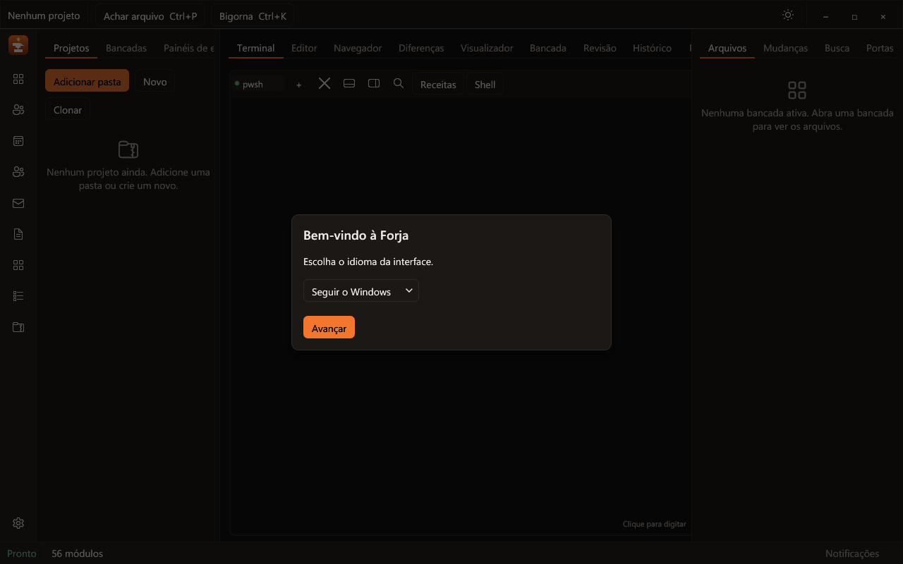

# Onboarding — Boas-vindas e escolha de idioma

Tela de primeiro uso exibida sobre a janela principal, em que a pessoa escolhe o idioma da interface e avança pela configuração inicial da Forja.

## Como chegar
Abertura direta pela linha de comando: `forja-app --locale pt-BR --theme dark --open onboarding`. No app normal, a tela aparece na primeira execução (quando ainda não há projeto) e pode ser retomada pelos Ajustes (botão "Ajustes" no rodapé do trilho à esquerda, retângulo (8,724)–(44,760)).

## Regiões
- **Barra superior** — (0,0)–(1280,42): à esquerda o rótulo "Nenhum projeto" e os botões "Achar arquivo  Ctrl+P" e "Bigorna  Ctrl+K"; à direita o botão sem nome acessível com ícone de sol (alternar tema), seguido dos botões de janela "–", "□" e "×".
- **Trilho à esquerda** — (0,42)–(56,768): o logotipo (imagem sem nome acessível em (12,50)–(40,78)) e uma coluna de botões de ícone: "Quadro", "Ajudantes", "Rotinas", "Mutirão", "Pedidos", "Skills", "Uso", "Extensões" e "Acervo", com "Ajustes" fixado no rodapé.
- **Painel lateral esquerdo (Projetos)** — (56,42)–(314,768): abas "Projetos" (marcada), "Bancadas" e "Painéis de extensões"; abaixo, os botões "Adicionar pasta", "Novo" e "Clonar"; mais abaixo, um ícone de pasta e a mensagem "Nenhum projeto ainda. Adicione uma pasta ou crie um novo."
- **Área central (Terminal + cartão de onboarding)** — (320,42)–(980,768): faixa de abas "Terminal" (marcada), "Editor", "Navegador", "Diferenças", "Visualizador", "Bancada", "Revisão", "Histórico" e "Painéis de extensões"; barra do terminal com o separador "+", botões de ícone sem nome acessível e os botões "Receitas" e "Shell"; aba de sessão "pwsh" (sem nome acessível) e a área do terminal em (328,139)–(980,756), vazia, com a dica "Clique para digitar" no canto inferior direito. Sobre o terminal, o cartão de onboarding (aprox. (414,304)–(866,496)) com o título "Bem-vindo à Forja", o texto "Escolha o idioma da interface.", a caixa de seleção de idioma mostrando "Seguir o Windows" e o botão "Avançar".
- **Painel lateral direito (Arquivos)** — (988,42)–(1280,768): abas "Arquivos" (marcada), "Mudanças", "Ajudante (chat)", "Busca", "Portas" e "Painéis de extensões"; abaixo, um ícone de grade (rótulo "(ícone)" em (1116,114)–(1144,142)) e a mensagem "Nenhuma bancada ativa. Abra uma bancada para ver os arquivos."
- **Barra de status** — (0,768)–(1280,800): "Pronto" à esquerda em verde, "56 módulos" ao lado e "Notificações" à direita.

## Elementos
| Elemento | Tipo | Posição (px) | Estado | O que faz |
|---|---|---|---|---|
| "Achar arquivo  Ctrl+P" | Button | (135,5)–(291,37) | — | Busca rápida de arquivo pelo comando Ctrl+P |
| "Bigorna  Ctrl+K" | Button | (299,5)–(417,37) | — | Paleta de comandos (Ctrl+K) |
| (sem nome acessível) | Unknown | (1101,5)–(1133,37) | — | Ícone de sol: alterna tema claro/escuro |
| "–" | Button | (1155,5)–(1187,37) | — | Minimiza a janela |
| "□" | Button | (1195,5)–(1227,37) | — | Maximiza/restaura a janela |
| "×" | Button | (1235,5)–(1269,37) | — | Fecha a janela |
| "Nenhum projeto" | Label | (11,12)–(113,31) | — | Mostra que nenhum projeto está aberto; clicável |
| (sem nome acessível) | Unknown | (304,42)–(320,768) | foco | Separador vertical entre o painel esquerdo e a área central |
| (sem nome acessível) | Unknown | (972,42)–(988,768) | foco | Separador vertical entre a área central e o painel direito |
| (sem nome acessível) | Image | (12,50)–(40,78) | — | Logotipo da Forja no topo do trilho |
| "Projetos" | Button | (64,50)–(138,82) | marcado=True | Aba ativa do painel esquerdo: lista de projetos |
| (sem nome acessível) | Unknown | (64,50)–(300,82) | foco | Contêiner da faixa de abas do painel esquerdo |
| "Bancadas" | Button | (138,50)–(220,82) | marcado=False | Aba que alternaria para a lista de bancadas |
| "Painéis de extensões" | Button | (220,50)–(371,82) | marcado=False | Aba de painéis de extensões do painel esquerdo |
| "Terminal" | Button | (324,50)–(401,82) | marcado=True | Aba ativa da área central: terminal |
| "Editor" | Button | (401,50)–(461,82) | marcado=False | Alterna a área central para o editor |
| "Navegador" | Button | (461,50)–(553,82) | marcado=False | Alterna para o navegador de arquivos |
| "Diferenças" | Button | (553,50)–(641,82) | marcado=False | Alterna para a vista de diferenças |
| "Visualizador" | Button | (641,50)–(739,82) | marcado=False | Alterna para o visualizador de arquivos |
| "Bancada" | Button | (739,50)–(815,82) | marcado=False | Alterna para a vista de bancada |
| "Revisão" | Button | (815,50)–(885,82) | marcado=False | Alterna para a vista de revisão |
| "Histórico" | Button | (885,50)–(965,82) | marcado=False | Alterna para o histórico |
| "Painéis de extensões" | Button | (965,50)–(1115,82) | marcado=False | Aba de painéis de extensões da área central |
| (sem nome acessível) | Unknown | (992,50)–(1268,82) | foco | Contêiner da faixa de abas do painel direito |
| "Arquivos" | Button | (992,50)–(1070,82) | marcado=True | Aba ativa do painel direito: arquivos da bancada |
| "Mudanças" | Button | (1070,50)–(1157,82) | marcado=False | Aba de mudanças (diffs) |
| "Ajudante (chat)" | Button | (1115,50)–(1234,82) | marcado=False | Aba do chat com o ajudante |
| "Busca" | Button | (1157,50)–(1216,82) | marcado=False | Aba de busca |
| "Portas" | Button | (1216,50)–(1278,82) | marcado=False | Aba de portas em uso |
| "Painéis de extensões" | Button | (1278,50)–(1429,82) | marcado=False | Aba de painéis de extensões do painel direito |
| (sem nome acessível) | Unknown | (64,80)-(300,82) | — | Sublinha/faixa de indicador das abas do painel esquerdo |
| (sem nome acessível) | Unknown | (992,80)-(1268,82) | — | Sublinha/faixa de indicador das abas do painel direito |
| "Quadro" | Button | (8,94)–(44,130) | marcado=False | Ícone do trilho: abre o quadro |
| "Adicionar pasta" | Button | (64,98)–(183,130) | — | Destaque laranja: adiciona uma pasta como projeto |
| "Novo" | Button | (191,98)–(248,130) | — | Cria um projeto novo |
| "+" | Button | (407,102)–(441,134) | — | Nova aba/sessão de terminal |
| (sem nome acessível) | Unknown | (444,102)–(476,134) | — | Ícone de dividir terminal |
| (sem nome acessível) | Unknown | (479,102)–(511,134) | — | Ícone de encerrar sessão (X) |
| (sem nome acessível) | Unknown | (514,102)–(546,134) | — | Ícone de limpar terminal |
| (sem nome acessível) | Unknown | (549,102)–(581,134) | — | Ícone de busca no terminal |
| "Receitas" | Button | (584,102)–(658,134) | — | Alterna o painel de receitas do terminal |
| "Shell" | Button | (661,102)–(714,134) | — | Alterna o painel de shell |
| (sem nome acessível) | Unknown | (328,107)–(404,129) | — | Aba da sessão "pwsh" com ponto verde de sessão ativa |
| (sem nome acessível) | Unknown | (385,110)–(401,126) | — | X de fechar da aba "pwsh" |
| (ícone) | Label | (1116,114)–(1144,142) | — | Ícone de grade do painel Arquivos vazio |
| "Ajudantes" | Button | (8,138)–(44,174) | marcado=False | Ícone do trilho: abre os ajudantes |
| "Clonar" | Button | (64,138)–(128,170) | — | Clona um repositório como projeto |
| (sem nome acessível) | Unknown | (328,139)–(980,756) | — | Área do terminal (vazia, com dica "Clique para digitar") |
| "Nenhuma bancada ativa. Abra uma bancada para ver os arquivos." | Label | (994,150)–(1266,188) | — | Mensagem de estado vazio do painel Arquivos |
| "Rotinas" | Button | (8,182)–(44,218) | marcado=False | Ícone do trilho: abre as rotinas |
| (ícone) | Label | (168,198)–(196,226) | — | Ícone de pasta do painel Projetos vazio |
| "Mutirão" | Button | (8,226)–(44,262) | marcado=False | Ícone do trilho: abre o mutirão |
| "Nenhum projeto ainda. Adicione uma pasta ou crie um novo." | Label | (66,234)–(298,272) | — | Mensagem de estado vazio do painel Projetos |
| "Pedidos" | Button | (8,270)–(44,306) | marcado=False | Ícone do trilho: abre os pedidos |
| "Skills" | Button | (8,314)–(44,350) | marcado=False | Ícone do trilho: abre as skills |
| "Bem-vindo à Forja" | Label | (430,321)–(579,345) | — | Título do cartão de onboarding |
| "Uso" | Button | (8,358)–(44,394) | marcado=False | Ícone do trilho: abre o uso |
| "Escolha o idioma da interface." | Label | (430,361)–(614,380) | — | Instrução do passo de idioma |
| (sem nome acessível) | Unknown | (430,396)–(594,428) | — | Caixa de seleção de idioma exibindo "Seguir o Windows" |
| (sem nome acessível) | Unknown | (640,400)–(640,400) | — | Elemento de tamanho zero associado à seleção de idioma |
| "Extensões" | Button | (8,402)–(44,438) | marcado=False | Ícone do trilho: abre as extensões |
| "Acervo" | Button | (8,446)–(44,482) | marcado=False | Ícone do trilho: abre o acervo |
| "Avançar" | Button | (430,448)–(503,480) | — | Botão laranja de destaque: segue para o próximo passo do onboarding |
| "Ajustes" | Button | (8,724)–(44,760) | marcado=False | Ícone do rodapé do trilho: abre os ajustes |
| "Pronto" | Label | (10,775)–(51,794) | — | Estado geral, em verde, na barra de status |
| "56 módulos" | Label | (73,775)–(146,794) | — | Contagem de módulos carregados |
| "Notificações" | Label | (1170,775)–(1246,794) | — | Atalho de notificações na barra de status |

## Aparência
Tema escuro: fundo quase preto (janela e barras) com painéis em cinza-escuro; o cartão de onboarding usa um tom levemente mais claro que o fundo, com bordas arredondadas. A cor de destaque é o laranja (paleta "Brasa"), aplicada ao botão "Avançar", ao botão "Adicionar pasta", ao texto das abas marcadas ("Projetos", "Terminal", "Arquivos") e às sublinhas de aba. Tipografia sem serifa em dois níveis: títulos e botões em branco/cinza-claro, mensagens secundárias e estados vazios em cinza médio. Os textos de estado vazio ("Nenhum projeto ainda...", "Nenhuma bancada ativa...") são centralizados verticalmente no painel, acompanhados do ícone correspondente. O trilho à esquerda tem botões de ícone de 36 px com espaçamento uniforme; a barra de status usa fonte menor e mantém "Pronto" em verde.

## Problemas encontrados
- A aba "Painéis de extensões" do painel direito tem retângulo (1278,50)–(1429,82), estendendo-se 149 px além da largura da janela (1280 px): o texto fica cortado/fora da tela.
- As faixas de abas se sobrepõem: a aba "Painéis de extensões" da área central (965,50)–(1115,82) cobre a região das abas do painel direito ("Arquivos", "Mudanças"), e "Ajudante (chat)" (1115,50)–(1234,82) se sobrepõe a "Mudanças" (1070,50)–(1157,82) e "Busca" (1157,50)–(1216,82); há também sobreposição entre "Painéis de extensões" do painel esquerdo (220,50)–(371,82) e "Terminal" (324,50)–(401,82).
- O texto da aba "Painéis de extensões" do painel esquerdo aparece truncado na imagem ("Painéis de e") porque a faixa de abas é interrompida pela área central.
- A caixa de seleção de idioma ("Seguir o Windows") e seu elemento associado em (640,400)–(640,400) estão sem nome acessível; o segundo tem tamanho zero.
- Os quatro botões de ícone da barra do terminal (dividir, encerrar, limpar, buscar) e a aba de sessão "pwsh" estão sem nome acessível.
- O botão de alternar tema (ícone de sol, (1101,5)–(1133,37)) está sem nome acessível.
