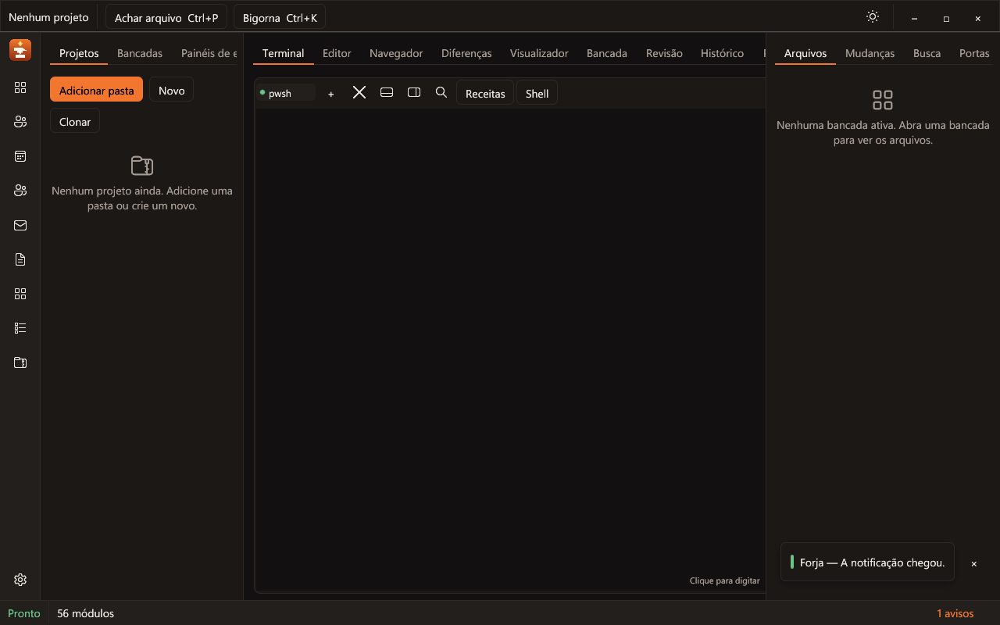

# Notificação (toast)

Captura da janela principal com uma notificação (toast) aberta no canto inferior direito; o restante da tela mostra o estado inicial sem projeto, com o painel Terminal ativo ao centro.

## Como chegar
Na janela principal, dispare uma notificação (o alvo desta captura é o toast aberto sobre o painel direito). Comando de captura: `forja-app --locale pt-BR --theme dark --open toast`.

## Regiões
- **Barra superior** — (0,0)–(1280,42): rótulo "Nenhum projeto" à esquerda, botões "Achar arquivo Ctrl+P" e "Bigorna Ctrl+K", alternador de tema (ícone de sol, sem nome acessível) e os botões de janela "–", "□" e "×" à direita.
- **Trilho à esquerda** — (0,42)–(52,768): coluna de ícones de navegação: logotipo da Forja (12,50)–(40,78) e, de cima para baixo, "Quadro", "Ajudantes", "Rotinas", "Mutirão", "Pedidos", "Skills", "Uso", "Extensões", "Acervo" e, no fim, "Ajustes".
- **Painel esquerdo (Projetos)** — (52,42)–(310,768): abas "Projetos" (marcada), "Bancadas" e "Painéis de extensões"; botões "Adicionar pasta" (destaque laranja), "Novo" e "Clonar"; estado vazio com ícone de pasta e o texto "Nenhum projeto ainda. Adicione uma pasta ou crie um novo.".
- **Área central (Terminal)** — (320,42)–(980,768): abas do painel ("Terminal" marcada, "Editor", "Navegador", "Diferenças", "Visualizador", "Bancada", "Revisão", "Histórico" e "Painéis de extensões"), barra de ferramentas do terminal com a aba "pwsh" e botões de ícone, os filtros "Receitas" e "Shell", e a área vazia do terminal com o aviso "Clique para digitar" no canto inferior.
- **Painel direito (Arquivos)** — (988,42)–(1280,768): abas "Arquivos" (marcada), "Mudanças", "Busca" e "Portas"; estado vazio com ícone de grade e o texto "Nenhuma bancada ativa. Abra uma bancada para ver os arquivos."; sobre ele, o toast com "Forja — A notificação chegou." e botão de fechar "×".
- **Barra de status** — (0,768)–(1280,800): "Pronto" à esquerda, "56 módulos" ao lado e "1 avisos" em laranja à direita.

## Elementos
| Elemento | Tipo | Posição (px) | Estado | O que faz |
|---|---|---|---|---|
| "Nenhum projeto" | Label | (11,12)–(113,31) | — | Indica que não há projeto aberto. |
| "Achar arquivo Ctrl+P" | Button | (135,5)–(291,37) | — | Abre a busca rápida de arquivos (Ctrl+P). |
| "Bigorna Ctrl+K" | Button | (299,5)–(417,37) | — | Abre a paleta de comandos (Ctrl+K). |
| (sem nome acessível) | Unknown | (1101,5)–(1133,37) | — | Botão de alternância de tema (ícone de sol); alterna para o tema claro. |
| "–" | Button | (1155,5)–(1187,37) | — | Minimiza a janela. |
| "□" | Button | (1195,5)–(1227,37) | — | Maximiza/restaura a janela. |
| "×" | Button | (1235,5)–(1269,37) | — | Fecha a janela. |
| (sem nome acessível) | Unknown | (304,42)–(320,768) | — | Divisor arrastável entre o painel esquerdo e a área central. |
| (sem nome acessível) | Unknown | (972,42)–(988,768) | — | Divisor arrastável entre a área central e o painel direito. |
| (sem nome acessível) | Image | (12,50)–(40,78) | — | Logotipo da Forja no topo do trilho. |
| "Projetos" | Button | (64,50)–(138,82) | marcado=True | Aba ativa do painel esquerdo; mostra a lista de projetos. |
| (sem nome acessível) | Unknown | (64,50)–(300,82) | — | Linha de fundo/sublinhado da barra de abas do painel esquerdo. |
| "Bancadas" | Button | (138,50)–(220,82) | marcado=False | Alterna o painel esquerdo para a lista de bancadas. |
| "Painéis de extensões" | Button | (220,50)–(371,82) | marcado=False | Terceira aba do painel esquerdo; texto cortado na borda do painel. |
| "Terminal" | Button | (324,50)–(401,82) | marcado=True | Aba ativa da área central; mostra o terminal. |
| "Editor" | Button | (401,50)–(461,82) | marcado=False | Mostra o editor na área central. |
| "Navegador" | Button | (461,50)–(553,82) | marcado=False | Mostra o navegador de conteúdo na área central. |
| "Diferenças" | Button | (553,50)–(641,82) | marcado=False | Mostra a visão de diferenças. |
| "Visualizador" | Button | (641,50)–(739,82) | marcado=False | Mostra o visualizador de arquivos. |
| "Bancada" | Button | (739,50)–(815,82) | marcado=False | Mostra a visão da bancada. |
| "Revisão" | Button | (815,50)–(885,82) | marcado=False | Mostra a visão de revisão. |
| "Histórico" | Button | (885,50)–(965,82) | marcado=False | Mostra o histórico. |
| "Painéis de extensões" | Button | (965,50)–(1115,82) | marcado=False | Última aba da área central; retângulo invade o painel direito e só aparece uma barra vertical na imagem. |
| (sem nome acessível) | Unknown | (992,50)–(1268,82) | — | Linha de fundo da barra de abas do painel direito. |
| "Arquivos" | Button | (992,50)–(1070,82) | marcado=True | Aba ativa do painel direito; lista de arquivos da bancada. |
| "Mudanças" | Button | (1070,50)–(1157,82) | marcado=False | Mostra as mudanças da bancada. |
| "Ajudante (chat)" | Button | (1115,50)–(1234,82) | marcado=False | Retângulo sobreposto às abas "Mudanças", "Busca" e "Portas"; não visível na imagem. |
| "Busca" | Button | (1157,50)–(1216,82) | marcado=False | Mostra a busca no painel direito. |
| "Portas" | Button | (1216,50)–(1278,82) | marcado=False | Mostra a lista de portas. |
| "Painéis de extensões" | Button | (1278,50)–(1429,82) | marcado=False | Aba extra cujo retângulo vai além da largura da imagem (1280 px); não visível. |
| (sem nome acessível) | Unknown | (64,80)–(300,82) | — | Sublinhado da aba ativa do painel esquerdo. |
| (sem nome acessível) | Unknown | (992,80)–(1268,82) | — | Sublinhado da aba ativa do painel direito. |
| "Quadro" | Button | (8,94)–(44,130) | marcado=False | Ícone do trilho: abre o quadro. |
| "Adicionar pasta" | Button | (64,98)–(183,130) | — | Abre o seletor para adicionar uma pasta de projeto. |
| "Novo" | Button | (191,98)–(248,130) | — | Cria um novo projeto. |
| "+" | Button | (407,102)–(441,134) | — | Abre nova aba/instância de terminal. |
| (sem nome acessível) | Unknown | (444,102)–(476,134) | — | Botão de ícone da barra do terminal (fecha o painel/terminal). |
| (sem nome acessível) | Unknown | (479,102)–(511,134) | — | Botão de ícone da barra do terminal (divide o terminal). |
| (sem nome acessível) | Unknown | (514,102)–(546,134) | — | Botão de ícone da barra do terminal (limpa/executa). |
| (sem nome acessível) | Unknown | (549,102)–(581,134) | — | Botão de ícone da barra do terminal (busca no terminal). |
| "Receitas" | Button | (584,102)–(658,134) | — | Alterna o filtro de receitas do terminal. |
| "Shell" | Button | (661,102)–(714,134) | — | Alterna o filtro de shells do terminal. |
| (sem nome acessível) | Unknown | (328,107)–(404,129) | — | Aba da sessão de terminal "pwsh", com indicador verde. |
| (sem nome acessível) | Unknown | (385,110)–(401,126) | — | Ponto verde de status dentro da aba "pwsh". |
| (ícone) | Label | (1116,114)–(1144,142) | — | Ícone de grade do estado vazio do painel direito. |
| "Ajudantes" | Button | (8,138)–(44,174) | marcado=False | Ícone do trilho: abre os ajudantes de código. |
| "Clonar" | Button | (64,138)–(128,170) | — | Clona um repositório como novo projeto. |
| (sem nome acessível) | Unknown | (328,139)–(980,756) | — | Área do terminal (vazia); clique concentra o teclado; mostra "Clique para digitar" no canto inferior. |
| "Nenhuma bancada ativa. Abra uma bancada para ver os arquivos." | Label | (994,150)–(1266,188) | — | Estado vazio do painel de arquivos. |
| "Rotinas" | Button | (8,182)–(44,218) | marcado=False | Ícone do trilho: abre as rotinas. |
| (ícone) | Label | (168,198)–(196,226) | — | Ícone de pasta do estado vazio do painel de projetos. |
| "Mutirão" | Button | (8,226)–(44,262) | marcado=False | Ícone do trilho: abre o mutirão. |
| "Nenhum projeto ainda. Adicione uma pasta ou crie um novo." | Label | (66,234)–(298,272) | — | Estado vazio do painel de projetos. |
| "Pedidos" | Button | (8,270)–(44,306) | marcado=False | Ícone do trilho: abre os pedidos. |
| "Skills" | Button | (8,314)–(44,350) | marcado=False | Ícone do trilho: abre as skills. |
| "Uso" | Button | (8,358)–(44,394) | marcado=False | Ícone do trilho: abre o uso. |
| (sem nome acessível) | Unknown | (640,400)–(640,400) | — | Elemento de dimensão zero no centro da janela; sem efeito visível. |
| "Extensões" | Button | (8,402)–(44,438) | marcado=False | Ícone do trilho: abre as extensões. |
| "Acervo" | Button | (8,446)–(44,482) | marcado=False | Ícone do trilho: abre o acervo. |
| (sem nome acessível) | Unknown | (999,694)–(1264,760) | — | Contêiner do toast no canto inferior direito. |
| "×" | Button | (1230,703)–(1264,735) | — | Fecha o toast. |
| "Forja — A notificação chegou." | Label | (1024,710)–(1209,729) | — | Texto da notificação, com barra vertical laranja à esquerda. |
| "Ajustes" | Button | (8,724)–(44,760) | marcado=False | Ícone do trilho: abre os ajustes. |
| "Pronto" | Label | (10,775)–(51,794) | — | Estado geral na barra de status. |
| "56 módulos" | Label | (73,775)–(146,794) | — | Quantidade de módulos carregados. |
| "1 avisos" | Label | (1200,775)–(1246,794) | — | Contador de avisos, em laranja. |

## Aparência
Tema escuro com fundo marrom-escuro (tons próximos de #1a1614) nos painéis e preto mais profundo na área do terminal; divisórias finas em marrom-acinzentado separam as regiões. A cor de destaque é o laranja (Brasa): fundo do botão "Adicionar pasta", sublinhado e texto das abas marcadas ("Projetos", "Terminal", "Arquivos"), barra vertical do toast e o contador "1 avisos" na barra de status. Tipografia sem serifa em dois tamanhos: rótulos de interface (~15 px) e textos de apoio em cinza médio; atalhos ("Ctrl+P", "Ctrl+K") aparecem em cinza mais apagado dentro dos botões da barra superior. Ícones do trilho são monocromáticos em cinza, alinhados em coluna única de 36 px. O estado vazio é centrado (ícone acima do texto) nos painéis de projetos e arquivos; o terminal exibe a dica "Clique para digitar" em cinza escuro alinhada ao canto inferior direito. O toast tem borda laranja fina, fundo do tom de painel e barra de título da notificação em texto claro.

## Problemas encontrados
- A terceira aba do painel esquerdo, "Painéis de extensões", tem texto cortado na borda do painel ("Painéis de e…" visível), embora seu retângulo (220,50)–(371,82) ultrapasse a largura visível do painel (~310 px).
- A aba "Painéis de extensões" da área central tem retângulo (965,50)–(1115,82) que invade o painel direito; na imagem só aparece uma barra vertical estreita junto ao divisor.
- A aba "Painéis de extensões" do painel direito tem retângulo (1278,50)–(1429,82) totalmente fora da largura da imagem (1280 px); não é visível.
- O retângulo do botão "Ajudante (chat)" (1115,50)–(1234,82) se sobrepõe às abas "Mudanças", "Busca" e "Portas"; o botão não aparece na imagem.
- Cinco botões de ícone da barra do terminal (444,102)–(581,134) e o botão de tema (1101,5)–(1133,37) não têm nome acessível.
- Há dois botões nomeados apenas "×" (fechar janela em (1235,5) e fechar toast em (1230,703)), o que os torna ambíguos para leitores de tela.
- O texto "Clique para digitar", visível na área do terminal, não aparece na árvore de acessibilidade.
- O contador "1 avisos" está no plural para valor singular (deveria ser "1 aviso").
- Elemento de dimensão zero (640,400)–(640,400) sem nome na área central.
