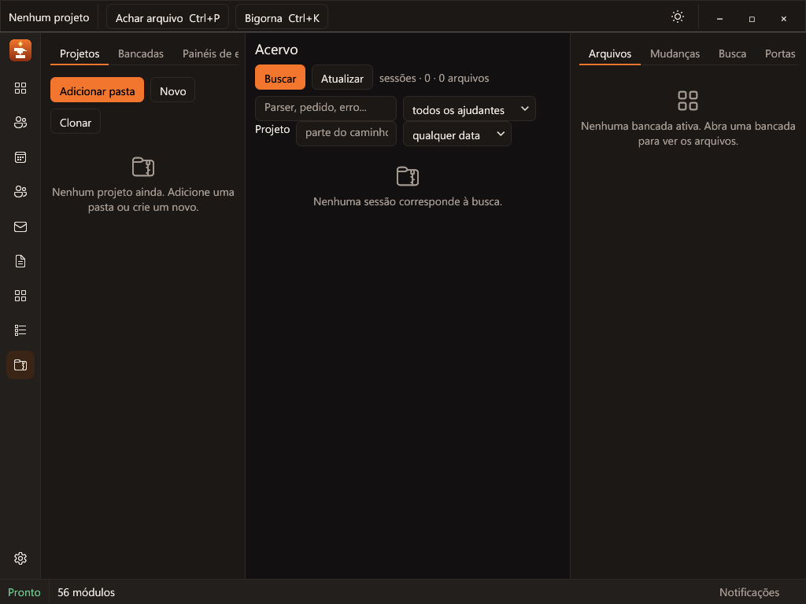

# Acervo (aba do trilho)

Tela do módulo Acervo, que lista e filtra sessões anteriores dos ajudantes e os arquivos de que eles dispõem, com estados vazios quando não há projeto ou bancada ativa.

## Como chegar
No trilho à esquerda, clique no botão "Acervo" (o último dos ícones do grupo principal, destacado em laranja quando ativo). Equivalente por comando de captura: `forja-app --locale pt-BR --theme dark --rail archive.tab`.

## Regiões
- **Barra superior** (0,0)–(1280,40): indicador de projeto ("Nenhum projeto"), botões de comando "Achar arquivo  Ctrl+P" e "Bigorna  Ctrl+K", alternador de tema (ícone, sem nome acessível) e os botões de janela "–", "□" e "×".
- **Trilho à esquerda** (0,40)–(50,768): logo do app (imagem em (12,50)–(40,78)) e a coluna de botões-ícone de navegação ("Quadro", "Ajudantes", "Rotinas", "Mutirão", "Pedidos", "Skills", "Uso", "Extensões", "Acervo"), com "Ajustes" fixado na base.
- **Painel lateral esquerdo** (50,40)–(304,768): abas "Projetos" (ativa), "Bancadas" e "Painéis de extensões"; ações "Adicionar pasta", "Novo" e "Clonar"; ícone e mensagem de estado vazio "Nenhum projeto ainda. Adicione uma pasta ou crie um novo."; no topo, o rótulo "Nenhum projeto" pertence à barra superior e fica sobreposto a esta região.
- **Divisor vertical** (304,42)–(320,768): separador fino entre o painel esquerdo e a área central.
- **Área central** (320,42)–(972,768): título "Acervo", botões "Buscar" e "Atualizar", contador "sessões · 0 · 0 arquivos", campo de filtro, seletor "todos os ajudantes", campo "Projeto" ("parte do caminho"), seletor de período "qualquer data" e o estado vazio "Nenhuma sessão corresponde à busca." com ícone de pasta acima.
- **Divisor vertical** (972,42)–(988,768): separador entre a área central e o painel direito.
- **Painel direito** (988,42)–(1280,768): abas "Arquivos" (ativa), "Mudanças", "Busca", "Portas" e "Painéis de extensões"; ícone (sem nome acessível) em (1116,114)–(1144,142) e a mensagem "Nenhuma bancada ativa. Abra uma bancada para ver os arquivos."
- **Barra de status** (0,768)–(1280,800): rótulos "Pronto" (em verde) à esquerda, "56 módulos" ao lado e "Notificações" à direita.

## Elementos
| Elemento | Tipo | Posição (px) | Estado | O que faz |
|---|---|---|---|---|
| "Achar arquivo  Ctrl+P" | Button | (135,5)–(291,37) | — | Abre a busca rápida de arquivos (atalho Ctrl+P). |
| "Bigorna  Ctrl+K" | Button | (299,5)–(417,37) | — | Abre a paleta de comandos (atalho Ctrl+K). |
| (sem nome acessível) | Unknown | (1101,5)–(1133,37) | — | Alternador de tema (ícone de sol). |
| "–" | Button | (1155,5)–(1187,37) | — | Minimiza a janela. |
| "□" | Button | (1195,5)–(1227,37) | — | Maximiza/restaura a janela. |
| "×" | Button | (1235,5)–(1269,37) | — | Fecha a janela. |
| "Nenhum projeto" | Label | (11,12)–(113,31) | — | Mostra que não há projeto selecionado na sessão atual. |
| (sem nome acessível) | Unknown | (304,42)–(320,768) | — | Divisor vertical entre painel esquerdo e área central. |
| (sem nome acessível) | Unknown | (972,42)–(988,768) | — | Divisor vertical entre área central e painel direito. |
| (sem nome acessível) | Image | (12,50)–(40,78) | clicável | Logo do app no topo do trilho. |
| "Projetos" | Button | (64,50)–(138,82) | marcado=True | Aba ativa do painel esquerdo; lista os projetos. |
| (sem nome acessível) | Unknown | (64,50)–(300,82) | — | Contêiner da linha de abas do painel esquerdo. |
| "Bancadas" | Button | (138,50)–(220,82) | marcado=False | Aba que listaria as bancadas (branches de trabalho). |
| "Painéis de extensões" | Button | (220,50)–(371,82) | marcado=False | Aba de painéis de extensões do painel esquerdo; truncada na renderização. |
| "Acervo" | Label | (324,50)–(379,74) | — | Título da área central. |
| (sem nome acessível) | Unknown | (992,50)–(1268,82) | — | Contêiner da linha de abas do painel direito. |
| "Arquivos" | Button | (992,50)–(1070,82) | marcado=True | Aba ativa do painel direito; mostraria os arquivos acessíveis à bancada. |
| "Mudanças" | Button | (1070,50)–(1157,82) | marcado=False | Aba de alterações pendentes da bancada. |
| "Busca" | Button | (1157,50)–(1216,82) | marcado=False | Aba de busca de texto no acervo. |
| "Portas" | Button | (1216,50)–(1278,82) | marcado=False | Aba de portas/recursos expostos pela bancada. |
| "Painéis de extensões" | Button | (1278,50)–(1429,82) | marcado=False | Aba de painéis de extensões do painel direito; retângulo além da largura da janela. |
| (sem nome acessível) | Unknown | (64,80)–(300,82) | clicável | Contêiner/rodapé fino sob as abas do painel esquerdo. |
| (sem nome acessível) | Unknown | (992,80)–(1268,82) | clicável | Contêiner/rodapé fino sob as abas do painel direito. |
| "Buscar" | Button | (324,82)–(388,114) | — | Aplica os filtros de busca do acervo. |
| "Atualizar" | Button | (396,82)–(474,114) | — | Recarrega a lista de sessões do acervo. |
| "sessões · 0 · 0 arquivos" | Label | (482,89)–(621,108) | — | Contador do resultado atual (0 sessões, 0 arquivos). |
| "Quadro" | Button | (8,94)–(44,130) | marcado=False | Botão-ícone do trilho que abre a visão de quadro. |
| "Adicionar pasta" | Button | (64,98)–(183,130) | — | Adiciona uma pasta existente como projeto (botão em destaque laranja). |
| "Novo" | Button | (191,98)–(248,130) | — | Cria um projeto novo. |
| (ícone) | Label | (1116,114)–(1144,142) | clicável | Ícone do estado vazio do painel direito. |
| (sem nome acessível) | TextInput | (324,122)–(504,154) | — | Campo de filtro textual (sugestão exibida: "Parser, pedido, erro..."). |
| (sem nome acessível) | Unknown | (512,122)–(681,154) | clicável | Seletor de ajudante com o valor "todos os ajudantes". |
| "Projeto" | Label | (689,122)–(733,154) | — | Rótulo do filtro por projeto ao lado. |
| (sem nome acessível) | TextInput | (741,122)–(869,154) | — | Campo do filtro por projeto (sugestão: "parte do caminho"). |
| "Ajudantes" | Button | (8,138)–(44,174) | marcado=False | Botão-ícone do trilho que abre os ajudantes. |
| "Clonar" | Button | (64,138)–(128,170) | — | Clona um repositório como novo projeto. |
| "Nenhuma bancada ativa. Abra uma bancada para ver os arquivos." | Label | (994,150)–(1266,188) | — | Estado vazio do painel direito. |
| (sem nome acessível) | Unknown | (324,162)–(462,194) | clicável | Seletor de período com o valor "qualquer data". |
| "Rotinas" | Button | (8,182)–(44,218) | marcado=False | Botão-ícone do trilho que abre as rotinas. |
| (ícone) | Label | (168,198)–(196,226) | clicável | Ícone de pasta do estado vazio do painel esquerdo. |
| (ícone) | Label | (632,218)–(660,246) | clicável | Ícone de pasta do estado vazio da área central. |
| "Mutirão" | Button | (8,226)–(44,262) | marcado=False | Botão-ícone do trilho que abre o mutirão. |
| "Nenhum projeto ainda. Adicione uma pasta ou crie um novo." | Label | (66,234)–(298,272) | — | Estado vazio do painel esquerdo. |
| "Nenhuma sessão corresponde à busca." | Label | (526,254)–(766,273) | — | Estado vazio da busca do acervo. |
| "Pedidos" | Button | (8,270)–(44,306) | marcado=False | Botão-ícone do trilho que abre os pedidos. |
| "Skills" | Button | (8,314)–(44,350) | marcado=False | Botão-ícone do trilho que abre as skills. |
| "Uso" | Button | (8,358)–(44,394) | marcado=False | Botão-ícone do trilho que abre o uso. |
| "Extensões" | Button | (8,402)–(44,438) | marcado=False | Botão-ícone do trilho que abre as extensões. |
| "Acervo" | Button | (8,446)–(44,482) | marcado=True | Botão-ícone do trilho da tela atual, em destaque laranja. |
| "Ajustes" | Button | (8,724)–(44,760) | marcado=False | Botão-ícone do trilho que abre os ajustes. |
| "Pronto" | Label | (10,775)–(51,794) | — | Status geral do app. |
| "56 módulos" | Label | (73,775)–(146,794) | — | Quantidade de módulos carregados. |
| "Notificações" | Label | (1170,775)–(1246,794) | — | Acesso às notificações na barra de status. |

## Aparência
Tema escuro: fundo quase preto (painéis com tons de marrom-escuro/carvão, mais claros que o trilho). Destaque em laranja ("Brasa") nos elementos ativos: aba "Projetos" (sublinhado), botão "Adicionar pasta" preenchido com laranja e texto branco, botão-ícone "Acervo" do trilho com fundo laranja, e linha laranja sob a aba "Arquivos" do painel direito. Tipografia sans-serif clara; títulos ("Acervo") maiores e rótulos de estado vazio em cinza médio centralizados. Espaçamento consistente: botões do trilho com 44 px de lado e passo de 44 px, abas de 32 px de altura, cantos levemente arredondados nos botões. A barra de status usa 32 px de altura com "Pronto" em verde e demais textos em cinza.

## Problemas encontrados
- A aba "Painéis de extensões" do painel esquerdo aparece truncada como "Painéis de e" e seu retângulo (220,50)–(371,82) se sobrepõe ao rótulo "Acervo" (324,50)–(379,74).
- A aba "Painéis de extensões" do painel direito tem retângulo (1278,50)–(1429,82), ultrapassando a largura da janela (1280 px); o texto é cortado fora da tela.
- Vários elementos sem nome acessível: os dois divisores verticais, os contêineres das linhas de abas, o alternador de tema da barra superior, os dois campos de filtro (TextInput) e os dois seletores de valores ("todos os ajudantes" e "qualquer data"), o que dificulta a navegação por leitor de telas.
- Os botões de janela usam apenas os símbolos "–", "□" e "×" como nome acessível, sem rótulo descritivo.
- A barra de abas do painel direito não cabe na largura disponível (cinco abas se estendem além da borda), indicando estouro de layout.
- Os contêineres "Unknown" das linhas de abas em (64,80)–(300,82) e (992,80)–(1268,82) têm apenas 2 px de altura, sugerindo retângulos residuais possivelmente decorrentes de truncamento.
