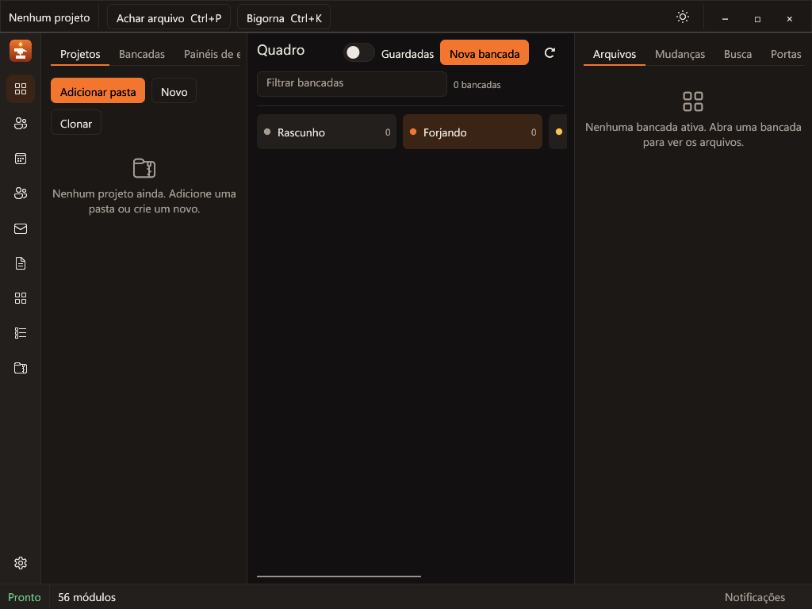

# Quadro (página do painel Projetos)

Tela inicial da área de projetos: mostra um quadro Kanban de bancadas em colunas de fluxo (Rascunho, Forjando, Revisão, Pronto), com painel de projetos à esquerda e painel de arquivos à direita, ambos vazios porque não há projeto aberto.

## Como chegar
Na janela principal, clique no primeiro ícone do trilho à esquerda, o botão "Quadro" (retângulo (8,94)–(44,130)), abaixo da logomarca da Forja; a aba "Projetos" do painel esquerdo fica marcada. A captura foi gerada com o comando `forja-app --locale pt-BR --theme dark --rail board.page`.

## Regiões
- **Barra superior** — (0,0)–(1280,42): rótulo "Nenhum projeto", botões "Achar arquivo  Ctrl+P" e "Bigorna  Ctrl+K" à esquerda; à direita, ícone de tema (sol, sem nome acessível) e os botões de janela "–", "□" e "×".
- **Trilho à esquerda** — (0,42)–(56,768): logomarca (imagem sem nome acessível em (12,50)–(40,78)) e coluna de ícones: "Quadro", "Ajudantes", "Rotinas", "Mutirão", "Pedidos", "Skills", "Uso", "Extensões", "Acervo", com "Ajustes" fixado no rodapé.
- **Painel esquerdo (Projetos)** — (56,42)–(320,768): abas "Projetos", "Bancadas" e "Painéis de extensões"; botões "Adicionar pasta", "Novo" e "Clonar"; mensagem de vazio "Nenhum projeto ainda. Adicione uma pasta ou crie um novo." com ícone de pasta.
- **Área central (Quadro)** — (320,42)–(972,768): título "Quadro", interruptor "Guardadas", botão "Nova bancada" e botão "⟳"; campo de filtro sem nome acessível, contador "0 bancadas", as quatro colunas com cabeçalhos e contadores "0", e uma barra de rolagem horizontal sem nome em (324,758)–(968,760).
- **Painel direito (Arquivos)** — (988,42)–(1280,768): abas "Arquivos", "Mudanças", "Busca", "Portas" e "Painéis de extensões"; ícone de grade e mensagem "Nenhuma bancada ativa. Abra uma bancada para ver os arquivos."
- **Barra de status** — (0,768)–(1280,800): "Pronto" (em verde), "56 módulos" à esquerda e "Notificações" à direita.

## Elementos
| Elemento | Tipo | Posição (px) | Estado | O que faz |
|---|---|---|---|---|
| "Achar arquivo  Ctrl+P" | Button | (135,5)–(291,37) | normal | Abre a busca/arquivos rápidos pelo atalho Ctrl+P. |
| "Bigorna  Ctrl+K" | Button | (299,5)–(417,37) | normal | Abre o lançador de ajudantes/agentes pelo atalho Ctrl+K. |
| (sem nome acessível) | Unknown | (1101,5)–(1133,37) | normal | Ícone de sol; alterna o tema da interface. |
| "–" | Button | (1155,5)–(1187,37) | normal | Minimiza a janela. |
| "□" | Button | (1195,5)–(1227,37) | normal | Maximiza/restaura a janela. |
| "×" | Button | (1235,5)–(1269,37) | normal | Fecha a janela. |
| "Nenhum projeto" | Label | (11,12)–(113,31) | normal | Mostra que não há projeto aberto. |
| (sem nome acessível) | Unknown | (304,42)–(320,768) | normal | Divisor vertical entre o painel esquerdo e a área central. |
| (sem nome acessível) | Unknown | (972,42)–(988,768) | normal | Divisor vertical entre a área central e o painel direito. |
| (sem nome acessível) | Image | (12,50)–(40,78) | normal | Logomarca da Forja no topo do trilho. |
| "Projetos" | Button | (64,50)–(138,82) | marcado=True | Aba ativa do painel esquerdo, com sublinhado laranja. |
| (sem nome acessível) | Unknown | (64,50)–(300,82) | normal | Faixa da aba ativa "Projetos". |
| "Bancadas" | Button | (138,50)–(220,82) | normal | Aba que listaria as bancadas do projeto. |
| "Painéis de extensões" | Button | (220,50)–(371,82) | normal | Aba de painéis de extensões; o texto aparece cortado na borda do painel ("Painéis de e"). |
| "Quadro" | Label | (324,50)–(384,74) | normal | Título da página central. |
| "Nova bancada" | Button | (811,50)–(923,82) | normal | Botão em destaque laranja para criar uma bancada. |
| "⟳" | Button | (931,50)–(968,82) | normal | Recarrega/atualiza o quadro. |
| (sem nome acessível) | Unknown | (992,50)–(1268,82) | normal | Faixa das abas do painel direito. |
| "Arquivos" | Button | (992,50)–(1070,82) | marcado=True | Aba ativa do painel direito, com sublinhado laranja. |
| "Mudanças" | Button | (1070,50)–(1157,82) | normal | Aba que mostraria as mudanças (controle de versão). |
| "Busca" | Button | (1157,50)–(1216,82) | normal | Aba de busca nos arquivos. |
| "Portas" | Button | (1216,50)–(1278,82) | normal | Aba que mostraria portas/terminais. |
| "Painéis de extensões" | Button | (1278,50)–(1429,82) | normal | Aba de painéis de extensões; fica parcialmente fora da janela. |
| "Guardadas" | CheckBox | (689,54)–(803,78) | marcado=False | Interruptor para exibir somente bancadas guardadas. |
| (sem nome acessível) | Unknown | (64,80)–(300,82) | normal | Linha de sublinhado da aba ativa do painel esquerdo. |
| (sem nome acessível) | Unknown | (992,80)–(1268,82) | normal | Linha de sublinhado da aba ativa do painel direito. |
| (sem nome acessível) | TextInput | (324,90)–(564,122) | normal | Campo de filtro com o texto de marca d'água "Filtrar bancadas". |
| "Quadro" | Button | (8,94)–(44,130) | marcado=True | Ícone do trilho que abre esta página do quadro. |
| "Adicionar pasta" | Button | (64,98)–(183,130) | normal | Botão em destaque laranja para importar uma pasta como projeto. |
| "Novo" | Button | (191,98)–(248,130) | normal | Cria um projeto novo. |
| "0 bancadas" | Label | (572,98)–(631,114) | normal | Contador de bancadas visíveis no quadro. |
| (ícone) | Label | (1116,114)–(1144,142) | normal | Ícone de grade do estado vazio do painel direito. |
| "Ajudantes" | Button | (8,138)–(44,174) | normal | Ícone do trilho para a área de ajudantes (agentes de IA). |
| "Clonar" | Button | (64,138)–(128,170) | normal | Clona um projeto existente. |
| (sem nome acessível) | Unknown | (324,144)–(968,760) | normal | Área rolável do quadro com as colunas. |
| "Nenhuma bancada ativa. Abra uma bancada para ver os arquivos." | Label | (994,150)–(1266,188) | normal | Mensagem de vazio do painel direito. |
| "Rascunho" | Label | (350,157)–(409,176) | normal | Cabeçalho da primeira coluna do fluxo. |
| "Forjando" | Label | (534,157)–(588,176) | normal | Cabeçalho da segunda coluna, com fundo âmbar escuro (coluna destacada). |
| "Revisão" | Label | (718,157)–(764,176) | normal | Cabeçalho da terceira coluna. |
| "Pronto" | Label | (902,157)–(943,176) | normal | Cabeçalho da quarta coluna, parcialmente coberto pela borda da área central. |
| "0" | Label | (486,158)–(492,174) | normal | Contador de cartões na coluna Rascunho. |
| "0" | Label | (670,158)–(676,174) | normal | Contador de cartões na coluna Forjando. |
| "0" | Label | (854,158)–(860,174) | normal | Contador de cartões na coluna Revisão. |
| "0" | Label | (1038,158)–(1044,174) | normal | Contador de cartões na coluna Pronto. |
| "Rotinas" | Button | (8,182)–(44,218) | normal | Ícone do trilho para a área de rotinas. |
| (ícone) | Label | (168,198)–(196,226) | normal | Ícone de pasta ilustrando o estado vazio do painel esquerdo. |
| "Mutirão" | Button | (8,226)–(44,262) | normal | Ícone do trilho para a área de mutirão. |
| "Nenhum projeto ainda. Adicione uma pasta ou crie um novo." | Label | (66,234)–(298,272) | normal | Mensagem de vazio do painel de projetos. |
| "Pedidos" | Button | (8,270)–(44,306) | normal | Ícone do trilho para a área de pedidos. |
| "Skills" | Button | (8,314)–(44,350) | normal | Ícone do trilho para a área de skills. |
| "Uso" | Button | (8,358)–(44,394) | normal | Ícone do trilho para a área de uso. |
| "Extensões" | Button | (8,402)–(44,438) | normal | Ícone do trilho para a área de extensões. |
| "Acervo" | Button | (8,446)–(44,482) | normal | Ícone do trilho para a área de acervo. |
| "Ajustes" | Button | (8,724)–(44,760) | normal | Ícone do trilho para os ajustes, fixado no rodapé do trilho. |
| (sem nome acessível) | Unknown | (324,758)–(968,760) | normal | Barra de rolagem horizontal do quadro. |
| "Pronto" | Label | (10,775)–(51,794) | normal | Estado geral do app na barra de status, em verde. |
| "56 módulos" | Label | (73,775)–(146,794) | normal | Quantidade de módulos carregados. |
| "Notificações" | Label | (1170,775)–(1246,794) | normal | Indicador de notificações, clicável, no canto direito. |
| (ícone) | Label | (632,792)–(660,820) | normal | Ícone de estado vazio do quadro; fica quase todo abaixo da barra de status, fora da área visível. |
| "Nenhuma bancada neste quadro ainda. Crie uma para começar." | Label | (450,828)–(842,847) | normal | Mensagem de vazio do quadro; inteiramente abaixo da altura da janela, invisível na captura. |

## Aparência
Tema escuro com fundo quase preto (tons entre #191917 e #222220), painéis ligeiramente mais claros que a barra superior. O acento laranja ("Brasa") aparece no botão "Nova bancada", no botão "Adicionar pasta", no sublinhado das abas ativas e no texto laranja do contador da coluna destacada "Forjando", que tem fundo âmbar escuro (#3a2410 aprox.) com ponto laranja; as demais colunas usam pontos cinza, laranja e verde para Rascunho, Revisão e Pronto. O texto é predominantemente cinza claro sobre escuro, com "Pronto" na barra de status em verde (#6cbf6c aprox.). Tipografia sem serifa de um único tamanho, com botões de trilho de 36 px alinhados a um trilho de 56 px; abas e botões do cabeçalho ocupam faixas de 32 px de altura com cantos arredondados pequenos.

## Problemas encontrados
- O botão "Painéis de extensões" do painel direito tem retângulo (1278,50)–(1429,82), estendendo-se além da largura da janela (1280 px); a aba fica cortada.
- O botão "Painéis de extensões" do painel esquerdo tem retângulo (220,50)–(371,82), que cruza o divisor em x=320, e seu texto aparece truncado na borda do painel ("Painéis de e").
- O cabeçalho "Pronto" da quarta coluna é cortado pela borda direita da área central em x=972.
- O Label "(ícone)" em (632,792)–(660,820) invade a barra de status e ultrapassa a altura da janela (800 px).
- A mensagem "Nenhuma bancada neste quadro ainda. Crie uma para começar." (450,828)–(842,847) está inteiramente abaixo da área visível e não aparece na tela.
- O campo de filtro de bancadas (TextInput em (324,90)–(564,122)) não tem nome acessível; o rótulo visível é só a marca d'água "Filtrar bancadas".
- Elementos sem nome acessível além do esperado: divisores verticais, faixas de abas, área do quadro, barra de rolagem horizontal e ícone de tema da barra superior.
