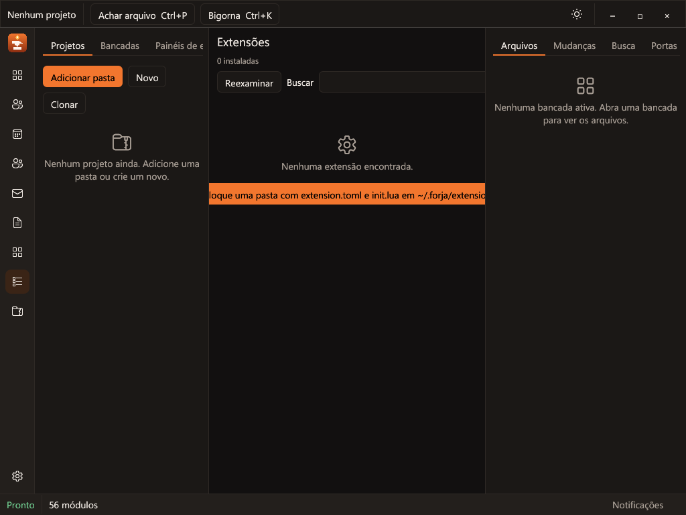

# Painel de extensões (Extensões)

Tela do painel central de extensões, onde se vê a lista de extensões instaladas do projeto (vazia nesta captura) e a instrução para instalá-las manualmente em `~/.forja/extensions`.

## Como chegar
Abrir a Forja e, no trilho vertical à esquerda, clicar no botão "Extensões" (nono ícone do trilho, destacado com fundo laranja). Equivale a abrir o app com o trilho apontando para o painel de extensões. Comando de captura: `forja-app --locale pt-BR --theme dark --rail extension.page`.

## Regiões
- **Barra superior** (0,0)–(1280,40): rótulo do projeto atual "Nenhum projeto", botões de comando "Achar arquivo  Ctrl+P" e "Bigorna  Ctrl+K" com atalhos, botão sem nome acessível para alternar tema (ícone de sol em ~1101,5) e os botões de janela "–", "□" e "×" no canto direito.
- **Trilho à esquerda** (0,42)–(48,768): logotipo do app (imagem em 12,50) e uma coluna de ícones de navegação: "Quadro", "Ajudantes", "Rotinas", "Mutirão", "Pedidos", "Skills", "Uso", "Extensões" (ativo) e "Acervo", com "Ajustes" isolado na base (8,724).
- **Painel lateral esquerdo (Projetos)** (48,42)–(310,768): abas "Projetos" (ativa), "Bancadas" e "Painéis de extensões"; botões "Adicionar pasta" (destacado em laranja), "Novo" e "Clonar"; estado vazio com ícone de pasta e o texto "Nenhum projeto ainda. Adicione uma pasta ou crie um novo.".
- **Área central (painel de extensões)** (310,42)–(980,768): título "Extensões" com contador "0 instaladas", botão "Reexaminar", rótulo "Buscar" e campo de texto de busca em largura quase total (324,146)–(968,178); estado vazio com ícone de engrenagem, o texto "Nenhuma extensão encontrada." e um botão-aviso com o caminho de instalação.
- **Painel direito (Arquivos)** (980,42)–(1280,768): abas "Arquivos" (ativa), "Mudanças", "Busca", "Portas" e "Painéis de extensões"; estado vazio com ícone de grade e o texto "Nenhuma bancada ativa. Abra uma bancada para ver os arquivos.".
- **Barra de status** (0,768)–(1280,800): status "Pronto" em verde à esquerda, contador "56 módulos" ao lado e "Notificações" à direita.

## Elementos
| Elemento | Tipo | Posição (px) | Estado | O que faz |
|---|---|---|---|---|
| "Nenhum projeto" | Rótulo | (11,12)–(113,31) | — | Mostra que nenhum projeto está aberto. |
| "Achar arquivo  Ctrl+P" | Botão | (135,5)–(291,37) | clicável, focável | Abre a busca rápida de arquivos (Ctrl+P). |
| "Bigorna  Ctrl+K" | Botão | (299,5)–(417,37) | clicável, focável | Abre a paleta de comandos (Ctrl+K). |
| (sem nome acessível) | Desconhecido | (1101,5)–(1133,37) | clicável, focável | Ícone de sol na barra superior: alterna tema claro/escuro. |
| "–" | Botão | (1155,5)–(1187,37) | clicável, focável | Minimiza a janela. |
| "□" | Botão | (1195,5)–(1227,37) | clicável, focável | Maximiza/restaura a janela. |
| "×" | Botão | (1235,5)–(1269,37) | clicável, focável | Fecha a janela. |
| (sem nome acessível) | Desconhecido | (304,42)–(320,768) | focável | Divisor arrastável entre o painel de projetos e a área central. |
| (sem nome acessível) | Desconhecido | (972,42)–(988,768) | focável | Divisor arrastável entre a área central e o painel de arquivos. |
| (sem nome acessível) | Imagem | (12,50)–(40,78) | clicável, focável | Logotipo do app no topo do trilho. |
| "Projetos" | Botão (aba) | (64,50)–(138,82) | marcado=True | Aba ativa do painel lateral: lista de projetos. |
| (sem nome acessível) | Desconhecido | (64,50)–(300,82) | focável | Faixa de destaque da aba ativa "Projetos". |
| "Bancadas" | Botão (aba) | (138,50)–(220,82) | clicável, focável, marcado=False | Troca o painel lateral para a lista de bancadas. |
| "Painéis de extensões" | Botão (aba) | (220,50)–(371,82) | clicável, focável, marcado=False | Troca o painel lateral para a lista de painéis de extensão; texto truncado no borda do painel. |
| "Extensões" | Rótulo | (324,50)–(402,74) | clicável | Título do painel central. |
| (sem nome acessível) | Desconhecido | (992,50)–(1268,82) | focável | Faixa de destaque da aba ativa "Arquivos" no painel direito. |
| "Arquivos" | Botão (aba) | (992,50)–(1070,82) | marcado=True | Aba ativa do painel direito: navegador de arquivos da bancada. |
| "Mudanças" | Botão (aba) | (1070,50)–(1157,82) | clicável, focável, marcado=False | Mostra as mudanças (diff) da bancada. |
| "Busca" | Botão (aba) | (1157,50)–(1216,82) | clicável, focável, marcado=False | Abre a busca no projeto. |
| "Portas" | Botão (aba) | (1216,50)–(1278,82) | clicável, focável, marcado=False | Lista portas em uso no projeto. |
| "Painéis de extensões" | Botão (aba) | (1278,50)–(1429,82) | clicável, focável, marcado=False | Aba do painel direito para painéis de extensão; seu retângulo ultrapassa a largura da janela (1280 px). |
| (sem nome acessível) | Desconhecido | (64,80)–(300,82) | clicável, focável | Linha inferior/separador do cabeçalho de abas do painel lateral. |
| (sem nome acessível) | Desconhecido | (992,80)–(1268,82) | clicável, focável | Linha inferior/separador do cabeçalho de abas do painel direito. |
| "0 instaladas" | Rótulo | (324,82)–(386,98) | clicável | Contador de extensões instaladas (vazio). |
| "Quadro" | Botão (ícone) | (8,94)–(44,130) | clicável, focável, marcado=False | Vai à tela de quadro do trilho. |
| "Adicionar pasta" | Botão | (64,98)–(183,130) | clicável, focável | Abre o seletor para adicionar uma pasta de projeto; botão primário em laranja. |
| "Novo" | Botão | (191,98)–(248,130) | clicável, focável | Cria um novo projeto. |
| "Reexaminar" | Botão | (324,106)–(420,138) | clicável, focável | Reescaneia as pastas de extensões e atualiza a lista. |
| "Buscar" | Rótulo | (428,106)–(468,138) | clicável | Rótulo do campo de busca de extensões. |
| (ícone) | Rótulo | (1116,114)–(1144,142) | clicável | Ícone de grade do estado vazio do painel de arquivos. |
| "Ajudantes" | Botão (ícone) | (8,138)–(44,174) | clicável, focável, marcado=False | Vai à tela de ajudantes (agentes de IA). |
| "Clonar" | Botão | (64,138)–(128,170) | clicável, focável | Clona um repositório como novo projeto. |
| (sem nome acessível) | Campo de texto | (324,146)–(968,178) | clicável, focável | Campo de busca por nome de extensão. |
| "Nenhuma bancada ativa. Abra uma bancada para ver os arquivos." | Rótulo | (994,150)–(1266,188) | clicável | Estado vazio do painel de arquivos. |
| (ícone) | Rótulo | (168,198)–(196,226) | clicável | Ícone de pasta do estado vazio do painel de projetos. |
| (ícone) | Rótulo | (632,202)–(660,230) | clicável | Ícone de engrenagem do estado vazio do painel de extensões. |
| "Rotinas" | Botão (ícone) | (8,182)–(44,218) | clicável, focável, marcado=False | Vai à tela de rotinas. |
| "Nenhum projeto ainda. Adicione uma pasta ou crie um novo." | Rótulo | (66,234)–(298,272) | clicável | Estado vazio do painel de projetos. |
| "Nenhuma extensão encontrada." | Rótulo | (548,238)–(744,257) | clicável | Mensagem de lista vazia de extensões. |
| "Mutirão" | Botão (ícone) | (8,226)–(44,262) | clicável, focável, marcado=False | Vai à tela de mutirão. |
| "Coloque uma pasta com extension.toml e init.lua em ~/.forja/extensions." | Botão | (411,273)–(882,305) | clicável, focável | Instrução de instalação manual de extensões, exposta como botão clicável (destaque laranja). |
| "Pedidos" | Botão (ícone) | (8,270)–(44,306) | clicável, focável, marcado=False | Vai à tela de pedidos. |
| "Skills" | Botão (ícone) | (8,314)–(44,350) | clicável, focável, marcado=False | Vai à tela de skills. |
| "Uso" | Botão (ícone) | (8,358)–(44,394) | clicável, focável, marcado=False | Vai à tela de uso. |
| "Extensões" | Botão (ícone) | (8,402)–(44,438) | clicável, focável, marcado=True | Item ativo do trilho: mostra o painel de extensões (esta tela). |
| "Acervo" | Botão (ícone) | (8,446)–(44,482) | clicável, focável, marcado=False | Vai à tela de acervo. |
| "Ajustes" | Botão (ícone) | (8,724)–(44,760) | clicável, focável, marcado=False | Vai à tela de ajustes, fixado na base do trilho. |
| "Pronto" | Rótulo | (10,775)–(51,794) | clicável | Status geral do app na barra inferior. |
| "56 módulos" | Rótulo | (73,775)–(146,794) | clicável | Contador de módulos carregados. |
| "Notificações" | Rótulo | (1170,775)–(1246,794) | clicável, focável | Abre a área de notificações, no canto direito da barra de status. |

## Aparência
Tema escuro: fundo quase preto com leve tom amarronzado nas laterais e no trilho, e a área central ligeiramente mais clara que o painel esquerdo. A cor de destaque é o laranja ("Brasa"): preenchimento do botão "Adicionar pasta" e do botão-aviso de instalação, fundo do item ativo "Extensões" no trilho e sublinhado das abas ativas "Projetos" e "Arquivos"; o status "Pronto" também é verde-claro na barra de status. Texto principal em cinza-claro e textos secundários/estados vazios em cinza médio esmaecido. Tipografia sem serifa, em torno de 13–14 px, com atalhos ("Ctrl+P", "Ctrl+K") na mesma linha do comando. Abas e botões ficam alinhados em linha com ~8 px de respiro; os três painéis são separados por divisores verticais de 1 px e o painel central concentra o conteúdo (título, contador, busca e estado vazio) no topo, deixando o restante vazio.

## Problemas encontrados
- A aba "Painéis de extensões" do painel lateral esquerdo (botão em (220,50)–(371,82)) é cortada pelo limite do painel em ~x=310: na imagem aparece só "Painéis de e", embora o retângulo acessível vá até x=371.
- A aba "Painéis de extensões" do painel direito (botão em (1278,50)–(1429,82)) tem retângulo além da largura da janela (1280 px); o rótulo fica fora da área visível e inacessível.
- O botão de alternar tema na barra superior (1101,5)–(1133,37) não tem nome acessível; só se identifica pela imagem do sol.
- O campo de busca de extensões (324,146)–(968,178) é um TextInput sem nome acessível; o rótulo "Buscar" fica fora do campo, sem associação.
- O logotipo do app (imagem em 12,50) e os dois ícones de estado vazio (168,198) e (632,202) estão sem nome acessível.
- A instrução "Coloque uma pasta com extension.toml e init.lua em ~/.forja/extensions." é exposta com papel de Botão; semanticamente é um texto de ajuda, o que pode confundir leitores de tela.
