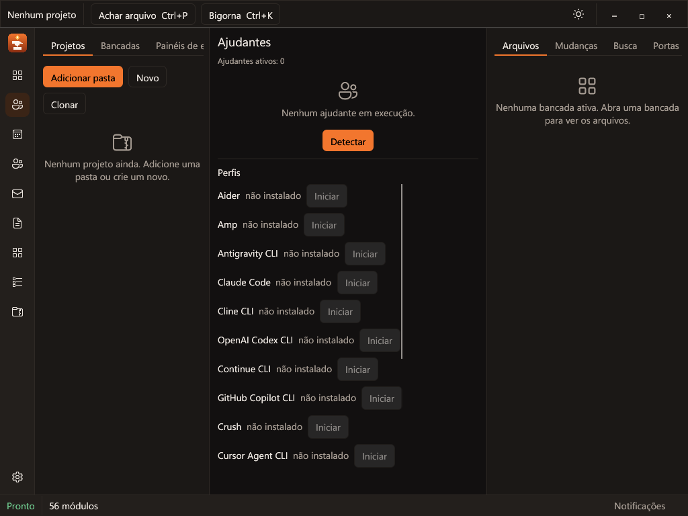

# Ajudantes (trilho, aba helper.tab)

Tela do painel central "Ajudantes", que lista os perfis de ajudantes de código (agentes de IA) e permite detectar e iniciar cada um, com o trilho esquerdo na aba Ajudantes e o painel direito em Arquivos.

## Como chegar
Na janela principal, clique no segundo ícone do trilho à esquerda (ícone de pessoas, botão "Ajudantes", (8,138)–(44,174), marcado como ativo). Comando de captura/abertura: `forja-app --locale pt-BR --theme dark --rail helper.tab` (arquivo `captures/pt-BR.dark.rail.helper.tab.png`, 1280×800 px).

## Regiões
- **Barra de título** — (0,0)–(1280,42): rótulo do projeto ("Nenhum projeto"), ações rápidas "Achar arquivo  Ctrl+P" e "Bigorna  Ctrl+K", botão de tema (ícone de sol, sem nome acessível) e botões de janela "–", "□", "×".
- **Trilho esquerdo (rail)** — (0,42)–(48,768): logotipo da Forja (imagem sem nome acessível) e ícones de navegação: "Quadro", "Ajudantes" (ativo), "Rotinas", "Mutirão", "Pedidos", "Skills", "Uso", "Extensões", "Acervo" e "Ajustes".
- **Painel lateral esquerdo** — (48,42)–(304,768): abas "Projetos" (ativa), "Bancadas" e "Painéis de extensões" (texto truncado), botões "Adicionar pasta", "Novo" e "Clonar", e estado vazio com ícone de pasta (rótulo "(ícone)" em (168,198)–(196,226)) e a mensagem "Nenhum projeto ainda. Adicione uma pasta ou crie um novo.".
- **Divisor 1** — (304,42)–(320,768): divisor arrastável entre o painel esquerdo e a área central.
- **Área central** — (320,42)–(972,768): cabeçalho "Ajudantes" e contador "Ajudantes ativos: 0"; estado vazio com ícone (rótulo "(ícone)" em (632,122)–(660,150)), texto "Nenhum ajudante em execução." e botão laranja "Detectar"; seção "Perfis" com a lista de ajudantes (Aider, Amp, Antigravity CLI, Claude Code, Cline CLI, OpenAI Codex CLI, Continue CLI, GitHub Copilot CLI, Crush, Cursor Agent CLI, Gemini CLI, Goose, Kimi Code CLI, Kiro CLI, OpenCode, Qwen Code), cada um com a etiqueta "não instalado" e um botão "Iniciar" desativado; a lista continua abaixo do corte da janela (rolagem).
- **Divisor 2** — (972,42)–(988,768): divisor arrastável entre a área central e o painel direito.
- **Painel direito** — (988,42)–(1280,768): abas "Arquivos" (ativa), "Mudanças", "Busca", "Portas" e "Painéis de extensões" (fora da janela); estado vazio com ícone de grade (rótulo "(ícone)" em (1116,114)–(1144,142)) e a mensagem "Nenhuma bancada ativa. Abra uma bancada para ver os arquivos.".
- **Barra de status** — (0,768)–(1280,800): "Pronto", "56 módulos" e "Notificações" à direita.

## Elementos
| Elemento | Tipo | Posição (px) | Estado | O que faz |
|---|---|---|---|---|
| "Achar arquivo  Ctrl+P" | Button | (135,5)–(291,37) | — | Abre a busca rápida de arquivos (atalho Ctrl+P). |
| "Bigorna  Ctrl+K" | Button | (299,5)–(417,37) | — | Abre a paleta de comandos (atalho Ctrl+K). |
| (sem nome acessível) | Unknown | (1101,5)–(1133,37) | — | Ícone de sol: alterna tema claro/escuro. |
| "–" | Button | (1155,5)–(1187,37) | — | Minimiza a janela. |
| "□" | Button | (1195,5)–(1227,37) | — | Maximiza/restaura a janela. |
| "×" | Button | (1235,5)–(1269,37) | — | Fecha a janela. |
| "Nenhum projeto" | Label | (11,12)–(113,31) | — | Mostra que nenhum projeto está aberto. |
| (sem nome acessível) | Unknown | (304,42)–(320,768) | foco | Divisor arrastável entre painel esquerdo e área central. |
| (sem nome acessível) | Unknown | (972,42)–(988,768) | foco | Divisor arrastável entre área central e painel direito. |
| (sem nome acessível) | Image | (12,50)–(40,78) | — | Logotipo da Forja no trilho (ícone de bigorna laranja). |
| "Projetos" | Button | (64,50)–(138,82) | marcado=True | Aba ativa do painel esquerdo (sublinhado laranja). |
| (sem nome acessível) | Unknown | (64,50)–(300,82) | foco | Contêiner/barra das abas do painel esquerdo. |
| "Bancadas" | Button | (138,50)–(220,82) | marcado=False | Aba das bancadas (branches de trabalho). |
| "Painéis de extensões" | Button | (220,50)–(371,82) | marcado=False | Aba dos painéis de extensões; retângulo passa do limite do painel e o texto aparece truncado ("Painéis de e"). |
| "Ajudantes" | Label | (324,50)–(403,74) | — | Título do painel central. |
| (sem nome acessível) | Unknown | (992,50)–(1268,82) | foco | Contêiner/barra das abas do painel direito. |
| "Arquivos" | Button | (992,50)–(1070,82) | marcado=True | Aba ativa do painel direito (sublinhado laranja). |
| "Mudanças" | Button | (1070,50)–(1157,82) | marcado=False | Aba de mudanças (diffs) da bancada. |
| "Busca" | Button | (1157,50)–(1216,82) | marcado=False | Aba de busca no projeto. |
| "Portas" | Button | (1216,50)–(1278,82) | marcado=False | Aba de portas em uso. |
| "Painéis de extensões" | Button | (1278,50)–(1429,82) | marcado=False | Aba dos painéis de extensões; fica além da largura da janela (1280 px). |
| (sem nome acessível) | Unknown | (64,80)–(300,82) | — | Linha divisória sob as abas do painel esquerdo. |
| (sem nome acessível) | Unknown | (992,80)–(1268,82) | — | Linha divisória sob as abas do painel direito. |
| "Ajudantes ativos: 0" | Label | (324,82)–(423,98) | — | Contador de ajudantes em execução. |
| "Quadro" | Button | (8,94)–(44,130) | marcado=False | Ícone do trilho: abre o quadro. |
| "Adicionar pasta" | Button | (64,98)–(183,130) | — | Adiciona uma pasta de projeto existente. |
| "Novo" | Button | (191,98)–(248,130) | — | Cria um projeto novo. |
| (ícone) | Label | (1116,114)–(1144,142) | — | Ícone de grade do estado vazio do painel direito. |
| (ícone) | Label | (632,122)–(660,150) | — | Ícone de pessoas do estado vazio do painel central. |
| "Ajudantes" | Button | (8,138)–(44,174) | marcado=True | Ícone do trilho: abre esta tela de Ajudantes (ativa). |
| "Clonar" | Button | (64,138)–(128,170) | — | Clona um repositório como projeto. |
| "Nenhuma bancada ativa. Abra uma bancada para ver os arquivos." | Label | (994,150)–(1266,188) | — | Estado vazio do painel de arquivos. |
| "Nenhum ajudante em execução." | Label | (547,158)–(745,177) | — | Estado vazio da lista de ajudantes. |
| "Rotinas" | Button | (8,182)–(44,218) | marcado=False | Ícone do trilho: abre rotinas. |
| "Detectar" | Button | (608,193)–(684,225) | — | Detecta os ajudantes instalados na máquina. |
| (ícone) | Label | (168,198)–(196,226) | — | Ícone de pasta do estado vazio do painel esquerdo. |
| "Mutirão" | Button | (8,226)–(44,262) | marcado=False | Ícone do trilho: abre o mutirão. |
| "Nenhum projeto ainda. Adicione uma pasta ou crie um novo." | Label | (66,234)–(298,272) | — | Estado vazio da lista de projetos. |
| "Perfis" | Label | (324,247)–(357,266) | — | Título da seção que lista os perfis de ajudantes. |
| "Pedidos" | Button | (8,270)–(44,306) | marcado=False | Ícone do trilho: abre pedidos. |
| (sem nome acessível) | Unknown | (324,274)–(599,694) | foco | Área da lista rolável de perfis. |
| "Iniciar" | Button | (456,274)–(517,309) | desativado | Iniciaria o Aider; indisponível por não estar instalado. |
| (sem nome acessível) | Unknown | (597,274)–(599,694) | — | Barra de rolagem da lista de perfis. |
| "Aider" | Label | (324,281)–(357,300) | — | Nome do perfil de ajudante. |
| "não instalado" | Label | (365,281)–(448,300) | — | Estado do Aider. |
| "Skills" | Button | (8,314)–(44,350) | marcado=False | Ícone do trilho: abre skills. |
| "Iniciar" | Button | (452,317)–(513,352) | desativado | Iniciaria o Amp. |
| "Amp" | Label | (324,324)–(353,343) | — | Nome do perfil de ajudante. |
| "não instalado" | Label | (361,324)–(444,343) | — | Estado do Amp. |
| "Uso" | Button | (8,358)–(44,394) | marcado=False | Ícone do trilho: abre uso/consumo. |
| "Iniciar" | Button | (513,360)–(574,395) | desativado | Iniciaria o Antigravity CLI. |
| "Antigravity CLI" | Label | (324,367)–(414,386) | — | Nome do perfil de ajudante. |
| "não instalado" | Label | (422,367)–(505,386) | — | Estado do Antigravity CLI. |
| "Extensões" | Button | (8,402)–(44,438) | marcado=False | Ícone do trilho: abre extensões. |
| "Iniciar" | Button | (502,403)–(562,438) | desativado | Iniciaria o Claude Code. |
| "Claude Code" | Label | (324,410)–(402,429) | — | Nome do perfil de ajudante. |
| "não instalado" | Label | (410,410)–(494,429) | — | Estado do Claude Code. |
| "Acervo" | Button | (8,446)–(44,482) | marcado=False | Ícone do trilho: abre o acervo. |
| "Iniciar" | Button | (476,446)–(537,481) | desativado | Iniciaria o Cline CLI. |
| "Cline CLI" | Label | (324,453)–(377,472) | — | Nome do perfil de ajudante. |
| "não instalado" | Label | (385,453)–(468,472) | — | Estado do Cline CLI. |
| "Iniciar" | Button | (535,489)–(596,524) | desativado | Iniciaria o OpenAI Codex CLI. |
| "OpenAI Codex CLI" | Label | (324,496)–(436,515) | — | Nome do perfil de ajudante. |
| "não instalado" | Label | (444,496)–(527,515) | — | Estado do OpenAI Codex CLI. |
| "Iniciar" | Button | (502,532)–(563,567) | desativado | Iniciaria o Continue CLI. |
| "Continue CLI" | Label | (324,539)–(403,558) | — | Nome do perfil de ajudante. |
| "não instalado" | Label | (411,539)–(494,558) | — | Estado do Continue CLI. |
| "Iniciar" | Button | (538,575)–(599,610) | desativado | Iniciaria o GitHub Copilot CLI. |
| "GitHub Copilot CLI" | Label | (324,582)–(439,601) | — | Nome do perfil de ajudante. |
| "não instalado" | Label | (447,582)–(530,601) | — | Estado do GitHub Copilot CLI. |
| "Iniciar" | Button | (458,618)–(519,653) | desativado | Iniciaria o Crush. |
| "Crush" | Label | (324,625)–(359,644) | — | Nome do perfil de ajudante. |
| "não instalado" | Label | (367,625)–(450,644) | — | Estado do Crush. |
| "Iniciar" | Button | (527,661)–(588,696) | desativado | Iniciaria o Cursor Agent CLI. |
| "Cursor Agent CLI" | Label | (324,668)–(428,687) | — | Nome do perfil de ajudante. |
| "não instalado" | Label | (436,668)–(519,687) | — | Estado do Cursor Agent CLI. |
| "Iniciar" | Button | (489,704)–(550,739) | desativado | Iniciaria o Gemini CLI. |
| "Gemini CLI" | Label | (324,711)–(390,730) | — | Nome do perfil de ajudante. |
| "não instalado" | Label | (398,711)–(481,730) | — | Estado do Gemini CLI. |
| "Ajustes" | Button | (8,724)–(44,760) | marcado=False | Ícone do trilho: abre os ajustes. |
| "Iniciar" | Button | (463,747)–(523,782) | desativado | Iniciaria o Goose; retângulo invade a faixa da barra de status. |
| "Goose" | Label | (324,754)–(363,773) | — | Nome do perfil de ajudante. |
| "não instalado" | Label | (371,754)–(455,773) | — | Estado do Goose. |
| "Pronto" | Label | (10,775)–(51,794) | — | Status geral do app na barra de status. |
| "56 módulos" | Label | (73,775)–(146,794) | — | Quantidade de módulos carregados. |
| "Notificações" | Label | (1170,775)–(1246,794) | — | Atalho/área de notificações na barra de status. |
| "Iniciar" | Button | (509,790)–(570,825) | desativado | Iniciaria o Kimi Code CLI; fica abaixo do corte da janela (800 px). |
| "Kimi Code CLI" | Label | (324,797)–(410,816) | — | Nome do perfil de ajudante; parcialmente fora da janela. |
| "não instalado" | Label | (418,797)–(501,816) | — | Estado do Kimi Code CLI; fora da janela. |
| "Iniciar" | Button | (470,833)–(531,868) | desativado | Iniciaria o Kiro CLI; fora da janela. |
| "Kiro CLI" | Label | (324,840)–(371,859) | — | Nome do perfil de ajudante; fora da janela. |
| "não instalado" | Label | (379,840)–(462,859) | — | Estado do Kiro CLI; fora da janela. |
| "Iniciar" | Button | (490,876)–(550,911) | desativado | Iniciaria o OpenCode; fora da janela. |
| "OpenCode" | Label | (324,883)–(390,902) | — | Nome do perfil de ajudante; fora da janela. |
| "não instalado" | Label | (398,883)–(482,902) | — | Estado do OpenCode; fora da janela. |
| "Iniciar" | Button | (495,919)–(555,954) | desativado | Iniciaria o Qwen Code; fora da janela. |
| "Qwen Code" | Label | (324,926)–(395,945) | — | Nome do perfil de ajudante; fora da janela. |
| "não instalado" | Label | (403,926)–(487,945) | — | Estado do Qwen Code; fora da janela. |

## Aparência
Tema escuro: fundo quase preto (~#1a1a1a) na área central e painel direito, faixas levemente mais claras na barra de título, painel esquerdo e barra de status. Cor de destaque laranja (accent "Brasa") no logotipo, no sublinhado das abas ativas ("Projetos" e "Arquivos") e nos botões primários "Adicionar pasta" e "Detectar". Texto em cinza claro; etiquetas "não instalado" e botões "Iniciar" em cinza apagado (desativados). Tipografia sem serifa de tamanho único, com hierarquia por peso e cor (título "Ajudantes" maior). Estados ativos das abas do trilho ("Ajudantes") recebem fundo destacado. Espaçamento regular: linhas de perfis com ~43 px de altura, alinhamento à esquerda consistente em x=324, botões "Iniciar" com largura constante (61 px) e posição variável conforme o comprimento do nome do ajudante.

## Problemas encontrados
- A lista de perfis não cabe na janela: os elementos a partir de "Iniciar" (509,790)–(570,825) e "Kimi Code CLI" (324,797)–(410,816) ficam abaixo da altura da imagem (800 px), cortados sem indício visível de rolagem além da barra estreita em x=597.
- Sobreposição na base da janela: o botão "Iniciar" (463,747)–(523,782) e a área da lista invadem a faixa da barra de status (y≥768), onde estão "Pronto", "56 módulos" e "Notificações" (y 775–794).
- Texto truncado: a aba "Painéis de extensões" (220,50)–(371,82) ultrapassa o limite do painel esquerdo (divisor em x 304–320) e aparece cortada como "Painéis de e".
- Elemento fora da janela: a aba "Painéis de extensões" do painel direito (1278,50)–(1429,82) fica inteiramente além da largura de 1280 px, invisível na captura.
- Botões de janela com nomes acessíveis simbólicos "–", "□" e "×" em vez de rótulos descritivos (Minimizar/Maximizar/Fechar).
- Vários elementos sem nome acessível: dois divisores, o contêiner de abas de cada painel, o botão de tema e as imagens/ícones de estado vazio (registrados como "(sem nome acessível)" ou "(ícone)").
- Dezesseis botões com o mesmo nome acessível "Iniciar" na mesma tela, o que dificulta a identificação por leitor de tela (o alvo só é inferido pela linha do perfil).
