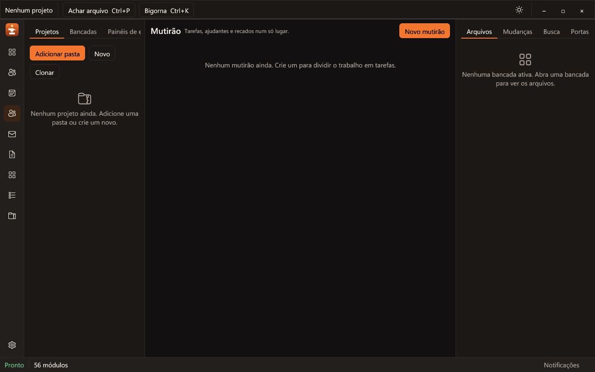

# Mutirão (muster.page)

Tela inicial do trilho "Mutirão", que reúne tarefas, ajudantes e recados do projeto; sem projeto aberto, mostra estados vazios nas três colunas.

## Como chegar
Inicie o app com o trilho Mutirão ativo: `forja-app --locale pt-BR --theme dark --rail muster.page`. Na interface, clique no quinto ícone do trilho à esquerda (o de pessoas, "Mutirão"), que é a entrada marcada.

## Regiões
- **Barra superior** (0,0)–(1280,42): à esquerda o chip "Nenhum projeto" e os botões "Achar arquivo  Ctrl+P" e "Bigorna  Ctrl+K"; à direita o botão de tema (ícone de sol, sem nome) e os botões de janela "–", "□" e "×".
- **Trilho à esquerda** (0,42)–(56,768): a marca do app no topo e uma coluna de ícones ("Quadro", "Ajudantes", "Rotinas", "Mutirão", "Pedidos", "Skills", "Uso", "Extensões", "Acervo") e, no rodapé, "Ajustes".
- **Painel esquerdo** (56,42)–(304,768): abas "Projetos" (marcada), "Bancadas" e "Painéis de extensões", com os botões "Adicionar pasta", "Novo" e "Clonar" e a mensagem de estado vazio "Nenhum projeto ainda. Adicione uma pasta ou crie um novo." sobre um ícone de pasta.
- **Área central** (320,42)–(972,768): cabeçalho com o título "Mutirão" e o subtítulo "Tarefas, ajudantes e recados num só lugar.", o botão laranja "Novo mutirão" e o estado vazio "Nenhum mutirão ainda. Crie um para dividir o trabalho em tarefas." centralizado na coluna.
- **Painel direito** (988,42)–(1280,768): abas "Arquivos" (marcada), "Mudanças", "Busca", "Portas" e "Painéis de extensões", com ícone de grade e a mensagem "Nenhuma bancada ativa. Abra uma bancada para ver os arquivos.".
- **Barra de status** (0,768)–(1280,800): "Pronto" em verde à esquerda, "56 módulos" ao lado e "Notificações" à direita.

## Elementos
| Elemento | Tipo | Posição (px) | Estado | O que faz |
|---|---|---|---|---|
| "Achar arquivo  Ctrl+P" | Button | (135,5)–(291,37) | clicável, focável | Abre o localizador de arquivos do projeto; atalho Ctrl+P indicado no rótulo. |
| "Bigorna  Ctrl+K" | Button | (299,5)–(417,37) | clicável, focável | Abre a paleta de comandos ("Bigorna"); atalho Ctrl+K indicado no rótulo. |
| (sem nome acessível) | Unknown | (1101,5)–(1133,37) | clicável, focável | Botão de alternância de tema, desenhado como ícone de sol na extremidade direita da barra de título. |
| "–" | Button | (1155,5)–(1187,37) | clicável, focável | Minimiza a janela. |
| "□" | Button | (1195,5)–(1227,37) | clicável, focável | Maximiza/restaura a janela. |
| "×" | Button | (1235,5)–(1269,37) | clicável, focável | Fecha a janela. |
| "Nenhum projeto" | Label | (11,12)–(113,31) | clicável, focável | Indicador do projeto atual na barra de título; sem projeto, exibe este texto. |
| (sem nome acessível) | Unknown | (304,42)–(320,768) | focável | Divisor vertical entre o painel esquerdo e a área central (arrastável/redimensionável). |
| (sem nome acessível) | Unknown | (972,42)–(988,768) | focável | Divisor vertical entre a área central e o painel direito. |
| (sem nome acessível) | Image | (12,50)–(40,78) | clicável, focável | Marca/logo do app no topo do trilho (ícone laranja). |
| "Projetos" | Button | (64,50)–(138,82) | marcado=True | Aba do painel esquerdo que lista os projetos; é a aba ativa. |
| (sem nome acessível) | Unknown | (64,50)–(300,82) | focável | Contêiner/fundo da tira de abas do painel esquerdo. |
| "Bancadas" | Button | (138,50)–(220,82) | marcado=False | Aba que alterna o painel esquerdo para a lista de bancadas. |
| "Painéis de extensões" | Button | (220,50)–(371,82) | marcado=False | Aba que alterna o painel esquerdo para os painéis de extensões. |
| "Novo mutirão" | Button | (859,50)–(968,82) | clicável, focável | Botão primário laranja que cria um mutirão na área central. |
| (sem nome acessível) | Unknown | (992,50)–(1268,82) | focável | Contêiner/fundo da tira de abas do painel direito. |
| "Arquivos" | Button | (992,50)–(1070,82) | marcado=True | Aba do painel direito com o navegador de arquivos; é a aba ativa. |
| "Mudanças" | Button | (1070,50)–(1157,82) | marcado=False | Aba de mudanças (arquivos alterados) do painel direito. |
| "Busca" | Button | (1157,50)–(1216,82) | marcado=False | Aba de busca do painel direito. |
| "Portas" | Button | (1216,50)–(1278,82) | marcado=False | Aba de portas do painel direito. |
| "Painéis de extensões" | Button | (1278,50)–(1429,82) | marcado=False | Aba de painéis de extensões do painel direito; retângulo se estende além da largura da janela. |
| "Mutirão" | Label | (324,54)–(389,78) | clicável | Título da tela na área central. |
| "Tarefas, ajudantes e recados num só lugar." | Label | (397,58)–(621,74) | clicável | Subtítulo descritivo ao lado do título. |
| (sem nome acessível) | Unknown | (64,80)–(300,82) | clicável, focável | Linha sublinhada que indica a aba ativa ("Projetos") do painel esquerdo. |
| (sem nome acessível) | Unknown | (992,80)–(1268,82) | clicável, focável | Linha sublinhada que indica a aba ativa ("Arquivos") do painel direito. |
| "Quadro" | Button | (8,94)–(44,130) | marcado=False | Entrada do trilho para o quadro; ícone de grade. |
| "Adicionar pasta" | Button | (64,98)–(183,130) | clicável, focável | Botão destacado do painel Projetos para adicionar uma pasta de projeto. |
| "Novo" | Button | (191,98)–(248,130) | clicável, focável | Cria um projeto novo no painel Projetos. |
| (ícone) | Label | (1116,114)–(1144,142) | clicável | Ícone decorativo (grade de quadradinhos) do estado vazio do painel Arquivos. |
| "Nenhum mutirão ainda. Crie um para dividir o trabalho em tarefas." | Label | (441,130)–(851,149) | clicável | Estado vazio da área central; orienta criar um mutirão. |
| "Ajudantes" | Button | (8,138)–(44,174) | marcado=False | Entrada do trilho para ajudantes de código. |
| "Clonar" | Button | (64,138)–(128,170) | clicável, focável | Ação do painel Projetos para clonar um repositório/pasta. |
| "Nenhuma bancada ativa. Abra uma bancada para ver os arquivos." | Label | (994,150)–(1266,188) | clicável | Estado vazio do painel Arquivos; orienta abrir uma bancada. |
| "Rotinas" | Button | (8,182)–(44,218) | marcado=False | Entrada do trilho para rotinas. |
| (ícone) | Label | (168,198)–(196,226) | clicável | Ícone decorativo (pasta aberta) do estado vazio do painel Projetos. |
| "Mutirão" | Button | (8,226)–(44,262) | marcado=True | Entrada do trilho da tela atual; é a entrada marcada. |
| "Nenhum projeto ainda. Adicione uma pasta ou crie um novo." | Label | (66,234)–(298,272) | clicável | Estado vazio do painel Projetos; orienta adicionar pasta ou criar projeto. |
| "Pedidos" | Button | (8,270)–(44,306) | marcado=False | Entrada do trilho para pedidos. |
| "Skills" | Button | (8,314)–(44,350) | marcado=False | Entrada do trilho para skills. |
| "Uso" | Button | (8,358)–(44,394) | marcado=False | Entrada do trilho para uso. |
| "Extensões" | Button | (8,402)–(44,438) | marcado=False | Entrada do trilho para extensões. |
| "Acervo" | Button | (8,446)–(44,482) | marcado=False | Entrada do trilho para o acervo. |
| "Ajustes" | Button | (8,724)–(44,760) | marcado=False | Entrada do trilho para ajustes, fixada no rodapé do trilho. |
| "Pronto" | Label | (10,775)–(51,794) | clicável | Status geral na barra inferior, em verde. |
| "56 módulos" | Label | (73,775)–(146,794) | clicável | Contagem de módulos carregados. |
| "Notificações" | Label | (1170,775)–(1246,794) | clicável, focável | Área de notificações no canto direito da barra de status. |

## Aparência
Tema escuro: fundo quase preto (tons de marrom-escuro/grafite), com divisórias discretas entre trilho, painéis e área central. O laranja é a cor de destaque: marca do app no trilho, aba "Projetos" sublinhada, ícone do trilho "Mutirão" com fundo laranja escuro, botão primário "Novo mutirão" e botão "Adicionar pasta" em laranja sólido com texto escuro. Tipografia sem serifa em dois tamanhos: título "Mutirão" maior em negrito, o resto em corpo pequeno; os subtítulos e estados vazios aparecem em cinza médio (contraste mais baixo que o texto principal). A aba ativa de cada tira é marcada por um sublinhado claro. Espaçamento uniforme: ícones do trilho com 32 px de lado e passo vertical de 44 px; botões de janela de 32 px alinhados no topo.

## Problemas encontrados
- O botão "Painéis de extensões" da tira direita tem retângulo (1278,50)–(1429,82), que ultrapassa a largura da janela (1280 px); o texto fica cortado fora da área visível.
- O botão "Painéis de extensões" da tira esquerda (220,50)–(371,82) invade a região do divisor em (304,42)–(320,768); o rótulo aparece truncado ("Painéis de e") no painel.
- Dois botões com o mesmo nome acessível "Painéis de extensões" em abas diferentes, o que dificulta a identificação por leitores de tela.
- Botão de alternância de tema e as duas divisórias verticais estão sem nome acessível.
- Textos de estado vazio e subtítulo em cinza sobre fundo escuro têm contraste reduzido (por exemplo, "Tarefas, ajudantes e recados num só lugar.").
