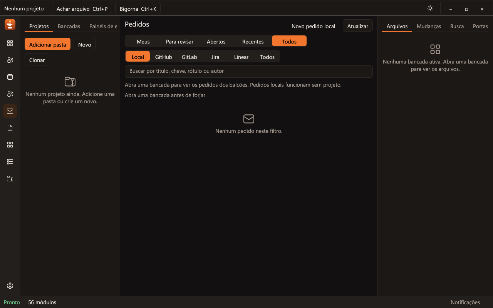

# Pedidos (página request.page no trilho)

Tela de listagem e filtro de pedidos (tarefas/demandas) dos balcões, com painel de projetos à esquerda e painel de arquivos da bancada à direita; funciona sem projeto aberto para pedidos locais.

## Como chegar
Na janela principal, clicar no ícone de envelope "Pedidos" no trilho à esquerda (9º botão do trilho, em (8,270)–(44,306)). Via comando de captura: `forja-app --locale pt-BR --theme dark --rail request.page`.

## Regiões
- **Barra superior** (0,0)–(1280,42): seletor de projeto "Nenhum projeto", atalhos "Achar arquivo  Ctrl+P" e "Bigorna  Ctrl+K", botão de alternância de tema (ícone de sol, sem nome acessível) e botões de janela –, □, ×.
- **Trilho à esquerda** (0,42)–(52,768): logotipo da Forja no topo (12,50)–(40,78) e botões-ícone de 36×36 px: Quadro, Ajudantes, Rotinas, Mutirão, Pedidos (ativo, marcado=True), Skills, Uso, Extensões, Acervo; "Ajustes" fixado no rodapé (8,724).
- **Painel lateral esquerdo** (52,42)–(304,768): abas "Projetos" (ativa), "Bancadas" e "Painéis de extensões"; ações "Adicionar pasta", "Novo" e "Clonar"; estado vazio com ícone de pasta (168,198)–(196,226) e o texto "Nenhum projeto ainda. Adicione uma pasta ou crie um novo.".
- **Área central** (320,42)–(972,768): cabeçalho "Pedidos" com "Novo pedido local" e "Atualizar"; filtros de lista (Meus, Para revisar, Abertos, Recentes, Todos — "Todos" ativo); filtros de origem (Local — ativo, GitHub, GitLab, Jira, Linear, Todos); campo de busca "Buscar por título, chave, rótulo ou autor" (324,170)–(968,202); dois avisos ("Abra uma bancada para ver os pedidos dos balcões. Pedidos locais funcionam sem projeto." e "Abra uma bancada antes de forjar."); estado vazio com ícone de envelope (632,294)–(660,322) e "Nenhum pedido neste filtro.".
- **Painel direito** (988,42)–(1280,768): abas "Arquivos" (ativa), "Mudanças", "Busca", "Portas" e "Painéis de extensões" (esta última cortada pela borda da janela); estado vazio com ícone de grade (1116,114)–(1144,142) e o texto "Nenhuma bancada ativa. Abra uma bancada para ver os arquivos.".
- **Barra de status** (0,768)–(1280,800): "Pronto" em verde, "56 módulos" e "Notificações" à direita.

Separadores verticais finos de 16 px dividem os painéis em x=304–320 e x=972–988.

## Elementos
| Elemento | Tipo | Posição (px) | Estado | O que faz |
|---|---|---|---|---|
| "Nenhum projeto" | Label | (11,12)–(113,31) | — | Indica o projeto atual (nenhum selecionado); abre a lista de projetos. |
| "Achar arquivo  Ctrl+P" | Button | (135,5)–(291,37) | — | Abre a busca rápida de arquivos (atalho Ctrl+P). |
| "Bigorna  Ctrl+K" | Button | (299,5)–(417,37) | — | Abre a paleta de comandos (atalho Ctrl+K). |
| (sem nome acessível) | Unknown | (1101,5)–(1133,37) | — | Botão-ícone de sol: alterna tema claro/escuro. |
| "–" | Button | (1155,5)–(1187,37) | — | Minimiza a janela. |
| "□" | Button | (1195,5)–(1227,37) | — | Maximiza/restaura a janela. |
| "×" | Button | (1235,5)–(1269,37) | — | Fecha a janela. |
| (sem nome acessível) | Unknown | (304,42)–(320,768) | foco | Separador vertical entre painel esquerdo e área central. |
| (sem nome acessível) | Unknown | (972,42)–(988,768) | foco | Separador vertical entre área central e painel direito. |
| (sem nome acessível) | Image | (12,50)–(40,78) | — | Logotipo da Forja no topo do trilho. |
| "Projetos" | Button | (64,50)–(138,82) | marcado=True | Aba ativa do painel esquerdo; mostra a lista de projetos. |
| (sem nome acessível) | Unknown | (64,50)–(300,82) | foco | Faixa das abas do painel esquerdo (fundo/indicador). |
| "Bancadas" | Button | (138,50)–(220,82) | marcado=False | Aba que troca o painel esquerdo para a lista de bancadas. |
| "Painéis de extensões" | Button | (220,50)–(371,82) | marcado=False | Aba do painel esquerdo; aparece truncada como "Painéis de e". |
| "Pedidos" | Label | (324,50)–(387,74) | — | Título da área central. |
| "Novo pedido local" | Button | (745,50)–(882,82) | — | Cria um pedido local (funciona sem projeto). |
| "Atualizar" | Button | (890,50)–(968,82) | — | Recarrega a lista de pedidos. |
| (sem nome acessível) | Unknown | (992,50)–(1268,82) | foco | Faixa das abas do painel direito. |
| "Arquivos" | Button | (992,50)–(1070,82) | marcado=True | Aba ativa do painel direito; lista os arquivos da bancada. |
| "Mudanças" | Button | (1070,50)–(1157,82) | marcado=False | Mostra as mudanças (diff) da bancada. |
| "Busca" | Button | (1157,50)–(1216,82) | marcado=False | Abre a busca do painel direito. |
| "Portas" | Button | (1216,50)–(1278,82) | marcado=False | Mostra as portas em uso. |
| "Painéis de extensões" | Button | (1278,50)–(1429,82) | marcado=False | Aba extra do painel direito; retângulo passa da borda da janela (1280 px) e fica invisível. |
| (sem nome acessível) | Unknown | (64,80)–(300,82) | — | Sublinhado da aba ativa "Projetos". |
| (sem nome acessível) | Unknown | (992,80)–(1268,82) | — | Sublinhado da aba ativa "Arquivos". |
| "Meus" | Button | (324,90)–(419,122) | marcado=False | Filtro de pedidos atribuídos a mim. |
| "Para revisar" | Button | (419,90)–(514,122) | marcado=False | Filtro de pedidos aguardando revisão. |
| "Abertos" | Button | (514,90)–(609,122) | marcado=False | Filtro de pedidos em aberto. |
| "Recentes" | Button | (609,90)–(704,122) | marcado=False | Filtro de pedidos acessados recentemente. |
| "Todos" | Button | (704,90)–(798,122) | marcado=True | Filtro ativo: mostra todos os pedidos. |
| "Quadro" | Button | (8,94)–(44,130) | marcado=False | Botão-ícone do trilho: abre o quadro de pedidos. |
| "Adicionar pasta" | Button | (64,98)–(183,130) | — | Adiciona uma pasta existente como projeto (destacado em laranja). |
| "Novo" | Button | (191,98)–(248,130) | — | Cria um projeto novo. |
| (ícone) | Label | (1116,114)–(1144,142) | — | Ícone de grade do estado vazio do painel direito. |
| "Local" | Button | (324,130)–(391,162) | marcado=True | Filtro de origem ativo: pedidos locais. |
| "GitHub" | Button | (391,130)–(458,162) | marcado=False | Filtro de origem: pedidos do GitHub. |
| "GitLab" | Button | (458,130)–(526,162) | marcado=False | Filtro de origem: pedidos do GitLab. |
| "Jira" | Button | (526,130)–(593,162) | marcado=False | Filtro de origem: pedidos do Jira. |
| "Linear" | Button | (593,130)–(660,162) | marcado=False | Filtro de origem: pedidos do Linear. |
| "Todos" | Button | (660,130)–(727,162) | marcado=False | Filtro de origem: todas as origens. |
| "Ajudantes" | Button | (8,138)–(44,174) | marcado=False | Botão-ícone do trilho: abre os ajudantes de código. |
| "Clonar" | Button | (64,138)–(128,170) | — | Clona um repositório para criar um projeto. |
| "Nenhuma bancada ativa. Abra uma bancada para ver os arquivos." | Label | (994,150)–(1266,188) | — | Estado vazio do painel direito. |
| (sem nome acessível) | TextInput | (324,170)–(968,202) | — | Campo de busca com o texto-guia "Buscar por título, chave, rótulo ou autor". |
| "Rotinas" | Button | (8,182)–(44,218) | marcado=False | Botão-ícone do trilho: abre as rotinas. |
| (ícone) | Label | (168,198)–(196,226) | — | Ícone de pasta do estado vazio do painel esquerdo. |
| "Abra uma bancada para ver os pedidos dos balcões. Pedidos locais funcionam sem projeto." | Label | (324,210)–(886,229) | — | Aviso sobre o escopo dos pedidos. |
| "Mutirão" | Button | (8,226)–(44,262) | marcado=False | Botão-ícone do trilho: abre o mutirão. |
| "Nenhum projeto ainda. Adicione uma pasta ou crie um novo." | Label | (66,234)–(298,272) | — | Estado vazio do painel esquerdo. |
| "Abra uma bancada antes de forjar." | Label | (324,237)–(536,256) | — | Aviso: a ação de forjar exige bancada ativa. |
| "Pedidos" | Button | (8,270)–(44,306) | marcado=True | Botão-ícone do trilho da tela atual (envelope, realce laranja). |
| (ícone) | Label | (632,294)–(660,322) | — | Ícone de envelope do estado vazio da área central. |
| "Skills" | Button | (8,314)–(44,350) | marcado=False | Botão-ícone do trilho: abre as skills. |
| "Nenhum pedido neste filtro." | Label | (559,330)–(733,349) | — | Estado vazio da lista de pedidos. |
| "Uso" | Button | (8,358)–(44,394) | marcado=False | Botão-ícone do trilho: abre o uso de recursos. |
| "Extensões" | Button | (8,402)–(44,438) | marcado=False | Botão-ícone do trilho: abre as extensões. |
| "Acervo" | Button | (8,446)–(44,482) | marcado=False | Botão-ícone do trilho: abre o acervo. |
| "Ajustes" | Button | (8,724)–(44,760) | marcado=False | Botão-ícone do trilho (rodapé): abre os ajustes. |
| "Pronto" | Label | (10,775)–(51,794) | — | Status geral na cor verde. |
| "56 módulos" | Label | (73,775)–(146,794) | — | Quantidade de módulos carregados. |
| "Notificações" | Label | (1170,775)–(1246,794) | — | Atalho/indicador de notificações na barra de status. |

## Aparência
Tema escuro de fundo marrom-acinzentado (janela ~#1e1a17, painéis ligeiramente mais claros). A cor de destaque é o laranja, aplicada ao botão primário "Adicionar pasta", aos filtros ativos "Todos" (lista) e "Local" (origem), ao sublinhado das abas ativas "Projetos" e "Arquivos" e à borda esquerda do botão ativo "Pedidos" do trilho. Texto em cinza-claro; rótulos inativos ("Bancadas", "Mudanças", "Busca") em cinza médio com contraste mais baixo. Tipografia sem serifa de um único tamanho nas abas e botões, com tamanhos menores nos avisos e na barra de status. Botões e abas com cantos arredondados e bordas sutis; espaçamento consistente de ~8 px entre filtros e ~16 px entre seções. Na barra de status, "Pronto" aparece em verde sobre fundo mais escuro.

## Problemas encontrados
- A aba "Painéis de extensões" do painel direito tem retângulo (1278,50)–(1429,82), que passa da largura da imagem (1280 px): o botão fica cortado e inalcançável por clique visível.
- A aba "Painéis de extensões" do painel esquerdo aparece truncada como "Painéis de e" no texto visível.
- O botão de alternância de tema no topo direito (1101,5)–(1133,37) não tem nome acessível; é identificável apenas pelo ícone de sol.
- O campo de busca (TextInput) não tem nome acessível, apenas o texto-guia visível.
- Os três ícones de estado vazio (pasta, envelope, grade) são Labels "(ícone)" sem descrição acessível.
- O nome "Todos" se repete em dois grupos de filtro (lista e origem) com retângulos distintos, o que pode gerar ambiguidade para leitores de tela.
