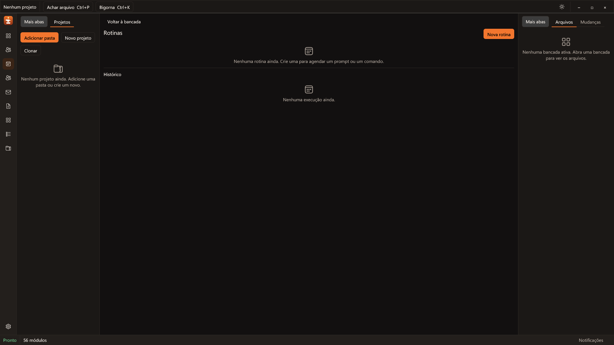

# Rotinas (página do trilho, com painéis vazios)

Tela inicial da área de rotinas do app, mostrada com os painéis de projetos (à esquerda), rotinas (centro) e arquivos de bancada (à direita) ainda sem conteúdo.

## Como chegar
Abrir o Forja em pt-BR com tema dark, com o trilho esquerdo posicionado em "Rotinas" (o botão "Rotinas" do trilho aparece marcado). Comando de captura: `forja-app --locale pt-BR --theme dark --rail routine.page`.

## Regiões
- **Barra superior (0,0)–(1280,42):** rótulo do projeto ("Nenhum projeto") à esquerda; botões "Achar arquivo Ctrl+P" e "Bigorna Ctrl+K"; ícone de tema (sol) à direita; e os botões de janela (minimizar "–", maximizar "□", fechar "×") no canto superior direito.
- **Trilho à esquerda (0,42)–(56,768):** coluna vertical de ícones de navegação; a logomarca (12,50)–(40,78) no topo e, abaixo, os botões-ícone "Quadro", "Ajudantes", "Rotinas" (marcado, em laranja), "Mutirão", "Pedidos", "Skills", "Uso", "Extensões", "Acervo" e, na base, "Ajustes".
- **Painel lateral esquerdo (56,42)–(320,768):** abas "Projetos" (marcada), "Bancadas" e "Painéis de extensões"; botões "Adicionar pasta" (destaque laranja), "Novo" e "Clonar"; estado vazio com ícone de pasta e a mensagem "Nenhum projeto ainda. Adicione uma pasta ou crie um novo.".
- **Área central (320,42)–(988,768):** título "Rotinas" com o botão de destaque "Nova rotina"; estado vazio com ícone e a mensagem "Nenhuma rotina ainda. Crie uma para agendar um prompt ou um comando."; abaixo, a seção "Histórico" com ícone e a mensagem "Nenhuma execução ainda.".
- **Painel direito (988,42)–(1280,768):** abas "Arquivos" (marcada), "Mudanças", "Busca", "Portas" e "Painéis de extensões"; estado vazio com ícone e a mensagem "Nenhuma bancada ativa. Abra uma bancada para ver os arquivos.".
- **Barra de status (0,768)–(1280,800):** "Pronto" em verde à esquerda, "56 módulos" ao lado; "Notificações" à direita.

## Elementos
| Elemento | Tipo | Posição (px) | Estado | O que faz |
|---|---|---|---|---|
| "Achar arquivo Ctrl+P" | Button | (135,5)–(291,37) | — | Atalho global de busca de arquivos (Ctrl+P). |
| "Bigorna Ctrl+K" | Button | (299,5)–(417,37) | — | Atalho global de comandos (Ctrl+K). |
| (sem nome acessível) | Unknown | (1101,5)–(1133,37) | — | Ícone de tema (sol) na barra superior; alterna o tema. |
| "–" | Button | (1155,5)–(1187,37) | — | Minimizar a janela. |
| "□" | Button | (1195,5)–(1227,37) | — | Maximizar/restaurar a janela. |
| "×" | Button | (1235,5)–(1269,37) | — | Fechar a janela. |
| "Nenhum projeto" | Label | (11,12)–(113,31) | clicável | Indica que nenhum projeto está aberto; abre a seletora de projetos. |
| (sem nome acessível) | Unknown | (304,42)–(320,768) | — | Divisor/ calha entre o painel esquerdo e a área central (arrastável). |
| (sem nome acessível) | Unknown | (972,42)–(988,768) | — | Divisor/ calha entre a área central e o painel direito (arrastável). |
| (sem nome acessível) | Image | (12,50)–(40,78) | clicável | Logomarca do Forja no topo do trilho. |
| "Projetos" | Button | (64,50)–(138,82) | marcado=True | Aba do painel esquerdo que exibe a lista de projetos (ativa). |
| (sem nome acessível) | Unknown | (64,50)–(300,82) | — | Faixa da aba ativa "Projetos" (linha de sublinhado até a borda do painel). |
| "Bancadas" | Button | (138,50)–(220,82) | marcado=False | Aba do painel esquerdo que lista as bancadas do projeto. |
| "Painéis de extensões" | Button | (220,50)–(371,82) | marcado=False | Aba do painel esquerdo que lista painéis de extensões; título cortado na largura visível. |
| "Rotinas" | Label | (324,50)–(383,74) | clicável | Título da página central. |
| "Nova rotina" | Button | (872,50)–(968,82) | — | Cria uma nova rotina (ação principal da página, em destaque laranja). |
| (sem nome acessível) | Unknown | (992,50)–(1268,82) | — | Faixa das abas do painel direito (linha de sublinhado da aba ativa). |
| "Arquivos" | Button | (992,50)–(1070,82) | marcado=True | Aba do painel direito que mostra os arquivos da bancada (ativa). |
| "Mudanças" | Button | (1070,50)–(1157,82) | marcado=False | Aba do painel direito que mostra as mudanças da bancada. |
| "Busca" | Button | (1157,50)–(1216,82) | marcado=False | Aba do painel direito de busca em arquivos. |
| "Portas" | Button | (1216,50)–(1278,82) | marcado=False | Aba do painel direito de portas/terminais. |
| "Painéis de extensões" | Button | (1278,50)–(1429,82) | marcado=False | Aba do painel direito que lista painéis de extensões; retângulo se estende além da largura da janela. |
| (sem nome acessível) | Unknown | (64,80)–(300,82) | clicável | Linha de sublinhado da aba ativa "Projetos". |
| (sem nome acessível) | Unknown | (992,80)–(1268,82) | clicável | Linha de sublinhado da aba ativa "Arquivos". |
| "Quadro" | Button | (8,94)–(44,130) | marcado=False | Botão-ícone do trilho para a tela do quadro. |
| "Adicionar pasta" | Button | (64,98)–(183,130) | — | Adiciona uma pasta de projeto existente (botão em destaque laranja). |
| "Novo" | Button | (191,98)–(248,130) | — | Cria um projeto novo. |
| (ícone) | Label | (632,106)–(660,134) | clicável | Ícone ilustrativo do estado vazio das rotinas (centralizado). |
| (ícone) | Label | (1116,114)–(1144,142) | clicável | Ícone ilustrativo do estado vazio do painel de arquivos (centralizado). |
| "Ajudantes" | Button | (8,138)–(44,174) | marcado=False | Botão-ícone do trilho para a tela de ajudantes. |
| "Clonar" | Button | (64,138)–(128,170) | — | Clona um projeto (repositório) existente. |
| "Nenhuma rotina ainda. Crie uma para agendar um prompt ou um comando." | Label | (412,142)–(881,161) | clicável | Mensagem de estado vazio das rotinas. |
| "Nenhuma bancada ativa. Abra uma bancada para ver os arquivos." | Label | (994,150)–(1266,188) | clicável | Mensagem de estado vazio do painel de arquivos, em duas linhas. |
| "Rotinas" | Button | (8,182)–(44,218) | marcado=True | Botão-ícone do trilho da página atual, destacado em laranja. |
| "Histórico" | Label | (324,183)–(379,202) | clicável | Título da seção de histórico de execuções abaixo das rotinas. |
| (ícone) | Label | (168,198)–(196,226) | clicável | Ícone ilustrativo do estado vazio dos projetos (centralizado no painel esquerdo). |
| "Mutirão" | Button | (8,226)–(44,262) | marcado=False | Botão-ícone do trilho para a tela de mutirão. |
| (ícone) | Label | (632,226)–(660,254) | clicável | Ícone ilustrativo do estado vazio do histórico (centralizado). |
| "Nenhum projeto ainda. Adicione uma pasta ou crie um novo." | Label | (66,234)–(298,272) | clicável | Mensagem de estado vazio do painel de projetos, em duas linhas. |
| "Nenhuma execução ainda." | Label | (565,262)–(727,281) | clicável | Mensagem de estado vazio do histórico de execuções. |
| "Pedidos" | Button | (8,270)–(44,306) | marcado=False | Botão-ícone do trilho para a tela de pedidos. |
| "Skills" | Button | (8,314)–(44,350) | marcado=False | Botão-ícone do trilho para a tela de skills. |
| "Uso" | Button | (8,358)–(44,394) | marcado=False | Botão-ícone do trilho para a tela de uso. |
| "Extensões" | Button | (8,402)–(44,438) | marcado=False | Botão-ícone do trilho para a tela de extensões. |
| "Acervo" | Button | (8,446)–(44,482) | marcado=False | Botão-ícone do trilho para a tela de acervo. |
| "Ajustes" | Button | (8,724)–(44,760) | marcado=False | Botão-ícone do trilho (engrenagem), fixado na base, para os ajustes. |
| "Pronto" | Label | (10,775)–(51,794) | clicável | Indicador de estado na barra de status, em verde. |
| "56 módulos" | Label | (73,775)–(146,794) | clicável | Contagem de módulos carregados, na barra de status. |
| "Notificações" | Label | (1170,775)–(1246,794) | clicável | Abre as notificações, à direita da barra de status. |

## Aparência
Tema escuro: fundo geral em marrom-escuro quase preto (aprox. #221a14 na área de conteúdo, com tom levemente mais claro na barra superior e na barra de status). Cor de destaque laranja forte, usada no botão "Nova rotina", no botão "Adicionar pasta", no ícone "Rotinas" do trilho (fundo laranja com ícone escuro) e no sublinhado das abas ativas ("Projetos" e "Arquivos"). O indicador "Pronto" na barra de status usa verde. Os demais rótulos e mensagens vazias aparecem em cinza claro com contraste moderado; mensagens de estado vazio ficam centralizadas horizontalmente em suas regiões, acompanhadas de um ícone acima do texto. Tipografia sem serifa em tamanho pequeno (títulos de seção como "Histórico" e "Rotinas" levemente maiores), com espaçamento uniforme: abas com ~20 px de altura de área clicável, trilho com ícones de 36 px e passos regulares de 44 px, e os três painéis separados por divisores verticais de 16 px (304–320 e 972–988). A barra de status tem 32 px de altura e os rótulos "Pronto"/"56 módulos" ficam alinhados à esquerda, com "Notificações" à direita.

## Problemas encontrados
- O botão "Painéis de extensões" do painel direito tem o retângulo (1278,50)–(1429,82) estendido além da largura da imagem/janela (1280 px): parte do elemento fica fora da tela, embora o texto visível "Portas" ainda caiba.
- O texto da aba "Painéis de extensões" do painel esquerdo (220,50)–(371,82) é cortado visualmente pela área central, aparecendo como "Painéis de e" na captura.
- Botões-ícone do trilho ("Quadro", "Ajudantes", "Mutirão", "Pedidos", "Skills", "Uso", "Extensões", "Acervo") dependem exclusivamente de ícone na interface; o nome acessível existe na árvore, mas não há rótulo visível nem dica na tela.
- Os três ícones ilustrativos dos estados vazios e os ícones da barra superior e divisores são expostos como "(sem nome acessível)", sem descrição para leitores de tela.
