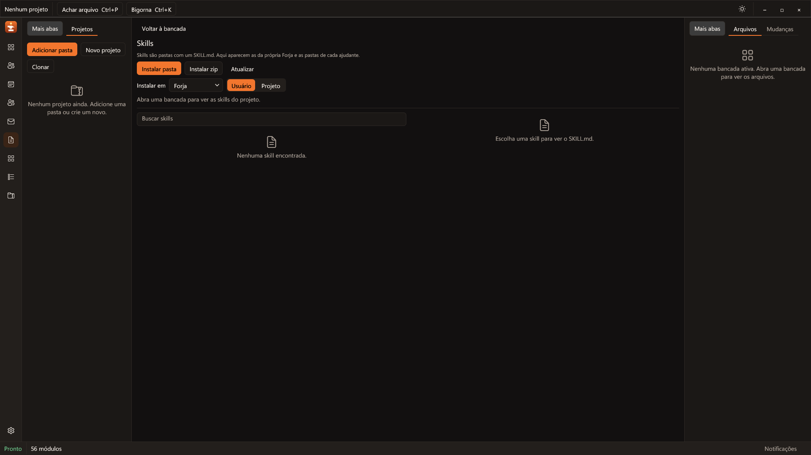

# Skills (página central)

Tela de gerenciamento de skills (pastas com `SKILL.md`): permite instalar, criar e buscar skills da Forja e dos ajudantes, enquanto o restante da janela mostra projetos e arquivos.

## Como chegar
Na barra vertical à esquerda, clique no ícone de skills (o nono botão do trilho, marcado em laranja). Equivalente a abrir o app com `forja-app --locale pt-BR --theme dark --rail skill.page`.

## Regiões
- **Barra superior** (0,0)–(1280,42): rótulo do projeto atual ("Nenhum projeto"), botões "Achar arquivo Ctrl+P" e "Bigorna Ctrl+K", ícone de tema e botões de janela (minimizar, maximizar, fechar).
- **Trilho à esquerda** (0,42)–(52,768): logotipo da Forja no topo e ícones de navegação (Quadro, Ajudantes, Rotinas, Mutirão, Pedidos, Skills, Uso, Extensões, Acervo), com "Ajustes" fixado no rodapé do trilho.
- **Painel lateral esquerdo** (52,42)–(312,768): abas "Projetos" (ativa), "Bancadas" e "Painéis de extensões"; ações "Adicionar pasta", "Novo" e "Clonar"; estado vazio com ícone de pasta e o texto "Nenhum projeto ainda. Adicione uma pasta ou crie um novo.".
- **Área central** (312,42)–(980,768): página "Skills", com descrição, ações de instalação, seletor de destino, busca e duas mensagens de estado vazio ("Nenhuma skill encontrada." e "Escolha uma skill para ver o SKILL.md.").
- **Painel lateral direito** (980,42)–(1280,768): abas "Arquivos" (ativa), "Mudanças", "Busca", "Portas" e "Painéis de extensões"; ícone de grade e texto "Nenhuma bancada ativa. Abra uma bancada para ver os arquivos.".
- **Barra de status** (0,768)–(1280,800): status "Pronto", contagem "56 módulos" e "Notificações" à direita.

## Elementos
| Elemento | Tipo | Posição (px) | Estado | O que faz |
|---|---|---|---|---|
| "Achar arquivo Ctrl+P" | Botão | (135,5)–(291,37) | — | Abre a busca rápida de arquivos (atalho Ctrl+P) |
| "Bigorna Ctrl+K" | Botão | (299,5)–(417,37) | — | Abre a paleta de comandos (atalho Ctrl+K) |
| (sem nome acessível) | Ícone | (1101,5)–(1133,37) | — | Ícone de sol na barra superior; alterna o tema |
| "–" | Botão | (1155,5)–(1187,37) | — | Minimiza a janela |
| "□" | Botão | (1195,5)–(1227,37) | — | Maximiza/restaura a janela |
| "×" | Botão | (1235,5)–(1269,37) | — | Fecha a janela |
| "Nenhum projeto" | Rótulo | (11,12)–(113,31) | — | Mostra o projeto ativo na barra superior |
| (sem nome acessível) | Divisor | (304,42)–(320,768) | — | Separador vertical entre o painel esquerdo e a área central |
| (sem nome acessível) | Divisor | (972,42)–(988,768) | — | Separador vertical entre a área central e o painel direito |
| (sem nome acessível) | Imagem | (12,50)–(40,78) | — | Logotipo da Forja no topo do trilho |
| "Projetos" | Botão | (64,50)–(138,82) | marcado=True | Aba ativa do painel esquerdo; mostra a lista de projetos |
| (sem nome acessível) | Contêiner | (64,50)–(300,82) | — | Fundo/área da barra de abas do painel esquerdo |
| "Bancadas" | Botão | (138,50)–(220,82) | marcado=False | Aba que mostra as bancadas (branches de trabalho) |
| "Painéis de extensões" | Botão | (220,50)–(371,82) | marcado=False | Aba de painéis de extensões do painel esquerdo |
| "Skills" | Rótulo | (324,50)–(363,74) | — | Título da página central |
| (sem nome acessível) | Contêiner | (992,50)–(1268,82) | — | Fundo/área da barra de abas do painel direito |
| "Arquivos" | Botão | (992,50)–(1070,82) | marcado=True | Aba ativa do painel direito; lista de arquivos |
| "Mudanças" | Botão | (1070,50)–(1157,82) | marcado=False | Aba de mudanças (versionamento) |
| "Busca" | Botão | (1157,50)–(1216,82) | marcado=False | Aba de busca |
| "Portas" | Botão | (1216,50)–(1278,82) | marcado=False | Aba de portas |
| "Painéis de extensões" | Botão | (1278,50)–(1429,82) | marcado=False | Aba de painéis de extensões do painel direito |
| (sem nome acessível) | Indicador | (64,80)–(300,82) | — | Sublinhado da aba ativa no painel esquerdo |
| (sem nome acessível) | Indicador | (992,80)–(1268,82) | — | Sublinhado da aba ativa no painel direito |
| "Skills são pastas com um SKILL.md. Aqui aparecem as da própria Forja e as pastas de cada ajudante." | Rótulo | (324,82)–(851,98) | — | Descrição da página |
| "Quadro" | Botão | (8,94)–(44,130) | marcado=False | Ícone do trilho para o quadro |
| "Adicionar pasta" | Botão | (64,98)–(183,130) | — | Adiciona uma pasta de projeto existente |
| "Novo" | Botão | (191,98)–(248,130) | — | Cria um projeto novo |
| "Instalar pasta" | Botão | (324,106)–(429,138) | — | Instala uma skill a partir de uma pasta (botão destacado em laranja) |
| "Instalar zip" | Botão | (437,106)–(527,138) | — | Instala uma skill a partir de um arquivo zip |
| "Atualizar" | Botão | (535,106)–(613,138) | — | Atualiza a lista de skills |
| (ícone) | Rótulo | (1116,114)–(1144,142) | — | Ícone de grade do estado vazio do painel de arquivos |
| "Ajudantes" | Botão | (8,138)–(44,174) | marcado=False | Ícone do trilho para ajudantes |
| "Clonar" | Botão | (64,138)–(128,170) | — | Clona um projeto |
| "Instalar em" | Rótulo | (324,146)–(392,178) | — | Rótulo do seletor de destino da instalação |
| (sem nome acessível) | Caixa de seleção | (400,146)–(528,178) | — | Combobox que mostra "Forja"; escolhe o escopo de instalação |
| "Usuário" | Botão | (536,146)–(606,178) | marcado=True | Escopo de instalação no usuário (selecionado, laranja) |
| "Projeto" | Botão | (606,146)–(677,178) | marcado=False | Escopo de instalação no projeto |
| "Nenhuma bancada ativa. Abra uma bancada para ver os arquivos." | Rótulo | (994,150)–(1266,188) | — | Estado vazio do painel de arquivos |
| "Rotinas" | Botão | (8,182)–(44,218) | marcado=False | Ícone do trilho para rotinas |
| "Abra uma bancada para ver as skills do projeto." | Rótulo | (324,186)–(616,205) | — | Aviso de que as skills de projeto dependem de uma bancada |
| (ícone) | Rótulo | (168,198)–(196,226) | — | Ícone de pasta do estado vazio do painel de projetos |
| "Mutirão" | Botão | (8,226)–(44,262) | marcado=False | Ícone do trilho para o mutirão |
| (sem nome acessível) | Campo de texto | (324,227)–(642,259) | — | Campo de busca com o texto de sugestão "Buscar skills" |
| "Nenhum projeto ainda. Adicione uma pasta ou crie um novo." | Rótulo | (66,234)–(298,272) | — | Estado vazio da lista de projetos |
| (ícone) | Rótulo | (795,243)–(823,271) | — | Ícone de documento do estado vazio direito da área central |
| "Pedidos" | Botão | (8,270)–(44,306) | marcado=False | Ícone do trilho para pedidos |
| "Escolha uma skill para ver o SKILL.md." | Rótulo | (693,279)–(925,298) | — | Estado vazio do painel de detalhe da skill |
| (ícone) | Rótulo | (469,283)–(497,311) | — | Ícone de documento do estado vazio esquerdo da área central |
| "Skills" | Botão | (8,314)–(44,350) | marcado=True | Ícone do trilho da página atual (destacado em laranja) |
| "Nenhuma skill encontrada." | Rótulo | (401,319)–(565,338) | — | Estado vazio da lista de skills |
| "Uso" | Botão | (8,358)–(44,394) | marcado=False | Ícone do trilho para uso |
| "Extensões" | Botão | (8,402)–(44,438) | marcado=False | Ícone do trilho para extensões |
| "Acervo" | Botão | (8,446)–(44,482) | marcado=False | Ícone do trilho para o acervo |
| "Ajustes" | Botão | (8,724)–(44,760) | marcado=False | Ícone do trilho para ajustes, fixado no rodapé |
| "Pronto" | Rótulo | (10,775)–(51,794) | — | Status atual na barra inferior |
| "56 módulos" | Rótulo | (73,775)–(146,794) | — | Contagem de módulos carregados |
| "Notificações" | Rótulo | (1170,775)–(1246,794) | — | Abre as notificações na barra de status |

## Aparência
Tema escuro: fundo quase preto com leve tom marrom nas três colunas, separadas por divisores verticais finos e discretos. A cor de destaque é o laranja, usado no botão "Adicionar pasta" e "Instalar pasta", no botão de escopo "Usuário" e no ícone ativo "Skills" do trilho; as abas ativas ("Projetos", "Arquivos") recebem sublinhado claro. Tipografia sans-serif de corpo pequeno (texto de rótulos em torno de 13–16 px), cinza-claro sobre fundo escuro, com os títulos "Skills" em tamanho maior. Os ícones de estado vazio são contornos cinza centralizados com a mensagem abaixo. Botões secundários têm borda fina arredondada e fundo levemente mais claro que o painel; o espaçamento entre ações é uniforme (cerca de 8–16 px).

## Problemas encontrados
- O botão "Painéis de extensões" do painel direito tem o retângulo (1278,50)–(1429,82) além da largura da janela (1280 px): o texto fica cortado e parte do botão não é visível/clicável.
- Na barra de abas do painel esquerdo, o botão "Painéis de extensões" (220,50)–(371,82) ultrapassa a borda do painel (x≈312); na imagem só se lê "Painéis de e", texto truncado.
- O campo de busca "Buscar skills" é um TextInput sem nome acessível; o texto de sugestão só aparece visualmente.
- O ícone de alternância de tema na barra superior (1101,5)–(1133,37) é um elemento clicável sem nome acessível; a função só é identificável pela imagem.
- Os divisores verticais, os contêineres das barras de abas e os indicadores de aba ativa são elementos sem nome acessível.
- Os quatro ícones de estado vazio aparecem como rótulos "(ícone)" sem descrição de texto alternativa.
