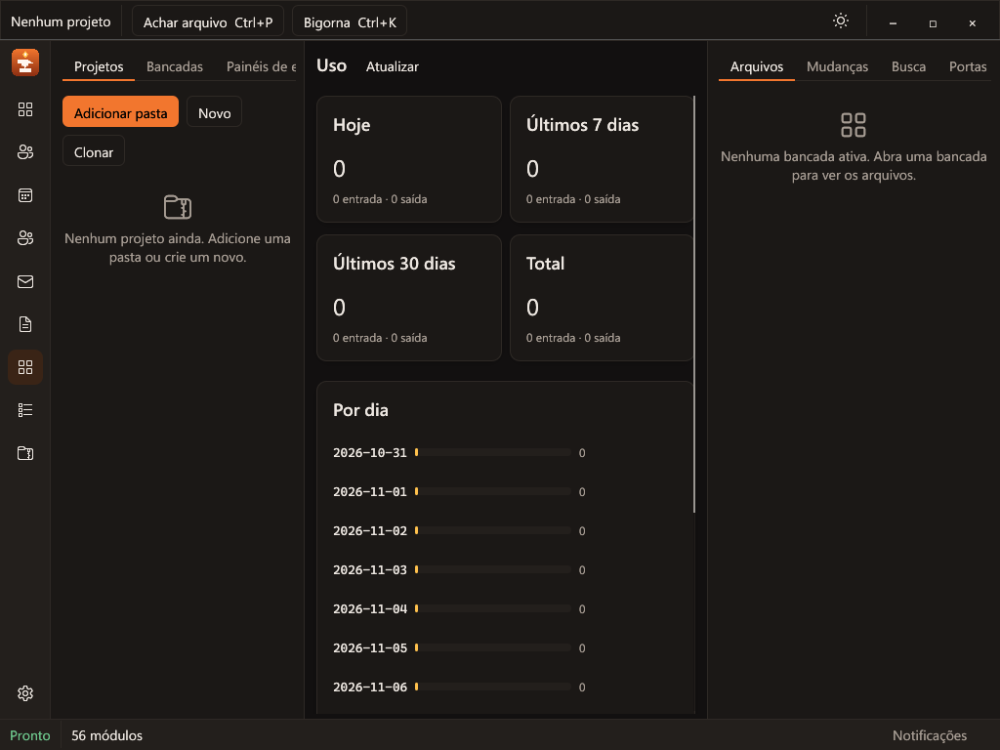

# Uso (página central, com trilho e painéis laterais)

Tela de estatísticas de uso de tokens dos ajudantes, exibida na área central enquanto o trilho lateral e os painéis de projetos e arquivos continuam visíveis.

## Como chegar
Na barra superior ou no trilho à esquerda, clique no botão "Uso" (o quinto conjunto de ícones do trilho, marcado como ativo). Equivalente a abrir o app com `forja-app --locale pt-BR --theme dark --rail usage.page`. Captura: `captures/pt-BR.dark.rail.usage.page.png` (1280×800 px, escala 1.0).

## Regiões
- **Barra superior** (0,0)–(1280,42): botão de projeto "Nenhum projeto", "Achar arquivo Ctrl+P", "Bigorna Ctrl+K", botão de alternância de tema (ícone de sol, sem nome acessível) e os botões de janela "–", "□", "×".
- **Trilho de ícones à esquerda** (0,42)–(48,768): logotipo do app (imagem) em cima, seguido dos botões "Quadro", "Ajudantes", "Rotinas", "Mutirão", "Pedidos", "Skills", "Uso" (ativo), "Extensões" e "Acervo"; "Ajustes" fixado embaixo.
- **Painel de projetos (esquerda)** (48,42)–(304,768): abas "Projetos" (ativa), "Bancadas" e "Painéis de e…", botões "Adicionar pasta", "Novo" e "Clonar", e o estado vazio com ícone de pasta e a mensagem "Nenhum projeto ainda. Adicione uma pasta ou crie um novo.".
- **Área central** (320,42)–(972,768): cabeçalho "Uso" com botão "Atualizar"; cartões "Hoje", "Últimos 7 dias", "Últimos 30 dias" e "Total"; cartão "Por dia" com uma lista rolável de datas de 2026-10-31 a 2026-11-13, cada uma com barra e valor "0"; barra de rolagem vertical na borda direita (966,98)–(968,760).
- **Painel direito** (988,42)–(1280,768): abas "Arquivos" (ativa), "Mudanças", "Busca", "Portas" e "Painéis de e…" e o estado vazio com ícone de grade e a mensagem "Nenhuma bancada ativa. Abra uma bancada para ver os arquivos.".
- **Barra de status** (0,768)–(1280,800): "Pronto" em verde, "56 módulos" e, à direita, "Notificações".

## Elementos
| Elemento | Tipo | Posição (px) | Estado | O que faz |
|---|---|---|---|---|
| "Achar arquivo  Ctrl+P" | Button | (135,5)–(291,37) | — | Abre a busca de arquivos (atalho Ctrl+P) |
| "Bigorna  Ctrl+K" | Button | (299,5)–(417,37) | — | Abre a paleta de comandos (atalho Ctrl+K) |
| (sem nome acessível) | Unknown | (1101,5)–(1133,37) | — | Ícone de sol: alterna tema claro/escuro |
| "–" | Button | (1155,5)–(1187,37) | — | Minimiza a janela |
| "□" | Button | (1195,5)–(1227,37) | — | Maximiza/restaura a janela |
| "×" | Button | (1235,5)–(1269,37) | — | Fecha a janela |
| "Nenhum projeto" | Label | (11,12)–(113,31) | — | Mostra que não há projeto aberto; clique abre o seletor de projeto |
| (sem nome acessível) | Unknown | (304,42)–(320,768) | — | Divisor redimensionável entre painel esquerdo e área central |
| (sem nome acessível) | Unknown | (972,42)–(988,768) | — | Divisor redimensionável entre área central e painel direito |
| (sem nome acessível) | Image | (12,50)–(40,78) | — | Logotipo da Forja no topo do trilho |
| "Projetos" | Button | (64,50)–(138,82) | marcado=True | Aba ativa do painel esquerdo; mostra a lista de projetos |
| (sem nome acessível) | Unknown | (64,50)–(300,82) | — | Faixa de fundo das abas do painel esquerdo |
| "Bancadas" | Button | (138,50)–(220,82) | marcado=False | Aba que lista as bancadas do projeto |
| "Painéis de e…" ("Painéis de extensões") | Button | (220,50)–(371,82) | marcado=False | Aba de painéis de extensões; texto truncado na borda do painel |
| "Uso" | Label | (324,50)–(355,82) | — | Título da página central |
| "Atualizar" | Button | (363,50)–(441,82) | — | Recarrega os dados de uso |
| (sem nome acessível) | Unknown | (992,50)–(1268,82) | — | Faixa de fundo das abas do painel direito |
| "Arquivos" | Button | (992,50)–(1070,82) | marcado=True | Aba ativa do painel direito; lista de arquivos da bancada |
| "Mudanças" | Button | (1070,50)–(1157,82) | marcado=False | Aba de mudanças (diffs) da bancada |
| "Busca" | Button | (1157,50)–(1216,82) | marcado=False | Aba de busca no projeto |
| "Portas" | Button | (1216,50)–(1278,82) | marcado=False | Aba de portas locais em uso |
| "Painéis de extensões" | Button | (1278,50)–(1429,82) | marcado=False | Aba de painéis de extensões; retângulo passa da largura da janela (1280 px) e é cortado |
| (sem nome acessível) | Unknown | (64,80)–(300,82) | — | Sublinhado da aba ativa "Projetos" |
| (sem nome acessível) | Unknown | (992,80)–(1268,82) | — | Sublinhado da aba ativa "Arquivos" |
| "Quadro" | Button | (8,94)–(44,130) | marcado=False | Ícone do trilho: abre o quadro de projetos |
| "Adicionar pasta" | Button | (64,98)–(183,130) | — | Destaque laranja: adiciona uma pasta de projeto |
| "Novo" | Button | (191,98)–(248,130) | — | Cria um projeto novo |
| (sem nome acessível) | Unknown | (324,98)–(968,760) | — | Área de conteúdo rolável da página de uso |
| (sem nome acessível) | Unknown | (966,98)–(968,760) | — | Barra de rolagem vertical da área central |
| (ícone) | Label | (1116,114)–(1144,142) | — | Ícone de grade do estado vazio do painel direito |
| "Hoje" | Label | (341,115)–(625,139) | — | Título do cartão de uso de hoje |
| "Últimos 7 dias" | Label | (667,115)–(951,139) | — | Título do cartão dos últimos 7 dias |
| "Ajudantes" | Button | (8,138)–(44,174) | marcado=False | Ícone do trilho: lista os ajudantes |
| "Clonar" | Button | (64,138)–(128,170) | — | Clona um repositório para usar como projeto |
| "Nenhuma bancada ativa. Abra uma bancada para ver os arquivos." | Label | (994,150)–(1266,188) | — | Estado vazio do painel direito |
| "0" | Label | (341,155)–(625,187) | — | Valor do cartão "Hoje" |
| "0" | Label | (667,155)–(951,187) | — | Valor do cartão "Últimos 7 dias" |
| "Rotinas" | Button | (8,182)–(44,218) | marcado=False | Ícone do trilho: abre as rotinas |
| "0 entrada · 0 saída" | Label | (341,195)–(625,211) | — | Detalhe de tokens do cartão "Hoje" |
| "0 entrada · 0 saída" | Label | (667,195)–(951,211) | — | Detalhe de tokens do cartão "Últimos 7 dias" |
| (ícone) | Label | (168,198)–(196,226) | — | Ícone de pasta do estado vazio do painel esquerdo |
| "Mutirão" | Button | (8,226)–(44,262) | marcado=False | Ícone do trilho: abre o mutirão |
| "Nenhum projeto ainda. Adicione uma pasta ou crie um novo." | Label | (66,234)–(298,272) | — | Estado vazio da lista de projetos |
| "Últimos 30 dias" | Label | (341,257)–(625,281) | — | Título do cartão dos últimos 30 dias |
| "Total" | Label | (667,257)–(951,281) | — | Título do cartão de total acumulado |
| "Pedidos" | Button | (8,270)–(44,306) | marcado=False | Ícone do trilho: abre os pedidos |
| "0" | Label | (341,297)–(625,329) | — | Valor do cartão "Últimos 30 dias" |
| "0" | Label | (667,297)–(951,329) | — | Valor do cartão "Total" |
| "Skills" | Button | (8,314)–(44,350) | marcado=False | Ícone do trilho: abre as skills |
| "0 entrada · 0 saída" | Label | (341,337)–(625,353) | — | Detalhe de tokens do cartão "Últimos 30 dias" |
| "0 entrada · 0 saída" | Label | (667,337)–(951,353) | — | Detalhe de tokens do cartão "Total" |
| "Uso" | Button | (8,358)–(44,394) | marcado=True | Ícone do trilho ativo: mostra esta página de uso |
| "Extensões" | Button | (8,402)–(44,438) | marcado=False | Ícone do trilho: abre as extensões |
| "Por dia" | Label | (341,407)–(397,431) | — | Título do cartão com a série diária |
| "Acervo" | Button | (8,446)–(44,482) | marcado=False | Ícone do trilho: abre o acervo |
| "0" | Label | (593,455)–(599,471) | — | Valor do dia 2026-10-31 |
| "2026-10-31" | Label | (341,456)–(417,471) | — | Data da primeira linha da série |
| "0" | Label | (593,495)–(599,511) | — | Valor do dia 2026-11-01 |
| "2026-11-01" | Label | (341,496)–(417,511) | — | Data da linha seguinte |
| "0" | Label | (593,535)–(599,551) | — | Valor do dia 2026-11-02 |
| "2026-11-02" | Label | (341,536)–(417,551) | — | Data da linha seguinte |
| "0" | Label | (593,575)–(599,591) | — | Valor do dia 2026-11-03 |
| "2026-11-03" | Label | (341,576)–(417,591) | — | Data da linha seguinte |
| "0" | Label | (593,615)–(599,631) | — | Valor do dia 2026-11-04 |
| "2026-11-04" | Label | (341,616)–(417,631) | — | Data da linha seguinte |
| "0" | Label | (593,655)–(599,671) | — | Valor do dia 2026-11-05 |
| "2026-11-05" | Label | (341,656)–(417,671) | — | Data da linha seguinte |
| "0" | Label | (593,695)–(599,711) | — | Valor do dia 2026-11-06 |
| "2026-11-06" | Label | (341,696)–(417,711) | — | Data da linha seguinte |
| "Ajustes" | Button | (8,724)–(44,760) | marcado=False | Ícone do trilho: abre os ajustes |
| "0" | Label | (593,735)–(599,751) | — | Valor do dia 2026-11-07 (última linha visível) |
| "2026-11-07" | Label | (341,736)–(417,751) | — | Última data visível antes da rolagem |
| "Pronto" | Label | (10,775)–(51,794) | — | Status do app, em verde |
| "56 módulos" | Label | (73,775)–(146,794) | — | Quantidade de módulos carregados |
| "0" | Label | (593,775)–(599,791) | — | Valor do dia 2026-11-08 (abaixo da dobra, na área rolável) |
| "Notificações" | Label | (1170,775)–(1246,794) | — | Abre as notificações, na barra de status |
| "2026-11-08" | Label | (341,776)–(417,791) | — | Data abaixo da dobra, na área rolável |
| "0" | Label | (593,815)–(599,831) | — | Valor do dia 2026-11-09 (fora da janela visível) |
| "2026-11-09" | Label | (341,816)–(417,831) | — | Data fora da janela visível |
| "0" | Label | (593,855)–(599,871) | — | Valor do dia 2026-11-10 (fora da janela visível) |
| "2026-11-10" | Label | (341,856)–(417,871) | — | Data fora da janela visível |
| "0" | Label | (593,895)–(599,911) | — | Valor do dia 2026-11-11 (fora da janela visível) |
| "2026-11-11" | Label | (341,896)–(417,911) | — | Data fora da janela visível |
| "0" | Label | (593,935)–(599,951) | — | Valor do dia 2026-11-12 (fora da janela visível) |
| "2026-11-12" | Label | (341,936)–(417,951) | — | Data fora da janela visível |
| "0" | Label | (593,975)–(599,991) | — | Valor do dia 2026-11-13 (fora da janela visível) |
| "2026-11-13" | Label | (341,976)–(417,991) | — | Última data da série; fora da janela visível |

## Aparência
Tema escuro: fundo quase preto na barra superior e na barra de status, painéis em cinza-escuro com cartões levemente mais claros, delimitados por bordas arredondadas finas. O acento laranja (Brasa) aparece no botão primário "Adicionar pasta", nos sublinhados das abas ativas "Projetos" e "Arquivos", no retângulo do item ativo "Uso" do trilho e nas marcas iniciais das barras da série "Por dia" (trilho cinza escuro, valor zero). Texto principal em branco, textos secundários e estados vazios em cinza médio; "Pronto" na barra de status em verde. Tipografia sans-serif de um único peso médio, com títulos de cartão maiores ("Hoje", "Total") e valores em número grande. Alinhamento consistente: cartões em duas colunas (341–625 e 667–951), linhas da série com data à esquerda, barra no meio e valor à direita; ícones do trilho centralizados em coluna única de 36 px.

## Problemas encontrados
- A aba "Painéis de extensões" do painel esquerdo é exibida como "Painéis de e…": o retângulo do botão (até x=371) passa do limite do painel (x=304) e o texto é cortado.
- No painel direito, o botão "Painéis de extensões" tem retângulo até x=1429, além da largura da janela (1280 px); a aba aparece truncada na borda direita.
- Linhas da série "Por dia" de 2026-11-08 a 2026-11-13 ficam além da altura da janela (y até 991, imagem de 800 px); a área é rolável e há barra de rolagem, mas o corte da última linha visível (2026-11-07) encosta na borda do cartão.
- O botão de alternância de tema na barra superior (1101,5)–(1133,37) não tem nome acessível (apenas ícone de sol).
- Os botões de janela usam os símbolos "–", "□" e "×" como nome acessível, em vez de rótulos descritivos ("Minimizar", "Maximizar", "Fechar").
- O logotipo do app (12,50)–(40,78) é uma imagem sem nome acessível.
