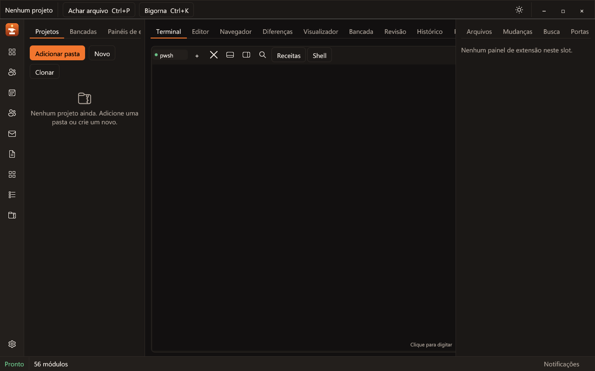

# Painel de extensões (slot direito)

Tela principal da Forja no estado inicial (nenhum projeto aberto), com o painel direito exibindo o slot "Painéis de extensões", vazio.

## Como chegar
Abrir o app com o painel direito apontado para o slot de painéis de extensão: `forja-app --locale pt-BR --theme dark --right-tab extension.panels.right`. Na interface, seria clicando na aba "Painéis de extensões" da faixa de abas do painel direito — porém, neste estado, essa aba está posicionada além da borda direita da janela (ver Problemas).

## Regiões
- **Barra superior** (0,0)–(1280,42): rótulo "Nenhum projeto" à esquerda; botões "Achar arquivo  Ctrl+P" e "Bigorna  Ctrl+K"; ícone de tema (sol) e botões de janela (–, □, ×) à direita.
- **Trilho de ícones à esquerda** (0,42)–(48,768): logotipo da Forja (bigorna laranja) e, de cima para baixo, os botões "Quadro", "Ajudantes", "Rotinas", "Mutirão", "Pedidos", "Skills", "Uso", "Extensões", "Acervo" e, no rodapé do trilho, "Ajustes".
- **Painel esquerdo** (48,42)–(300,768): abas "Projetos" (ativa, sublinhada), "Bancadas" e "Painéis de extensões" (cortada visualmente como "Painéis de e"); botões "Adicionar pasta" (destaque laranja), "Novo" e "Clonar"; estado vazio com ícone de pasta e o texto "Nenhum projeto ainda. Adicione uma pasta ou crie um novo.".
- **Divisor vertical 1** (304,42)–(320,768): separador redimensionável entre o painel esquerdo e a área central.
- **Área central** (320,42)–(980,768): faixa de abas ("Terminal" ativa, "Editor", "Navegador", "Diferenças", "Visualizador", "Bancada", "Revisão", "Histórico" e uma "Painéis de extensões" cortada na borda); barra de ferramentas do terminal com a aba "pwsh" (bolinha verde), "+", ícones de fechar/dividir/maximizar/busca e os botões "Receitas" e "Shell"; área do terminal vazia com a dica "Clique para digitar" no canto inferior direito.
- **Divisor vertical 2** (972,42)–(988,768): separador entre a área central e o painel direito.
- **Painel direito** (988,42)–(1280,768): faixa de abas com "Arquivos", "Mudanças", "Busca" e "Portas" visíveis; mensagem "Nenhum painel de extensão neste slot." indicando o slot vazio.
- **Barra de status** (0,768)–(1280,800): "Pronto" em verde à esquerda, "56 módulos" em seguida e "Notificações" à direita.

## Elementos
| Elemento | Tipo | Posição (px) | Estado | O que faz |
|---|---|---|---|---|
| "Achar arquivo  Ctrl+P" | Button | (135,5)–(291,37) | — | Abre a busca rápida de arquivos (atalho Ctrl+P) |
| "Bigorna  Ctrl+K" | Button | (299,5)–(417,37) | — | Abre a paleta de comandos (atalho Ctrl+K) |
| (sem nome acessível) | Unknown | (1101,5)–(1133,37) | — | Ícone de sol na barra superior: alterna tema claro/escuro |
| "–" | Button | (1155,5)–(1187,37) | — | Minimiza a janela |
| "□" | Button | (1195,5)–(1227,37) | — | Maximiza/restaura a janela |
| "×" | Button | (1235,5)–(1269,37) | — | Fecha a janela |
| "Nenhum projeto" | Label | (11,12)–(113,31) | — | Indica que nenhum projeto está aberto |
| (sem nome acessível) | Unknown | (304,42)–(320,768) | — | Divisor vertical entre painel esquerdo e área central (arrastar redimensiona) |
| (sem nome acessível) | Unknown | (972,42)–(988,768) | — | Divisor vertical entre área central e painel direito |
| (sem nome acessível) | Image | (12,50)–(40,78) | — | Logotipo da Forja (bigorna laranja) no topo do trilho |
| "Projetos" | Button | (64,50)–(138,82) | marcado=True | Aba ativa do painel esquerdo; mostra a lista de projetos |
| (sem nome acessível) | Unknown | (64,50)–(300,82) | — | Contêiner da faixa de abas do painel esquerdo |
| "Bancadas" | Button | (138,50)–(220,82) | marcado=False | Aba do painel esquerdo; mostra as bancadas (branches de trabalho) |
| "Painéis de extensões" | Button | (220,50)–(371,82) | marcado=False | Aba do painel esquerdo; seu retângulo invade o divisor e a área central; visualmente cortada como "Painéis de e" |
| "Terminal" | Button | (324,50)–(401,82) | marcado=True | Aba ativa da área central; mostra o terminal |
| "Editor" | Button | (401,50)–(461,82) | marcado=False | Aba da área central; mostra o editor |
| "Navegador" | Button | (461,50)–(553,82) | marcado=False | Aba da área central; mostra o navegador |
| "Diferenças" | Button | (553,50)–(641,82) | marcado=False | Aba da área central; mostra diff de arquivos |
| "Visualizador" | Button | (641,50)–(739,82) | marcado=False | Aba da área central; visualiza arquivos |
| "Bancada" | Button | (739,50)–(815,82) | marcado=False | Aba da área central; mostra a visão da bancada |
| "Revisão" | Button | (815,50)–(885,82) | marcado=False | Aba da área central; revisão de mudanças |
| "Histórico" | Button | (885,50)–(965,82) | marcado=False | Aba da área central; histórico da bancada |
| "Painéis de extensões" | Button | (965,50)–(1115,82) | marcado=False | Aba da área central; retângulo cruza o divisor e invade a faixa de abas do painel direito; cortada na borda do painel central |
| (sem nome acessível) | Unknown | (992,50)–(1268,82) | — | Contêiner da faixa de abas do painel direito |
| "Arquivos" | Button | (992,50)–(1070,82) | marcado=False | Aba do painel direito; lista de arquivos |
| "Mudanças" | Button | (1070,50)–(1157,82) | marcado=False | Aba do painel direito; mudanças pendentes |
| "Ajudante (chat)" | Button | (1115,50)–(1234,82) | marcado=False | Aba do painel direito; chat com ajudante — invisível, sobreposta às abas "Mudanças", "Busca" e "Portas" |
| "Busca" | Button | (1157,50)–(1216,82) | marcado=False | Aba do painel direito; busca no projeto |
| "Portas" | Button | (1216,50)–(1278,82) | marcado=False | Aba do painel direito; portas em uso |
| "Painéis de extensões" | Button | (1278,50)–(1429,82) | marcado=True | Aba ativa do slot direito; fica fora da janela (x1=1429 > 1280), invisível para o usuário |
| (sem nome acessível) | Unknown | (64,80)–(300,82) | — | Borda/alça de arraste sob as abas do painel esquerdo |
| (sem nome acessível) | Unknown | (992,80)–(1268,82) | — | Borda/alça de arraste sob as abas do painel direito |
| "Quadro" | Button | (8,94)–(44,130) | marcado=False | Item do trilho: quadro geral do app |
| "Adicionar pasta" | Button | (64,98)–(183,130) | — | Botão em destaque laranja: adiciona uma pasta de projeto |
| "Novo" | Button | (191,98)–(248,130) | — | Cria um projeto novo |
| "Nenhum painel de extensão neste slot." | Label | (992,98)–(1231,117) | — | Mensagem de estado vazio do slot direito |
| "+" | Button | (407,102)–(441,134) | — | Abre um novo terminal |
| (sem nome acessível) | Unknown | (444,102)–(476,134) | — | Ícone X: fecha o terminal atual |
| (sem nome acessível) | Unknown | (479,102)–(511,134) | — | Ícone de dividir terminal |
| (sem nome acessível) | Unknown | (514,102)–(546,134) | — | Ícone de maximizar o painel do terminal |
| (sem nome acessível) | Unknown | (549,102)–(581,134) | — | Ícone de lupa: busca no terminal |
| "Receitas" | Button | (584,102)–(658,134) | — | Lista de receitas do terminal |
| "Shell" | Button | (661,102)–(714,134) | — | Seletor de shell/perfil do terminal |
| (sem nome acessível) | Unknown | (328,107)–(404,129) | — | Aba do terminal "pwsh" com indicador de status |
| (sem nome acessível) | Unknown | (385,110)–(401,126) | — | Bolinha verde de status dentro da aba "pwsh" |
| "Ajudantes" | Button | (8,138)–(44,174) | marcado=False | Item do trilho: lista de ajudantes (agentes de IA) |
| "Clonar" | Button | (64,138)–(128,170) | — | Clona um repositório para começar um projeto |
| (sem nome acessível) | Unknown | (328,139)–(980,756) | — | Área de conteúdo do terminal, vazia; exibe a dica "Clique para digitar" no canto inferior direito |
| "Rotinas" | Button | (8,182)–(44,218) | marcado=False | Item do trilho: rotinas/tarefas |
| (ícone) | Label | (168,198)–(196,226) | — | Ícone de pasta do estado vazio do painel esquerdo |
| "Mutirão" | Button | (8,226)–(44,262) | marcado=False | Item do trilho: mutirão de ajudantes |
| "Nenhum projeto ainda. Adicione uma pasta ou crie um novo." | Label | (66,234)–(298,272) | — | Mensagem de estado vazio do painel esquerdo |
| "Pedidos" | Button | (8,270)–(44,306) | marcado=False | Item do trilho: pedidos |
| "Skills" | Button | (8,314)–(44,350) | marcado=False | Item do trilho: skills dos ajudantes |
| "Uso" | Button | (8,358)–(44,394) | marcado=False | Item do trilho: uso de recursos |
| "Extensões" | Button | (8,402)–(44,438) | marcado=False | Item do trilho: extensões instaladas |
| "Acervo" | Button | (8,446)–(44,482) | marcado=False | Item do trilho: acervo de conteúdo |
| "Ajustes" | Button | (8,724)–(44,760) | marcado=False | Item do trilho: abre os ajustes |
| "Pronto" | Label | (10,775)–(51,794) | — | Status geral na barra de status, em verde |
| "56 módulos" | Label | (73,775)–(146,794) | — | Quantidade de módulos carregados |
| "Notificações" | Label | (1170,775)–(1246,794) | — | Atalho/indicador de notificações na barra de status |

## Aparência
Tema escuro: fundo geral marrom-escuro quase preto, com painéis levemente distintos por bordas finas. Cor de destaque laranja (identidade "Brasa") no logotipo, no botão "Adicionar pasta" (fundo laranja sólido com texto escuro) e no sublinhado das abas ativas ("Projetos", "Terminal"). Bolinha verde indica o terminal "pwsh" ativo e "Pronto" aparece em verde na barra de status. Tipografia sans-serif de tamanho uniforme; rótulos de abas e botões em cinza claro com contraste razoável, textos de estado vazio em cinza médio. Botões "Novo", "Clonar", "Receitas", "Shell" e as abas usam contornos arredondados discretos. Alinhamento consistente: trilho de ícones com botões quadrados de 36 px de lado, espaçamento vertical regular de 44 px entre eles; faixas de abas e barras de ferramenta com altura de 32–40 px.

## Problemas encontrados
- A aba ativa "Painéis de extensões" do painel direito tem retângulo (1278,50)–(1429,82), que ultrapassa a largura da janela (1280 px): a aba marcada como ativa está fora da área visível.
- Sobreposição na faixa de abas do painel direito: "Ajudante (chat)" (1115–1234) se sobrepõe a "Mudanças" (1070–1157), "Busca" (1157–1216) e "Portas" (1216–1278); na imagem apenas quatro abas são visíveis e "Ajudante (chat)" fica oculta.
- A aba "Painéis de extensões" da área central (965–1115) cruza o divisor (972–988) e invade a faixa de abas do painel direito, sobrepondo-se a "Arquivos" (992–1070); na imagem ela aparece cortada na borda do painel central.
- A aba "Painéis de extensões" do painel esquerdo (220–371) ultrapassa a borda do painel (x=300), invade o divisor e a área central (sobrepondo "Terminal", 324–371); na imagem o texto aparece truncado como "Painéis de e".
- Três faixas de abas coexistem na mesma linha (y 50–82) com retângulos intercalados ("Projetos"/"Bancadas"/"Painéis de extensões" até x=371, "Terminal" a partir de x=324), indicando faixas de abas de painéis diferentes invadindo umas às outras.
- Botão de tema na barra superior (1101,5)–(1133,37) sem nome acessível; mesmo problema nos ícones de fechar/dividir/maximizar/busca do terminal e no divisor de painéis.
- Nome acessível "(ícone)" no rótulo do ícone de pasta (168,198)–(196,226) não descreve o elemento.
- Botões de janela nomeados apenas com os símbolos "–", "□" e "×", sem rótulos descritivos.
- Estado inconsistente com o alvo da captura: a captura declara o slot direito "Painéis de extensões" como alvo, mas a aba correspondente está invisível, enquanto "Projetos" (esquerda) e "Terminal" (centro) também aparecem marcados como ativos.
