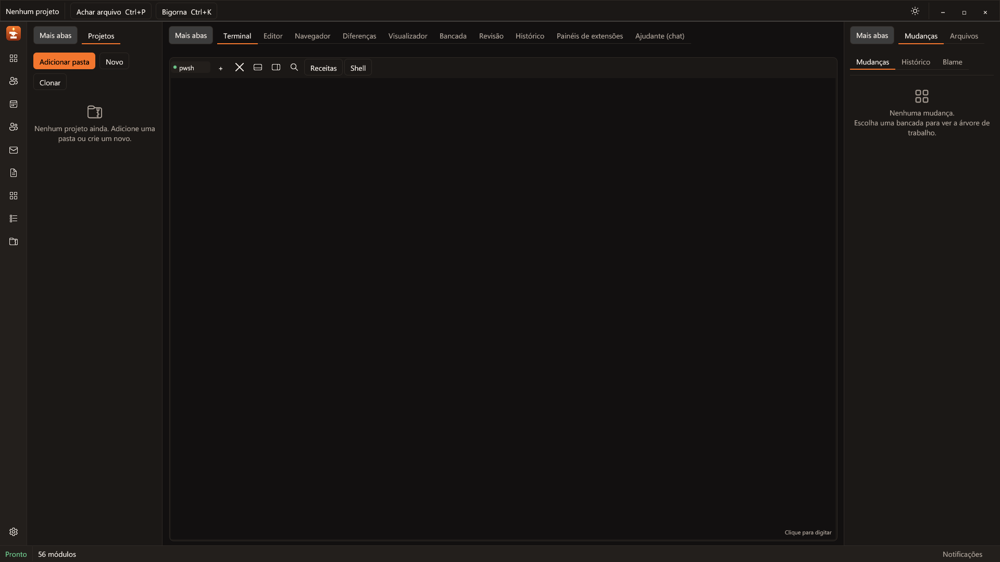

# Tela principal — painel direito "Mudanças" (git.changes)

Tela principal do app com o painel direito aberto na aba "Mudanças" (git), mostrando estado vazio porque nenhuma bancada está selecionada. Variante pt-BR, tema dark, layout "right-tab" com alvo "git.changes" — a estrutura é a da janela principal; o que muda em relação à referência é apenas a aba ativa do painel direito ("Mudanças" em vez da padrão).

## Como chegar
Na janela principal, clique em "Mudanças" na faixa de abas do topo do painel direito (à direita de "Arquivos"). A subaba "Mudanças" já vem selecionada. Comando de captura: `forja-app --locale pt-BR --theme dark --right-tab git.changes` (imagem: `captures/pt-BR.dark.right-tab.git.changes.png`, 1280×800 px, escala 1.0).

## Regiões
- **Barra superior** (0,0)–(1280,42): seletor de projeto "Nenhum projeto", botões "Achar arquivo  Ctrl+P" e "Bigorna  Ctrl+K", e à direita o alternador de tema (ícone de sol) e os botões de janela "–", "□", "×".
- **Trilho à esquerda** (0,42)–(52,768): coluna de ícones de navegação — "Quadro", "Ajudantes", "Rotinas", "Mutirão", "Pedidos", "Skills", "Uso", "Extensões", "Acervo" e, no rodapé, "Ajustes"; o logotipo da Forja (bigorna laranja) no topo.
- **Painel esquerdo** (52,42)–(304,768): abas "Projetos" (ativa, com sublinhado), "Bancadas" e "Painéis de extensões" (cortada); ações "Adicionar pasta" (destaque laranja), "Novo" e "Clonar"; estado vazio com ícone de pasta e o texto "Nenhum projeto ainda. Adicione uma pasta ou crie um novo.".
- **Divisor** (304,42)–(320,768): separador vertical arrastável entre o painel esquerdo e a área central.
- **Área central** (320,42)–(972,768): faixa de abas "Terminal" (ativa), "Editor", "Navegador", "Diferenças", "Visualizador", "Bancada", "Revisão", "Histórico" e "Painéis de extensões" (coberta pelo painel direito); barra do terminal com chip "pwsh" (ponto verde), botão "+", quatro botões de ícone e os chips "Receitas" e "Shell"; abaixo, o terminal vazio com a dica "Clique para digitar" no canto inferior direito.
- **Divisor** (972,42)–(988,768): separador vertical entre a área central e o painel direito.
- **Painel direito** (988,42)–(1280,768): faixa de abas "Arquivos", "Mudanças" (ativa), "Busca", "Portas" (e "Ajudante (chat)" e "Painéis de extensões" na árvore, não renderizadas/fora da janela); subabas "Mudanças" (ativa), "Histórico" e "Blame"; estado vazio com ícone de grade e o texto "Nenhuma mudança. Escolha uma bancada para ver a árvore de trabalho.".
- **Barra de status** (0,768)–(1280,800): "Pronto" em verde à esquerda, "56 módulos" ao lado e "Notificações" à direita.

## Elementos
| Elemento | Tipo | Posição (px) | Estado | O que faz |
|---|---|---|---|---|
| "Achar arquivo  Ctrl+P" | Button | (135,5)–(291,37) | — | Abre a busca rápida de arquivos (atalho Ctrl+P). |
| "Bigorna  Ctrl+K" | Button | (299,5)–(417,37) | — | Abre a paleta de comandos (atalho Ctrl+K). |
| (sem nome acessível) | Unknown | (1101,5)–(1133,37) | — | Ícone de sol: alterna tema claro/escuro. |
| "–" | Button | (1155,5)–(1187,37) | — | Minimiza a janela. |
| "□" | Button | (1195,5)–(1227,37) | — | Maximiza/restaura a janela. |
| "×" | Button | (1235,5)–(1269,37) | — | Fecha a janela. |
| "Nenhum projeto" | Label | (11,12)–(113,31) | — | Indicador do projeto ativo na barra superior (chip clicável). |
| (sem nome acessível) | Unknown | (304,42)–(320,768) | — | Divisor vertical entre painel esquerdo e área central. |
| (sem nome acessível) | Unknown | (972,42)–(988,768) | — | Divisor vertical entre área central e painel direito. |
| (sem nome acessível) | Image | (12,50)–(40,78) | — | Logotipo da Forja (bigorna laranja) no topo do trilho. |
| "Projetos" | Button | (64,50)–(138,82) | marcado=True | Aba ativa do painel esquerdo; mostra a lista de projetos. |
| (sem nome acessível) | Unknown | (64,50)–(300,82) | — | Faixa/contêiner das abas do painel esquerdo. |
| "Bancadas" | Button | (138,50)–(220,82) | marcado=False | Aba que mostraria a lista de bancadas. |
| "Painéis de extensões" | Button | (220,50)–(371,82) | marcado=False | Aba de painéis de extensão; texto cortado na borda do painel. |
| "Terminal" | Button | (324,50)–(401,82) | marcado=True | Aba ativa da área central; mostra o terminal integrado. |
| "Editor" | Button | (401,50)–(461,82) | marcado=False | Aba do editor de arquivos. |
| "Navegador" | Button | (461,50)–(553,82) | marcado=False | Aba do navegador. |
| "Diferenças" | Button | (553,50)–(641,82) | marcado=False | Aba de visualização de difusões. |
| "Visualizador" | Button | (641,50)–(739,82) | marcado=False | Aba do visualizador de arquivos. |
| "Bancada" | Button | (739,50)–(815,82) | marcado=False | Aba da bancada. |
| "Revisão" | Button | (815,50)–(885,82) | marcado=False | Aba de revisão. |
| "Histórico" | Button | (885,50)–(965,82) | marcado=False | Aba de histórico. |
| "Painéis de extensões" | Button | (965,50)–(1115,82) | marcado=False | Aba da faixa central parcialmente coberta pelo painel direito. |
| (sem nome acessível) | Unknown | (992,50)–(1268,82) | — | Faixa/contêiner das abas do painel direito. |
| "Arquivos" | Button | (992,50)–(1070,82) | marcado=False | Aba do painel de arquivos. |
| "Mudanças" | Button | (1070,50)–(1157,82) | marcado=True | Aba ativa do painel direito; mostra as mudanças (git) da bancada. |
| "Ajudante (chat)" | Button | (1115,50)–(1234,82) | marcado=False | Aba do chat do ajudante; não aparece renderizada na imagem. |
| "Busca" | Button | (1157,50)–(1216,82) | marcado=False | Aba de busca. |
| "Portas" | Button | (1216,50)–(1278,82) | marcado=False | Aba de portas. |
| "Painéis de extensões" | Button | (1278,50)–(1429,82) | marcado=False | Aba do painel direito; retângulo vai além da largura da janela. |
| (sem nome acessível) | Unknown | (64,80)–(300,82) | — | Sublinhado da aba ativa "Projetos". |
| (sem nome acessível) | Unknown | (992,80)–(1268,82) | — | Sublinhado da aba ativa "Mudanças" do painel direito. |
| "Quadro" | Button | (8,94)–(44,130) | marcado=False | Ícone do trilho: abre o quadro. |
| "Adicionar pasta" | Button | (64,98)–(183,130) | — | Ação destacada em laranja: adiciona uma pasta de projeto. |
| "Novo" | Button | (191,98)–(248,130) | — | Cria um novo projeto. |
| "Mudanças" | Button | (992,98)–(1079,130) | marcado=True | Subaba ativa do painel de git: lista de mudanças. |
| "Histórico" | Button | (1079,98)–(1158,130) | marcado=False | Subaba de histórico de commits. |
| "Blame" | Button | (1158,98)–(1219,130) | marcado=False | Subaba de blame. |
| "+" | Button | (407,102)–(441,134) | — | Nova instância/aba de terminal. |
| (sem nome acessível) | Unknown | (444,102)–(476,134) | — | Ícone "X": fecha o terminal/painel atual. |
| (sem nome acessível) | Unknown | (479,102)–(511,134) | — | Ícone de retângulo cheio: alterna modo de preenchimento/divisão do painel. |
| (sem nome acessível) | Unknown | (514,102)–(546,134) | — | Ícone de retângulo dividido: divide o terminal. |
| (sem nome acessível) | Unknown | (549,102)–(581,134) | — | Ícone de lupa: busca no terminal. |
| "Receitas" | Button | (584,102)–(658,134) | — | Chip que abre a lista de receitas do terminal. |
| "Shell" | Button | (661,102)–(714,134) | — | Chip para escolher/trocar o shell. |
| (sem nome acessível) | Unknown | (328,107)–(404,129) | — | Chip da sessão "pwsh" com ponto verde (sessão ativa). |
| (sem nome acessível) | Unknown | (385,110)–(401,126) | — | Controle dentro do chip "pwsh" (fechar/indicador). |
| "Ajudantes" | Button | (8,138)–(44,174) | marcado=False | Ícone do trilho: abre a lista de ajudantes. |
| (sem nome acessível) | Unknown | (328,139)–(980,756) | — | Área do terminal, vazia; dica "Clique para digitar" no canto inferior direito. |
| (ícone) | Label | (1116,168)–(1144,196) | — | Ícone de grade (quatro quadrados) do estado vazio do painel direito. |
| "Rotinas" | Button | (8,182)–(44,218) | marcado=False | Ícone do trilho: abre rotinas. |
| (ícone) | Label | (168,198)–(196,226) | — | Ícone de pasta do estado vazio do painel esquerdo. |
| "Nenhuma mudança. Escolha uma bancada para ver a árvore de trabalho." | Label | (1000,204)–(1260,261) | — | Mensagem de estado vazio das mudanças (git). |
| "Mutirão" | Button | (8,226)–(44,262) | marcado=False | Ícone do trilho: abre o mutirão. |
| "Nenhum projeto ainda. Adicione uma pasta ou crie um novo." | Label | (66,234)–(298,272) | — | Mensagem de estado vazio da lista de projetos. |
| "Pedidos" | Button | (8,270)–(44,306) | marcado=False | Ícone do trilho: abre pedidos. |
| "Skills" | Button | (8,314)–(44,350) | marcado=False | Ícone do trilho: abre skills. |
| "Uso" | Button | (8,358)–(44,394) | marcado=False | Ícone do trilho: abre uso. |
| "Extensões" | Button | (8,402)–(44,438) | marcado=False | Ícone do trilho: abre extensões. |
| "Acervo" | Button | (8,446)–(44,482) | marcado=False | Ícone do trilho: abre o acervo. |
| "Ajustes" | Button | (8,724)–(44,760) | marcado=False | Ícone do trilho (rodapé): abre os ajustes. |
| "Pronto" | Label | (10,775)–(51,794) | — | Status geral na barra de status, em verde. |
| "56 módulos" | Label | (73,775)–(146,794) | — | Contador de módulos carregados. |
| "Notificações" | Label | (1170,775)–(1246,794) | — | Abre notificações, à direita da barra de status. |

## Aparência
Tema escuro de fundo marrom-muito-escuro/quase preto em toda a janela, com texto claro. A cor de destaque é o laranja (Brasa), usada no logotipo, no botão "Adicionar pasta", no sublinhado das abas ativas ("Projetos", "Terminal", "Mudanças" e a subaba "Mudanças") e no ponto verde-limão do chip "pwsh" (verde indica sessão ativa). Tipografia sem serifa de ~13 px em rótulos de abas, botões e status; a mensagem de estado vazio do painel direito tem ~13 px em cinza médio, centralizada, com ícone de grade acima. Chips ("pwsh", "Receitas", "Shell") são pequenos retângulos arredondados com borda sutil. Abas inativas ficam em cinza médio sem sublinhado; há ~32 px de altura nas faixas de abas e alinhamento consistente à esquerda nos painéis. O painel central é dominado pela área vazia do terminal (quase toda a região 328–980 × 139–756).

## Problemas encontrados
- "Painéis de extensões" (220,50)–(371,82): texto renderizado é cortado na borda do painel esquerdo ("Painéis de e…") e o retângulo sobrepõe o botão "Terminal" (324,50)–(401,82).
- "Painéis de extensões" (965,50)–(1115,82): aba da faixa central parcialmente coberta pelo painel direito; retângulo sobrepõe "Arquivos" e "Mudanças".
- "Ajudante (chat)" (1115,50)–(1234,82): não está visível na imagem, embora esteja na árvore; seu retângulo sobrepõe "Busca" (1157,50)–(1216,82) e "Portas" (1216,50)–(1278,82).
- "Painéis de extensões" (1278,50)–(1429,82): retângulo vai além da largura da janela (1280 px).
- Botões de janela rotulados apenas com os caracteres "–", "□" e "×" como nome acessível.
- Vários controles sem nome acessível: alternador de tema (1101,5)–(1133,37), os quatro botões de ícone da barra do terminal (444–581), o chip "pwsh", os divisores verticais e a área do terminal.
- A dica "Clique para digitar" (≈884,737–973,749), visível na imagem dentro do terminal, não tem entrada na árvore de acessibilidade.
- Abas e textos inativos em cinza médio sobre fundo escuro (por exemplo "Bancadas", "Navegador", "Histórico" do topo) têm contraste baixo.
