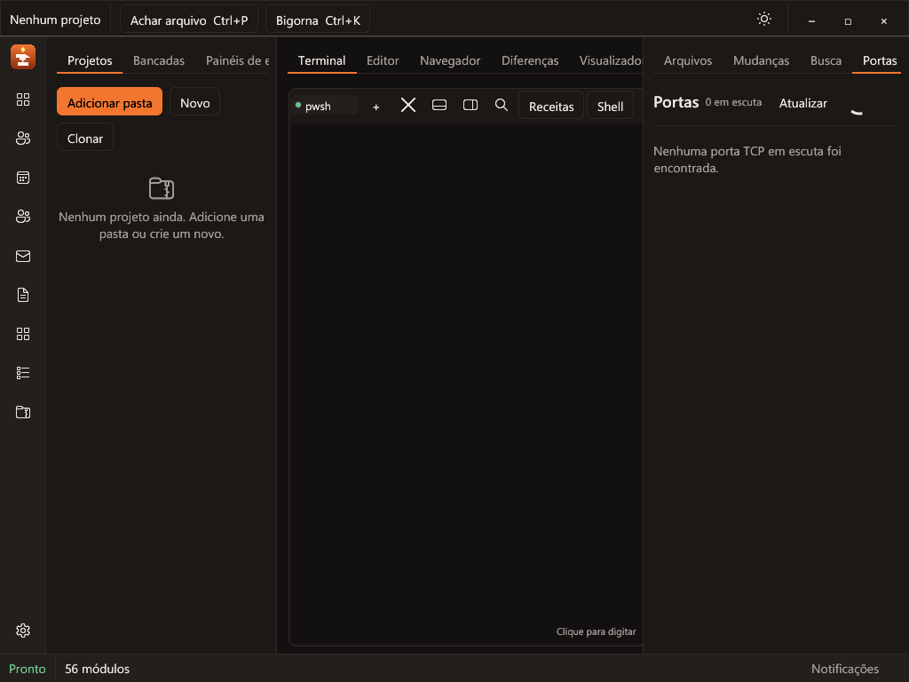

# Painel Portas (aba lateral direita)

Tela do painel "Portas", que lista as portas TCP em escuta detectadas no ambiente de trabalho; nesta captura nenhuma porta foi encontrada.

## Como chegar
Na janela principal do Forja, clique na aba **"Portas"** na linha de abas do painel lateral direito (à direita de **"Busca"**). A captura foi gerada com o comando `forja-app --locale pt-BR --theme dark --right-tab ports.panel`.

## Regiões
- **Barra superior (barra de título)** — (0,0)–(1280,42): rótulo do projeto atual ("Nenhum projeto"), botões "Achar arquivo  Ctrl+P" e "Bigorna  Ctrl+K", botão-ícone de tema (sol) e os controles de janela "–", "□", "×".
- **Trilho à esquerda** — (0,42)–(52,768): logotipo da Forja no topo e botões-ícone verticais "Quadro", "Ajudantes", "Rotinas", "Mutirão", "Pedidos", "Skills", "Uso", "Extensões", "Acervo" e, na base, "Ajustes".
- **Painel lateral esquerdo (Projetos)** — (52,42)–(304,768): abas "Projetos", "Bancadas" e "Painéis de extensões"; botões "Adicionar pasta", "Novo" e "Clonar"; estado vazio com ícone de pasta e o texto "Nenhum projeto ainda. Adicione uma pasta ou crie um novo.".
- **Área central (Terminal)** — (320,42)–(972,768): linha de abas ("Terminal", "Editor", "Navegador", "Diferenças", "Visualizador", "Bancada", "Revisão", "Histórico", "Painéis de extensões"); barra do terminal com o chip "pwsh", "+", ícones de fechar/dividir/sessão/busca e botões "Receitas" e "Shell"; superfície do terminal vazia com o aviso "Clique para digitar" no canto inferior direito.
- **Painel lateral direito (Portas)** — (988,42)–(1280,768): abas "Arquivos", "Mudanças", "Ajudante (chat)", "Busca", "Portas" (ativa) e "Painéis de extensões"; cabeçalho "Portas" com o contador "0 em escuta" e o botão "Atualizar"; mensagem "Nenhuma porta TCP em escuta foi encontrada.".
- **Barra de status** — (0,768)–(1280,800): "Pronto" (tom de destaque), "56 módulos" à esquerda e "Notificações" à direita.

## Elementos
| Elemento | Tipo | Posição (px) | Estado | O que faz |
|---|---|---|---|---|
| "Achar arquivo  Ctrl+P" | Button | (135,5)–(291,37) | click,focus | Abre a busca rápida de arquivos (atalho Ctrl+P). |
| "Bigorna  Ctrl+K" | Button | (299,5)–(417,37) | click,focus | Abre a paleta de comandos "Bigorna" (atalho Ctrl+K). |
| (sem nome acessível) | Unknown | (1101,5)–(1133,37) | click,focus | Botão-ícone de alternância de tema (sol), à esquerda dos controles de janela. |
| "–" | Button | (1155,5)–(1187,37) | click,focus | Minimiza a janela. |
| "□" | Button | (1195,5)–(1227,37) | click,focus | Restaura/maximiza a janela. |
| "×" | Button | (1235,5)–(1269,37) | click,focus | Fecha a janela. |
| "Nenhum projeto" | Label | (11,12)–(113,31) | click,focus | Indica o projeto atual na barra de título; sem projeto aberto. |
| (sem nome acessível) | Unknown | (304,42)–(320,768) | focus | Divisor vertical arrastável entre o painel esquerdo e a área central. |
| (sem nome acessível) | Unknown | (972,42)–(988,768) | focus | Divisor vertical arrastável entre a área central e o painel direito. |
| (sem nome acessível) | Image | (12,50)–(40,78) | click,focus | Logotipo da Forja (bigorna sobre quadrado laranja) no topo do trilho. |
| "Projetos" | Button | (64,50)–(138,82) | click,focus, marcado=True | Aba ativa do painel esquerdo; mostra a lista de projetos. |
| (sem nome acessível) | Unknown | (64,50)–(300,82) | focus | Contêiner da linha de abas do painel esquerdo. |
| "Bancadas" | Button | (138,50)–(220,82) | click,focus, marcado=False | Aba que troca o painel para a lista de bancadas. |
| "Painéis de extensões" | Button | (220,50)–(371,82) | click,focus, marcado=False | Aba que troca o painel para painéis de extensões. |
| "Terminal" | Button | (324,50)–(401,82) | click,focus, marcado=True | Aba ativa da área central; mostra o terminal. |
| "Editor" | Button | (401,50)–(461,82) | click,focus, marcado=False | Aba que troca a área central para o editor. |
| "Navegador" | Button | (461,50)–(553,82) | click,focus, marcado=False | Aba que troca a área central para o navegador de arquivos. |
| "Diferenças" | Button | (553,50)–(641,82) | click,focus, marcado=False | Aba que troca a área central para a visualização de diferenças. |
| "Visualizador" | Button | (641,50)–(739,82) | click,focus, marcado=False | Aba que troca a área central para o visualizador. |
| "Bancada" | Button | (739,50)–(815,82) | click,focus, marcado=False | Aba que troca a área central para a bancada. |
| "Revisão" | Button | (815,50)–(885,82) | click,focus, marcado=False | Aba que troca a área central para a revisão. |
| "Histórico" | Button | (885,50)–(965,82) | click,focus, marcado=False | Aba que troca a área central para o histórico. |
| "Painéis de extensões" | Button | (965,50)–(1115,82) | click,focus, marcado=False | Aba extra da área central; invade o painel direito. |
| (sem nome acessível) | Unknown | (992,50)–(1268,82) | focus | Contêiner da linha de abas do painel direito. |
| "Arquivos" | Button | (992,50)–(1070,82) | click,focus, marcado=False | Aba do painel direito que mostra arquivos. |
| "Mudanças" | Button | (1070,50)–(1157,82) | click,focus, marcado=False | Aba do painel direito que mostra mudanças. |
| "Ajudante (chat)" | Button | (1115,50)–(1234,82) | click,focus, marcado=False | Aba do painel direito que abre o chat do ajudante. |
| "Busca" | Button | (1157,50)–(1216,82) | click,focus, marcado=False | Aba do painel direito que abre a busca. |
| "Portas" | Button | (1216,50)–(1278,82) | click,focus, marcado=True | Aba ativa do painel direito; mostra esta tela de portas em escuta. |
| "Painéis de extensões" | Button | (1278,50)–(1429,82) | click,focus, marcado=False | Última aba do painel direito; fica fora da largura da janela. |
| (sem nome acessível) | Unknown | (64,80)–(300,82) | click,focus | Sublinhado/divisa sob a linha de abas do painel esquerdo. |
| (sem nome acessível) | Unknown | (992,80)–(1268,82) | click,focus | Sublinhado/divisa sob a linha de abas do painel direito. |
| "Quadro" | Button | (8,94)–(44,130) | click,focus, marcado=False | Botão-ícone do trilho que abre o quadro. |
| "Adicionar pasta" | Button | (64,98)–(183,130) | click,focus | Botão primário laranja; abre o seletor para adicionar uma pasta de projeto. |
| "Novo" | Button | (191,98)–(248,130) | click,focus | Cria um novo projeto. |
| "Portas" | Label | (992,98)–(1043,130) | click | Título do painel atual. |
| "0 em escuta" | Label | (1050,98)–(1114,130) | click | Contador de portas TCP detectadas; zero nesta captura. |
| "Atualizar" | Button | (1122,98)–(1200,130) | click,focus | Repete a detecção de portas em escuta; a cada clique aparece um pequeno indicador de giro ao lado. |
| "+" | Button | (407,102)–(441,134) | click,focus | Abre uma nova sessão/aba de terminal. |
| (sem nome acessível) | Unknown | (444,102)–(476,134) | click,focus | Botão-ícone fechar (X) da sessão atual. |
| (sem nome acessível) | Unknown | (479,102)–(511,134) | click,focus | Botão-ícone de dividir o terminal. |
| (sem nome acessível) | Unknown | (514,102)–(546,134) | click,focus | Botão-ícone de sessão/aba (retângulo). |
| (sem nome acessível) | Unknown | (549,102)–(581,134) | click,focus | Botão-ícone de busca no terminal (lupa). |
| "Receitas" | Button | (584,102)–(658,134) | click,focus | Lista de receitas de comandos para o terminal. |
| "Shell" | Button | (661,102)–(714,134) | click,focus | Seletor do shell da sessão. |
| (sem nome acessível) | Unknown | (328,107)–(404,129) | click,focus | Chip da sessão ativa "pwsh", com ponto verde de status. |
| (sem nome acessível) | Unknown | (385,110)–(401,126) | click,focus | Ponto verde de status dentro do chip pwsh. |
| "Ajudantes" | Button | (8,138)–(44,174) | click,focus, marcado=False | Botão-ícone do trilho que abre a lista de ajudantes. |
| "Clonar" | Button | (64,138)–(128,170) | click,focus | Abre o fluxo de clonagem de repositório. |
| (sem nome acessível) | Unknown | (328,139)–(980,756) | click,focus | Superfície do terminal, vazia; clique concentra o cursor ("Clique para digitar"). |
| "Rotinas" | Button | (8,182)–(44,218) | click,focus, marcado=False | Botão-ícone do trilho que abre rotinas. |
| (ícone) | Label | (168,198)–(196,226) | click | Ícone de pasta do estado vazio da lista de projetos. |
| "Mutirão" | Button | (8,226)–(44,262) | click,focus, marcado=False | Botão-ícone do trilho que abre o mutirão. |
| "Nenhum projeto ainda. Adicione uma pasta ou crie um novo." | Label | (66,234)–(298,272) | click | Mensagem de estado vazio da lista de projetos. |
| "Pedidos" | Button | (8,270)–(44,306) | click,focus, marcado=False | Botão-ícone do trilho que abre pedidos. |
| "Skills" | Button | (8,314)–(44,350) | click,focus, marcado=False | Botão-ícone do trilho que abre skills. |
| "Uso" | Button | (8,358)–(44,394) | click,focus, marcado=False | Botão-ícone do trilho que abre o uso de recursos. |
| "Extensões" | Button | (8,402)–(44,438) | click,focus, marcado=False | Botão-ícone do trilho que abre extensões. |
| "Acervo" | Button | (8,446)–(44,482) | click,focus, marcado=False | Botão-ícone do trilho que abre o acervo. |
| "Ajustes" | Button | (8,724)–(44,760) | click,focus, marcado=False | Botão-ícone do trilho que abre os ajustes, fixado na base. |
| "Pronto" | Label | (10,775)–(51,794) | click | Estado geral do app na barra de status. |
| "56 módulos" | Label | (73,775)–(146,794) | click | Quantidade de módulos carregados. |
| "Notificações" | Label | (1170,775)–(1246,794) | click,focus | Área de notificações na barra de status. |

## Aparência
Tema escuro quente: fundo quase preto com tom amarronzado nas barras e painéis, e a área central do terminal mais escura que o restante. Acento laranja ("Brasa") no botão primário "Adicionar pasta", no logotipo e no sublinhado das abas ativas "Projetos", "Terminal" e "Portas"; os botões secundários têm contorno fino e fundo levemente mais claro. Texto em cinza-claro com contraste bom nos rótulos principais; "Pronto" na barra de status aparece em tom alaranjado de destaque. Ponto verde indica a sessão "pwsh" ativa. Tipografia sem serifa de tamanho médio (~13 px) nos botões e rótulos, com atalhos ("Ctrl+P", "Ctrl+K") em tom mais apagado; cantos arredondados moderados em botões e chips; o trilho de ícones tem 36 px de largura útil, alinhado ao centro, e a barra de status é uma faixa fina e contínua na base.

## Problemas encontrados
- A aba "Painéis de extensões" do painel esquerdo (220,50)–(371,82) invade a área central e sobrepõe a aba "Terminal" (324,50)–(401,82).
- A aba "Painéis de extensões" da área central (965,50)–(1115,82) cruza o divisor (972,42)–(988,768) e sobrepõe a aba "Arquivos" do painel direito (992,50)–(1070,82).
- No painel direito, a aba "Ajudante (chat)" (1115,50)–(1234,82) sobrepõe "Mudanças" (1070,50)–(1157,82) e "Busca" (1157,50)–(1216,82).
- A aba "Painéis de extensões" do painel direito (1278,50)–(1429,82) ultrapassa a largura da imagem/janela (1280 px) e fica cortada.
- Botões sem nome acessível: alternância de tema (1101,5)–(1133,37) e os quatro ícones da barra do terminal (fechar, dividir, sessão, busca).
- O chip da sessão "pwsh" (328,107)–(404,129) e seu ponto de status (385,110)–(401,126) não têm nome acessível.
- O rótulo "(ícone)" do estado vazio (168,198)–(196,226) não tem nome acessível significativo.
- "Nenhum projeto" (11,12)–(113,31) e "Notificações" (1170,775)–(1246,794) são Labels, mas expõem ações de clique e foco, papel incoerente com o tipo.
- Três abas aparecem simultaneamente com marcado=True ("Projetos", "Terminal" e "Portas"), o que torna ambíguo qual painel está de fato selecionado.
