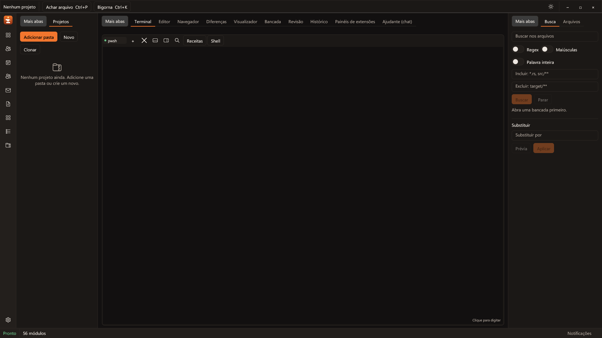

# Painel Busca (painel direito)

Tela de busca e substituição de texto nos arquivos da bancada, exibida como aba do painel direito; com o estado inicial "Nenhum projeto", a busca está desativada até que uma bancada seja aberta.

## Como chegar
Na barra superior, clique em "Achar arquivo Ctrl+P" para localizar arquivos ou use a faixa de abas do painel direito e clique em "Busca" (é a aba marcada). Por linha de comando: `forja-app --locale pt-BR --theme dark --right-tab search.panel`.

## Regiões
- **Barra superior** (0,0)–(1280,42): rótulo de projeto "Nenhum projeto", botões "Achar arquivo Ctrl+P" e "Bigorna Ctrl+K", ícone de tema sem nome à direita e botões de janela "–", "□", "×".
- **Trilho à esquerda** (0,42)–(48,768): logotipo (imagem sem nome em (12,50)–(40,78)) e uma coluna de botões-ícone com rótulo acessível: "Quadro", "Ajudantes", "Rotinas", "Mutirão", "Pedidos", "Skills", "Uso", "Extensões", "Acervo" e, na base, "Ajustes"; nenhum está marcado.
- **Painel lateral esquerdo** (48,42)–(311,768): abas "Projetos" (marcada), "Bancadas" e "Painéis de extensões" (esta truncada na borda); botões "Adicionar pasta", "Novo" e "Clonar"; estado vazio com ícone de pasta e o texto "Nenhum projeto ainda. Adicione uma pasta ou crie um novo."
- **Área central** (311,42)–(981,768): faixa de abas ("Terminal" marcada, "Editor", "Navegador", "Diferenças", "Visualizador", "Bancada", "Revisão", "Histórico", "Painéis de extensões"), barra de ferramentas do terminal (chip "pwsh", botão "+", quatro ícones sem nome, "Receitas", "Shell") e o terminal vazio com a dica "Clique para digitar" no canto inferior direito.
- **Painel direito** (980,42)–(1280,768): abas "Arquivos", "Mudanças", "Busca" (marcada), "Portas" e "Painéis de extensões"; formulário de busca (campo "Buscar nos arquivos", opções "Regex", "Maiúsculas", "Palavra inteira", campos de incluir/excluir, botões "Buscar"/"Parar"), aviso "Abra uma bancada primeiro." e seção "Substituir" (campo "Substituir por", botões "Prévia"/"Aplicar").
- **Barra de status** (0,768)–(1280,800): "Pronto" à esquerda, "56 módulos" e "Notificações" à direita.

## Elementos
| Elemento | Tipo | Posição (px) | Estado | O que faz |
|---|---|---|---|---|
| "Achar arquivo Ctrl+P" | Button | (135,5)–(291,37) | normal | Abre a busca rápida de arquivos pelo atalho Ctrl+P. |
| "Bigorna Ctrl+K" | Button | (299,5)–(417,37) | normal | Abre a paleta de comandos (Bigorna) pelo atalho Ctrl+K. |
| (sem nome acessível) | Unknown | (1101,5)–(1133,37) | normal | Ícone de sol/tema claro na barra superior; alterna o tema pelo clique. |
| "–" | Button | (1155,5)–(1187,37) | normal | Minimiza a janela. |
| "□" | Button | (1195,5)–(1227,37) | normal | Maximiza/restaura a janela. |
| "×" | Button | (1235,5)–(1269,37) | normal | Fecha a janela. |
| "Nenhum projeto" | Label | (11,12)–(113,31) | normal | Indica que nenhum projeto está aberto; clique abre a lista de projetos. |
| (sem nome acessível) | Unknown | (304,42)–(320,768) | normal | Divisor arrastável entre o painel esquerdo e a área central. |
| (sem nome acessível) | Unknown | (972,42)–(988,768) | normal | Divisor arrastável entre a área central e o painel direito. |
| (sem nome acessível) | Image | (12,50)–(40,78) | normal | Logotipo da Forja no topo do trilho esquerdo. |
| "Projetos" | Button | (64,50)–(138,82) | marcado=True | Aba ativa do painel esquerdo: lista de projetos. |
| (sem nome acessível) | Unknown | (64,50)–(300,82) | normal | Faixa contínua sobre as abas do painel esquerdo (sublinhado/fundo da aba ativa). |
| "Bancadas" | Button | (138,50)–(220,82) | marcado=False | Aba de bancadas (branches de trabalho). |
| "Painéis de extensões" | Button | (220,50)–(371,82) | marcado=False | Aba de painéis de extensões; truncada na borda do painel. |
| "Terminal" | Button | (324,50)–(401,82) | marcado=True | Aba ativa da área central: terminal integrado. |
| "Editor" | Button | (401,50)–(461,82) | marcado=False | Aba do editor de arquivos. |
| "Navegador" | Button | (461,50)–(553,82) | marcado=False | Aba do navegador de repositório. |
| "Diferenças" | Button | (553,50)–(641,82) | marcado=False | Aba de comparação de diferenças. |
| "Visualizador" | Button | (641,50)–(739,82) | marcado=False | Aba do visualizador de arquivos. |
| "Bancada" | Button | (739,50)–(815,82) | marcado=False | Aba da visão de bancada. |
| "Revisão" | Button | (815,50)–(885,82) | marcado=False | Aba de revisão. |
| "Histórico" | Button | (885,50)–(965,82) | marcado=False | Aba do histórico de commits. |
| "Painéis de extensões" | Button | (965,50)–(1115,82) | marcado=False | Aba de painéis de extensões da área central; invade a região do painel direito. |
| (sem nome acessível) | Unknown | (992,50)–(1268,82) | normal | Faixa contínua sobre as abas do painel direito (fundo/sublinhado da aba ativa). |
| "Arquivos" | Button | (992,50)–(1070,82) | marcado=False | Aba de árvore de arquivos do painel direito. |
| "Mudanças" | Button | (1070,50)–(1157,82) | marcado=False | Aba de mudanças pendentes. |
| "Ajudante (chat)" | Button | (1115,50)–(1234,82) | marcado=False | Aba do chat do ajudante; retângulo sobrepõe "Busca" e "Portas" e não aparece visível na imagem. |
| "Busca" | Button | (1157,50)–(1216,82) | marcado=True | Aba ativa do painel direito: busca e substituição nos arquivos. |
| "Portas" | Button | (1216,50)–(1278,82) | marcado=False | Aba de portas/serviços em escuta. |
| "Painéis de extensões" | Button | (1278,50)–(1429,82) | marcado=False | Aba de painéis de extensões do painel direito; retângulo além da largura da janela (1280 px). |
| (sem nome acessível) | Unknown | (64,80)–(300,82) | normal | Linha de sublinhado da aba ativa do painel esquerdo. |
| (sem nome acessível) | Unknown | (992,80)–(1268,82) | normal | Linha de sublinhado da aba ativa do painel direito. |
| "Quadro" | Button | (8,94)–(44,130) | marcado=False | Botão-ícone do trilho: abre o quadro (kanban). |
| "Adicionar pasta" | Button | (64,98)–(183,130) | normal | Botão em destaque laranja: adiciona uma pasta de projeto. |
| "Novo" | Button | (191,98)–(248,130) | normal | Cria um projeto novo. |
| (sem nome acessível) | TextInput | (992,98)–(1268,130) | normal | Campo "Buscar nos arquivos" (texto-placeholder visível); sem nome acessível. |
| "+" | Button | (407,102)–(441,134) | normal | Abre nova aba/sessão de terminal. |
| (sem nome acessível) | Unknown | (444,102)–(476,134) | normal | Ícone de fechar sessão (X) na barra do terminal. |
| (sem nome acessível) | Unknown | (479,102)–(511,134) | normal | Ícone de dividir terminal. |
| (sem nome acessível) | Unknown | (514,102)–(546,134) | normal | Ícone de copiar/limpar do terminal. |
| (sem nome acessível) | Unknown | (549,102)–(581,134) | normal | Ícone de lupa (busca no terminal). |
| "Receitas" | Button | (584,102)–(658,134) | normal | Abre a lista de receitas de terminal. |
| "Shell" | Button | (661,102)–(714,134) | normal | Seletor do shell da sessão (pwsh). |
| (sem nome acessível) | Unknown | (328,107)–(404,129) | normal | Chip da sessão "pwsh" com indicador verde de sessão ativa. |
| (sem nome acessível) | Unknown | (385,110)–(401,126) | normal | Indicador verde de estado dentro do chip "pwsh". |
| "Ajudantes" | Button | (8,138)–(44,174) | marcado=False | Botão-ícone do trilho: lista de ajudantes de código. |
| "Clonar" | Button | (64,138)–(128,170) | normal | Clona um repositório como novo projeto. |
| (sem nome acessível) | Unknown | (328,139)–(980,756) | normal | Área do terminal (viewport da sessão pwsh), vazia. |
| "Regex" | CheckBox | (992,142)–(1077,166) | marcado=False | Interpreta o termo buscado como expressão regular. |
| "Maiúsculas" | CheckBox | (1085,142)–(1200,166) | marcado=False | Diferencia maiúsculas de minúsculas na busca. |
| "Rotinas" | Button | (8,182)–(44,218) | marcado=False | Botão-ícone do trilho: rotinas/tarefas. |
| "Palavra inteira" | CheckBox | (992,182)–(1126,206) | marcado=False | Casa apenas palavras inteiras. |
| (ícone) | Label | (168,198)–(196,226) | normal | Ícone de pasta do estado vazio do painel de projetos. |
| (sem nome acessível) | TextInput | (992,218)–(1268,250) | normal | Padrões de inclusão, com placeholder "Incluir: *.rs, src/**"; sem nome acessível. |
| "Mutirão" | Button | (8,226)–(44,262) | marcado=False | Botão-ícone do trilho: mutirão (execução em vários projetos). |
| "Nenhum projeto ainda. Adicione uma pasta ou crie um novo." | Label | (66,234)–(298,272) | normal | Mensagem de estado vazio do painel de projetos. |
| (sem nome acessível) | TextInput | (992,258)–(1268,290) | normal | Padrões de exclusão, com placeholder "Excluir: target/**"; sem nome acessível. |
| "Pedidos" | Button | (8,270)–(44,306) | marcado=False | Botão-ícone do trilho: pedidos (solicitações ao ajudante). |
| "Buscar" | Button | (992,298)–(1056,330) | desativado | Inicia a busca; desativado porque não há bancada aberta. |
| "Parar" | Button | (1064,298)–(1120,330) | desativado | Interrompe a busca em andamento; desativado. |
| "Skills" | Button | (8,314)–(44,350) | marcado=False | Botão-ícone do trilho: skills dos ajudantes. |
| "Abra uma bancada primeiro." | Label | (992,338)–(1167,357) | normal | Explica por que a busca está indisponível. |
| "Uso" | Button | (8,358)–(44,394) | marcado=False | Botão-ícone do trilho: uso de recursos. |
| "Substituir" | Label | (992,387)–(1050,406) | normal | Título da seção de substituição. |
| "Extensões" | Button | (8,402)–(44,438) | marcado=False | Botão-ícone do trilho: extensões instaladas. |
| (sem nome acessível) | TextInput | (992,414)–(1268,446) | normal | Campo de substituição, com placeholder "Substituir por"; sem nome acessível. |
| "Acervo" | Button | (8,446)–(44,482) | marcado=False | Botão-ícone do trilho: acervo de conteúdo. |
| "Prévia" | Button | (992,454)–(1053,486) | desativado | Mostra a prévia das substituições; desativado. |
| "Aplicar" | Button | (1061,454)–(1127,486) | desativado | Aplica as substituições; desativado. |
| "Ajustes" | Button | (8,724)–(44,760) | marcado=False | Botão-ícone do trilho, na base: abre os ajustes. |
| "Pronto" | Label | (10,775)–(51,794) | normal | Estado geral na barra de status. |
| "56 módulos" | Label | (73,775)–(146,794) | normal | Quantidade de módulos carregados. |
| "Notificações" | Label | (1170,775)–(1246,794) | normal | Abre o centro de notificações. |

## Aparência
Tema escuro: fundo geral quase preto (varia entre #0d0d0d nas faixas de abas/trilho e #161616 nos painéis), com bordas discretas em cinza-escuro. Acento laranja (Brasa) usado no sublinhado das abas ativas ("Projetos", "Terminal", "Busca"), no botão "Adicionar pasta", no botão "Aplicar" (com tom mais apagado por estar desativado) e no logotipo. Texto em cinza claro (#e6e6e6) para itens ativos e cinza médio (#9a9a9a) para inativos e placeholders; rótulo "Pronto" na barra de status em verde suave. Tipografia sans-serif de tamanho uniforme (~13–14 px), sem hierarquia forte além das abas. Espaçamento consistente: 8 px entre botões do formulário, campos de texto com ~32 px de altura e cantos levemente arredondados; os três painéis dividem a janela com divisores de 16 px entre eles.

## Problemas encontrados
- A aba "Painéis de extensões" do painel esquerdo (220,50)–(371,82) ultrapassa a borda do painel, invade a área central e sobrepõe a aba "Terminal" (324,50)–(401,82); na imagem o texto aparece truncado ("Painéis de e...").
- A aba "Painéis de extensões" do painel direito (1278,50)–(1429,82) tem retângulo além da largura da janela (1280 px): fica fora da área visível.
- A aba "Ajudante (chat)" (1115,50)–(1234,82) sobrepõe as abas "Busca" (1157,50)–(1216,82) e "Portas" (1216,50)–(1278,82) na árvore de acessibilidade, embora não apareça desenhada na imagem.
- Há elementos Unknown sobrepostos às faixas de abas ((64,50)–(300,82) e (992,50)–(1268,82)), o que pode atrapalhar a navegação por acessibilidade.
- Os quatro campos de texto do painel Busca e os quatro botões-ícone da barra do terminal não têm nome acessível; só são identificáveis pelo placeholder ou pela aparência.
- O ícone de tema na barra superior (1101,5)–(1133,37) é um elemento Unknown sem nome acessível.
- O chip "pwsh" (328,107)–(404,129) contém um segundo elemento Unknown sobreposto (385,110)–(401,126), duplicando a região na árvore.
- Botões "Buscar", "Parar", "Prévia" e "Aplicar" estão desativados sem indicador visual de tooltip explicativo; a razão só aparece no texto "Abra uma bancada primeiro." abaixo dos botões.
