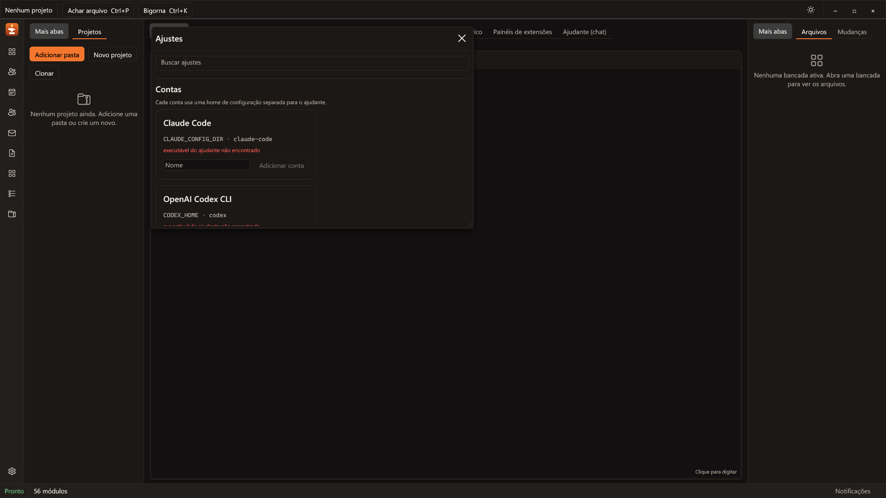

# Ajustes — Contas

Janela modal de configurações aberta na seção "Contas", onde se registram os ajudantes de código (agentes de IA) usados nos projetos.

## Como chegar
No app: clicar no botão "Ajustes" (ícone de engrenagem no rodapé do trilho à esquerda) e abrir a seção "Contas". Comando de captura: `forja-app --locale pt-BR --theme dark --settings accounts`.

## Regiões
- **Barra superior (0,0)–(1280,42):** rótulo "Nenhum projeto", botões "Achar arquivo  Ctrl+P" e "Bigorna  Ctrl+K", alternador de tema (ícone de sol) e os botões de janela "–", "□", "×".
- **Trilho à esquerda (0,42)–(48,768):** logo do app (12,50)–(40,78) e uma coluna de ícones: "Quadro", "Ajudantes", "Rotinas", "Mutirão", "Pedidos", "Skills", "Uso", "Extensões", "Acervo" e, no rodapé, "Ajustes".
- **Painel esquerdo (48,42)–(304,768):** abas "Projetos" (ativa), "Bancadas" e "Painéis de extensões"; botões "Adicionar pasta", "Novo" e "Clonar"; estado vazio com ícone de pasta aberta e o texto "Nenhum projeto ainda. Adicione uma pasta ou crie um novo.".
- **Área central (304,42)–(988,768):** sua barra de abas ("Terminal" ativa, "Editor", "Navegador", "Diferenças", "Visualizador", "Bancada", "Revisão", "Histórico", "Painéis de extensões") e uma barra de ferramentas ("+", "Receitas", "Shell") ficam em grande parte cobertas pelo modal "Ajustes" (328,58)–(1026,571); abaixo do modal há um campo de texto com a dica "Clique para digitar" no canto inferior direito.
- **Separadores verticais:** faixas estreitas em (304,42)–(320,768) e (972,42)–(988,768) dividem painel esquerdo, área central e painel direito.
- **Painel direito (988,42)–(1280,768):** abas "Arquivos" (ativa, parcialmente coberta pelo modal), "Mudanças", "Busca", "Portas"; estado vazio com ícone de grade e o texto "Nenhuma bancada ativa. Abra uma bancada para ver os arquivos.".
- **Barra de status (0,768)–(1280,800):** "Pronto", "56 módulos" à esquerda e "Notificações" à direita.

## Elementos
| Elemento | Tipo | Posição (px) | Estado | O que faz |
|---|---|---|---|---|
| "Achar arquivo  Ctrl+P" | Button | (135,5)–(291,37) | normal | Abre a busca de arquivos do projeto (atalho Ctrl+P). |
| "Bigorna  Ctrl+K" | Button | (299,5)–(417,37) | normal | Abre a paleta de comandos (atalho Ctrl+K). |
| Ícone de sol, sem nome acessível | Desconhecido | (1101,5)–(1133,37) | normal | Alterna o tema (claro/escuro). |
| "–" | Button | (1155,5)–(1187,37) | normal | Minimiza a janela. |
| "□" | Button | (1195,5)–(1227,37) | normal | Maximiza/restaura a janela. |
| "×" | Button | (1235,5)–(1269,37) | normal | Fecha a janela. |
| "Nenhum projeto" | Label | (11,12)–(113,31) | normal | Mostra o projeto atualmente aberto (nenhum). |
| Sem nome acessível | Desconhecido | (304,42)–(320,768) | focável | Separador arrastável entre painel esquerdo e área central. |
| Sem nome acessível | Desconhecido | (972,42)–(988,768) | focável | Separador arrastável entre área central e painel direito. |
| Sem nome acessível | Desconhecido | (319,49)–(339,69) | focável | Alça de redimensionamento (canto superior esquerdo do modal). |
| Sem nome acessível | Desconhecido | (1016,49)–(1036,69) | focável | Alça de redimensionamento (canto superior direito do modal). |
| Logo do app, sem nome acessível | Image | (12,50)–(40,78) | clicável, focável | Marca visual da Forja no topo do trilho. |
| "Projetos" | Button | (64,50)–(138,82) | marcado=True | Aba ativa do painel esquerdo; mostra a lista de projetos. |
| Sem nome acessível | Desconhecido | (64,50)–(300,82) | focável | Faixa de fundo/marcação da aba ativa no painel esquerdo. |
| "Bancadas" | Button | (138,50)–(220,82) | normal | Aba que lista as bancadas (branches de trabalho). |
| "Painéis de extensões" | Button | (220,50)–(371,82) | normal | Aba de painéis de extensões; texto visível cortado pelo modal. |
| "Terminal" | Button | (324,50)–(401,82) | marcado=True | Aba ativa da área central; coberta pelo modal. |
| "Editor" | Button | (401,50)–(461,82) | normal | Aba do editor; coberta pelo modal. |
| "Navegador" | Button | (461,50)–(553,82) | normal | Aba do navegador; coberta pelo modal. |
| "Diferenças" | Button | (553,50)–(641,82) | normal | Aba de diferenças; coberta pelo modal. |
| "Visualizador" | Button | (641,50)–(739,82) | normal | Aba do visualizador; coberta pelo modal. |
| "Bancada" | Button | (739,50)–(815,82) | normal | Aba da bancada; coberta pelo modal. |
| "Revisão" | Button | (815,50)–(885,82) | normal | Aba de revisão; coberta pelo modal. |
| "Histórico" | Button | (885,50)–(965,82) | normal | Aba de histórico; coberta pelo modal. |
| "Painéis de extensões" | Button | (965,50)–(1115,82) | normal | Aba de painéis de extensões da área central; em parte coberta pelo modal e sobreposta às abas do painel direito. |
| Sem nome acessível | Desconhecido | (992,50)–(1268,82) | focável | Faixa de fundo/marcação da barra de abas do painel direito. |
| "Arquivos" | Button | (992,50)–(1070,82) | marcado=True | Aba ativa do painel direito; lista de arquivos da bancada ("uivos" visível, início coberto pelo modal). |
| "Mudanças" | Button | (1070,50)–(1157,82) | normal | Aba de mudanças da bancada. |
| "Ajudante (chat)" | Button | (1115,50)–(1234,82) | normal | Aba do chat do ajudante; retângulo sobreposto ao de "Mudanças". |
| "Busca" | Button | (1157,50)–(1216,82) | normal | Aba de busca. |
| "Portas" | Button | (1216,50)–(1278,82) | normal | Aba de portas (servidores/portas em uso). |
| "Painéis de extensões" | Button | (1278,50)–(1429,82) | normal | Aba de painéis de extensões do painel direito; fica além da borda direita da imagem. |
| Sem nome acessível | Desconhecido | (339,51)–(1016,67) | focável | Faixa de arraste do título do modal. |
| "Ajustes" | Window | (328,58)–(1026,571) | focada | Janela modal de configurações sobreposta à área de trabalho. |
| Sem nome acessível | Desconhecido | (361,59)–(993,107) | clicável, focável | Cabeçalho interno do modal (título e campo de busca). |
| Sem nome acessível | Desconhecido | (321,69)–(337,561) | focável | Borda esquerda redimensionável do modal. |
| Sem nome acessível | Desconhecido | (1018,69)–(1034,561) | focável | Borda direita redimensionável do modal. |
| "Close window" | Button | (994,76)–(1008,90) | normal | Ícone "×" que fecha o modal (nome acessível em inglês). |
| Sem nome acessível | Desconhecido | (64,80)–(300,82) | clicável, focável | Sublinhado laranja da aba ativa "Projetos". |
| Sem nome acessível | Desconhecido | (992,80)–(1268,82) | clicável, focável | Sublinhado da aba ativa do painel direito ("Arquivos"). |
| "Quadro" | Button | (8,94)–(44,130) | não marcado | Ícone do quadro (visão geral). |
| "Adicionar pasta" | Button | (64,98)–(183,130) | normal | Botão destacado em laranja para adicionar uma pasta de projeto. |
| "Novo" | Button | (191,98)–(248,130) | normal | Cria um novo projeto. |
| "+" | Button | (407,102)–(441,134) | normal | Botão "+" da barra de ferramentas central; coberto pelo modal. |
| Sem nome acessível | Desconhecido | (444,102)–(476,134) | clicável, focável | Ícone de ferramenta da barra central; coberto pelo modal. |
| Sem nome acessível | Desconhecido | (479,102)–(511,134) | clicável, focável | Ícone de ferramenta da barra central; coberto pelo modal. |
| Sem nome acessível | Desconhecido | (514,102)–(546,134) | clicável, focável | Ícone de ferramenta da barra central; coberto pelo modal. |
| Sem nome acessível | Desconhecido | (549,102)–(581,134) | clicável, focável | Ícone de ferramenta da barra central; coberto pelo modal. |
| "Receitas" | Button | (584,102)–(658,134) | normal | Abre receitas; coberto pelo modal. |
| "Shell" | Button | (661,102)–(714,134) | normal | Abre o shell; coberto pelo modal. |
| Sem nome acessível | Desconhecido | (328,107)–(404,129) | clicável, focável | Área à esquerda do campo de busca, dentro do modal. |
| Sem nome acessível | Desconhecido | (385,110)–(401,126) | focável | Pequeno elemento dentro do campo de busca (possível ícone). |
| Ícone de grade, rotulado "(ícone)" | Label | (1116,114)–(1144,142) | clicável | Ilustração do estado vazio do painel direito. |
| Sem nome acessível | TextInput | (337,116)–(1017,148) | clicável, focável | Campo de busca de ajustes (placeholder "Buscar ajustes"). |
| "Ajudantes" | Button | (8,138)–(44,174) | não marcado | Ícone da seção de ajudantes no trilho. |
| "Clonar" | Button | (64,138)–(128,170) | normal | Clona um projeto existente. |
| Sem nome acessível | Desconhecido | (328,139)–(980,756) | clicável, focável | Área de texto central atrás/abaixo do modal, com a dica "Clique para digitar" no canto inferior direito. |
| "Nenhuma bancada ativa. Abra uma bancada para ver os arquivos." | Label | (994,150)–(1266,188) | clicável | Mensagem de estado vazio do painel de arquivos. |
| "Contas" | Label | (337,176)–(393,200) | clicável | Título da seção de contas exibida no modal. |
| "Rotinas" | Button | (8,182)–(44,218) | não marcado | Ícone da seção de rotinas no trilho. |
| "Cada conta usa uma home de configuração separada para o ajudante." | Label | (337,208)–(707,224) | clicável | Explicação da seção: cada conta tem sua própria home de configuração. |
| "Mutirão" | Button | (8,226)–(44,262) | não marcado | Ícone da seção "Mutirão" no trilho. |
| "Nenhum projeto ainda. Adicione uma pasta ou crie um novo." | Label | (66,234)–(298,272) | clicável | Mensagem de estado vazio do painel de projetos. |
| "Claude Code" | Label | (354,249)–(458,273) | clicável | Nome do primeiro cartão de conta (ajudante Claude Code). |
| "Pedidos" | Button | (8,270)–(44,306) | não marcado | Ícone da seção de pedidos no trilho. |
| "CLAUDE_CONFIG_DIR · claude-code" | Label | (354,289)–(590,304) | clicável | Variável de configuração e identificador da conta Claude Code, em fonte mono. |
| "executável do ajudante não encontrado" | Label | (354,312)–(563,328) | clicável | Aviso em vermelho: o executável do Claude Code não foi localizado. |
| "Skills" | Button | (8,314)–(44,350) | não marcado | Ícone da seção de skills no trilho. |
| "Adicionar conta" | Button | (550,336)–(670,368) | desativado | Adicionaria uma conta Claude Code; desativado até preencher o nome. |
| Sem nome acessível | TextInput | (354,341)–(542,364) | clicável, focável | Campo "Nome" da conta Claude Code. |
| "Uso" | Button | (8,358)–(44,394) | não marcado | Ícone da seção de uso no trilho. |
| "Extensões" | Button | (8,402)–(44,438) | não marcado | Ícone da seção de extensões no trilho. |
| "OpenAI Codex CLI" | Label | (354,414)–(502,438) | clicável | Nome do segundo cartão de conta (ajudante OpenAI Codex CLI). |
| "Acervo" | Button | (8,446)–(44,482) | não marcado | Ícone da seção de acervo no trilho. |
| "CODEX_HOME · codex" | Label | (354,454)–(491,469) | clicável | Variável de configuração e identificador da conta Codex, em fonte mono. |
| "executável do ajudante não encontrado" | Label | (354,477)–(563,493) | clicável | Aviso em vermelho: o executável do Codex não foi localizado. |
| "Adicionar conta" | Button | (550,501)–(670,533) | desativado | Adicionaria uma conta OpenAI Codex CLI; desativado até preencher o nome. |
| Sem nome acessível | TextInput | (354,506)–(542,529) | clicável, focável | Campo "Nome" da conta OpenAI Codex CLI. |
| Sem nome acessível | Desconhecido | (319,561)–(339,581) | focável | Alça de redimensionamento (canto inferior esquerdo do modal). |
| Sem nome acessível | Desconhecido | (1016,561)–(1036,581) | focável | Alça de redimensionamento (canto inferior direito do modal). |
| Sem nome acessível | Desconhecido | (339,563)–(1016,579) | focável | Borda inferior redimensionável do modal. |
| "Ajustes" | Button | (8,724)–(44,760) | não marcado | Ícone de engrenagem que abre esta tela de ajustes. |
| "Pronto" | Label | (10,775)–(51,794) | clicável | Status geral do app, em verde. |
| "56 módulos" | Label | (73,775)–(146,794) | clicável | Quantidade de módulos carregados. |
| "Notificações" | Label | (1170,775)–(1246,794) | clicável, focável | Abre o painel de notificações. |

## Aparência
Tema escuro: fundo geral cinza muito escuro, modal com fundo levemente mais claro, borda sutil e cantos arredondados. A cor de destaque é o laranja/âmbar: o botão "Adicionar pasta" é preenchido em laranja com texto escuro, e as abas ativas ("Projetos", "Terminal", "Arquivos") têm sublinhado laranja. Textos em cinza claro sobre fundo escuro, com bons contrastes nos títulos ("Contas", "Claude Code", "OpenAI Codex CLI" em peso maior). Mensagens de erro ("executável do ajudante não encontrado") em vermelho salmão; "Pronto" na barra de status em verde. Identificadores como "CLAUDE_CONFIG_DIR · claude-code" e "CODEX_HOME · codex" usam fonte monoespaçada, com a variável em cinza apagado e o identificador em cinza mais claro. Os cartões das contas são caixas com borda sutil, separadas por bom espaçamento vertical; campos de texto escuros com borda fina e placeholders apagados. Botões desativados ("Adicionar conta") aparecem com texto esmaecido.

## Problemas encontrados
- O botão "Painéis de extensões" do painel direito tem retângulo (1278,50)–(1429,82) além da largura da imagem (1280 px): fica cortado/fora da janela visível.
- O modal "Ajustes" (328,58)–(1026,571) se sobrepõe às barras de abas (y 50–82) e à barra de ferramentas central, escondendo os botões "+", "Receitas", "Shell" e as abas "Terminal" a "Painéis de extensões", além do início da aba "Arquivos".
- O texto da aba "Painéis de extensões" do painel esquerdo aparece cortado ("Painéis de e") por causa dessa sobreposição.
- Retângulos de abas se sobrepõem entre si: "Painéis de extensões" central (965–1115) cruza "Arquivos" (992–1070) e "Ajudante (chat)" (1115–1234); "Mudanças" (1070–1157) também cruza "Ajudante (chat)".
- A área central sem nome (328,139)–(980,756) se sobrepõe ao retângulo do modal "Ajustes".
- O botão de fechar do modal tem nome acessível em inglês, "Close window", em uma interface em pt-BR.
- Os campos de busca de ajustes e os dois campos "Nome" são TextInput sem nome acessível; o rótulo visível é apenas o placeholder.
- O botão "Achar arquivo  Ctrl+P" tem dois espaços entre o rótulo e o atalho.
- Vários elementos da barra central e do modal são ícones sem nome acessível (incluindo o alternador de tema na barra superior), o que prejudica leitores de tela.
