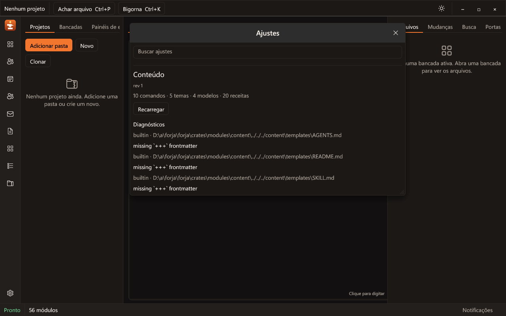

# Ajustes (janela modal "Conteúdo")

Janela modal de configurações da Forja, aberta sobre a tela principal, mostrando a seção "Conteúdo" com o resumo do acervo embutido e os diagnósticos dos modelos de conteúdo.

## Como chegar
Na tela principal, clique no botão "Ajustes" (ícone de engrenagem) na base do trilho à esquerda (8,724)–(44,760); a janela "Ajustes" abre centralizada sobre a área central. Comando de captura: `forja-app --locale pt-BR --theme dark --settings content`.

## Regiões
- **Barra superior** (0,0)–(1280,42): pílula "Nenhum projeto" à esquerda, botões "Achar arquivo  Ctrl+P" e "Bigorna  Ctrl+K", ícone de tema (sol) e os botões de janela "–", "□", "×" à direita.
- **Trilho à esquerda** (0,42)–(52,768): logotipo laranja no topo (12,50)–(40,78) e coluna de botões-ícone ("Quadro", "Ajudantes", "Rotinas", "Mutirão", "Pedidos", "Skills", "Uso", "Extensões", "Acervo" e, na base, "Ajustes"), com nomes acessíveis mas sem rótulo visível.
- **Painel esquerdo (Projetos)** (52,42)–(304,768): faixa de abas com "Projetos" (marcada, com sublinhado laranja), "Bancadas" e "Painéis de extensões" (cortado), botões "Adicionar pasta" (laranja), "Novo" e "Clonar", ícone de pasta e o texto "Nenhum projeto ainda. Adicione uma pasta ou crie um novo.".
- **Divisores** (304,42)–(320,768) e (972,42)–(988,768): separadores arrastáveis entre os painéis.
- **Área central** (320,42)–(972,768): faixa de abas no topo ("Terminal", "Editor", "Navegador", "Diferenças", "Visualizador", "Bancada", "Revisão", "Histórico", "Painéis de extensões") e um grande painel de terminal vazio (328,139)–(980,756) com o aviso "Clique para digitar" no canto inferior direito; a maior parte fica encoberta pela janela "Ajustes".
- **Janela modal "Ajustes"** (328,58)–(1026,495): barra de título com o rótulo central "Ajustes" e o botão "Close window" (×) à direita, campo de busca "Buscar ajustes", título "Conteúdo", contagem "rev 1" e "10 comandos · 5 temas · 4 modelos · 20 receitas", botão "Recarregar" e a seção "Diagnósticos" com pares de caminho/mensagem.
- **Painel direito (Arquivos)** (988,42)–(1280,768): abas "Arquivos" (marcada, parcialmente encoberta pela modal), "Mudanças", "Busca", "Portas" e outra "Painéis de extensões" (além da borda da janela); abaixo, ícone de grade e o texto "Nenhuma bancada ativa. Abra uma bancada para ver os arquivos.".
- **Barra de status** (0,768)–(1280,800): "Pronto" em verde, "56 módulos" à esquerda e "Notificações" à direita.

## Elementos
| Elemento | Tipo | Posição (px) | Estado | O que faz |
|---|---|---|---|---|
| "Nenhum projeto" | Label | (11,12)–(113,31) | — | Indica que não há projeto aberto; clicável. |
| "Achar arquivo  Ctrl+P" | Button | (135,5)–(291,37) | — | Abre a busca rápida de arquivos (atalho Ctrl+P). |
| "Bigorna  Ctrl+K" | Button | (299,5)–(417,37) | — | Abre a paleta de comandos (atalho Ctrl+K). |
| (sem nome acessível) | Unknown | (1101,5)–(1133,37) | — | Ícone de sol para alternar o tema, no canto superior direito. |
| "–" | Button | (1155,5)–(1187,37) | — | Minimiza a janela. |
| "□" | Button | (1195,5)–(1227,37) | — | Maximiza/restaura a janela. |
| "×" | Button | (1235,5)–(1269,37) | — | Fecha a janela do app. |
| (sem nome acessível) | Image | (12,50)–(40,78) | — | Logotipo da Forja no topo do trilho. |
| "Projetos" | Button | (64,50)–(138,82) | marcado=True | Aba ativa do painel esquerdo, com sublinhado laranja. |
| (sem nome acessível) | Unknown | (64,50)–(300,82) | — | Contêiner da faixa de abas do painel esquerdo. |
| "Bancadas" | Button | (138,50)–(220,82) | marcado=False | Aba de bancadas (branches de trabalho). |
| "Painéis de extensões" | Button | (220,50)–(371,82) | marcado=False | Aba de painéis de extensões; o texto aparece cortado na borda do painel. |
| "Terminal" | Button | (324,50)–(401,82) | marcado=True | Aba do terminal na faixa central; encoberta pela modal. |
| "Editor" | Button | (401,50)–(461,82) | marcado=False | Aba do editor; encoberta pela modal. |
| "Navegador" | Button | (461,50)–(553,82) | marcado=False | Aba do navegador de arquivos; encoberta pela modal. |
| "Diferenças" | Button | (553,50)–(641,82) | marcado=False | Aba de difusão (diff); encoberta pela modal. |
| "Visualizador" | Button | (641,50)–(739,82) | marcado=False | Aba do visualizador; encoberta pela modal. |
| "Bancada" | Button | (739,50)–(815,82) | marcado=False | Aba da bancada; encoberta pela modal. |
| "Revisão" | Button | (815,50)–(885,82) | marcado=False | Aba de revisão; encoberta pela modal. |
| "Histórico" | Button | (885,50)–(965,82) | marcado=False | Aba de histórico; encoberta pela modal. |
| "Painéis de extensões" | Button | (965,50)–(1115,82) | marcado=False | Segunda aba de painéis de extensões, na faixa que se estende à direita. |
| (sem nome acessível) | Unknown | (992,50)–(1268,82) | — | Contêiner da faixa de abas do lado direito. |
| "Arquivos" | Button | (992,50)–(1070,82) | marcado=True | Aba ativa do painel direito; aparece cortada ("…uivos") pela borda da modal. |
| "Mudanças" | Button | (1070,50)–(1157,82) | marcado=False | Aba de mudanças do projeto. |
| "Ajudante (chat)" | Button | (1115,50)–(1234,82) | marcado=False | Aba do chat do ajudante; retângulo se sobrepõe ao de "Busca". |
| "Busca" | Button | (1157,50)–(1216,82) | marcado=False | Aba de busca. |
| "Portas" | Button | (1216,50)–(1278,82) | marcado=False | Aba de portas (serviços/terminais em escuta). |
| "Painéis de extensões" | Button | (1278,50)–(1429,82) | marcado=False | Terceira aba de painéis de extensões; o retângulo passa da largura da janela. |
| (sem nome acessível) | Unknown | (339,51)–(1016,67) | — | Faixa superior da área central (borda/rolagem da faixa de abas). |
| "Ajustes" | Window | (328,58)–(1026,495) | foco | Janela modal de configurações em primeiro plano. |
| (sem nome acessível) | Unknown | (361,59)–(993,107) | — | Barra de título da modal, arrastável, com o rótulo "Ajustes" centralizado. |
| (sem nome acessível) | Unknown | (321,69)–(337,485) | — | Borda esquerda da modal (redimensionar). |
| (sem nome acessível) | Unknown | (1018,69)–(1034,485) | — | Borda direita da modal (redimensionar). |
| "Close window" | Button | (994,76)–(1008,90) | — | Ícone × que fecha a janela de ajustes; nome em inglês. |
| (sem nome acessível) | Unknown | (64,80)–(300,82) | — | Linha do sublinhado indicador da aba ativa à esquerda. |
| (sem nome acessível) | Unknown | (992,80)–(1268,82) | — | Linha do sublinhado indicador da aba ativa à direita. |
| "Quadro" | Button | (8,94)–(44,130) | marcado=False | Botão-ícone do quadro geral (kanban) no trilho. |
| "Adicionar pasta" | Button | (64,98)–(183,130) | — | Adiciona uma pasta de projeto ao acervo; destaque laranja. |
| "Novo" | Button | (191,98)–(248,130) | — | Cria um novo projeto. |
| "+" | Button | (407,102)–(441,134) | — | Abre novo terminal (na faixa central, sob a modal). |
| (sem nome acessível) | Unknown | (444,102)–(476,134) | — | Botão-ícone da faixa de terminais, sem rótulo. |
| (sem nome acessível) | Unknown | (479,102)–(511,134) | — | Botão-ícone da faixa de terminais, sem rótulo. |
| (sem nome acessível) | Unknown | (514,102)–(546,134) | — | Botão-ícone da faixa de terminais, sem rótulo. |
| (sem nome acessível) | Unknown | (549,102)–(581,134) | — | Botão-ícone da faixa de terminais, sem rótulo. |
| "Receitas" | Button | (584,102)–(658,134) | — | Abre a lista de receitas; encoberto pela modal. |
| "Shell" | Button | (661,102)–(714,134) | — | Abre um shell; encoberto pela modal. |
| (sem nome acessível) | Unknown | (328,107)–(404,129) | — | Elemento da modal sobre o campo de busca (provável área de rolagem). |
| (sem nome acessível) | Unknown | (385,110)–(401,126) | — | Pequeno elemento dentro do anterior. |
| (ícone) | Label | (1116,114)–(1144,142) | — | Ícone de grade do painel de arquivos, à direita. |
| (sem nome acessível) | TextInput | (337,116)–(1017,148) | — | Campo de busca com o texto de apoio "Buscar ajustes". |
| "Ajudantes" | Button | (8,138)–(44,174) | marcado=False | Botão-ícone dos ajudantes (agentes de IA). |
| "Clonar" | Button | (64,138)–(128,170) | — | Clona um repositório para o acervo de projetos. |
| (sem nome acessível) | Unknown | (328,139)–(980,756) | — | Área do terminal na região central, vazia, com o aviso "Clique para digitar". |
| "Nenhuma bancada ativa. Abra uma bancada para ver os arquivos." | Label | (994,150)–(1266,188) | — | Mensagem do painel de arquivos quando não há bancada aberta. |
| "Conteúdo" | Label | (337,176)–(416,200) | — | Título da seção de ajustes exibida. |
| "Rotinas" | Button | (8,182)–(44,218) | marcado=False | Botão-ícone das rotinas no trilho. |
| (ícone) | Label | (168,198)–(196,226) | — | Ícone de pasta ilustrando o estado vazio do painel de projetos. |
| "rev 1" | Label | (337,208)–(361,224) | — | Versão/geração do conteúdo embutido. |
| "Mutirão" | Button | (8,226)–(44,262) | marcado=False | Botão-ícone do mutirão (lista de agentes em ação). |
| "10 comandos · 5 temas · 4 modelos · 20 receitas" | Label | (337,232)–(629,251) | — | Resumo do acervo de conteúdo carregado. |
| "Nenhum projeto ainda. Adicione uma pasta ou crie um novo." | Label | (66,234)–(298,272) | — | Estado vazio do painel de projetos, em duas linhas. |
| "Recarregar" | Button | (337,259)–(427,291) | — | Recarrega o conteúdo (comandos, temas, modelos, receitas). |
| "Pedidos" | Button | (8,270)–(44,306) | marcado=False | Botão-ícone dos pedidos (solicitações) no trilho. |
| "Diagnósticos" | Label | (337,305)–(416,324) | — | Título da lista de problemas do conteúdo. |
| "Skills" | Button | (8,314)–(44,350) | marcado=False | Botão-ícone das skills no trilho. |
| "builtin · D:\a\forja\forja\crates\modules\content\../../../content\templates\AGENTS.md" | Label | (337,332)–(864,351) | — | Caminho do modelo AGENTS.md examinado pelo diagnóstico. |
| "missing `+++` frontmatter" | Label | (337,359)–(499,378) | — | Diagnóstico: falta frontmatter `+++` no arquivo. |
| "builtin · D:\a\forja\forja\crates\modules\content\../../../content\templates\README.md" | Label | (337,386)–(867,405) | — | Caminho do README.md examinado. |
| "missing `+++` frontmatter" | Label | (337,413)–(499,432) | — | Diagnóstico repetido para o README.md. |
| "Uso" | Button | (8,358)–(44,394) | marcado=False | Botão-ícone de uso/consumo no trilho. |
| "builtin · D:\a\forja\forja\crates\modules\content\../../../content\templates\SKILL.md" | Label | (337,440)–(845,459) | — | Caminho do modelo SKILL.md examinado. |
| "Extensões" | Button | (8,402)–(44,438) | marcado=False | Botão-ícone das extensões no trilho. |
| "missing `+++` frontmatter" | Label | (337,467)–(499,486) | — | Diagnóstico repetido para o SKILL.md. |
| "Acervo" | Button | (8,446)–(44,482) | marcado=False | Botão-ícone do acervo de conteúdo no trilho. |
| (sem nome acessível) | Unknown | (319,485)–(339,505) | — | Canto inferior esquerdo da modal (redimensionar). |
| (sem nome acessível) | Unknown | (1016,485)–(1036,505) | — | Canto inferior direito da modal (redimensionar). |
| (sem nome acessível) | Unknown | (339,487)–(1016,503) | — | Borda inferior da modal (redimensionar). |
| "Ajustes" | Button | (8,724)–(44,760) | marcado=False | Botão-ícone de engrenagem que abre esta janela; na base do trilho. |
| "Pronto" | Label | (10,775)–(51,794) | — | Status geral do app, em verde. |
| "56 módulos" | Label | (73,775)–(146,794) | — | Quantidade de módulos carregados. |
| "Notificações" | Label | (1170,775)–(1246,794) | — | Área de notificações na barra de status. |
| (sem nome acessível) | Unknown | (304,42)–(320,768) | — | Divisor vertical entre o painel esquerdo e a área central. |
| (sem nome acessível) | Unknown | (972,42)–(988,768) | — | Divisor vertical entre a área central e o painel direito. |
| (sem nome acessível) | Unknown | (319,49)–(339,69) | — | Canto superior esquerdo da área central (rolagem). |
| (sem nome acessível) | Unknown | (1016,49)–(1036,69) | — | Canto superior direito da área central (rolagem). |

## Aparência
Tema escuro: fundo geral marrom-escuro quase preto (aprox. #1c1917), painéis e modal em tons ligeiramente mais claros, e a barra de título da modal em cinza-escuro. A cor de destaque é o laranja (identidade "Brasa"), usado no logotipo, no botão "Adicionar pasta" e no sublinhado das abas marcadas ("Projetos" e "Arquivos"); "Pronto" na barra de status usa um verde discreto. Tipografia sem serifa, pequena (cerca de 13 px), com hierarquia por peso: títulos ("Ajustes", "Conteúdo", "Diagnósticos") em branco e corpo secundário ("rev 1", contagens, caminhos, mensagens de estado vazio) em cinza médio. Espaçamento regular de 8–16 px entre botões e seções; a modal é alinhada ao centro da área central e os retângulos de botões têm altura consistente (32 px na barra superior, 32–36 px nas faixas de abas).

## Problemas encontrados
- A aba "Painéis de extensões" do lado direito (1278,50)–(1429,82) ultrapassa a largura da janela (1280 px): a faixa de abas transborda e a aba fica invisível fora da tela.
- No painel esquerdo, o texto da aba "Painéis de extensões" é cortado na divisória ("Painéis de e"), sem reticências.
- Botão "Close window" com nome acessível em inglês em uma interface pt-BR.
- Mensagens de diagnóstico "missing `+++` frontmatter" em inglês, sem tradução.
- Caminhos exibidos com separadores misturados e trecho relativo cru ("…\modules\content\../../../content\templates\…"), difíceis de ler.
- Retângulos de abas se sobrepõem na árvore de acessibilidade: "Ajudante (chat)" (1115–1234) sobre "Busca" (1157–1216) e "Painéis de extensões" (965–1115) sobre "Arquivos" (992–1070), indicando faixas de abas duplicadas.
- Botão da barra superior em (1101,5)–(1133,37) (ícone de tema) sem nome acessível.
- O texto visível "Clique para digitar" no rodapé da área central (aprox. 885,735–973,750) não corresponde a nenhum elemento nomeado na árvore de acessibilidade.
- A modal encobre a faixa de abas central e corta a aba "Arquivos" ao meio ("…uivos"); os grupos de quatro botões-ícone sem rótulo (444–581,102–134) também ficam totalmente atrás da modal.
- Textos secundários em cinza médio sobre fundo escuro (por exemplo, "rev 1" e os caminhos dos diagnósticos) têm contraste baixo.
