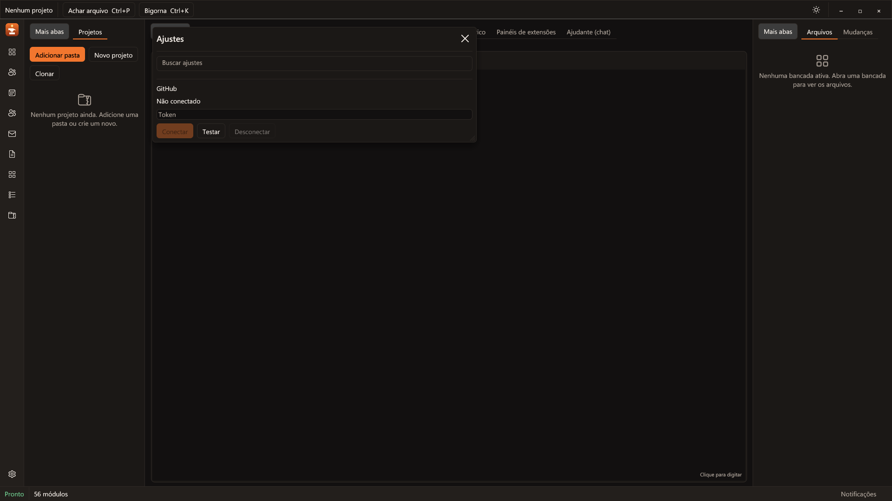

# Ajustes — GitHub (token de conexão)

Tela de configuração exibida como janela modal "Ajustes" sobre a área de trabalho, aberta na seção GitHub, onde se informa um token para conectar a conta (alvo `counter_github`), com estado "Não conectado".

## Como chegar
Na janela principal, clique no botão "Ajustes" no trilho de ícones à esquerda (parte inferior) e selecione a seção GitHub; ou abra o app já direto na seção com o comando de captura `forja-app --locale pt-BR --theme dark --settings counter_github`.

## Regiões
- **Barra superior** (0,0)–(1280,42): rótulo "Nenhum projeto" à esquerda, botões "Achar arquivo Ctrl+P" e "Bigorna Ctrl+K", ícone de alternância de tema (sol) e os botões de janela "–", "□", "×" à direita.
- **Trilho à esquerda** (0,42)–(56,765): coluna de ícones com os botões "Quadro", "Ajudantes", "Rotinas", "Mutirão", "Pedidos", "Skills", "Uso", "Extensões", "Acervo" e, no rodapé, "Ajustes".
- **Painel lateral esquerdo** (56,42)–(313,765): logotipo (bigorna laranja), abas "Projetos" (ativa), "Bancadas" e "Painéis de extensões"; botões "Adicionar pasta", "Novo" e "Clonar"; estado vazio "Nenhum projeto ainda..." com ícone de pasta.
- **Área central** (313,42)–(980,765): faixa de abas (Terminal, Editor, Navegador, Diferenças, Visualizador, Bancada, Revisão, Histórico, Painéis de extensões) e barra de ferramentas ("+", ícones, "Receitas", "Shell"), praticamente toda coberta pela janela modal; no canto inferior direito aparece a dica "Clique para digitar" (editor de texto vazio).
- **Painel direito** (980,42)–(1280,765): abas "Arquivos" (ativa), "Mudanças", "Ajudante (chat)", "Busca", "Portas" e outra "Painéis de extensões"; ícone de grade e a mensagem "Nenhuma bancada ativa. Abra uma bancada para ver os arquivos." (parcialmente encoberta pelo modal).
- **Barra de status** (0,765)–(1280,800): "Pronto", "56 módulos" à esquerda e "Notificações" à direita.
- **Janela modal "Ajustes"** (328,58)–(1026,302): campo de busca de ajustes, seção "GitHub" com status "Não conectado", campo de token e botões "Conectar" (desativado), "Testar" e "Desconectar" (desativado).

## Elementos
| Elemento | Tipo | Posição (px) | Estado | O que faz |
|---|---|---|---|---|
| "Nenhum projeto" | Label | (11,12)–(113,31) | — | Indica que não há projeto aberto. |
| "Achar arquivo  Ctrl+P" | Button | (135,5)–(291,37) | — | Busca rápida de arquivos (atalho Ctrl+P). |
| "Bigorna  Ctrl+K" | Button | (299,5)–(417,37) | — | Paleta de comandos (atalho Ctrl+K). |
| (sem nome acessível) | Unknown | (1101,5)–(1133,37) | — | Ícone de sol: alternância de tema claro/escuro. |
| "–" | Button | (1155,5)–(1187,37) | — | Minimizar janela. |
| "□" | Button | (1195,5)–(1227,37) | — | Maximizar/restaurar janela. |
| "×" | Button | (1235,5)–(1269,37) | — | Fechar janela. |
| (sem nome acessível) | Image | (12,50)–(40,78) | — | Logotipo da Forja (bigorna laranja). |
| "Projetos" | Button | (64,50)–(138,82) | marcado=True | Aba ativa do painel esquerdo. |
| "Bancadas" | Button | (138,50)–(220,82) | marcado=False | Aba de bancadas do painel esquerdo. |
| "Painéis de extensões" | Button | (220,50)–(371,82) | marcado=False | Aba de painéis de extensões (texto truncado na borda do painel). |
| "Terminal" | Button | (324,50)–(401,82) | marcado=True | Aba do terminal, encoberta pelo modal. |
| "Editor" | Button | (401,50)–(461,82) | marcado=False | Aba do editor de texto. |
| "Navegador" | Button | (461,50)–(553,82) | marcado=False | Aba do navegador de projeto. |
| "Diferenças" | Button | (553,50)–(641,82) | marcado=False | Aba de diffs. |
| "Visualizador" | Button | (641,50)–(739,82) | marcado=False | Aba de visualização de arquivos. |
| "Bancada" | Button | (739,50)–(815,82) | marcado=False | Aba da bancada ativa. |
| "Revisão" | Button | (815,50)–(885,82) | marcado=False | Aba de revisão. |
| "Histórico" | Button | (885,50)–(965,82) | marcado=False | Aba de histórico. |
| "Painéis de extensões" | Button | (965,50)–(1115,82) | marcado=False | Aba de painéis de extensões da área central. |
| "Arquivos" | Button | (992,50)–(1070,82) | marcado=True | Aba ativa do painel direito (arquivos da bancada). |
| "Mudanças" | Button | (1070,50)–(1157,82) | marcado=False | Aba de mudanças pendentes. |
| "Ajudante (chat)" | Button | (1115,50)–(1234,82) | marcado=False | Aba do chat com ajudantes. |
| "Busca" | Button | (1157,50)–(1216,82) | marcado=False | Aba de busca. |
| "Portas" | Button | (1216,50)–(1278,82) | marcado=False | Aba de portas em uso. |
| "Painéis de extensões" | Button | (1278,50)–(1429,82) | marcado=False | Segunda aba de extensões; retângulo vai além da largura da imagem (1280 px). |
| "Ajustes" | Window | (328,58)–(1026,302) | focus | Janela modal de configurações. |
| "Close window" | Button | (994,76)–(1008,90) | — | Botão × do modal para fechar a janela de ajustes. |
| (sem nome acessível) | TextInput | (337,116)–(1017,148) | — | Campo "Buscar ajustes" (placeholder visível) para filtrar seções. |
| "GitHub" | Label | (337,176)–(380,195) | — | Título da seção de conexão com o GitHub. |
| "Não conectado" | Label | (337,203)–(431,222) | — | Estado atual da integração. |
| (sem nome acessível) | PasswordInput | (337,230)–(1017,253) | — | Campo de token, com placeholder "Token", texto oculto. |
| "Conectar" | Button | (337,261)–(416,293) | desativado | Salvaria e validaria o token; inativo enquanto o campo está vazio. |
| "Testar" | Button | (424,261)–(485,293) | — | Testa o token informado. |
| "Desconectar" | Button | (493,261)–(593,293) | desativado | Removeria a conexão; inativo por não haver conexão. |
| "Adicionar pasta" | Button | (64,98)–(183,130) | — | Abre seletor para adicionar um projeto existente (destaque laranja). |
| "Novo" | Button | (191,98)–(248,130) | — | Cria um projeto novo. |
| "Clonar" | Button | (64,138)–(128,170) | — | Clona um repositório. |
| "+" | Button | (407,102)–(441,134) | — | Botão de adicionar da barra do editor (atrás do modal). |
| (sem nome acessível) | Unknown | (444,102)–(476,134) | — | Ícone de ferramenta da barra do editor. |
| (sem nome acessível) | Unknown | (479,102)–(511,134) | — | Ícone de ferramenta da barra do editor. |
| (sem nome acessível) | Unknown | (514,102)–(546,134) | — | Ícone de ferramenta da barra do editor. |
| (sem nome acessível) | Unknown | (549,102)–(581,134) | — | Ícone de ferramenta da barra do editor. |
| "Receitas" | Button | (584,102)–(658,134) | — | Aba/painel de receitas da área central. |
| "Shell" | Button | (661,102)–(714,134) | — | Aba/painel de shell da área central. |
| (ícone) | Label | (1116,114)–(1144,142) | — | Ícone de grade no topo do painel direito. |
| (ícone) | Label | (168,198)–(196,226) | — | Ícone de pasta do estado vazio do painel esquerdo. |
| "Nenhuma bancada ativa. Abra uma bancada para ver os arquivos." | Label | (994,150)–(1266,188) | — | Mensagem de estado vazio do painel de arquivos. |
| "Nenhum projeto ainda. Adicione uma pasta ou crie um novo." | Label | (66,234)–(298,272) | — | Mensagem de estado vazio do painel de projetos. |
| "Quadro" | Button | (8,94)–(44,130) | marcado=False | Botão-ícone do quadro no trilho esquerdo. |
| "Ajudantes" | Button | (8,138)–(44,174) | marcado=False | Botão-ícone de ajudantes. |
| "Rotinas" | Button | (8,182)–(44,218) | marcado=False | Botão-ícone de rotinas. |
| "Mutirão" | Button | (8,226)–(44,262) | marcado=False | Botão-ícone do mutirão. |
| "Pedidos" | Button | (8,270)–(44,306) | marcado=False | Botão-ícone de pedidos. |
| "Skills" | Button | (8,314)–(44,350) | marcado=False | Botão-ícone de skills. |
| "Uso" | Button | (8,358)–(44,394) | marcado=False | Botão-ícone de uso. |
| "Extensões" | Button | (8,402)–(44,438) | marcado=False | Botão-ícone de extensões. |
| "Acervo" | Button | (8,446)–(44,482) | marcado=False | Botão-ícone do acervo. |
| "Ajustes" | Button | (8,724)–(44,760) | marcado=False | Botão-ícone que abre esta tela de ajustes. |
| "Pronto" | Label | (10,775)–(51,794) | — | Status geral na barra inferior. |
| "56 módulos" | Label | (73,775)–(146,794) | — | Quantidade de módulos carregados. |
| "Notificações" | Label | (1170,775)–(1246,794) | — | Acesso a notificações. |

Elementos sem nome da árvore, pelos retângulos: divisores verticais entre painéis em (304,42)–(320,768) e (972,42)–(988,768); alças de redimensionamento do modal em (319,49)–(339,69), (1016,49)–(1036,69), (321,69)–(337,292) e (1018,69)–(1034,292); faixa de abas atrás do modal em (339,51)–(1016,67); resíduos de controles atrás do modal em (328,107)–(404,129), (385,110)–(401,126) e (328,139)–(980,756) (área do editor, com a dica "Clique para digitar" visível); grupos de abas em (64,50)–(300,82), (64,80)–(300,82), (992,50)–(1268,82) e (992,80)–(1268,82); faixa de título do modal em (361,59)–(993,107).

## Aparência
Tema escuro com fundo marrom-carvão (janela) e painéis em tons próximos; o modal "Ajustes" usa fundo cinza-escuro com barra de título mais clara e sombra projetada. Cor de destaque laranja: logotipo da bigorna, botão primário "Adicionar pasta" e botão desativado "Conectar" (laranja escurecido). Botões secundários têm contorno cinza sutil. Tipografia sem serifa em dois tamanhos: textos de interface e labels de seção ("GitHub", "Não conectado", "Token") maiores; rótulos de abas e botões de janela menores. Campos de busca e token ocupam a largura quase toda do modal, alinhados à esquerda em x=337; os três botões de ação formam uma fileira sob o campo. Estado vazio dos painéis usa texto cinza centralizado com ícone acima. Ícones do trilho esquerdo em cinza claro, uniformes e centralizados em colunas de 36 px.

## Problemas encontrados
- O botão de fechar do modal tem nome acessível em inglês, "Close window", em uma interface em pt-BR (esperado "Fechar janela").
- A segunda aba "Painéis de extensões" do grupo direito tem retângulo até x=1429, ultrapassando a largura da imagem (1280 px): elemento cortado/fora da janela.
- A aba "Painéis de extensões" do painel esquerdo aparece com o texto truncado ("Painéis de e") pela borda do painel, embora o retângulo indicado vá até x=371.
- O modal sobrepõe as abas centrais (de "Terminal" a "Painéis de extensões"), a barra de ferramentas do editor e parte da mensagem "Nenhuma bancada ativa...", que começa encoberta (só "...uma bancada ativa..." fica visível).
- O campo de busca e o campo de token não têm nome acessível (dependem apenas do placeholder "Buscar ajustes"/"Token").
- Os quatro botões-ícone da barra do editor (444–581 px) e o ícone de tema da barra superior estão sem nome acessível.
- Os retângulos das abas "Ajudante (chat)", "Mudanças" e "Busca" se sobrepõem entre si (por exemplo, "Ajudante (chat)" de 1115 a 1234 invade as duas vizinhas), indicando sobreposição de alvos de clique.
- Texto "Clique para digitar" visível na área central sem elemento correspondente na árvore de acessibilidade.
- Textos de apoio em cinza médio sobre fundo escuro (placeholder "Token", "Não conectado", mensagens de estado vazio) têm contraste baixo.
